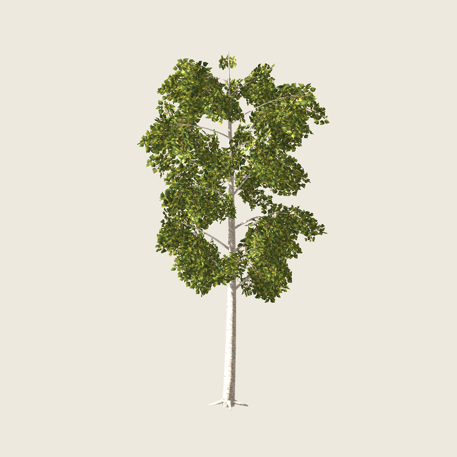
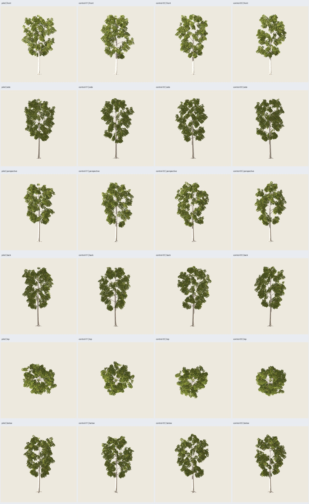

# Abedul pintado — árbol completo 1.0.0

Fecha: 2026-10-26. **Implementado y verificado; aceptación artística del árbol
completo pendiente**. Pintura y rama aceptadas previamente:
[autorización de continuación](../rama-01/user-acceptance.json).



## Resultado

Receta `abedul_pintado@1.0.0`, contrato 1.5, perfil `adulto` de **10 m**,
cuatro semillas y parámetros comunes cerrados. Estructura propia de abedul,
con primarias ascendentes de distinta altura y ramillas colgantes. Una primera
disposición de copa quedó demasiado escalonada en la revisión; la distribución
final usa la misma regla de ascenso/caída para los cuatro casos, sin retoques
por semilla. La ilustración inicial orienta pintura, no exige geometría idéntica.

| Caso | Base / copa / pintura | Madera | Follaje | Total | Generación sin render |
| --- | --- | ---: | ---: | ---: | ---: |
| Piloto | 6100 / 197 / 2718 | 3884 | 2394 | **6278** | 1,296 s |
| Control-01 | 6101 / 198 / 2718 | 3884 | 2394 | **6278** | 1,284 s |
| Control-02 | 6102 / 199 / 2718 | 3884 | 2394 | **6278** | 1,233 s |
| Control-03 | 6103 / 200 / 2718 | 3860 | 2394 | **6254** | 1,233 s |

Cada árbol: **399 grupos, 1197 planos, dos materiales**. Tres planos de dos
tris por grupo, inclinados .44 rad como la rama aprobada. Cota antes de mallar
**6446 tris**, incluyendo tronco, cuatro raíces, 18 primarias, 90 secundarias,
tapas y todo el follaje. Contrato con máximo **6999 tris/2 materiales/120 s**;
rechaza excederlo antes de generar. Altura exacta sobre madera, de Z=0 a Z=10.

## Implementación y recursos

- `src/treegen/birch.py`: estructura, distribución por recorridos, representación
  y simplificación de madera, separados en funciones puras. Reutiliza la
  construcción de cruzadas de la rama, sin cambiar su implementación histórica.
- `schemas/tree-blueprint-birch.schema.json` y `tree-instance-birch.schema.json`:
  contrato estricto 1.5, componentes exclusivos, semillas y recursos explícitos.
  Catálogo, resolución y ejecutor compartidos; API/TreeSpec históricos conservados.
- `blender/generate_birch.py`: exportación GLB con UV y PNG embebidos, `.blend`
  editable con imágenes empaquetadas, madera aislada y manifiestos.
- `src/treegen/birch_evaluation.py`: reconstrucción y contraste de geometría/UV
  exportadas, usando también las utilidades de auditoría existentes.

Los PNG **1254²** y metadatos de `assets/abedul-pintado/v0.1.0/` son exactamente
los de la rama: misma pintura de estilo manual generada con ImageGen, sin nueva
generación ni retoque de píxeles. Rutas/hashes fijados por receta. `base` cambia
madera; `canopy` modifica anclajes, longitudes y orientación sin tocar madera;
`paint` selecciona variantes sin mover los anclajes. Las variantes pueden
cambiar márgenes transparentes, no se afirma identidad de todos sus vértices.

Madera: anillos de copa simplificados a **5 mm** de correspondencia radial por
tramo completo, sin acumulación local; extremos, tapas y UV retenidos.
Tronco/raíces conservados. Máximos por caso: **4,903/4,638/4,995/4,653 mm**.
No son cotas Hausdorff certificadas ni garantía universal de conexiones. Las
guías originales mantienen los anclajes; inspección visual complementa la cota.

## Verificación técnica

**155 pruebas pasan** fuera del sandbox, incluyendo las diez de abedul/rama.
Contratos estrictos, recursos y hashes, rechazo de rangos/overrides/mezclas de
componentes, presupuesto previo, cuatro semillas, determinismo, separación de
streams, anclajes, extremos, error de madera y no degeneración.

El ejecutor valida cada GLB: caras/UV de madera y grupos exactamente reconstruidos,
normales unitarias, imágenes embebidas idénticas, material por canal, MASK .5,
doble cara, altura y presupuesto. Godot reimporta árbol y madera de los cuatro
casos y comprueba ejes, escala, conteos, texturas/mipmaps y materiales.

Piloto repetido: **GLB idéntico byte por byte**. La CLI normal con render genera
nueve vistas Blender en **7,814 s** y el **mismo GLB**. Regresiones regeneradas:
roble 2.2.0, pino 2.3.0 y columnar 1.0.0, los tres con GLB idéntico a sus
referencias seleccionadas. [Matriz, firmas y comprobaciones](verification.json),
[CLI y pruebas](additional-checks.json).

**Ocho defectos inyectados rechazados**, sobre copias sin tocar el original:
umbral alfa, doble cara, imagen en canal equivocado, vértice de follaje movido,
UV fuera del atlas, normal NaN, cara de madera ausente y firma de distribución
alterada. [Resultados y razones](export-audit.json).

Primer intento de generación falló por importar `jsonschema` dentro de Blender;
se sustituyó por la utilidad pura de hash ya existente. Esa salida fallida no
forma parte de los cuatro casos ni se cuenta como éxito.

## Revisión visual en Godot

**80 capturas reales inspeccionadas** en cuatro láminas: seis orientaciones y
tres escalas más fondo oscuro para cuatro árboles y cuatro maderas.
Godot 4.7.2 Compatibility, RTX 5060, 900²/MSAA4; sol .75, ambiente .35,
exposición 1, cámaras comunes. GLB con follaje doble cara, Alpha Scissor .5,
rugosidad .95, mipmaps/filtrado anisotrópico y sombras de ambas caras.

Se leen tronco claro, ramificación ascendente, huecos irregulares y grupos de
hojas caídos en las vistas inspeccionadas. No se observa una desaparición
dominante de copa en esos ángulos. Persisten masas densas por rama, variación
angular de cobertura, trazos de canto, corteza muy clara en caras iluminadas y
pérdida de detalle lejano. El usuario debe valorar el conjunto; la revisión del
agente no acredita aprobación artística ni fidelidad botánica exacta.

Sin benchmark de abedul, viento, LOD, bosque ni nuevas edades. No se promete
rendimiento por el ahorro de tris ni naturalidad para cualquier semilla.



## Uso y reproducción

Desde la raíz del repositorio, siempre una carpeta de salida nueva:

```sh
PYTHONPATH=src python3 -m treegen generate-blueprint blueprints/abedul_pintado/1.0.0.json --instance presets/blueprints/abedul-pintado/pilot.json --output artifacts/abedul-pintado/mi-abedul --no-render
PYTHONPATH=src python3 -m treegen validate artifacts/abedul-pintado/mi-abedul
PYTHONPATH=src python3 -m unittest discover -s tests
python3 scripts/verify_birch.py --output artifacts/abedul-pintado/otra-matriz --stage all
python3 scripts/audit_birch_export.py --source artifacts/abedul-pintado/otra-matriz/pilot --output artifacts/abedul-pintado/otra-matriz/export-audit
```

El verificador regenera cuatro casos, repetición y referencias desde fuentes;
no necesita modelos anteriores en `artifacts/`. Sus comparaciones históricas
consultan evidencia seleccionada en `docs/`. `--stage generate` y `--stage review`
separan ejecución y capturas, verificando hashes de fuentes entre etapas.
GPU/UI/audio y las pruebas de sockets pueden requerir ejecución fuera del sandbox.
Límite generación 120 s, comprobaciones/capturas 180 s por subproceso terminable.

Galería seleccionada: `artifacts/abedul-pintado/arbol-02/index.html`.
Modelos por caso: `pilot/tree.glb` y `pilot/tree.blend`; controles en carpetas
`control-01/02/03`. Proyecto Godot autocontenido en `arbol-02/godot/`, con
escenas de árbol/madera, materiales y visor de cuatro semillas:

```sh
/home/tao/repos/godot/openworld-forever/.tools/godot-4.7.2/Godot_v4.7.2-stable_linux.x86_64 --path artifacts/abedul-pintado/arbol-02/godot --audio-driver Dummy
```

Visor dejado abierto: arrastrar para girar, rueda para zoom, espacio giro
automático, `N` cambiar semilla, `1` árbol, `2` madera, `B` fondo, `L` luz,
`R` cámara. La receta sigue experimental y no hereda aprobación del árbol
completo por la aceptación previa de la rama.
