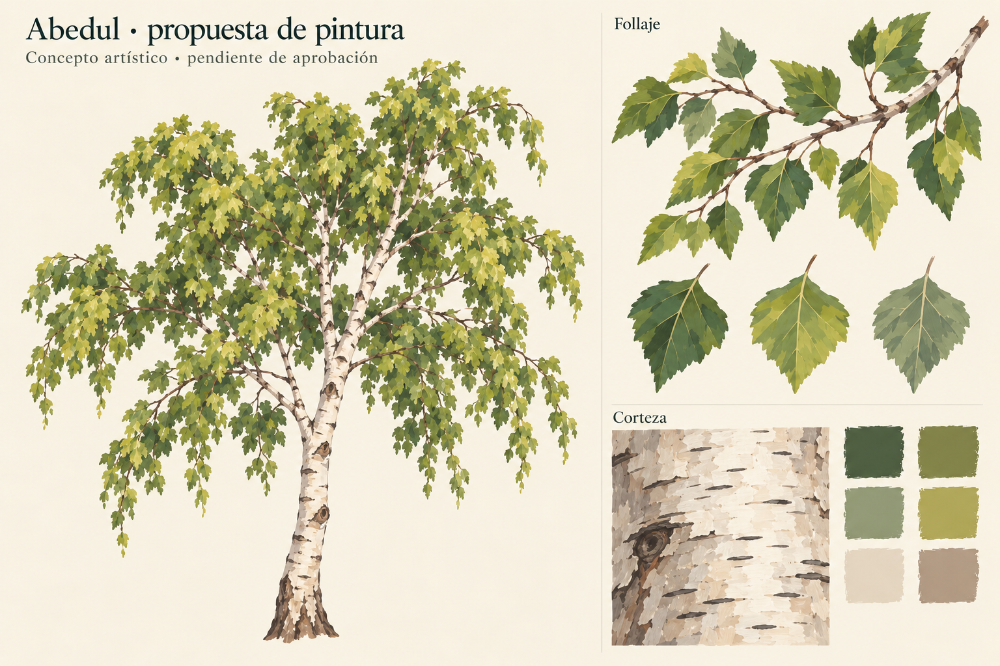

# Abedul — propuesta de pintura

Fecha: 2026-10-26. **Dirección de pintura aprobada por el usuario**;
[aceptación y alcance](user-acceptance.json).
[Plan activo](../../../../plans/abedul-pintado.md).

Follaje de verdes musgo y salvia con variación amarillo verdosa, hojas
puntiagudas y dentadas, nervaduras sencillas y manchas amplias de pincel.
Corteza marfil con grises y beige suaves, marcas oscuras horizontales
discontinuas y pocos nudos. La ramilla muestra la relación entre hojas,
pecíolos y madera fina. La pintura busca lectura clara sin ruido fino.

Imagen generada por IA con `image_gen.imagegen`, usando el concepto propio
del roble únicamente como referencia de estilo. No es pintura ejecutada por
una persona, atlas utilizable ni render de geometría implementada. Fuente PNG
sin capas previas; [prompt y procedencia](prompt.json). No se suministraron
imágenes externas al generador.

Inspección visual de la lámina: follaje y corteza diferenciados, pincelada mate,
hojas sin lóbulos de roble, marcas de abedul y extremos colgantes presentes.
La muestra de corteza conserva sombreado ilustrado lateral: al preparar la
textura de producción habrá que evitar fijar esa iluminación al material.
No se ha comprobado comportamiento en láminas cruzadas, uniones, transparencia
ni iluminación en Godot. Tampoco se ha medido presupuesto o rendimiento.

La aprobación solicitada se limita a la dirección de pintura. La forma y
densidad de copa ilustradas no son un contrato de geometría. Después se podrá
preparar una rama real para revisar la aplicación antes del árbol completo.

Rama autorizada posteriormente y disponible: [muestra real en Godot](../rama-01/informe.md).
La aceptación de la pintura no implica aceptación de esa aplicación.
