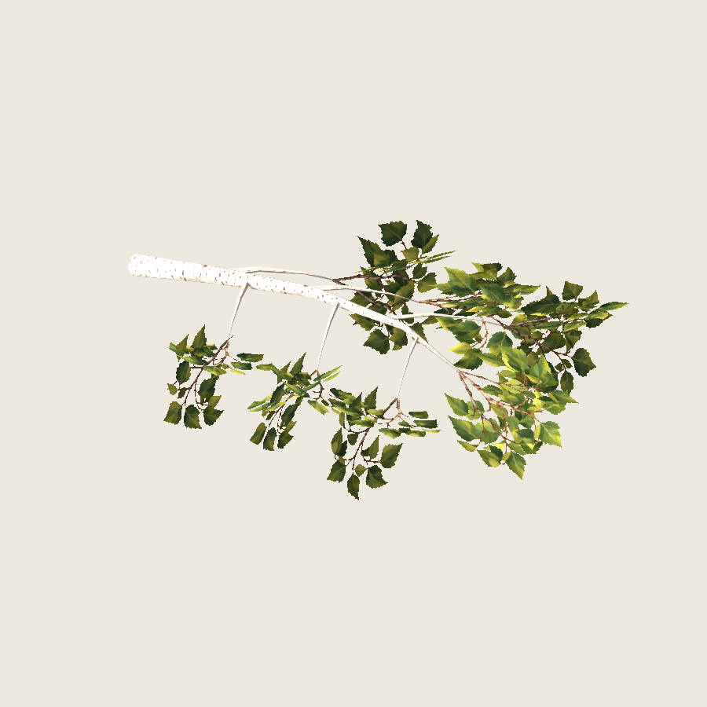
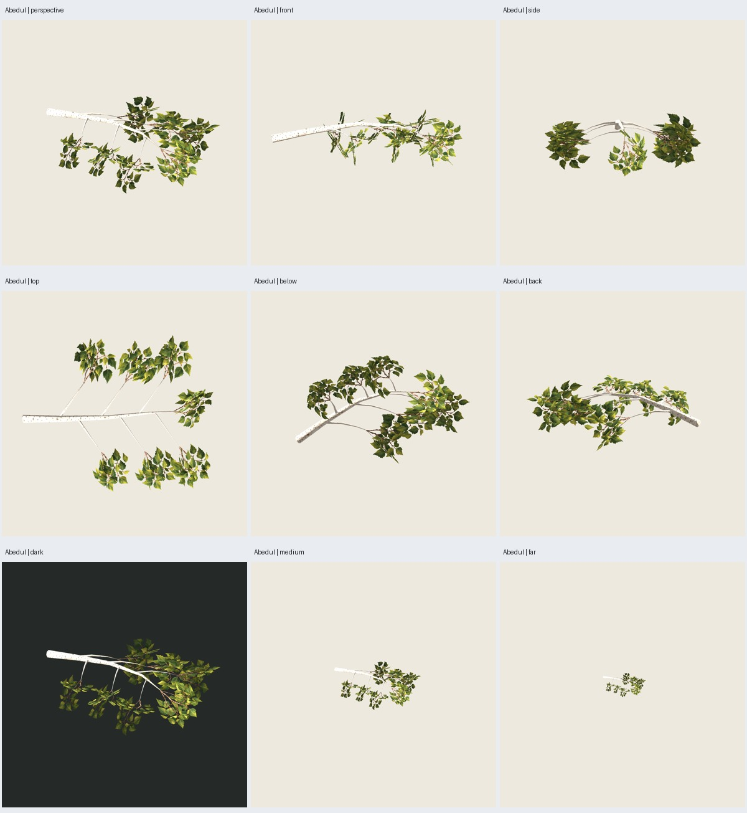
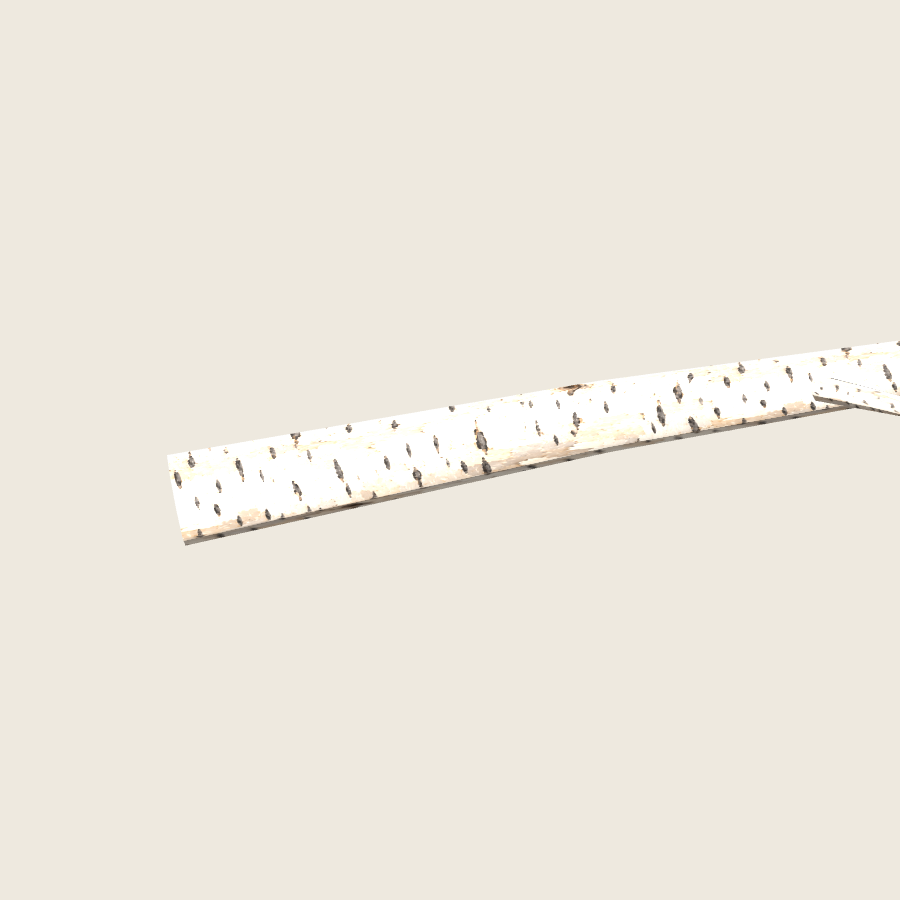

# Abedul — rama con láminas cruzadas en Godot

Fecha: 2026-10-26. Pintura aprobada y muestra autorizada por el usuario;
[alcance](../pintura-01/user-acceptance.json). **Rama implementada y revisada por
el agente y posteriormente aceptada por el usuario**;
[aceptación y continuación al árbol completo](user-acceptance.json).



## Construcción y recursos

Muestra aislada `birch-branch-sample-0.1.1`: una primaria curvada y seis
secundarias con extremos algo caídos. Geometría pura en
`src/treegen/birch_sample.py`, exportación separada en `blender/birch_sample.py`.
No hay receta de árbol completo ni cambios de generadores existentes.

Semillas structure **6100**, paint **2718**. Atlas de cuatro ramillas y corteza
en `assets/abedul-pintado/v0.1.0/`: dos PNG nuevos **1254 × 1254**, generados con
`image_gen.imagegen` a partir de la dirección aprobada. Pincelada de estilo
manual generada por IA; sin retoque de píxeles ni capas de pintura anteriores.
Prompt completo, regiones y anclajes medidos en el manifiesto de recursos.
Hashes de los PNG y fuentes en [verificación](verification.json).

| Parte | Coste |
| --- | ---: |
| Madera, siete tubos con anillos acotados | 340 tris |
| Follaje, siete grupos × tres planos × dos tris | 42 tris |
| Total de la rama | **382 tris** |
| Materiales | **2** |

Cada grupo usa una variante del atlas compartido. El pie del tallo pintado
se mide sobre alfa y se ancla 12 mm dentro del extremo de la madera. Los tres
planos se inclinan .44 rad (~25°) respecto del eje original para evitar la
desaparición común al mirar desde la punta. No son billboards orientados a cámara.
Una construcción inicial de eje común presentó estrellas de canto en vistas
inferiores; la muestra final se revisó tras corregir esa disposición, con igual
conteo. No se exige identidad de silueta con aquella disposición descartada.

GLB autocontenido con ambos PNG embebidos y fuente `.blend` con imágenes
empaquetadas. Madera opaca; follaje Alpha Scissor .5. Ambos materiales doble
cara, rugosidad .95, filtrado anisotrópico con mipmaps y sombras dobles en Godot.

## Verificación e inspección visual

Tres pruebas de contratos geométricos pasan: determinismo y separación de
pintura/madera; contactos de ejes y presupuesto, UV y triángulos no degenerados,
área proyectada de los planos desde la punta; rechazo de semillas y marcos
inválidos. Repetición de los dos GLB **idéntica byte por byte**.

Reimportación Blender conserva triángulos/UV. Auditoría independiente del GLB
verifica geometría finita y sin degenerados, conteos por material, imágenes
embebidas idénticas a fuentes, recorte alfa, doble cara y UV. Godot reimporta y
comprueba escala/ejes, conteos, texturas, mipmaps y normales unitarias.
No se afirma certificación universal de contactos entre superficies.

**35 capturas reales**: 23 de rama y 12 de madera. Godot 4.7.2, Compatibility,
RTX 5060, 900²/MSAA4; seis orientaciones, tres escalas, fondo oscuro, luz lateral,
contraluz, doce posiciones de órbita y acercamiento a corteza. Sol .75,
ambiente .35, exposición 1, fondo claro `#EEE9DF`; luz ajustada para no evaluar
la corteza blanca con el exceso de iluminación del primer ensayo.

Se inspeccionaron las láminas de nueve vistas, doce posiciones de órbita,
doce vistas de madera y dos luces adicionales, y capturas individuales
de perspectiva, parte inferior, órbita y corteza. La versión final mantiene
hojas legibles en las vistas de punta que antes quedaban de canto. La corteza
conserva marcas en detalle, aunque se ve muy clara en algunas caras iluminadas.
Hay variación angular de densidad, trazos finos en cruces y pérdida de detalle
lejano; evaluar estos límites al aprobar la muestra. Sin benchmark, certificación
para otras GPU ni garantía de volumen físico. **382 tris de rama no acreditan
el presupuesto del futuro árbol completo**, que deberá cumplir <7000 por separado.





## Reproducción y visor

Desde la raíz del repositorio, con salida nueva:

```sh
PYTHONPATH=src python3 -m unittest discover -s tests -p test_birch_sample.py -v
python3 scripts/birch_sample.py --output artifacts/abedul-pintado/otra-rama --stage all
```

El orquestador limita subprocesos a 180 s; cada generación de esta muestra
completó por debajo de 120 s. Ejecutar fuera del sandbox para GPU/audio/UI si
el entorno los bloquea. Primer intento descartado: Blender creó XDG antes del
directorio de salida, se corrigió ese orden; dentro del sandbox también quedó
bloqueado el cierre de audio. Estos intentos no se contabilizan como éxitos.

Salida seleccionada: `artifacts/abedul-pintado/rama-04/`, galería `index.html`,
`crossed/branch.glb`, `crossed/branch.blend`, `wood/branch.glb`, placements,
protocolo, repetición, capturas y manifiesto. El proyecto Godot es autocontenido.
Para abrir el visor con el binario configurado del proyecto:

```sh
/home/tao/repos/godot/openworld-forever/.tools/godot-4.7.2/Godot_v4.7.2-stable_linux.x86_64 --path artifacts/abedul-pintado/rama-04/godot --audio-driver Dummy
```

Controles: arrastrar para girar, rueda para zoom, espacio para giro automático,
`1` rama con follaje, `2` madera, `B` fondo claro/oscuro, `L` dirección de luz,
`R` restablecer cámara. El visor se dejó abierto al entregar la muestra.
