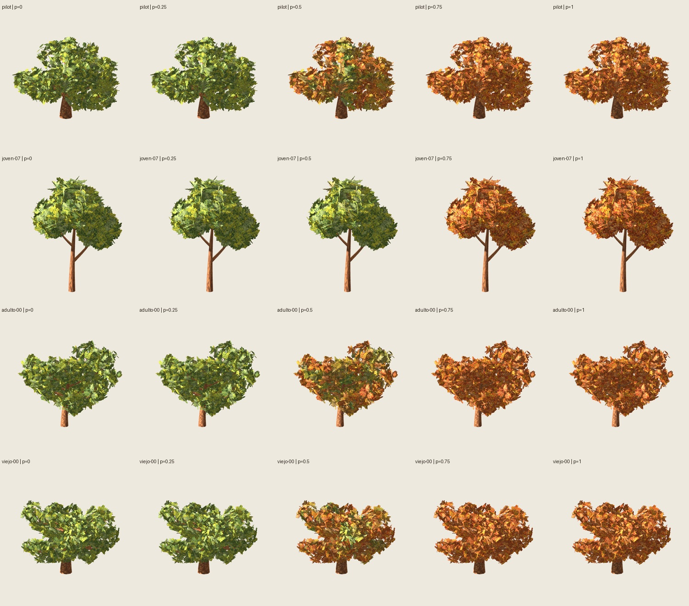

# T5 — Cuatro robles estacionales, candidata 0.1.0

2026-11-02. **Implementada y verificada técnicamente** como variante explícita
`season-bundle-0.1.0`. Normales T4 **.35 aprobadas por delegación**:
[decisión](../normales-t4/user-acceptance.json). Aceptación del conjunto T5 por
el usuario separada; T6 no iniciado. Misma regla para cuatro casos, sin retoques
por semilla. El piloto coincide byte por byte con la candidata .35 de T4.

| Caso | Base/copa/pintura/estacional | Triángulos | Grupos/láminas | Materiales |
| --- | --- | ---: | --- | ---: |
| pilot (viejo-09) | 3009/17/2718/1101 | 6812 | 264/792 | 2 |
| joven-07 | 1007/17/2718/1101 | 3132 | 264/792 | 2 |
| adulto-00 | 2000/17/2718/1101 | 5820 | 264/792 | 2 |
| viejo-00 | 3000/17/2718/1101 | 6900 | 264/792 | 2 |



## Verificación

- **194 pruebas** pasan, incluidas selección explícita, corrupción, rutas y
  presupuesto portable. Dos construcciones en carpetas distintas idénticas;
  calendarios recalculados iguales a T1; normales invariantes al reordenar binding.
  Catálogo `blueprints/`, `presets/` y `assets/` exacto. Geometría, madera, UV,
  anclajes e índices intactos; solo normales de follaje y pintura derivadas.
- **16 GLB estándar**: cuatro casos × verano/otoño × originales/.35; dos PNG
  embebidos por archivo, sin shader estacional. Blender importa/reexporta los 16:
  error angular máximo **.281353°**, límite .6°. Godot audita 16 directos y 16
  vueltas: error vectorial máximo **.001589/.005128**, límites .003/.012; UV2
  ≤.000021202. Presupuesto, 264 grupos y seis caras por grupo correctos.
- **2377 capturas**, más cuatro en la copia limpia. Por caso: 112 de matriz y
  241 por cámara fija/orbital. **1928 cuadros** ida/vuelta a paso 1/120; 960 pares
  de reversión con píxeles idénticos. Malla/material/texturas reutilizados.
- Extremos shader/GLB estándar exactos bajo condiciones igualadas; cinco máscaras
  exactas por caso. Mezcla lineal auditada con oráculo, salto .9→.2 exacto y fase
  independiente entre árboles. Visor común: 17 checks de controles y estado.
- Cuatro instancias: **dos materiales activos y tres texturas compartidos**;
  superficies de ejecución también retienen solo esos dos materiales. Copia
  limpia sin imports/cachés reimportada y ejecutada fuera del repositorio.
  ZIP comprobado por CRC y hashes; PNG guardados contrastados con hashes nativos.

[Verificación seleccionada y hashes](verification.json). El informe completo y
2377 hashes de capturas están en `artifacts/estaciones/integracion-t5-03/verification.json`,
con su hash registrado aquí; salidas voluminosas ignoradas por Git.

## Revisión visual y límites

Se inspeccionaron cinco fases/cuatro casos, tres luces/distancias, dos fondos,
originales/.35 estándar, sombras, visor y 121 cuadros de ida por caso/cámara en
láminas. Vuelta idéntica por píxeles. Se conserva silueta y plenitud; cambio por
zonas continuo en la selección. El joven cambia más tarde con las mismas reglas.
Originales/.35 siguen siendo visualmente cercanas. Las cruzadas conservan cantos
y cambios de visibilidad al girar; no se certifica ausencia universal de aliasing
o parpadeo. Sombras recortadas y huecos conservados. El suelo no proyecta sombra
propia para evitar el artefacto observado en T4; luz intensa sobre el receptor y
parte de las sombras largas del joven fuera del encuadre.

[Originales/.35](standard-controls.jpg), [luz lateral](light-1.jpg),
[otra luz](light-2.jpg), [distancias/fondos](distances-2.jpg),
[sombras](shadows-0.jpg), [fija joven](joven-07-fixed-all-forward.jpg),
[orbital adulto](adulto-00-orbit-all-forward.jpg).

Dos atlas de follaje 2000² RGBA8: **42 665 712 bytes** con mipmaps estimados;
con corteza 1254² supuesta RGBA8: **51 049 784 bytes**. Godot devuelve imágenes
RGBA8/RGB8 con mipmaps: **48 953 766 bytes** (21 332 856 por atlas, 6 288 054
corteza). Lectura CPU de Image, **no VRAM medida**. Dos muestras de follaje por
evaluación de fragmento; no hay benchmark ni afirmación de mejora de FPS.

Extremos estáticos portables; fases intermedias por grupo requieren el adaptador
Godot. No son animación glTF ni se exportan a un atlas único. UV2 reservado al
calendario, no a lightmap. Sin caída, invierno, viento, LOD ni otras especies.

## Uso y reproducción

[Contrato y API](../../../contrato-integracion-estacional.md), perfil
`configs/seasons/roble-integracion-v1.json`. Salida final:
`artifacts/estaciones/integracion-t5-03/`.

- `index.html`: comparación y animaciones `fixed.webp`/`orbit.webp`.
- `godot/project.godot`: importar con Godot 4.7.2 y ejecutar el visor.
- `portable/cases/<id>/{summer,autumn}-{selected,original}.glb`: extremos estándar.
- `portable/manifest.json`: semillas/versiones/calendarios/campos/rutas/hashes.
- `roble-estacional-0.1.0.zip`: proyecto y extremos, **257 531 053 bytes**.

```sh
# Carpeta nueva; entradas T1/T2/T4 congeladas según sus informes:
python3 scripts/verify_season_bundle.py --output artifacts/estaciones/otra-t5
python3 scripts/season_bundle_evidence.py --output artifacts/estaciones/otra-t5
env PYTHONPATH=src python3 -m unittest discover -s tests
```

Blender 5.2.1 LTS; Godot 4.7.2 Compatibility/OpenGL y RTX 5060. Capturas 600²,
MSAA4, alfa .5, doble cara, rugosidad .95, mipmaps y padding T2. Protocolo completo
en JSON. `BLENDER_BIN`/`GODOT_BIN` seleccionan ejecutables. Subprocesos terminables
con límite de 180 s. Intentos iniciales agotaron el límite por ventanas inactivas;
la ejecución final pasó con `--fixed-fps 60 --disable-render-loop` y dos dibujos
explícitos sin presentar por captura. Es control del arnés, no medida de FPS.
