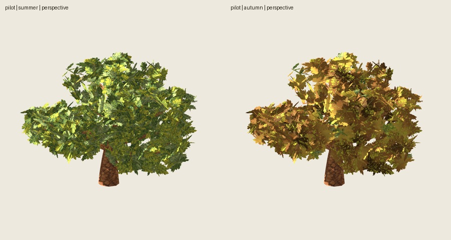

# Primer roble de otoño

Fecha: 2026-11-01. Perfil estacional **1.0.0**, roble base **2.2.0**.
Implementado y verificado técnicamente; valoración artística del usuario pendiente.

## Resultado

Otoño con copa completa, ocres/dorados/marrones y verde residual, conservando
la pintura original mediante un shader de color. Sin nuevas texturas, caída ni
movimiento de hojas. La especie define paleta, material, fase y escala de manchas;
motor de transformación, semilla, intensidad y adaptación Godot reutilizables.
[Contrato, uso y reproducción](../../../estaciones.md), [plan](../../../../plans/estaciones.md).

| Ejemplar | Semilla base/copa/pintura | Triángulos | Materiales |
| --- | --- | ---: | ---: |
| Piloto viejo-09 | 3009/17/2718 | 6812 | 2 |
| Joven-07 | 1007/17/2718 | 3132 | 2 |
| Adulto-00 | 2000/17/2718 | 5820 | 2 |
| Viejo-00 | 3000/17/2718 | 6900 | 2 |

Semilla estacional 1101 común, 264 grupos y 792 láminas por ejemplar. Geometría,
UV, atlas, alfa y madera conservados: los cuatro GLB copiados tienen los mismos
hashes que los originales. El otoño requiere escena Godot más shader; **el GLB
aislado conserva el color verde**. No se modifica el catálogo de blueprints.

## Verificación y revisión

- Tres pruebas estacionales, con rechazo de entradas inválidas, otra especie/fase,
  hashes alterados y presupuesto de 7000 tris; cuatro pruebas existentes de
  producción de roble pasan. `git diff --check` sin errores.
- **19 comprobaciones pasan**: importación real Godot, 64 capturas, cuatro hashes
  base exactos, ocho repeticiones de render exactas, cuatro cambios de color
  visibles y reconstrucción determinista del paquete.
- Importación comprueba triángulos, dos materiales, UV/normales, atlas original
  enlazado al shader, material compartido de follaje y madera sin sustitución.
- Godot 4.7.2, Compatibility/OpenGL 3.3, RTX 5060, capturas 900²/MSAA4; cámara/luz
  comunes entre estaciones. Cuatro casos, cinco orientaciones, dos distancias y
  repetición de perspectiva, en verano/otoño. Subprocesos limitados a 180 s.
- Inspeccionadas visualmente `controls.jpg`, `distances.jpg` y perspectiva del
  piloto. Forma y huecos conservados en las vistas revisadas; sin halos nuevos
  evidentes. Persisten cantos de láminas y reflejos claros de la pintura original.
  El color más pardo aumenta el contraste entre láminas y sombras interiores.

[Controles](controls.jpg), [distancias](distances.jpg),
[verificación con hashes](verification.json).

Las sombras propias están activadas y revisadas en esas imágenes; no se realizó
una comparación separada de sombra proyectada sobre suelo. No hay benchmark ni
afirmación de mejora de FPS. No se certifican otras semillas/rangos, reglas de
caída o fenología botánica exacta. El control de verde residual no mide una
fracción de hojas. Aceptación artística de verano no equivale a la de otoño.

## Archivos locales

Salida final: `artifacts/estaciones/roble-otono-04/`. `godot/pilot.tscn` y los
tres controles son instanciables; `godot/project.godot` inicia el visor.
**O** cambia estación, **N** ejemplar, arrastrar gira y rueda acerca.
Paquete portátil: `roble-otono-godot.zip`, sin cachés ni capturas.

Se corrigió un error inicial de tipo numérico JSON al calcular el módulo de la
semilla. Los ensayos 01–03 son regenerables y no constituyen la paleta final.
La 02 no cerró determinismo porque las fuentes cambiaron durante la ejecución;
la final 04 sí cierra las 19 comprobaciones con fuentes congeladas.
