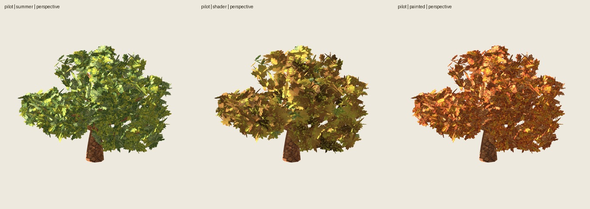

# Otoño desde pintura frente al shader

Fecha: 2026-11-01. Nueva pintura **0.1.0**, roble base **2.2.0**.
Comparación experimental autorizada por el usuario; aceptación artística pendiente.
Commit previo **4187776**, realizado antes de pintar; incluye el estado pendiente
del abedul. Shader 1.0.0 y sus recursos conservados sin cambios.

## Pintura y exportación

ImageGen integrado editó las cuatro hojas fuente con referencia a la pintura
aprobada. Cobre/ocre/dorado/pardo, manchas orgánicas, bordes secos y algún verde
residual; pinceladas amplias y nervaduras conservadas. PNG RGBA de 1254², sin
retoques posteriores de píxeles. [Prompt completo](../../../../assets/roble-otono-pintado/v0.1.0/prompt.json),
[procedencia, hashes y métricas](../../../../assets/roble-otono-pintado/v0.1.0/manifest.json).

Atlas 2000² rehorneado sobre las mismas ocho plantillas: Cycles CPU, ocho
muestras, semilla 2718, emisión sin iluminación. Rehorneado repetido **RGBA
idéntico**, sin exigir igualdad de metadatos PNG. Atlas versionado y recuperable.

Cada GLB sustituye solo el PNG embebido de follaje. Todos los bloques de
geometría/UV/normales/índices, corteza y estructura de materiales/escena se
conservan exactamente, auditados en binario. Exportación estándar glTF, sin
shader estacional; importada directamente en Godot. Árboles completos:

| Caso | Base/copa/pintura | Triángulos | Materiales |
| --- | --- | ---: | ---: |
| Piloto | 3009/17/2718 | 6812 | 2 |
| Joven-07 | 1007/17/2718 | 3132 | 2 |
| Adulto-00 | 2000/17/2718 | 5820 | 2 |
| Viejo-00 | 3000/17/2718 | 6900 | 2 |

264 grupos y 792 láminas por caso, sin caída, reducción de copa ni cambios de
arquitectura. Las semillas anteriores describen el árbol base; ImageGen no
expone una semilla reproducible. Se reproducen los resultados con el PNG congelado.

## Pruebas y revisión

**Seis pruebas** estacionales pasan: empaquetado determinista, alineación de
recursos posteriores, rechazo de GLB/PNG inválidos, detección de geometría
alterada y validación del perfil de shader. `git diff --check` sin errores.
**26 comprobaciones pasan**: cuatro auditorías binarias, cuatro repeticiones
GLB idénticas, cuatro conteos exactos, doce repeticiones de render idénticas,
verificación Godot y 132 capturas. Rehorneado exacto adicional registrado en
[additional-checks.json](additional-checks.json).

Godot 4.7.2, Compatibility/OpenGL 3.3/RTX 5060, 900²/MSAA4. Cinco orientaciones,
dos distancias y repetición en cada uno de cuatro árboles y tres versiones;
tres máscaras por árbol/versión. Misma cámara, iluminación y fondo. Rugosidad
.95 del material estándar conservada frente a .88 del shader experimental;
es comparación de implementaciones, no una medición aislada de pigmentos.

Inspeccionadas las tres láminas `comparison.jpg`, `controls.jpg`, `distances.jpg`
y perspectiva individual del piloto. La nueva pintura ofrece lectura más
cobriza y mayor detalle interno; el shader tiende a masas cromáticas amplias y
retiene más verde. La nueva paleta también resalta trazos claros y parece más
uniformemente otoñal en la copa. No se elige una ganadora sin valoración del
usuario. Persisten cantos de láminas y brillos/pinceladas claras del estilo base.

## Cambios de alfa y límites

ImageGen conserva disposición y carácter, pero no todos los píxeles del contorno.
Máscara fuente: IoU **.97173**, cobertura **+2,86 %**; atlas cruzado: IoU **.97866**,
cobertura **+2,15 %**. No se declara identidad de alfa ni de sombra proyectada.

| Caso | IoU mínimo árbol, tres vistas | Aumento máximo de cobertura |
| --- | ---: | ---: |
| Piloto | .996321 | .3693 % |
| Joven | .996708 | .3260 % |
| Adulto | .996261 | .3743 % |
| Viejo | .996261 | .3743 % |

Máscaras son de silueta proyectada; no prueban igualdad de volumen físico.
Sombras propias activas e inspeccionadas en color, sin pase de suelo separado.
GLB portables por formato estándar; **no se ensayó otra engine**. Sin benchmark,
viento, LOD, invierno ni adopción en catálogo de producción.

## Uso y reproducción

[Guía y comandos](../../../estaciones.md). Salida local:
`artifacts/estaciones/roble-pintura-01/`. Cuatro carpetas de caso con `tree.glb`
y manifiesto; paquete `robles-otono-glb.zip`. Visor `godot/project.godot`:
**O** pintura/shader/verano, **N** otro ejemplar, arrastrar gira, rueda acerca.
El shader anterior también sigue disponible en `roble-otono-04/godot/`.

[Controles](controls.jpg), [distancias](distances.jpg),
[verificación y hashes](verification.json). Nueva pintura y aplicación al árbol
pendientes de aceptación artística; no sustituyen las recetas históricas.
