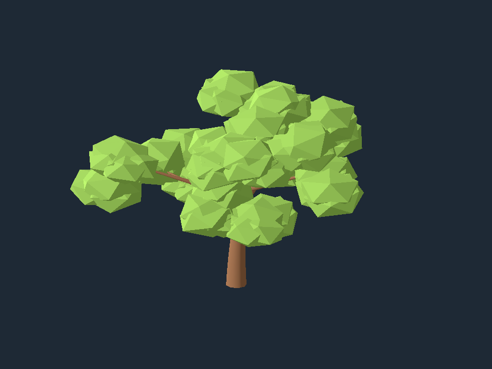

# F1 — primer roble en Geometry Nodes

Fecha: 2026-10-22. F1 del [plan v1](../../../plans/v1-generador-arboles.md) completada. Generador `oak_geometry_nodes` versión `0.1.0`. Entorno de F0 conservado: Blender 5.2.1 LTS, Python de Blender 3.13.13, Python externo 3.14.4, jsonschema 4.19.2, Godot 4.7.2 official.

## Resultado y reproducción

```sh
python3 scripts/generate_f1.py --preset presets/adulto.json --output artifacts/f1/adulto
python3 scripts/verify_f1.py --visual
```

Ejecutar desde la raíz, con las herramientas indicadas en el [README](../../../README.md). Cada proceso tiene límite de 120 segundos. La ejecución real fuera del sandbox pasó; se conserva la limitación de audio detectada en F0 dentro del sandbox.

| Preset | Semilla | Primarias / secundarias | Altura medida | Triángulos | Materiales |
| --- | ---: | ---: | ---: | ---: | ---: |
| Joven | 17 | 4 / 8 | 4.000 m | 1 748 | 2 |
| Adulto | 29 | 9 / 18 | 10.000 m | 4 768 | 2 |
| Viejo | 73 | 11 / 22 | 9.000 m | 5 088 | 2 |

Se conservan los presupuestos propuestos de 10 000 triángulos y 3 materiales; los casos comprobados caben sin recalibrarlos. Esto no sustituye el lote de 30 de F2. El caso con todos los parámetros al máximo produce 6 268 triángulos y altura 20.000002 m; con todos al mínimo, 296 triángulos y 2 m.

Evidencia: [resumen automático](summary.json), [manifiesto del adulto](adulto-manifest.json), [joven en Godot](joven-godot.png), [viejo en Godot](viejo-godot.png) y [ramas del adulto](adulto-branches.png).



## Fuente de verdad e interfaces

`blender/oak_nodes.py` construye cuatro grupos propios desde una sesión limpia, sin `.blend` fuente ni componentes externos. `blender/generate_oak.py` configura, evalúa, diagnostica, renderiza y exporta. Python no calcula una jerarquía de ramas: las curvas y sus colocaciones se generan en nodos. No se introdujo `BranchStructure`, previsto para F5.

| Grupo | Entradas | Salidas y responsabilidad |
| --- | --- | --- |
| `Oak_Structure_v0.1.0` | Height, Base Radius, Curvature, Primary Count, Depth, Branch Ratio, Inclination, Asymmetry, Structure Seed | Curves, Tips y curvas por nivel. Tronco, primarias y secundarias; radios por punto |
| `Oak_Volume_v0.1.0` | Curves, Profile Resolution, Bark | Mesh. Perfil circular nativo, radios, tapas y material |
| `Oak_Foliage_v0.1.0` | Tips, Mass Count, Scale, Foliage Seed, Leaves | Mesh. Icosferas facetadas instanciadas, transformadas y realizadas |
| `Oak_Generator_v0.1.0` | Diez controles TreeSpec, dos semillas y Profile Resolution | Geometry. Conversión de densidad, combinación y ajuste vertical final |

El mapa campo → nombre de socket está en `PARAMETERS`; los identificadores se capturan desde la interfaz al construir y se guardan en cada manifiesto. No se depende de su orden visual. Los rangos de los sockets parametrizados se obtienen del esquema; el ejecutor valida el JSON antes de iniciar Blender y la entrada interna vuelve a comprobar los rangos geométricos.

Tronco: 12 puntos, desplazamiento lateral cuadrático en X. Las primarias arrancan sobre la curva real entre factores de longitud 0.38 y 0.80; tienen 7 puntos y radio inicial 0.42 veces el basal. Azimut: ángulo áureo por índice más variación con semilla. `asymmetry` controla la variación de longitud/escala entre `1−0.35a` y `1+0.25a`; no garantiza simetría angular cuando vale 0.

Profundidad 1 incluye primarias; profundidad 2 añade exactamente dos secundarias por primaria, en factores 0.48 y 0.78. Las secundarias usan 5 puntos, longitud 0.48 veces la primaria nominal y radio 0.15 veces el basal; su orientación toma el tangente del padre. El radio de cada curva desciende linealmente hasta 7 % del inicial. `Curve to Mesh` usa perfil de ocho lados, tapas y `Radius → Scale` explícito.

La densidad se convierte dentro del grafo con `floor(4*density+0.5)`: de 0 a 4 masas por extremo. Este redondeo hacia arriba en el punto medio precisa la propuesta de F0, que citaba `round` de Python; las densidades de los presets F0 mantienen sus cantidades. Cada masa tiene 20 triángulos; su desplazamiento se limita para mantenerla solapada con el extremo correspondiente. Máximos: 12 primarias, 24 secundarias, 37 curvas y 148 masas. No hay simulación, zonas dependientes del tiempo ni avance de fotogramas para generar.

## Semillas, escala y trazabilidad

`src/treegen/seeds.py` deriva streams con SHA-256 de `oak-v1:{seed}:{stream}`, reducidos al rango entero de Blender. Streams: `structure` y `foliage`. Por ejemplo, la semilla 29 produce 1824590334 y 228031302. Se registran valores efectivos, especificación/hash, versiones, fuente de los grafos, sockets y hash del GLB. Los `.blend` son resultados regenerables, no fuente de verdad.

El ajuste final aplica una transformación afín vertical a la malla completa: `Z'=(Z−Zmin)*height_m/(Zmax−Zmin)`. Conserva X/Y y las conexiones, sitúa la base en cero y hace coincidir la altura real con la solicitada. Es parte de `Oak_Generator`, no del cálculo de estructura. Cambiar el follaje conserva las curvas nativas, pero puede modificar el factor vertical aplicado a corteza y copa. En F5 habrá que aplicar ese mismo factor a los ejes usados para evaluar; comparar ejes previos con mallas ajustadas sería incorrecto.

La escala basal y de follaje son controles en metros previos a ese ajuste vertical. Una esfera puede convertirse en una masa más achatada; no se promete conservar radios isotrópicos después del ajuste. Conversión a Godot: `(x,y,z) → (x,z,−y)`, en metros.

## Verificaciones realizadas

- Tres pruebas unitarias: presets/contrato, entradas inválidas y streams de semillas con valores conocidos.
- Diez casos de integración: tres presets, repetición del adulto, otro stream de follaje, adulto con semillas 30 y 31, extremos mínimo/máximo y adulto con profundidad 1 sin hojas. Las semillas 17, 29, 30, 31 y 73 forman la colección inicial de referencia; no son todavía las 30 de F2.
- Sesiones nuevas de Blender con `--factory-startup`: repetición de posiciones/triángulos/materiales normalizados del adulto y de su resumen de curvas. Las semillas 29, 30 y 31 producen geometrías distintas.
- Cambio aislado de cada uno de los diez parámetros del adulto: cada cambio altera el hash geométrico. Esta prueba detectó que cambiar sockets sin `obj.update_tag()` podía conservar una evaluación obsoleta; se corrigió y se volvió a ejecutar.
- Cambio exclusivo del stream de follaje: mismo hash de curvas nativas y distinta geometría final. Esto verifica la separación de streams antes del ajuste vertical, con la limitación ya descrita.
- Conteos de curvas y de follaje, coordenadas finitas, triángulos no degenerados, materiales presentes y presupuesto. Cada caso verifica altura final con tolerancia de 1 mm.
- Uniones: 64 muestras por curva nativa; distancia de cada inicio a la curva de su padre inferior a 3 mm. Errores máximos de muestreo: joven 0.054 mm, adulto 0.151 mm, viejo 0.522 mm y extremo máximo 2.045 mm. No son separaciones físicas medidas entre superficies; las raíces se colocan sobre las curvas nativas y sus radios se solapan.
- Godot importa los tres GLB sin errores y comprueba triángulos por material y caja transformada con tolerancia de 0.1 mm. Verificación sin interfaz seguida de ejecución gráfica y capturas; las dos pasaron.

Revisión visual realizada: perspectivas de los tres presets en Blender, ramas sin follaje de los tres, vistas frontal/lateral/superior del adulto y capturas de los tres GLB en Godot. Se ven troncos curvos y estrechamiento, ramas conectadas y masas de copa completas, sin piezas flotantes observadas en esas vistas. El joven tiene copa compacta y tronco delgado; adulto y viejo tienen copas más extendidas y asimétricas. No se declaró validación visual a partir de los tests sin interfaz.

Las vistas Blender llamadas `perspective.png` son oblicuas ortográficas, igual que la cámara de las capturas Godot. Se conservan también frontal, lateral, superior y ramas en `artifacts/f1/{preset}/`. Workbench usa luces de estudio; Godot usa Compatibility/OpenGL con luz direccional y ambiente. La diferencia de iluminación no se usa como métrica de calidad.

## Incidencias resueltas y límites

Blender 5.2.1 usa socket de menú `Mode = Count` para Resample Curve. Los valores efectivos del modificador se establecen con `getattr(modifier.properties.inputs, identifier).value`, seguidos de `obj.update_tag()` y evaluación. Esto refina el acceso de bajo nivel documentado en F0. Sin conectar `Radius → Scale`, Curve to Mesh producía ramas de grosor constante; la conexión explícita y la prueba de efecto del radio lo corrigieron. Godot requirió comparar conteos JSON convirtiéndolos a enteros, porque la igualdad de diccionarios con números de tipos distintos daba falsos fallos.

La copa es deliberadamente facetada y presenta superposiciones visibles entre masas. Las uniones de madera también son superpuestas; no se genera una superficie orgánica estanca. Se observan cruces entre ramas y zonas de copa abierta; no se implementó separación espacial ni se afirma una mejora de IA. Los extremos de rangos se comprobaron numéricamente, sin aprobación estética de todas sus combinaciones.

F2 queda pendiente: ejecutor general/CLI, lote de 30, evaluación y comparación generales, manifiestos de trabajos y fallos completos, y API local. F1 deja un ejecutor acotado para poder reproducir el prototipo, sin adelantar esos componentes.
