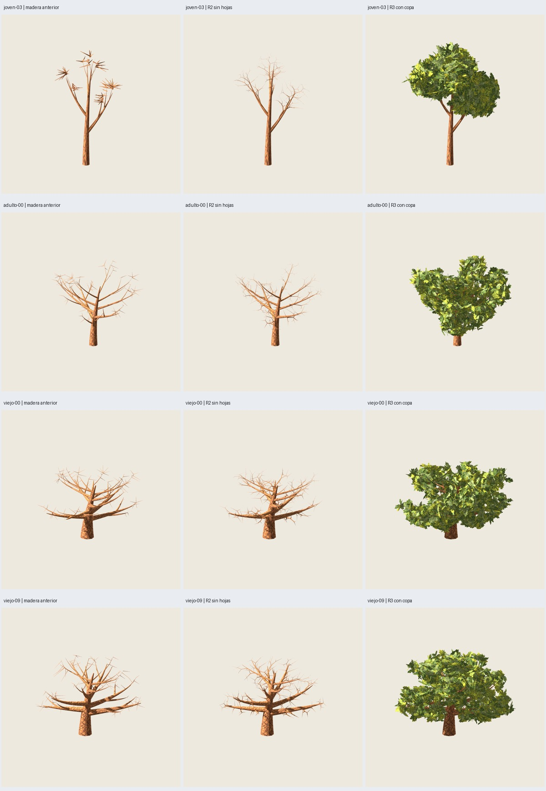

# R4 — ramificación integrada en robles completos

2026-11-03. **Implementado y verificado técnicamente; valoración artística del
árbol completo pendiente.** Petición: «continua con la inteegracion en arboles».
Generador explícito `branch-tree-0.1.0`; recetas y alias históricos conservados.

La ramificación de muestra ahora llega a todos los grupos de copa: tronco y
primarias intactos, redes bifurcadas en lugar de secundarias y soportes radiales.
R2 se exporta sin hojas; R3 añade simplificación interior al llevar follaje.
Se mantienen 264 grupos/792 láminas/1584 tris de follaje, pintura, UV, normales,
poses y atlas de cada fuente F5. Son árboles con/sin hojas independientes.



## Resultados

| Caso / semilla base | Fuente F5 con hojas | R2 sin hojas | R2 con hojas (control) | R3 con hojas (entrega) |
|---|---:|---:|---:|---:|
| joven-03 / 1003 | 3396 | 3426 | 5010 | **4874** |
| adulto-00 / 2000 | 5748 | 4556 | 6140 | **6140** |
| viejo-00 / 3000 | 6572 | 4824 | 6408 | **6408** |
| viejo-09 / 3009 | 6660 | 4824 | 6408 | **6408** |

Semillas de copa 17 y pintura 2718 en todos. Perfiles joven/adulto/viejo y
viejo_referencia, respectivamente. Uno/dos materiales sin/con follaje. Todos
los GLB completos cumplen **<7000 tris**; máximo final 6408. Cota previa por
perfil 5590/6380/6696/6696; generación final 19,60–47,97 s (límite 120 s).

La red natural cuesta más que los soportes anteriores en joven y adulto;
no se presenta esta sustitución como reducción universal. R3 ahorra 136 tris
frente a R2 con copa en el joven (−2,71 % del árbol, −3,97 % de madera).
En adulto y viejos el muestreo conserva toda la madera R2: sus R3 coinciden
con R2. No se fuerza una reducción que afecte ramas expuestas.

## Auditorías y revisión visual

- **239 pruebas**, **33 comprobaciones de cierre** y 19 auditorías por árbol.
- Cinco exportaciones del joven repetidas desde fuentes por el CLI público:
  GLB idénticos; fuente F5 también idéntica. Roble histórico 2.2.0 piloto
  regenerado: GLB idéntico al resultado anterior, sin modificar nodos/recetas.
- Atributos float32 de follaje exactos, sin redondear: posiciones, normales y UV.
  Atlas embebidos exactos. Tronco/primarias exactos también en los tres modos
  exportados, incluyendo sus normales y UV. Madera R2 de la primera primaria
  joven-03 idéntica a la muestra elegida por el usuario.
- 5/10/12/12 redes; 416/498/492/492 tramos R2 y 399/498/492/492 R3.
  Tres nacimientos por red, dentro de la madera de su eje; continuidad exacta
  entre extremos y padres, máximo tres hijos. Raíces expuestas conservadas.
- **608 capturas reales Godot**, 900×900, MSAA4, mipmaps/filtrado anisotrópico,
  alfa .5, luz/sombras y cámara compartidas. Godot 4.7.2, Compatibility/OpenGL,
  NVIDIA RTX 5060; Blender 5.2.1 LTS.
- **104 pares de máscaras de madera exactos**, **24 de follaje exactos**,
  **12 pares de sombras completas exactos**. También **116 pares normales R2/R3
  exactos**, incluidos cerca/media/lejos, abajo y ocho ángulos de giro.
- Inspección del agente de **240 capturas únicas en 22 láminas**: selección/copa,
  madera desnuda en seis vistas, cerca/lejos en seis vistas, ocho giros y tres
  luces sobre sombras completas, para los cuatro casos. No se atribuye esta
  revisión a las 608 imágenes ni se confunde con aceptación artística del usuario.

La copa mantiene su silueta y plenitud. La madera joven muestra bifurcaciones
continuas donde antes había abanicos de picos. Adultos/viejos conservan sus
brazos gruesos y añaden ramificación fina; siguen visibles cruces y superposiciones
propias del montaje por piezas, sin soldadura universal. Las vistas cercanas
recortan deliberadamente el encuadre para inspeccionar detalles.

## Criterio conservador y ensayos retenidos

La muestra R3 usaba alfa 128. Para árboles completos, la entrega usa cobertura
217 y catorce ángulos adicionales de protección (`branch-tree-guard-angles-0.1.0`).
El render mantiene el mismo alfa .5 y las mismas imágenes. El joven retiene
28 tris adicionales frente al primer ensayo alfa 128 (4874 frente a 4846).
R2 desnuda no cambia. La implementación histórica del clasificador se conserva;
un adaptador separado añade protección solo a R3 integrada.

`integracion-r4-01` y `-02` no pasaron la igualdad estricta en un giro: cero píxeles
perdidos y uno ganado en máscara, dos píxeles normales distintos. `-03` usó alfa
217, conservó algo más de madera y mostró la misma discrepancia en el arnés
compartido. Un control exportado con **el mismo SHA GLB** produjo esa variación
de dos píxeles al cambiar el orden de instancias. Eso impide atribuirla a una
contracción concreta. Capturas por proceso separado resolvieron la variación:
26 máscaras exactas en el diagnóstico, después todas las comparaciones finales
exactas. No se declara una causa interna del motor no investigada.

Se conservan resultados, entradas y diagnósticos locales; no se rebaja el criterio
para aceptar el lote. El lote final es **`artifacts/f5/integracion-r4-04/`**;
repetición `artifacts/f5/integracion-r4-repeat-01/`, regresión histórica
`artifacts/f5/integracion-r4-regresion-01/`.

## Entrega y reproducción

[Guía del generador](../../../uso-arboles-ramificados.md),
[auditoría y hashes](verification.json), [variantes elegidas](chosen-variants.json).
Galería local: `artifacts/f5/integracion-r4-04/index.html`.
En cada caso: `bare/tree.glb` sin hojas y `simple/tree.glb` con hojas.

```sh
python3 scripts/verify_branch_trees.py --output artifacts/mi-lote-r4
python3 scripts/verify_branch_trees.py --output artifacts/mi-lote-r4 --stage review
PYTHONPATH=src python3 -m unittest discover -s tests
```

Matriz `configs/verification/branch-tree-v1.json`; definición
`configs/branch-tree/0.1.0.json`. Cada caso reconstruye la fuente F5: no depende de
los ensayos de ramas anteriores. Para regenerar el cierre seleccionado tras
repetición/regresión y guardar el log de 239 pruebas en `/tmp/arboles-r4-tests-final.log`:
`python3 scripts/close_branch_trees.py --study artifacts/f5/integracion-r4-04`.
El cierre contrasta además con la evidencia histórica y la muestra R2 local.

Alcance: cuatro casos, sin certificación universal de semillas, sin benchmark FPS,
LOD, bosque, viento, nueva especie o conmutación estacional. No hay promoción
automática a F4 ni cambio de los predeterminados históricos. Siguiente paso:
valorar estos árboles completos antes de ampliar el lote o promover su selección.
