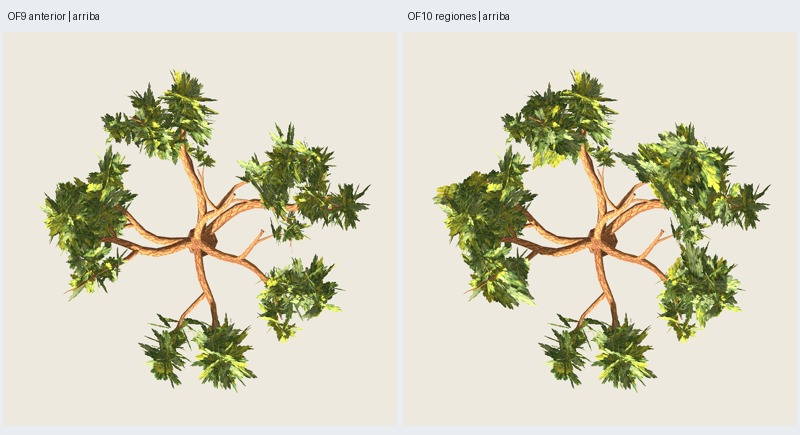

# OF10 — expansión lateral hacia huecos entre brazos

Fecha: 2026-11-03. **Implementada y verificada, aceptación artística pendiente.**
El usuario pide una expansión más clara desde arriba, permite hasta700 tris de
follaje adicionales sobre OF9 y exige216 grupos y bifurcaciones visibles.
[Dirección autorizada](user-direction.json). OF8 sigue como base provisional;
OF9 y las recetas históricas se conservan.

**5270 triángulos, +134 respecto a OF9; 216 grupos y dos materiales.**
Madera O5 exacta3714, follaje1556. Se añaden67 láminas en46 grupos existentes:
711→778 láminas. Usa134 de los700 tris autorizados; no hay grupos, soportes ni
mallas de macro-masa adicionales. Margen autorizado restante566; techo global6999.



Galería: `artifacts/oak-foliage/of10-maduro-05/index.html`.
Árbol/fuente en `painted/tree.glb` y `painted/tree.blend` dentro de esa carpeta.
Entrada: [gaps-B.json](../../../../configs/oak-foliage/gaps-B.json), versión
`oak-foliage-canopy-0.10.0`, maduro3100/distribución17/pintura2718.

## Organización y coste

OF9 permanece íntegra como subconjunto exacto, también comprobado sobre el GLB.
Los216 grupos originales, contactos, escalas, madera y texturas son idénticos.
Las láminas adicionales comparten la raíz opaca real del grupo que las porta;
no se trasladan al hueco ni se conectan mediante madera invisible añadida.

Se seleccionan hasta cinco interfaces entre regiones de brazos: separación
angular0.32–1.85 rad, diferencia vertical≤0.40H, distancia0.24–1.02H y máximo dos
enlaces por brazo. Se evita una región interpuesta. El destino sigue un arco
periférico: radio0.90 de la media regional, limitado por núcleo+0.12H. No se usa
la cuerda que cruza el tronco ni una copa esférica uniforme.

En flancos próximos a esas interfaces se ensayan tres planos del atlas,
tres escalas y tres inclinaciones. La media de la pintura opaca orienta su
alcance hacia el hueco, con ascenso/descenso acotado hacia el volumen vecino.
Se conservan las proporciones de la pintura: **escala isotrópica adicional de
1.15/1.35/1.55**, sin repintar ni estirar solo un eje. En la final:1/5/61 láminas
respectivamente. Esta ampliación sí cambia la escala aparente de la pintura en
esos planos; no afirmar que todas las hojas conservan su tamaño anterior.

Hasta dos láminas nuevas por grupo con normales distintas. La novedad de
ocupación tridimensional se mide con muestras alfa y vóxeles0.035H; se actualiza
al seleccionar para no repetir exactamente la misma cobertura. Las cinco
interfaces reciben12/17/17/11/10 planos; su unión visual depende de la cámara y
no convierte el grafo de regiones en una malla continua.

**6102 candidatos**, cota216×2×3×3×3=11664. Antes de añadir se limita el número
de planos por min(350, suelo((6999−totalOF9)/2)); el máximo adicional es700 tris
para cualquier entrada admitida. El piloto acaba también dentro de la reserva
histórica1584, pero la autorización permite superarla en otros casos dentro del
techo real; los contratos históricos siguen intactos.

## Protección de tronco y bifurcaciones

Además de distancia física a primarias interiores, cilindro3.6 m y suelo, el
planificador reserva proyecciones del tronco y estaciones interiores de
primarias. Prueba ocho azimuts uniformes en dos elevaciones(.12/.30), con rejilla
0.02H y radio0.045H. Descarta una propuesta si más del25 % de sus muestras opacas
entra en cualquiera de esas ventanas. Es una heurística general, sin consultar
las cámaras de revisión; el25 % no es una certificación de visibilidad.

La auditoría posterior usa **máscaras reales Godot**: madera negra, follaje blanco
con alfa recortada, sin iluminación; comparar con madera desnuda en la misma
cámara. La región de medida une discos proyectados sobre tronco y el primer30 %
de las primarias; cuenta solo píxeles que pertenecen a madera en la referencia.

| Vista | Madera central visible OF10 / OF9 |
| --- | ---: |
| Frente | 99.991 % |
| Perfil | 99.544 % |
| Perspectiva | 99.810 % |
| Arriba | 100.000 % |

La verificación exige conservar≥95 % en las cuatro vistas como guarda técnica
interna; no es una aceptación artística fijada por el usuario. La final pierde
como máximo0.456 % del área central previamente visible. Esto **conserva la
lectura anterior**: no despeja automáticamente la obstrucción que ya tenía OF9.
No certificar todas las bifurcaciones o todos los ángulos mediante cuatro vistas.

Se igualan geometría, encuadre y recorte alfa; el shader diagnóstico simplifica
los materiales y no mide sombras o coste de render. Las imágenes pintadas y el
giro se revisaron por separado. [Máscaras de madera](wood-masks.jpg).

## Resultado visual

**135 capturas Godot**,101 distintas inspeccionadas en comparación de seis
vistas, apariencia, rama, oblicuas y giro OF9/OF10; además doce máscaras de
follaje y doce de madera inspeccionadas. Giro muestreado24 azimuts cada15°, a
escala ortográfica2.2×span. Distancia habitual del videojuego aún no especificada.

| Vista | Área visible de follaje OF10 / OF9 | Componente mayor OF9 → OF10 |
| --- | ---: | ---: |
| Frente | +9.34 % | 60.25 % → 59.84 % |
| Perfil | +7.97 % | 59.65 % → 59.89 % |
| Perspectiva | +10.89 % | 80.50 % → 83.78 % |
| Arriba | **+20.26 %** | **26.26 % → 59.04 %** |

Arriba pasa de cinco a **tres componentes significativos** (≥1 % del área y32
píxeles), conectividad8 y sin dilatar. Son proyecciones con oclusión real de
madera; no volumen físico de unión ni reconocimiento botánico. Cámaras comunes
por estudio, recalculadas desde los límites comunes de las tres variantes.

Juicio del agente: expansión transversal más clara en el conjunto izquierdo y
superior derecho, con relaciones entre brazos que antes se leían separados.
Persisten huecos grandes y madera estructural expuesta. **La lectura radial no
desaparece por completo**, y el conjunto inferior sigue relativamente separado;
no presentar OF10 como copa definitivamente aprobada. La final equilibra esa
expansión con la visibilidad central, frente a una variante más cerrada que
ocultaba más madera. Algunas hojas ampliadas y ciertos cantos en el giro siguen
siendo notorios. Las nuevas siluetas lobuladas/pintura quedan pendientes.

Área suma de rectángulos, incluyendo transparencia/solapamiento:
2447.589→3091.702 m² (**+26.32 %**). No se midieron FPS ni se infiere que el coste
alfa crezca solo lo que crece el conteo de tris.

## Validación y reproducción

**73 comprobaciones correctas; seis pruebas nuevas finales** de contrato,
presupuesto/cota, conservación exacta OF9, contactos, determinismo, entradas
inmutables y controles3101–3103/layout18. Los controles son geométricos; no se
exportaron ni se aprobaron visualmente. Pruebas históricas OF9 se ejecutaron en
los ensayos anteriores; no se declara una suite completa334 en esta sesión.

Siete GLB repetidos idénticos y layout/estructura iguales; OF8 completa, OF9
completa/rama y madera O5 reproducidas con hashes históricos exactos. Recursos,
materiales, alfa, encaje de madera y presupuesto auditados. Núcleo exportado
mínimo3.60783833 m. Cada triángulo nuevo se coteja en posiciones/UV con el GLB
antes de interpolar su raíz pintada: error máximo de raíz **7.38e-7 m**; sus
contactos con madera son los mismos ya auditados de OF9. No certifica cada hoja
pintada en el atlas. [Auditoría, hashes y métricas](verification.json).

```sh
python3 scripts/prepare_oak_foliage_gaps.py --output artifacts/mi-of10
python3 scripts/oak_foliage_gaps_masks.py --study artifacts/mi-of10
python3 scripts/oak_foliage_gap_wood_masks.py --study artifacts/mi-of10
python3 scripts/prepare_oak_foliage_gaps.py --output artifacts/mi-of10-repeat --stage generate
PYTHONPATH=src python3 -m unittest discover -s tests -p test_oak_foliage_gaps.py > /tmp/mi-of10-tests.txt 2>&1
python3 scripts/close_oak_foliage_gaps.py --study artifacts/mi-of10 \
  --repeat artifacts/mi-of10-repeat --tests /tmp/mi-of10-tests.txt
```

Usar carpetas nuevas y ejecución externa para Blender/Godot. Generación39.21 s;
Blender≤120 s descontando preparación, revisión≤180 s por subproceso.
No se promueven recetas, edades, LOD o viento. Aceptación artística pendiente.

Ensayos conservados bajo `artifacts/oak-foliage/`:01 (+162 tris, escala1.85)
mostró láminas demasiado grandes/planas;02 (+256, escala≤1.55) amplió39 % desde
arriba pero ocultó6.76 % más madera central frontal;03/04 protegieron demasiado
las proyecciones y redujeron el cambio a41/47 planos. La final05 conserva67.
El arnés inicial de máscara de madera reprocesaba un shader ya convertido;
corregido y repetido antes de aceptar mediciones. Los ensayos descartados no se
presentan como la entrega final ni se borran sus resultados.
