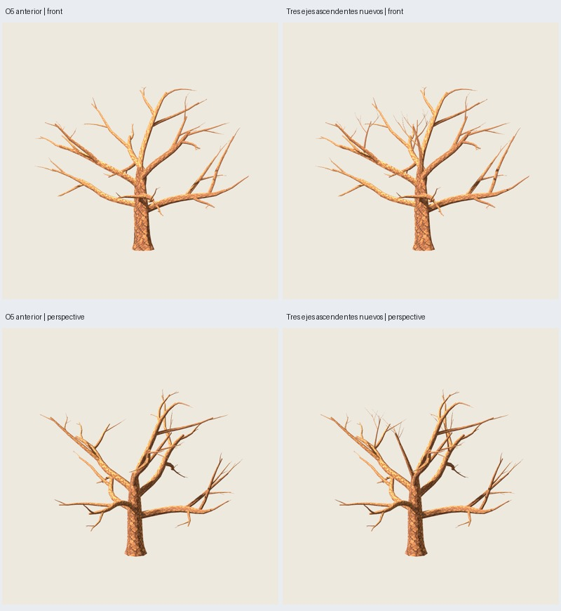

# OF11 — tres desarrollos ascendentes cerca de la copa

Fecha: 2026-11-03. **Árbol completo aprobado por el usuario; registrado como blueprint3.0.0.**
El usuario identifica falta de madera en medio de la copa y precisa que necesita
varias ramas de dirección más vertical cerca de ella. Se autoriza añadir madera,
antes congelada, y revisar la exclusión central de follaje.
[Dirección y alcance](user-direction.json). El usuario acepta después la estructura
para volver a mostrarla con follaje; se entrega la variante completa existente,
sin nueva generación o cambios de geometría. [Aceptación de madera](wood-acceptance.json).

**5745 triángulos: +475 de madera respecto a OF10.** Se mantienen **216 grupos,
778 láminas, dos materiales y la pintura**. Madera: 3714 → 4189 tris; follaje:
1556 tris exactos. No se gastan otros 700 tris de follaje ni se incrementan grupos.
Todas las piezas O5 anteriores se conservan exactamente.



Galería: `artifacts/oak-foliage/of11-maduro-03/index.html`.
Asset/fuente: `painted/tree.glb` y `painted/tree.blend` dentro de esa carpeta.
[Configuración](../../../../configs/oak-foliage/central-B.json): maduro de 12 m
nominales, estructura 3100, distribución 17, pintura 2718; copa `0.11.0` y
extensión de madera `oak-growth-central-0.1.0`. No se promueven recetas o edades.

## Soportes reales y redistribución

Se añaden tres ejes ascendentes con bifurcaciones menores: **21 piezas de madera**,
no 21 brazos principales. Un eje central nace a 0.88 del recorrido del tronco;
otros dos brotes nacen en primarias altas, elegidas con candidatos finitos según
espacio disponible y separación. En el piloto sus padres son `p:3` y `p:4`, ambos
a 0.72 de su recorrido. El ascenso de los tres ejes supera su desplazamiento
horizontal. Los diámetros y la topología son una decisión gráfica acotada,
no una simulación biológica o recalibración de toda la demanda de madera.

La dirección central se selecciona entre 16 candidatos de una fase determinista.
Los brotes altos se eligen entre primarias y estaciones 0.42/0.58/0.72, con
nacimientos entre 0.42H y 0.62H. No hay condiciones particulares para 3100. Se
ajustan solo anillos nuevos contra tubos padre reales; las curvas, radios y
mallas O5 permanecen exactos. Se comprueba encaje por solapamiento, no soldadura
ni ausencia universal de cruces entre ramas.

Se reasignan **24 grupos existentes** desde regiones densas, con cupos por brazo,
a doce terminales nuevos (dos grupos por terminal). No se toman grupos con
complementos OF8/OF10: **192 grupos y todos esos complementos quedan exactos**.
Plantilla, raíz opaca, pintura y tamaños de cada grupo reasignado se conservan;
solo cambian portador, contacto y orientación. Las raíces se proyectan sobre
triángulos reales, sin hojas flotantes ni conectores ocultos nuevos.

Las cotas son 600 tris de madera nueva, 24 × 12 ensayos de orientación y 6999 tris
totales, comprobados antes y después de exportar. El piloto usa 475 tris nuevos.
No se altera la selección histórica de O5/OF10 ni el generador de producción.
Los diagnósticos regionales heredados describen pases anteriores; la estructura
extendida, `central_changes` y `axis_quotas` describen el reparto final.

## Por qué hubo que cambiar la protección central

OF10 protegía un cilindro de radio 0.30H **a todas las alturas**. En este piloto
eso impedía follaje dentro de 3.6 m del eje, aunque hubiera madera alta disponible.
Añadir solo una rama manteniendo esa prohibición no resolvía el vacío superior.

OF11 conserva ese cilindro **hasta 0.62H = 7.44 m** y permite follaje central por
encima. Todas las caras de los 24 grupos reasignados quedan sobre esa altura;
la comprobación de exportación recorta cada triángulo en Z antes de medir radio.
No basta con mirar sus vértices. Radio mínimo protegido reimportado: **3.61826593 m**.
Arriba sí hay follaje cerca del eje: radio mínimo global de caras **0.08435 m**.

Se revisaron las horquillas inferiores en imágenes reales Godot; conservan su
lectura, con parte de la oclusión que ya existía. La protección espacial no
certifica ausencia de oclusión desde cualquier cámara. La medición 99.54 % de
OF10 no se traslada a esta estructura nueva, ni se repitió ese diagnóstico como
si la madera fuese la misma.

## Revisión visual y límites

135 capturas Godot producidas; **101 distintas inspeccionadas** en láminas de
comparación de seis vistas, oblicuas, ramas, apariencia y giro OF10/OF11; además
**ocho máscaras** de follaje inspeccionadas. Madera antes/después y árbol completo
comparten cámaras por estudio. Giro muestreado a 24 azimuts y escala ortográfica
2.2 × span; la cámara habitual del videojuego aún no se ha especificado.

Juicio del agente: se leen más ejes verticales en la zona alta y hay soporte
verdadero para follaje en el centro. Mejora la continuidad frontal/lateral en
esta prueba. El cambio de la madera es visible sin hojas, no solo una masa de
pintura colocada en el hueco. Sin embargo, **desde arriba los nuevos grupos
centrales todavía se leen parcialmente como agrupaciones separadas**. Persisten
huecos y estructura radial; no declarar aprobadas la arquitectura o la distribución
definitiva por añadir ramas. Algunos brotes y sus bifurcaciones menores son finos
y regulares; el desarrollo/relación entre las nuevas masas queda para valoración.

| Vista | Área foliar OF11 / OF10 | Componente mayor OF10 → OF11 |
| --- | ---: | ---: |
| Frente | +3.26 % | 59.85 % → 64.37 % |
| Perfil | +1.05 % | 59.87 % → 85.34 % |
| Perspectiva | +1.11 % | 83.78 % → 84.81 % |
| Arriba | +13.53 % | 59.04 % → 54.95 % |

Desde arriba los componentes significativos pasan de tres a cinco por las
agrupaciones nuevas en el centro. Umbral de área ≥1 % y 32 píxeles, conectividad
8, sin dilatar. No confundir más área visible con unión de masas o naturalidad.
La suma de áreas de láminas se conserva: 3091.702 m² en ambas; no es el área de
unión ni demuestra igualdad de coste alfa. Sin benchmark de rendimiento.

## Técnica y reproducción

**70 comprobaciones correctas y seis pruebas nuevas**: conservación de madera,
tres ejes ascendentes, cupo fijo, contactos, recorte de caras, determinismo,
entradas inmutables, contrato y controles geométricos 3101–3103. Esos controles
no se exportaron/revisaron en Godot; no tienen aceptación artística. No se declara
una suite completa del repositorio por haber ejecutado este conjunto.

Siete GLB, layout y estructura repetidos exactamente; OF10 completa y O5 desnuda
regeneradas con hashes históricos idénticos. Todas las piezas O5 aparecen exactas
como subconjunto exportado de la madera nueva. Normales/materiales/UV/atlas/alfa,
presupuesto y encajes auditados. Los 216 contactos sobre GLB pasan: error máximo
**6.35e-7 m**. Complementos OF10 auditados por triángulos y raíz opaca también.
No certifica cada hoja pintada. [Auditoría y hashes](verification.json).

```sh
python3 scripts/prepare_oak_foliage_central.py --output artifacts/mi-of11
python3 scripts/oak_foliage_central_masks.py --study artifacts/mi-of11
python3 scripts/prepare_oak_foliage_central.py --output artifacts/mi-of11-repeat --stage generate
PYTHONPATH=src python3 -m unittest discover -s tests -p test_oak_foliage_central.py > /tmp/mi-of11-tests.txt 2>&1
python3 scripts/close_oak_foliage_central.py --study artifacts/mi-of11 \
  --repeat artifacts/mi-of11-repeat --tests /tmp/mi-of11-tests.txt
```

Usar directorios nuevos y entorno externo Blender/Godot. Generación final 42.19 s;
exportación ≤120 s descontando preparación; revisión ≤180 s por subproceso.
El archivo `o5-structure.json` del estudio guarda la estructura extendida y su
versión explícita; la referencia O5 desnuda está en `reference/tree.glb`.

Ensayo 01: un solo eje central, anterior a la precisión del usuario de pedir más
ramas verticales. Ensayo 02: la auditoría falló al faltar los padres `p:3`/`p:4`
en su contexto de encaje; no llegó a exportar. Corregido incluyendo copias de los
padres sin alterar su geometría; ensayo final 03 y repetición 03 verificados.
Resultados de ensayo conservados bajo `artifacts/oak-foliage/`; arte pendiente.


## Aprobación y blueprint3.0.0

El usuario aprueba el árbol completo y solicita guardar esta versión, commit y
push. [Decisión](user-acceptance.json). La evaluación anterior describe los
límites observados durante el ensayo; la aprobación posterior es del piloto,
sin extenderla a otras semillas/edades.

Receta `blueprints/roble_copa_ancha/3.0.0.json`, ejemplar
`presets/blueprints/roble-central/maduro-3100.json`, contrato1.7. Se genera con la
CLI estándar, sin reutilizar el GLB ni los archivos de los estudios. La primera
generación CLI con nueve vistas y la repetición sin vistas producen exactamente
el GLB OF11 aprobado: `315943611b884005ea96122d005891b5ee83ca772132bda6c52c412916ad9fde`.
[Auditoría de la receta y suite](blueprint-release.json).

```sh
PYTHONPATH=src python3 -m treegen generate-blueprint blueprints/roble_copa_ancha/3.0.0.json --instance presets/blueprints/roble-central/maduro-3100.json --output artifacts/mi-roble3
PYTHONPATH=src python3 -m treegen generate-blueprint blueprints/roble_copa_ancha/3.0.0.json --instance presets/blueprints/roble-central/maduro-3100.json --output artifacts/mi-roble3-repeat --no-render
python3 scripts/run_tests_bounded.py --output artifacts/mi-roble3-tests
python3 scripts/verify_oak_central_blueprint.py --first artifacts/mi-roble3 --repeat artifacts/mi-roble3-repeat --tests artifacts/mi-roble3-tests/results.json
```

La ejecución de pruebas HTTP/Blender usa entorno externo al sandbox. El primer
ensayo del adaptador de producción importó por error el validador JSONSchema
dentro de Blender; se corrigió usando el hash canónico ligero existente, sin
instalar paquetes. El manifiesto fallido quedó conservado en los resultados
regenerables. Las capturas Godot aprobadas siguen siendo aplicables por identidad
exacta del GLB; no se afirma otra revisión visual de135 capturas.

La entrega de producción pasa **345 pruebas en73 archivos y15 comprobaciones**.
CLI con nueve vistas23.607 s; repetición sin vistas15.073 s. Se generaron las
nueve vistas técnicas Blender y se inspeccionó perspectiva, sin recorte de
encuadre; la valoración artística conserva las capturas Godot del GLB idéntico.
El coordinador inicial de la suite fue interrumpido por el entorno; se
recuperaron los registrosOK y se completaron los restantes por lotes, con180 s
máximos por subproceso. No se presentan esa interrupción o el primer fallo
del adaptador como ejecuciones completas satisfactorias.
