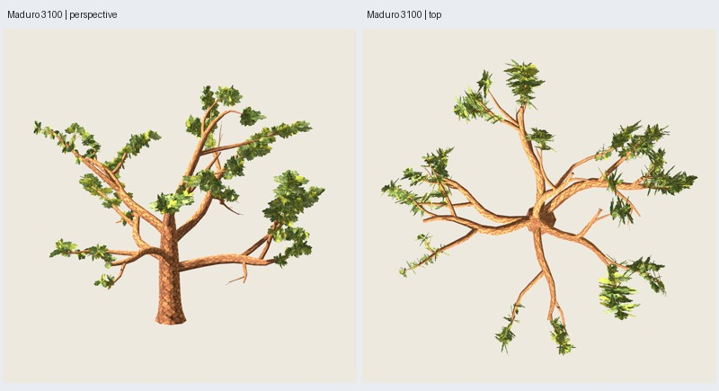

# OF3 — copa B revisada en maduro O5 3100

Fecha: 2026-11-03. El usuario elige B como base y autoriza la prueba completa
con expansión lateral, equilibrio entre bifurcaciones y variedad de masas.
[Dirección registrada](user-direction.json). Implementada y verificada técnicamente;
**aceptación artística de esta copa pendiente**. No se promueven recetas ni se
extiende la aprobación a otras edades o semillas.

## Resultado y presupuesto

`oak-foliage-canopy-0.3.0`, preset O5 maduro, semillas estructura 3100,
distribución 17 y pintura 2718. [Configuración](../../../../configs/oak-foliage/canopy-B.json).

| Componente | Triángulos |
| --- | ---: |
| Madera O5 exacta | 3714 |
| Follaje: 216 grupos, 648 láminas fijas | 1296 |
| Árbol completo exportado | **5010** |

Mismo cupo global que OF1/OF2; no se gastó otro presupuesto. Dos materiales;
follaje atlas 0.3.0 y corteza 0.2.0 idénticos en el GLB. La cota de familia
5415 + 1296 = 6711 respeta 6999, pero este ensayo solo certifica el piloto
materializado. No añade madera ni conectores y conserva la referencia O5 aceptada.

## Cambios de distribución

- Mantiene cupos por primaria; cada subárbol secundario recibe una fracción
  según longitud expuesta sublineal, vigor y exposición radial. Es una heurística
  geométrica, sin simulación de luz ni ajustes por semilla. En p:0, B original
  repartía 26/38/0 grupos entre las secundarias 0/1/2; ahora reparte **25/26/13**.
- Organiza 28 masas lógicas sobre bifurcaciones reales. Son agrupaciones de
  láminas, no nuevas mallas: 79 grupos en masas anchas, 61 alargadas y 76 de enlace.
  Variación correlacionada por masa, orientación horizontal/inclinación propias
  y anclajes alrededor de los ejes aportan crecimiento arriba, lateral y abajo.
- Sigue anclando las raíces pintadas a superficie de ramas reales de orden ≥2.
  No desplaza hojas a huecos arbitrarios. Cada masa prueba hasta seis orientaciones
  para evitar el núcleo; los segmentos y cupos están acotados y se rechaza una
  entrada si no puede completarse sin invadirlo.
- Comprueba las caras completas contra un cilindro de radio 0.30H = 3.6 m,
  incluso aristas/interiores que podrían cruzarlo con vértices exteriores.
  Radio mínimo tras GLB: **3.60010831 m**. Una hoja periférica puede coincidir
  con el tronco en proyección sin ocupar ese cilindro.

La pintura permanece exacta, pero cambian proporciones y orientaciones. El área
suma de rectángulos de láminas pasa de 617.216 a 695.189 m² (+12.6 %), incluyendo
zonas transparentes y solapadas: no es superficie opaca ni volumen de copa.
Mismo número de triángulos no implica mismo coste de alfa o FPS.

## Comparación visual

Galería: `artifacts/oak-foliage/of3-maduro-02/index.html`.



Se generó B original sobre todas las primarias para compararla con B revisada,
con cámaras, luz, fondo y escala comunes por pareja. La muestra p:0 original
exportada reproduce exactamente el GLB histórico OF2 B. La referencia completa
B original es una aplicación nueva de aquellas reglas, no un árbol ya aprobado.

Inspeccionadas las **46 capturas reales Godot**: madera 6, B original 11,
B revisada 11, follaje aislado 6 y dos ramas con 6 vistas cada una. Cubren
frente/perfil/perspectiva/reverso/arriba/abajo, distancia media/lejana, fondo
oscuro, otra luz y receptor de sombras. [Comparación](comparison.jpg),
[rama](branch.jpg), [aspecto](appearance.jpg).

Juicio del agente: la lateral antes vacía tiene desarrollo legible y las masas
superiores son más anchas, menos uniformes y con más profundidad. Conserva
tramos de madera estructural visibles. **El árbol completo sigue bastante ralo**,
con grandes huecos entre brazos; algunas vistas de rama aún forman una columna.
Desde arriba persisten tarjetas de canto y trazos espinosos. La variedad de
formas no basta para declarar resuelto el llenado ni la identidad botánica.
Se entrega para revisión del usuario, sin marcar aceptación ni medir FPS.

## Verificación y reproducción

**293 pruebas, 48 comprobaciones correctas**, seis GLB repetidos idénticos,
layout/estructura/grupos originales idénticos en repetición. Madera completa
idéntica al O5 histórico; muestra B original idéntica a OF2. Texturas, triángulos,
materiales, alfa y uniones auditados. Contactos GLB float32/UV/alfa opaca de los
216 grupos: error máximo **5.50e-7 m**. No certifica cada hoja dibujada del atlas.
Fuentes, parámetros, recursos y capturas con hashes en [verificación](verification.json).

```sh
python3 scripts/prepare_oak_foliage_canopy.py --output artifacts/mi-of3
python3 scripts/prepare_oak_foliage_canopy.py --output artifacts/mi-of3-repeat --stage generate
PYTHONPATH=src python3 -m unittest discover -s tests > /tmp/mi-of3-tests.txt 2>&1
python3 scripts/close_oak_foliage_canopy.py --study artifacts/mi-of3 \
  --repeat artifacts/mi-of3-repeat --tests /tmp/mi-of3-tests.txt
```

Cada directorio de generación debe ser nuevo. Depende de los manifiestos de
evidencia O5 y OF2 para verificar los hashes históricos; no necesita sus GLB
regenerables. Exportaciones autocontenidas: `painted/tree.glb` y
`painted/tree.blend` dentro del resultado. Generación final externa: 17.15 s;
subprocesos terminables (generación Blender ≤120 s, revisión ≤180 s por proceso).
La primera ejecución `of3-maduro-01` quedó bloqueada al cerrar el audio de Blender
en el sandbox y venció su límite; se conservó como fallo. La ejecución externa
`of3-maduro-02` y `of3-repeat-02` completaron las comprobaciones.

## Revisión posterior del usuario

El usuario considera la copa demasiado rala y solicita más llenado periférico
y continuidad sin tocar centro, madera, pintura ni 5010 tris, con reglas generales.
OF3 requiere revisión artística; se conserva como referencia de
[OF4](../of4/informe.md), sin atribuirle aceptación de la copa completa.
