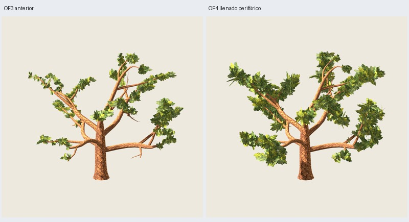

# OF4 — llenado periférico con presupuesto fijo

Fecha: 2026-11-03. OF3 fue revisada por el usuario: la copa sigue demasiado rala.
Autoriza mejorar periferia y continuidad, conservando madera, pintura, centro
y **5010 triángulos**, sin retoques por semilla. [Dirección](user-direction.json).
OF4 implementada y verificada; **aceptación artística pendiente**.

## Resultado

`oak-foliage-canopy-0.4.0`, preset O5 maduro, semilla estructural 3100,
distribución 17 y pintura 2718; [configuración](../../../../configs/oak-foliage/peripheral-B.json).
Conserva **3714 tris de madera + 1296 de follaje = 5010**, dos materiales,
216 grupos/648 láminas cruzadas fijas. Sin nuevos soportes o conectores.
Corteza 0.2.0 y atlas de follaje 0.3.0 idénticos, incluidos PNG embebidos en GLB.



Galería: `artifacts/oak-foliage/of4-maduro-01/index.html`.
Salida revisada: `painted/tree.glb` y fuente `painted/tree.blend`.
[Seis vistas](comparison.jpg), [rama](branch.jpg), [distancias/sombras](appearance.jpg),
[máscaras](masks.jpg).

## Reglas generales

OF3 se conserva sin modificar. OF4 tiene contrato y algoritmo independientes:

- Suaviza el peso por desarrollo expuesto de las primarias con exponente 0.55.
  Los cupos 64/20/14/39/27/28/24 pasan a **47/25/21/36/29/30/28**, sin cambiar
  el total. Los brazos menos poblados reciben parte de los grupos concentrados
  antes en el más dominante. Entre bifurcaciones sigue contando longitud expuesta
  y vigor (exponente 0.5), no una igualdad forzada ni simulación de iluminación.
- La regla inferior ya no descarta todo un subárbol descendente por estar debajo
  de una altura de su primaria. Solo excluye terminales inferiores de menos de
  0.025H; desarrolla madera periférica descendente real, con muestras desde 0.18
  del recorrido de secundarias y 0.15 de ejes más finos.
- Espaciado entre grupos de todo el brazo, no solo dentro de cada masa: recompensa
  candidatos poco cubiertos y permite una envolvente longitudinal más extensa.
  Parte de los grupos se orienta hacia otra masa de la misma bifurcación para
  enlazarla; el anclaje permanece sobre superficie real de madera.
- Amplía alcance de masas anchas/alargadas y de enlace. Variación coherente por
  masa; 30 masas lógicas en el piloto. Cerca del núcleo la extensión se limita
  con un factor de 0.45 a 1 según distancia disponible. Hasta diez orientaciones,
  32 candidatos por eje, máximo doce grupos por eje; rechaza cupos imposibles.

No hay condiciones por semilla o ediciones manuales de este árbol. Se comprobaron
geométricamente las mismas reglas en 3101–3103 y distribución 18, sin exportar
ni aprobar visualmente esos controles. Solo el piloto 3100 se revisó en Godot.
No se promueve receta ni se certifican otras edades.

## Centro, contactos y coste

Cilindro central de radio **0.30H = 3.6 m** excluido de las caras completas de
follaje, no solo anclajes/vértices. Radio mínimo en GLB: **3.60082396 m**.
Hojas periféricas pueden coincidir con tronco/centro en proyección sin ocupar
ese cilindro. Madera completa O5 y referencias OF3 completa/rama reproducidas
exactamente por hash. Las 216 raíces pintadas tienen contacto de superficie,
UV y alfa opaca ≥192: error máximo GLB **5.40e-7 m**; no certifica toda hoja pintada.

El cambio combina distribución, proporciones y tamaño; no es una ablación de
reparto con tamaños constantes. Suma de áreas de rectángulos, incluyendo zonas
transparentes/solapadas: **695.189 → 1595.001 m²**. El tamaño aparente de algunas
hojas aumenta. Mismos tris no garantiza mismo coste de alfa: no se midieron FPS.

## Revisión visual y máscaras

46 capturas reales Godot inspeccionadas: madera 6, OF3 anterior 11, OF4 11,
follaje aislado 6 y dos ramas con seis vistas cada una. Cámaras, luz, fondo y
escala comunes por pareja; frente/perfil/reverso/perspectiva/arriba/abajo,
distancias media/lejana, fondo oscuro, otra luz y receptor de sombras.
Ocho máscaras adicionales inspeccionadas conservan alfa, ponen follaje negro y
madera blanca con su oclusión real; no muestran follaje oculto tras la madera.

| Vista | Píxeles follaje OF3 | OF4 | Cambio | Fracción en componente mayor OF3 → OF4 |
| --- | ---: | ---: | ---: | ---: |
| Frente | 60653 | 116158 | +91.5 % | 0.327 → 0.429 |
| Perfil | 57594 | 110009 | +91.0 % | 0.278 → 0.612 |
| Perspectiva | 56634 | 115870 | +104.6 % | 0.265 → 0.278 |
| Arriba | 50756 | 108923 | +114.6 % | 0.240 → 0.211 |

Conteo con umbral 128 y conectividad de ocho vecinos, sin dilatar. El área visible
crece en las cuatro vistas; el componente mayor mejora frente/perfil, apenas
cambia en perspectiva y **disminuye proporcionalmente desde arriba**. Las cuentas
de componentes significativos del JSON usan umbral relativo del 1 % y no deben
compararse como número absoluto de masas con el mismo umbral de píxeles.
Son proyecciones 2D: no miden volumen físico, naturalidad o aprobación.

Juicio del agente: mayor presencia lateral y baja, más continuidad local y menos
tramos periféricos desnudos; madera estructural aún legible. Persisten huecos entre
brazos, algunos parches bajos separados y trazos de canto arriba. La continuidad
no está resuelta uniformemente en todas las vistas. Se entrega para revisión.

## Verificación y reproducción

**299 pruebas y 55 comprobaciones correctas**; seis GLB y layout/estructura/grupos
de referencia repetidos exactamente. Geometría, recursos, materiales, alfa,
uniones, anclajes y cilindro auditados sobre GLB. 46 capturas + ocho máscaras con
hashes/procedencia; [verificación](verification.json). Generación: 17.12 s;
Blender ≤120 s y revisión ≤180 s por subproceso terminable.

```sh
python3 scripts/prepare_oak_foliage_peripheral.py --output artifacts/mi-of4
python3 scripts/oak_foliage_peripheral_masks.py --study artifacts/mi-of4
python3 scripts/prepare_oak_foliage_peripheral.py --output artifacts/mi-of4-repeat --stage generate
PYTHONPATH=src python3 -m unittest discover -s tests > /tmp/mi-of4-tests.txt 2>&1
python3 scripts/close_oak_foliage_peripheral.py --study artifacts/mi-of4 \
  --repeat artifacts/mi-of4-repeat --tests /tmp/mi-of4-tests.txt
```

Directorios nuevos; Blender/Godot con el entorno externo documentado para evitar
bloqueos de audio/sockets del sandbox. OF3 se regenera desde el código histórico;
solo sus manifiestos de evidencia y el de O5 son necesarios para los hashes de
regresión, no sus GLB anteriores. OF1–OF3 y sus resultados siguen reconstruibles.

## Valoración posterior del usuario

El usuario valora favorablemente copa alrededor de brazos, periferia, cantidad,
madera visible y vista superior. Solicita pocos puentes, menos capuchones,
revisar ruido interior y jerarquía de macromasas. OF4 se conserva como referencia
valorada, sin inferir aceptación definitiva de todas las edades o de la siguiente
revisión. [Valoración](../of5/user-direction.json), [candidata OF5](../of5/informe.md).
