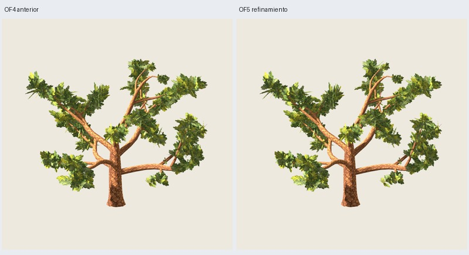

# OF5 — puentes discretos y jerarquía de masas

Fecha: 2026-11-03. El usuario valora favorablemente periferia, densidad, madera y
vista superior de OF4; solicita pocos puentes, menos capuchones/ruido interior y
organización en macromasas. [Revisión registrada](user-direction.json).
OF4 se conserva como referencia valorada. **OF5 pendiente de revisión artística**;
no sustituye una receta ni amplía edades.

## Resultado y alcance

`oak-foliage-canopy-0.5.0`, O5 maduro 3100, distribución 17, pintura 2718.
[Configuración](../../../../configs/oak-foliage/macro-B.json). **216 grupos,
3714 tris de madera + 1296 de follaje = 5010, dos materiales**. Madera O5 y
PNG históricos de follaje/corteza exactos; sin nuevos conectores o soportes.



Galería: `artifacts/oak-foliage/of5-maduro-02/index.html`;
`painted/tree.glb` y `painted/tree.blend` contienen la candidata.
[Comparación](comparison.jpg), [rama](branch.jpg), [aspecto](appearance.jpg),
[máscaras](masks.jpg).

## Reglas implementadas

OF5 parte de OF4 intacta. Agrupa las treinta masas locales en tres conjuntos
espaciales por cercanía, sin sectores radiales ni ejes de cámara preferidos:
10/12/8 masas. Seis pasos de agrupamiento determinista y enlaces de vecindad por
árbol de expansión mínimo. Esta jerarquía **sí dirige la selección de puentes**,
pero sus identificadores lógicos no acreditan tres grandes volúmenes visibles.

Reasigna como máximo 18 grupos existentes, manteniendo los demás exactos:

- **Diez puentes**, tomados de grupos redundantes de las masas vecinas y reducidos
  al 78 % de dimensión. Busca madera periférica real próxima al hueco entre masas
  del mismo conjunto; no traslada hojas al vacío. Conserva el cupo por primaria.
- **Seis retrocesos de punta** sobre su mismo eje: desplaza el anclaje 0.14 del
  recorrido hacia atrás si sigue respetando contactos y núcleo. Los grupos con
  anclajes después de 0.82 del recorrido pasan de **54 a 38**, incluyendo donantes
  de puentes que también estaban en punta. Es un indicador de distribución, no
  prueba de eliminación visual de todos los capuchones.
- **Dos grupos interiores redundantes** se desplazan hacia posiciones de mayor
  radio sobre su rama. Mantiene el resto del follaje interior; no vacía el centro.

**198 grupos conservan toda su geometría**, tamaños y plantillas. Los 216 conservan
su identidad y plantilla pintada; solo se modifica geometría de los 18 indicados.
No hay condiciones por semilla ni edición manual de ramas. Los controles
geométricos 3101–3103 y distribución 18 pasan las mismas reglas; no tienen nuevas
exportaciones/capturas ni aceptación artística.

Búsqueda acotada: 24 candidatos por eje, hasta 24 candidatos y seis donantes por
hueco, cuatro marcos por colocación; máximo 18 reasignaciones. El piloto realiza
32 intentos de marco. El cilindro central 0.30H = **3.6 m** permanece excluido de
caras completas: radio mínimo GLB **3.60082396 m**. Contactos sobre madera/UV/alfa
≥192, error máximo **5.40e-7 m**, sin certificar cada hoja dibujada del atlas.

## Comparación visual y límites

Inspeccionadas **46 capturas Godot y ocho máscaras**, con cámaras, luz, escala y
materiales comunes por pareja. Cubren seis direcciones, distancias media/lejana,
fondo oscuro, luz alternativa, sombras y rama/follaje aislado. Las máscaras
muestran follaje visible, con madera blanca conservando oclusión real.

| Vista | Cambio de área visible OF4 → OF5 | Fracción en componente mayor |
| --- | ---: | ---: |
| Frente | -0.03 % | 0.429 → 0.422 |
| Perfil | -0.06 % | 0.612 → 0.606 |
| Perspectiva | -1.49 % | 0.278 → 0.280 |
| Arriba | -0.91 % | 0.211 → 0.212 |

Umbral 128, conectividad de ocho vecinos, sin dilatar. La cobertura se conserva:
variación máxima de aproximadamente 1.5 %. **No hay mejora de conectividad
uniforme**: el componente mayor baja levemente frente/perfil, sube apenas en
perspectiva/arriba. El cambio no se presenta como una mejora demostrada de
macromasas por estas métricas; no miden volumen, naturalidad ni FPS.

Juicio del agente: el refinamiento es discreto; reduce concentración de anclajes
distales y mantiene cantidad y lectura de madera. Algunos puentes locales cambian
transiciones, pero la lectura global de macromasas no mejora de forma contundente.
Persisten huecos entre brazos, parches bajos separados y láminas de canto arriba.
Se entrega como candidata comparada con OF4 para valorar el efecto artístico;
no se da por resuelto el objetivo de macromasas ni se promueve la versión.

## Verificación y reproducción

**305 pruebas, 59 comprobaciones correctas**. Seis GLB/layout/estructura repetidos
idénticos, OF4 completa/rama y O5 históricos exactos. Fuentes, recursos, geometría,
contactos, núcleo, capturas y máscaras con hashes en [verificación](verification.json).
El primer ensayo `of5-maduro-01` no incluía reasignaciones interiores y permitía
traspasar cupos entre primarias; se conserva como comparación preliminar. La
final `of5-maduro-02` reserva dos ajustes interiores y conserva cupos de primaria.

```sh
python3 scripts/prepare_oak_foliage_macro.py --output artifacts/mi-of5
python3 scripts/oak_foliage_macro_masks.py --study artifacts/mi-of5
python3 scripts/prepare_oak_foliage_macro.py --output artifacts/mi-of5-repeat --stage generate
PYTHONPATH=src python3 -m unittest discover -s tests > /tmp/mi-of5-tests.txt 2>&1
python3 scripts/close_oak_foliage_macro.py --study artifacts/mi-of5 \
  --repeat artifacts/mi-of5-repeat --tests /tmp/mi-of5-tests.txt
```

Directorios nuevos; Blender/Godot requieren el entorno externo documentado para
evitar audio/sockets bloqueados en el sandbox. OF4 se regenera desde su algoritmo
conservado; la evidencia histórica O5/OF4 aporta los hashes de regresión, sin
necesitar sus GLB previos. Subprocesos Blender ≤120 s, revisión ≤180 s; sin benchmark.
