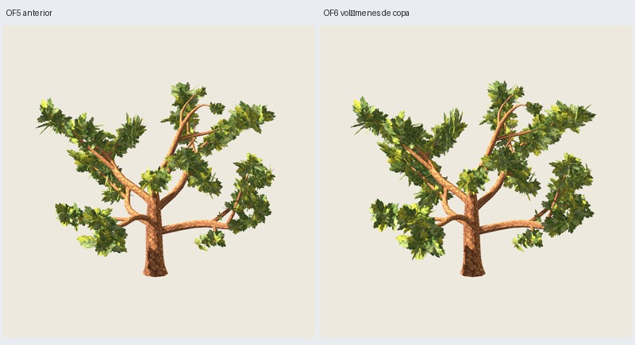

# OF6 — macromasas con efecto geométrico

Fecha: 2026-11-03. El usuario solicita volúmenes mayores de copa en maduro 3100,
conservando 216 grupos, 5010 tris, madera, pintura y centro despejado, sin retoques
por semilla. [Dirección](user-direction.json). **Implementada/verificada;
aceptación artística pendiente.** OF4/OF5 y recetas históricas conservadas.

## Resultado

`oak-foliage-canopy-0.6.0`, O5 maduro 3100, distribución 17, pintura 2718.
[Configuración](../../../../configs/oak-foliage/volume-B.json).
**3714 tris de madera + 1296 de follaje = 5010, dos materiales; 216 grupos y
648 láminas cruzadas fijas**. PNG embebidos de corteza 0.2.0 y follaje 0.3.0 exactos.
Madera completa O5 exacta y referencia OF5 completa/rama reproducidas por hash.



Galería: `artifacts/oak-foliage/of6-maduro-03/index.html`.
Candidata y fuente: `painted/tree.glb` y `painted/tree.blend`.
[Seis vistas](comparison.jpg), [rama](branch.jpg), [distancias/sombras](appearance.jpg),
[máscaras](masks.jpg).

## Qué cambia

Parte de OF5 preservada. Los tres conjuntos espaciales de 72/90/54 grupos dejan
de ser solo una guía para unos pocos puentes: sus anclajes definen centros,
extensiones y dirección horizontal principal reproducible. Esta dirección
influye suavemente en los marcos de los grupos (mezcla 0.78 original / 0.22 común),
conservando roll y proporciones de las plantillas.

Las interfaces se buscan entre grupos de masas locales distintas del mismo
conjunto: distancia 0.035H–0.27H, anclajes anteriores a 0.82 del recorrido. Hasta
68 % de los candidatos de interfaz de cada conjunto reciben mayor alcance.

En el piloto final:

- **63 grupos de interfaz** crecen uniformemente entre 1.22 y 1.46 según distancia
  a vecina; favorecen unión de los volúmenes sin estirar ejes de la pintura.
- **105 grupos** usan una envolvente moderada, escala 1.10 y orientación compartida.
- **34 grupos terminales** conservan su tamaño anterior, evitando ampliar capuchones.
- **14 grupos** conservan tamaño por protección del núcleo; se permite orientación
  válida o se recupera toda la geometría previa si no cabe.

209 grupos cambian tamaño o marco. **Los 216 conservan anclaje, rama, parámetro de
inserción, identidad, plantilla y raíz pintada exactos**; no se mueve ni añade
madera. El aumento es uniforme por grupo: conserva las relaciones de aspecto de
cada plantilla. No hay edición de ejemplares, condiciones por semilla, cámaras
preferidas en el algoritmo ni nuevos materiales.

La búsqueda prueba hasta tres marcos por grupo: 247 intentos en el piloto,
con fallback seguro a OF5. El cilindro **0.30H = 3.6 m** se comprueba sobre caras
completas antes y después de exportar: mínimo GLB **3.60082396 m**. La superposición
en proyección con el tronco no equivale a ocupar ese cilindro.

## Comparación visual y límites

Inspeccionadas **46 capturas Godot y ocho máscaras**. Comparaciones OF5/OF6 con
cámaras/luz/fondo/escala comunes, seis orientaciones, distancias media/lejana,
fondo oscuro, otra luz, receptor de sombras, rama y follaje aislado.

Las máscaras conservan alfa real, follaje negro y madera blanca con su oclusión;
umbral 128, conectividad de ocho vecinos, sin dilatar.

| Vista | Píxeles de follaje visible OF5 → OF6 | Cambio | Fracción en componente mayor |
| --- | ---: | ---: | ---: |
| Frente | 109775 → 140553 | +28.0 % | 0.422 → 0.642 |
| Perfil | 104042 → 121843 | +17.1 % | 0.606 → 0.628 |
| Perspectiva | 107935 → 130538 | +20.9 % | 0.280 → 0.452 |
| Arriba | 102148 → 124292 | +21.7 % | 0.212 → 0.205 |

La unión en proyección crece claramente de frente y en perspectiva; es un apoyo
a la lectura visual de volúmenes mayores, no una medida de volumen físico.
**Arriba no mejora la fracción del componente mayor**, y persisten huecos entre
brazos y láminas de canto. No se declara resuelta la copa desde todos los ángulos.
Las cuentas de componentes significativos del JSON usan umbral relativo del 1 %;
con distinta área no deben compararse como número absoluto de masas al mismo umbral.

Juicio del agente: volúmenes laterales más anchos y unidos y parte baja menos
fragmentada, conservando tronco/brazos legibles. Hay diferencia visible mayor
que en OF5, pero la vista superior y algunas separaciones siguen por revisar.
La candidata se entrega para valoración del usuario, sin aprobación ni promoción.

La pintura es idéntica, pero aumenta la escala aparente de hojas en los grupos
ampliados. Área suma de rectángulos transparentes/solapados: **1570.023 →
2162.147 m² (+37.7 %)**. Este efecto combina orientación y escala de geometría;
no es una comparación de distribución con área constante. No se midieron FPS
ni se atribuye igualdad de coste alfa a la igualdad de triángulos.

## Verificación y reproducción

**310 pruebas y 59 comprobaciones correctas**, seis GLB/layout/estructura repetidos
exactamente. Contratos, geometría, proporciones, recursos, contactos, núcleo,
regresiones y hashes de capturas auditados en [verificación](verification.json).
Contacto de 216 raíces pintadas, alfa ≥192: error máximo GLB **6.03e-7 m**.
No certifica cada hoja dibujada del atlas.

Controles 3101–3103 y distribución 18 comprobados geométricamente con las mismas
reglas; sin nuevas exportaciones/capturas ni aceptación de esos controles.
Solo piloto maduro 3100 revisado en Godot; otras edades/recetas no promovidas.
Generación final: 21.16 s; Blender ≤120 s y revisión ≤180 s por subproceso.

```sh
python3 scripts/prepare_oak_foliage_volume.py --output artifacts/mi-of6
python3 scripts/oak_foliage_volume_masks.py --study artifacts/mi-of6
python3 scripts/prepare_oak_foliage_volume.py --output artifacts/mi-of6-repeat --stage generate
PYTHONPATH=src python3 -m unittest discover -s tests > /tmp/mi-of6-tests.txt 2>&1
python3 scripts/close_oak_foliage_volume.py --study artifacts/mi-of6 \
  --repeat artifacts/mi-of6-repeat --tests /tmp/mi-of6-tests.txt
```

Directorios nuevos; entorno externo Blender/Godot documentado para evitar bloqueo
de audio/sockets del sandbox. Requiere manifiestos de evidencia O5/OF5 para hashes
históricos; regenera OF5 desde su algoritmo, sin necesitar sus GLB previos.

El ensayo `of6-maduro-01` alargaba el eje principal hacia vecinas: generó tiras y
penachos, descartado visualmente. `of6-maduro-02` corrigió proporciones y giro.
La final `of6-maduro-03` y repetición tienen la misma geometría/GLB que 02, con
metadatos de puntas/núcleo diferenciados y código sin el marco experimental ya
abandonado. Se conservan los ensayos y sus capturas; no se presentan como éxitos.

## Valoración posterior del usuario

El usuario considera que va mejor y pide refinar unión superior y cantos,
manteniendo centro, cantidades, madera/pintura y reglas generales. La nueva
[candidata OF7](../of7/informe.md) se compara con OF6, que permanece disponible;
esta petición no constituye aceptación final ni promoción de receta.
