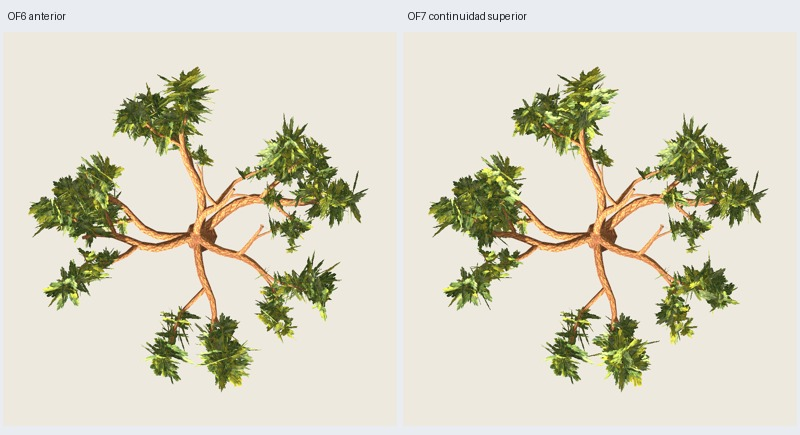

# OF7 — continuidad superior y reducción de cantos

Fecha: 2026-11-03. El usuario valora el avance de OF6 y solicita mejorar unión
superior y cantos, conservando centro, 216 grupos/5010 tris, madera y pintura,
sin retoques por semilla. [Dirección](user-direction.json). **OF7 implementada y
verificada; aceptación artística pendiente**, con un coste de continuidad frontal.

## Resultado

`oak-foliage-canopy-0.7.0`, O5 maduro 3100, distribución 17, pintura 2718;
[configuración](../../../../configs/oak-foliage/top-B.json).
**3714 tris de madera + 1296 de follaje = 5010, 216 grupos/648 láminas fijas,
dos materiales**. Madera O5 y atlas RGBA de corteza/follaje exactos en GLB.



Galería: `artifacts/oak-foliage/of7-maduro-04/index.html`.
Candidata/fuente: `painted/tree.glb`, `painted/tree.blend`.
[Seis vistas](comparison.jpg), [superiores oblicuas](upper.jpg), [rama](branch.jpg),
[aspecto/distancias](appearance.jpg), [máscaras](masks.jpg).

## Reglas generales

Parte de OF6 conservada. **Tamaños, identidades, anclajes, ramas, posiciones de
inserción, raíces pintadas, UV y plantillas de los 216 grupos permanecen exactos**.
No añade soportes ni láminas y no repinta. Solo cambia orientación de 63 grupos;
los otros **153 conservan toda su geometría**.

Selecciona grupos con algún plano casi vertical respecto a la vertical física
(|normal.z| < 0.15), conservando marcos que ya aportan espesor. Protege también
puentes y correcciones de distribución previas: no reorientar los grupos por
un resultado particular de 3100 ni por una cámara concreta.

En los grupos elegibles prueba ocho tríadas cruzadas inclinadas. Las tres normales
de partida tienen componente vertical 1/√3, con pequeña variación suave por altura.
Cada plano nuevo presenta superficie desde arriba; no se crea una capa horizontal
plana ni billboards. La orientación queda fija al exportar.

La dirección parte del hueco XY hacia la masa local vecina del mismo conjunto.
Muestrea el PNG original: rejilla 16×16 por plano y alfa ≥192, con coordenadas
UV/vertical PNG comprobadas por prueba. Puntúa pintura opaca hacia el hueco,
conservación del centro opaco previo y proximidad tridimensional al volumen
vecino. No optimiza solo rectángulos transparentes ni consulta cámaras de Godot.

151 grupos conservan el marco por selección/protección previa; de 65 candidatos,
63 admiten marco nuevo y dos recuperan OF6 por núcleo. **520 intentos** como máximo
ocho por grupo, sin bucles abiertos. El cilindro central 0.30H = **3.6 m** se
comprueba sobre caras completas antes y después de exportar: mínimo GLB
**3.60043405 m**. Raíces opacas en madera auditadas con alfa ≥192; no se certifica
cada hoja dibujada del atlas.

## Evidencia visual y límites

Inspeccionadas **50 capturas Godot y ocho máscaras**: seis vistas generales,
distancias media/lejana, fondo oscuro, otra luz, sombras, rama/follaje aislado y
dos superiores oblicuas adicionales por variante. Cámaras/luz/fondo/escala comunes
por pareja. Las máscaras conservan oclusión de madera blanca y alfa real.

Láminas geométricamente casi verticales (|normal.z|<0.15): **129/648 → 56/648**,
19.91 % → 8.64 %, reducción del 56.6 %. Este indicador refiere a visión superior:
no equivale a contar todos los trazos finos de la pintura ni elimina cantos desde
cualquier ángulo. Los marcos protegidos pueden conservarlos.

| Vista | Píxeles de follaje visible OF6 → OF7 | Cambio | Fracción en componente mayor |
| --- | ---: | ---: | ---: |
| Frente | 140576 → 140550 | -0.02 % | 0.642 → 0.445 |
| Perfil | 121802 → 124093 | +1.88 % | 0.629 → 0.821 |
| Perspectiva | 130563 → 132851 | +1.75 % | 0.451 → 0.455 |
| Arriba | 124292 → 128876 | +3.69 % | 0.205 → 0.277 |

Umbral 128, conectividad de ocho vecinos, sin dilatar. **Arriba** crecen cobertura
y componente mayor, y visualmente algunas masas se leen menos como láminas de
canto. Perfil y perspectiva conservan volumen; las dos superiores oblicuas no
muestran una copa aplanada. Aún quedan separaciones y trazos finos pintados.

**Coste observado:** la mayor componente frontal pasa de 64.2 % a 44.5 %, aunque
su cobertura varía menos del 0.02 %. Algunas uniones que coincidían en proyección
se separan; proteger puentes previos no garantiza conservar toda conexión de
píxeles. No presentar OF7 como una mejora uniforme de todas las vistas. Las
máscaras son diagnóstico 2D, no naturalidad, volumen físico ni aprobación.

No aumenta el área suma de rectángulos de láminas: aproximadamente **2162.147 m²**
en ambas variantes (incluye transparencia/solapamiento). No crecen las hojas;
las diferencias de silueta y cobertura proceden de orientación. El coste de alfa
puede variar con dirección/solapamiento; no se midieron FPS.

Juicio del agente: avance en lectura superior sin aumentar densidad geométrica,
con madera y centro legibles. Se entrega como candidata para revisar ese avance
junto a la pérdida de algunas uniones frontales. OF6 permanece disponible.

## Verificación y reproducción

**316 pruebas y 61 comprobaciones correctas**; seis GLB/layout/estructura repetidos
exactos, OF6 completa/rama y O5 históricos exactos. Contratos, muestras alfa,
marcos, tamaños/área, contactos, núcleo, recursos y capturas con hashes en
[verificación](verification.json). Controles 3101–3103 y distribución 18 geométricos,
sin nuevas exportaciones/capturas ni aceptación artística de esos controles.
Solo maduro 3100 revisado en Godot; sin promover receta ni otras edades.

```sh
python3 scripts/prepare_oak_foliage_top.py --output artifacts/mi-of7
python3 scripts/oak_foliage_top_masks.py --study artifacts/mi-of7
python3 scripts/prepare_oak_foliage_top.py --output artifacts/mi-of7-repeat --stage generate
PYTHONPATH=src python3 -m unittest discover -s tests > /tmp/mi-of7-tests.txt 2>&1
python3 scripts/close_oak_foliage_top.py --study artifacts/mi-of7 \
  --repeat artifacts/mi-of7-repeat --tests /tmp/mi-of7-tests.txt
```

Directorios nuevos. Entorno externo Blender/Godot documentado para audio/sockets;
Blender ≤120 s, revisión ≤180 s por subproceso. Generación final: 18.97 s. Necesita
manifiestos O5/OF6 para hashes históricos; regenera OF6 sin sus GLB anteriores.

Ensayos conservados: 01 tenía muestreo vertical del PNG incorrecto y fue descartado
antes de revisión artística; la prueba de correspondencia UV lo cubre. 02 cambió
la mayoría de marcos y perdió unión frontal; 03 limitó cambios a grupos con cantos
y puntuó volumen previo. La final 04 protege además puentes/correcciones y añade
oblicuas. Pese a la protección, el coste frontal persiste y queda registrado.

## Revisión posterior y margen autorizado

El usuario pide recuperar la continuidad frontal sin perder la mejora superior
y permite un pequeño aumento de triángulos si es necesario, manteniendo el techo
global7k. [OF8](../of8/informe.md) conserva OF7 y ensaya complementarias inclinadas;
no se infiere aceptación artística. Se corrigió el metadato de controles a
3101–3103, que fueron las semillas reales de las pruebas, sin nuevas generaciones.
