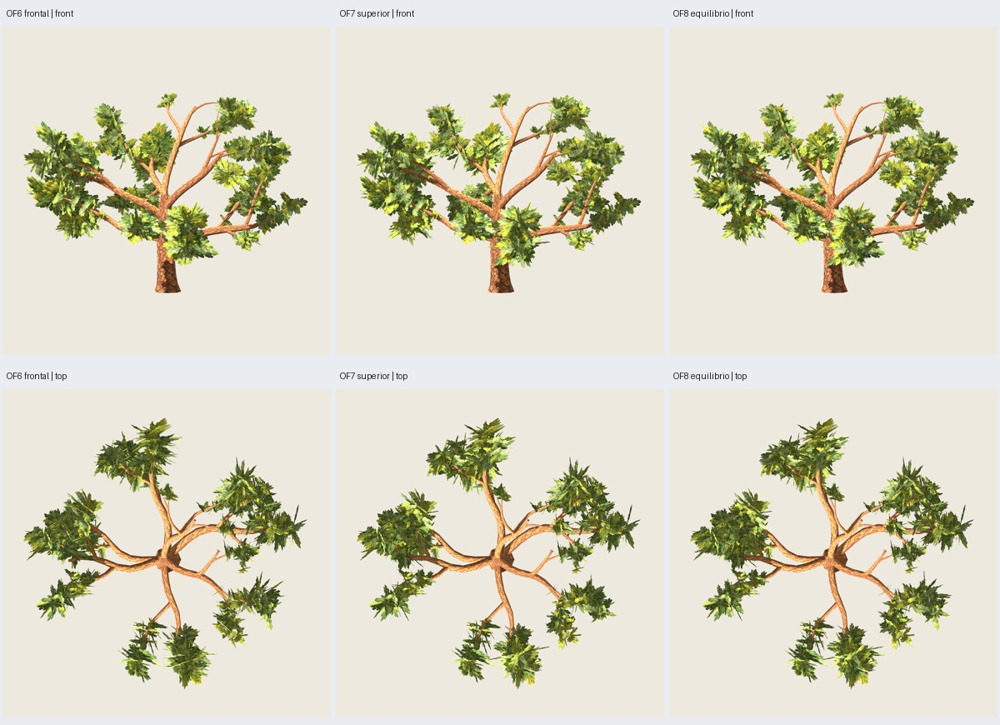

# OF8 — continuidad frontal con mejora superior conservada

Fecha: 2026-11-03. El usuario pide recuperar frontal sin perder OF7 y después
**autoriza un pequeño aumento de tris si resulta necesario**, con techo global
7k. Se aplica máximo **6999**, según política. [Autorización y decisión](user-direction.json).
Se ensaya un complemento de cobertura en vez de deshacer los marcos superiores.
**Implementada/verificada; aceptación artística pendiente.** OF6/OF7 conservadas.

## Resultado y presupuesto

`oak-foliage-canopy-0.8.0`, preset O5 maduro, semillas estructura 3100,
distribución 17, pintura 2718; [configuración](../../../../configs/oak-foliage/balance-B.json).

| Componente | Triángulos |
| --- | ---: |
| Madera O5 exacta | 3714 |
| Follaje base OF7, 648 láminas | 1296 |
| Complemento: 63 láminas × 2 tris | 126 |
| Árbol completo GLB | **5136** |

**216 grupos, 711 láminas, dos materiales**. 63 grupos tienen una cuarta lámina;
los otros 153 conservan tres. Incremento total **+126 tris (+2.5 %)** respecto a
5010; margen hasta 6999: **1863 tris**. Follaje 1422 sigue dentro de la reserva 1584;
cota conservadora de familia 5415 + 1422 = 6837. Límites aplicados antes de exportar.



Galería: `artifacts/oak-foliage/of8-maduro-02/index.html`.
Candidata/fuente: `painted/tree.glb`, `painted/tree.blend`.
[Seis vistas](comparison.jpg), [superiores oblicuas](upper.jpg), [rama](branch.jpg),
[distancias/sombras](appearance.jpg), [máscaras](masks.jpg).

## Regla general

OF8 conserva íntegra la geometría de OF7 y la usa como base; comprobado también
como subconjunto exacto sobre el follaje GLB reimportado. No cambia tamaños,
anclajes, identidades, ramas, raíces pintadas, atlas o madera. El complemento
parte de la misma plantilla y anclaje del grupo; no crea conectores ni nuevos grupos.

Solo considera grupos reorientados en OF7 respecto a OF6. Compara huellas de
pintura opaca (muestras alfa del PNG existente) en **ocho azimuts uniformes del
horizonte**, con elevación 0.1, rejilla de celda 0.012H y ocupación de cinco celdas (centro y cuatro vecinas)
por muestra para compensar submuestreo. Esta es una heurística de selección;
las máscaras Godot de verificación no se dilatan. Aplica las mismas reglas a
todas las semillas y no consulta la cámara de revisión ni un identificador de 3100.

Si la pérdida media de huella frente a OF6 es ≥18 %, prueba los tres planos de
esa plantilla. Elige uno que recupere al menos 10 % de la huella anterior en ese
muestreo. La normal se inclina si hace falta hasta |Nz|≥0.24, evitando una nueva
lámina casi vertical desde arriba. Conserva tamaño, UV y raíz pintada; rechaza
caras que entren en el cilindro central o bajo el suelo. Una sola complementaria
por grupo, máximo64, limitado además por reserva 1584 y techo6999 con cota de madera5415.

En este piloto los 63 grupos reorientados cumplen el criterio; se añaden 63 planos
tras 189 pruebas. Es una regla de pérdida/recuperación de cobertura, no un mínimo
matemático del número de planos. El coste pequeño está justificado por la
recuperación frontal observada sin retirar la mejora superior.

## Verificación visual

**63 capturas Godot y doce máscaras inspeccionadas**, con OF6/OF7/OF8 en cámaras,
luces, escala y fondos comunes. Seis direcciones, dos superiores oblicuas,
distancias media/lejana, fondo oscuro, luz alternativa, sombras y rama/follaje
separados. OF6 completa y OF7 completa/rama reproducidas exactamente por hash.

| Vista | Fracción en mayor componente OF6 | OF7 | OF8 | Área visible OF8 vs OF7 |
| --- | ---: | ---: | ---: | ---: |
| Frente | 0.642 | 0.445 | 0.645 | +4.94 % |
| Perfil | 0.629 | 0.821 | 0.820 | +3.57 % |
| Perspectiva | 0.451 | 0.455 | 0.455 | +4.16 % |
| Arriba | 0.205 | 0.277 | 0.275 | +2.90 % |

Máscaras de follaje visible con oclusión real de madera blanca; umbral 128 y
conectividad de ocho vecinos, sin dilatar. El frontal recupera **64.5 %** frente a
64.2 % de OF6 y 44.5 % de OF7. Arriba mantiene aproximadamente **27.5 %** frente a
27.7 % de OF7 y 20.5 % de OF6; el área visible superior crece 2.9 %. La variación
relativa de componente superior se debe también al área añadida: su tamaño en
píxeles aumenta. Son diagnósticos 2D, no volumen físico, naturalidad o aceptación.

OF7 permanece íntegra y no se agregan planos casi verticales con el umbral
|Nz|<0.15: **56 láminas** en ambas variantes. Fracción 56/648 en OF7 y 56/711 en OF8;
no confundir la reducción de fracción por denominador con quitar más cantos.
Las complementarias tienen normal |Nz|≥0.24. Persisten huecos entre brazos y
trazos finos pintados; no se afirma perfección desde todo ángulo.

Juicio del agente: la continuidad frontal vuelve a la lectura de OF6, con el
centro y madera legibles, y las vistas superiores/oblicuas conservan el avance
de OF7. La adición de densidad es moderada. Se entrega como candidata al usuario,
sin promover receta ni extender aceptación a otras edades/semillas.

Área suma de rectángulos, incluyendo transparencia y solapamiento:
**2162.147 →2447.589 m² (+13.2 %)**. Pintura y escala de las hojas anteriores
conservadas, con más superficie dibujada donde se añade la cuarta lámina.
No se midieron FPS ni se deduce igualdad de coste por el pequeño aumento de tris.

## Técnica y reproducción

**322 pruebas y 69 comprobaciones correctas**, siete GLB y layout/estructura/grupos
de referencia repetidos exactamente. Madera O5, texturas, materiales, alfa,
presupuesto, subconjunto OF7, contactos y núcleo auditados sobre GLB. Centro
excluido de caras completas: mínimo radial **3.60043405 m**, reserva 0.30H=3.6 m.
Raíces opacas compartidas con madera: error máximo **5.97e-7 m**; no certifica
cada hoja dibujada del atlas. [Verificación y hashes](verification.json).

Controles 3101–3103/distribución 18 comprobados geométricamente con reglas comunes,
sin nuevas exportaciones/capturas ni aceptación de controles. Solo piloto maduro
3100 revisado en Godot. En los metadatos históricos de OF7 se corrigió el rótulo
3161–3163 a las semillas realmente usadas 3101–3103; sin cambiar su geometría/métricas.

```sh
python3 scripts/prepare_oak_foliage_balance.py --output artifacts/mi-of8
python3 scripts/oak_foliage_balance_masks.py --study artifacts/mi-of8
python3 scripts/prepare_oak_foliage_balance.py --output artifacts/mi-of8-repeat --stage generate
PYTHONPATH=src python3 -m unittest discover -s tests > /tmp/mi-of8-tests.txt 2>&1
python3 scripts/close_oak_foliage_balance.py --study artifacts/mi-of8 \
  --repeat artifacts/mi-of8-repeat --tests /tmp/mi-of8-tests.txt
```

Directorios nuevos; entorno externo Blender/Godot para evitar audio/sockets
bloqueados en sandbox. Generación final 21.27 s; Blender ≤120 s, revisión ≤180 s por
subproceso. Necesita manifiestos de evidencia O5/OF6/OF7 para regresiones; regenera
referencias desde código, sin necesitar sus GLB históricos.
La prueba 01 produjo la misma geometría que la final 02; esta última limita también
la reserva y cota familiar antes de mallar. No se ha integrado una receta de producción.
