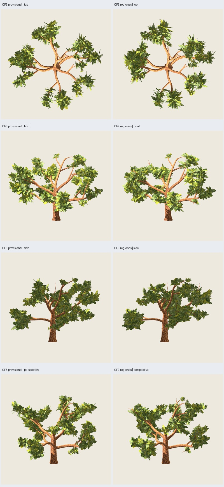

# OF9 — organización espacial de regiones de copa

Fecha: 2026-11-03. **Candidata para revisión artística**, con OF8 como base
aprobada provisionalmente. [Petición y margen autorizado](user-direction.json).
El usuario permite hasta +700 tris de follaje si hace falta; esta comparación
mantiene **5136 tris exactos**, sin consumir ese margen.

216 grupos, 711 láminas, dos materiales; madera **3714 tris**, follaje **1422**.
Pintura, tamaños/proporciones de las plantillas y madera O5 conservados. No hay
mallas de macro-masa ni soportes adicionales. Piloto maduro3100, distribución17,
pintura2718, [entrada congelada](../../../../configs/oak-foliage/regions-B.json).
No se promueven recetas ni se amplía la aceptación a otras edades.



Galería: `artifacts/oak-foliage/of9-maduro-03/index.html`.
Árbol/fuente: `painted/tree.glb`, `painted/tree.blend` dentro de esa carpeta.
Incluye comparación, oblicuas, rama p:0, distancias/fondos/sombras y giro comparado.

**65 comprobaciones técnicas correctas y siete GLB repetidos exactamente**;
328 casos de prueba cubiertos con la salvedad de ejecución explicada al final.

## Organización y anclaje

Versión `oak-foliage-canopy-0.9.0`, independiente de OF8 histórica. Parte de OF8,
conserva sus cupos por brazo derivados de longitud, vigor y exposición y organiza
**siete regiones tridimensionales**, una por primaria activa. Centros y marcos
se calculan desde la pintura opaca y los contactos existentes. Los objetivos
siguen una nube elipsoidal de amplitud transversal, con fases deterministas de
la semilla de distribución. No son sectores angulares iguales ni una esfera.

Las interfaces solo se dirigen hacia un vecino próximo, a menos de0.65H y con
diferencia vertical menor0.22H; solo una quinta parte de los objetivos recibe
ese sesgo. El grafo no conecta todos los brazos. Los objetivos exteriores se
resuelven primero para reservar alcance lateral.

Cada grupo elige entre su contacto original y hasta ocho estaciones reales de
secundarias/terciarias/terminales **del mismo brazo**. Prueba doce giros en torno
a Z, sin cambiar la elevación de las normales OF8. Los contactos nuevos se
proyectan sobre triángulos reales del tubo; la lámina complementaria lateral
acompaña el mismo giro y contacto. No se deslizan hojas fuera de la madera ni
se añaden grupos disimulados como conectores. **177 contactos se desplazan más
de1 cm**. Algunas estaciones longitudinales se comparten con contacto en
superficies distintas; no se promete distancia mínima entre grupos.

La selección considera distancia tridimensional al objetivo, congestión local,
proximidad al núcleo y a puntos interiores de primarias, además de una pequeña
penalización al desplazamiento. Son heurísticas gráficas, no crecimiento
biológico simulado ni exposición lumínica física. Conserva cupos por primaria,
pero puede modificar los de secundarias/bifurcaciones menores.

**23328 candidatos** como máximo216×9×12; no optimización sin cota. Cada candidato
rechaza caras dentro del cilindro0.30H o bajo el suelo. Núcleo exportado mínimo
**3.61656836 m**; cilindro protegido3.6 m. Las distancias de centroides a puntos
interiores de primarias pasan de mínimo1.667 a2.272 m; esto no certifica ausencia
de oclusión en cámara. Los metadatos OF3–OF8 heredados describen esos pases
anteriores; `regions`, `region_changes` y los grupos finales describen OF9.

## Lectura visual y límites

Se produjeron **135 capturas Godot y doce máscaras**. Se inspeccionaron las
láminas de seis vistas, oblicuas, rama, apariencia y giro OF8/OF9: **101 capturas
distintas**, además de las doce máscaras. El giro muestra24 azimuts separados15°,
a elevación explícita y escala ortográfica2.2×span. Es una inspección muestreada
a distancia media; no certifica cada ángulo continuo ni la distancia habitual
del videojuego, que aún no se ha especificado.

Juicio del agente: cambia la organización, mejora la relación entre masas en
perspectiva y aparecen extensiones transversales/intermedias en la zona
izquierda y superior. La vista superior gana presencia foliar y pierde un
componente significativo, pero **persiste la disposición de brazos con grandes
huecos**. No se consiguió una mejora uniforme de las siete regiones: la
dispersión transversal de sus centroides aumenta en tres y disminuye en cuatro.
No presentar el mero aumento de área como éxito completo de macro-masas.

El frontal conserva mucha madera legible, pero todavía hay follaje delante de
algunas bifurcaciones. El perfil izquierdo conserva separación respecto al
resto de la copa; su masa es más extensa, sin resolver por completo el equilibrio.
En algunos giros hay transiciones bruscas de láminas y trazos puntiagudos. La
pintura y las siluetas se dejan pendientes, como pidió el usuario.

| Vista | Componente mayor OF8 | OF9 | Área visible OF9 / OF8 |
| --- | ---: | ---: | ---: |
| Frente | 64.48 % | 60.25 % | −6.08 % |
| Perfil | 82.12 % | 59.64 % | +2.72 % |
| Perspectiva | 45.52 % | 80.44 % | −1.63 % |
| Arriba | 27.56 % | 26.28 % | +7.94 % |

Máscaras Godot de follaje visible, con oclusión real de madera, umbral128,
conectividad8, sin dilatación. Arriba pasa de seis a cinco componentes de al menos
1 % del área y32 píxeles. Los cambios de conectividad frontal/perfil son un coste
visible del nuevo reparto; la fuerte unión en perspectiva no los invalida.
Cámaras comunes por pareja; se recalculan desde los límites comunes del estudio,
por lo que los números no se comparan directamente con capturas de otros estudios.

OF9 se entrega como experimento comparativo, **sin sustituir OF8 provisional ni
declarar el follaje terminado**. El margen+700 queda disponible; este ensayo no
ha demostrado que añadir láminas sea necesario ni que vaya a resolver la estrella.
No se midieron FPS, volumen físico de unión ni reconocimiento botánico.

## Reproducción y ensayos conservados

```sh
python3 scripts/prepare_oak_foliage_regions.py --output artifacts/mi-of9
python3 scripts/oak_foliage_regions_masks.py --study artifacts/mi-of9
python3 scripts/prepare_oak_foliage_regions.py --output artifacts/mi-of9-repeat --stage generate
PYTHONPATH=src python3 -m unittest discover -s tests > /tmp/mi-of9-tests.txt 2>&1
python3 scripts/close_oak_foliage_regions.py --study artifacts/mi-of9 \
  --repeat artifacts/mi-of9-repeat --tests /tmp/mi-of9-tests.txt
```

Usar carpetas nuevas y entorno externo Blender/Godot; límites de120 s para el
subproceso de exportación, descontando la preparación, y180 s por revisión.
Generación final25.53 s. Atlas y referencias OF6/OF8/O5 se regeneran desde fuentes
con hashes históricos comprobados; no hace falta reutilizar GLB antiguos.

Ensayo01: Blender exportó, pero el cierre de audio se bloqueó en sandbox y el
proceso terminó por tiempo. Ensayo02/repetición02: candidato estrecho, descartado
visualmente por más fragmentación frontal/lateral; sus archivos se conservan en
`artifacts/oak-foliage/of9-maduro-02/`. Ensayo03 amplía objetivos transversales y
la vecindad e incorpora penalización de proximidad a primarias interiores.
Una prueba inicial de contacto reproyectaba desde otra dirección y exigía el
mismo punto sobre el tubo: oráculo incorrecto, sustituido por distancia mínima
a triángulos reales. La suite en sandbox encontró un bloqueo de sockets en la
prueba HTTP local; la prueba HTTP aislada pasa al repetirla fuera. La suite completa del sandbox
terminó328 pruebas con ese único error ambiental. Los seis tests OF9 se repiten
con las fuentes finales y la prueba HTTP se verifica aparte:328 casos distintos
cubiertos, sin afirmar que una única ejecución completa terminó enOK. Un segundo
intento de suite completa externa fue interrumpido (salida143), y no cuenta como
éxito. Los tres registros de pruebas se conservan en la evidencia.

La auditoría final y sus hashes se guardan en [verification.json](verification.json).
Controles3101–3103/layout18: comprobación geométrica en pruebas, sin capturas Godot
ni aceptación artística para esos controles. Aceptación artística OF9 pendiente.
