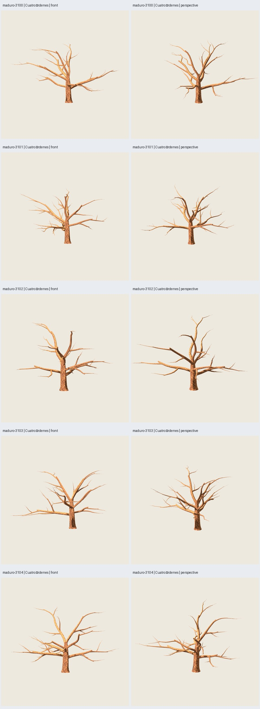
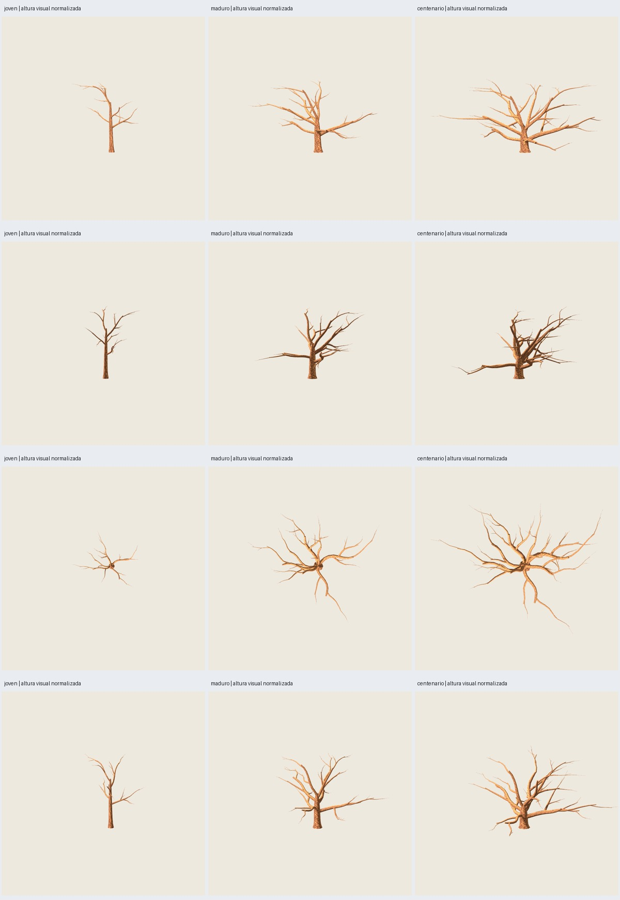

# O1 — arquitectura y madurez del roble

2026-11-03. **Implementado, verificado técnicamente y revisado en imágenes reales;
aceptación artística del usuario pendiente.** Referencia de forma: *Quercus robur*
de crecimiento libre; aproximación gráfica, sin simulación ni calibración por años.

Se cambió la arquitectura que origina las ramas, en una alternativa explícita
`oak-growth-0.1.0`. No se sustituyeron las recetas aprobadas, R4 o Geometry Nodes.
La entrega de este hito es **madera sin hojas**; no se integró ni aprobó follaje
nuevo. Corteza pintada y atlas existentes conservados.

## Diagnóstico y cambios por etapa

1. **Tronco/primarias:** F5 repartía sectores casi uniformes, nacimientos
   `.33+.53*step` y parábolas del mismo tipo. R4 congelaba esas primarias.
   O1 desarrolla un eje con dominancia dependiente de madurez, base ensanchada,
   nacimientos escalonados no equidistantes y primarias de distintas longitudes,
   inclinaciones y curvas espaciales. Ocupación angular por crecimiento previo,
   sin asignar sectores `2*pi/n` a las ramas. El perfil maduro tiene siete/ocho
   primarias frente a las once de las referencias: no se atribuye el resultado
   a agregar más ramas principales.
2. **Jerarquía:** F5 tenía dos órdenes; R4 conectaba destinos de follaje mediante
   particiones cartesianas/centroides y anclajes fijos. O1 diferencia primarias,
   secundarias, terciarias y terminales; combina continuaciones y laterales
   desiguales. Cada orden tiene frecuencia, longitud, referencia de bifurcación,
   peso de demanda, curvatura, nacimiento y resolución explícitos en el preset.
3. **Espacio y vigor:** campo regional suave, vigor heredado y disponibilidad
   local regulan desarrollo. Se eligen planos de bifurcación/direcciones con
   preferencia por espacio libre; no se añade ruido independiente por vértice.
   La luz usa una tendencia direccional y una aproximación espacial de exposición,
   sin trazar luz ni resolver competencia biológica completa. La gravedad permite
   descenso de brazos; la zona alta abre líderes hacia volumen lateral.
4. **Curvas/diámetros/uniones:** curvas correladas en tres ejes, radios por demanda
   distal acumulada y exponente configurable, ensanchamiento basal, cambio de radio
   por anillo ≤1.55 y marcos transportados. El anillo inicial hijo se limita según
   la sección poligonal del padre; cada nacimiento se comprueba contra su malla.
   Son piezas solapadas, sin soldadura topológica universal ni cálculo de tensiones.
5. **Presets/CLI:** joven, maduro y centenario; controles documentados y entrada
   estricta. Madurez gobierna las reglas: no es un escalado del mismo ejemplar.
   El vigor está separado de la edad y no se fuerza deterioro en todo centenario.

[Plan y referencias de forma](../../../../plans/arquitectura-roble.md).
Forest Research describe baja dominancia apical en ejemplares libres;
JRC describe tronco grande y copa expandida con primarias horizontales. Estas
referencias orientan la arquitectura; los coeficientes son decisiones del modelo,
no medidas botánicas extraídas de esas fuentes.

## Cinco semillas: mismo preset maduro

Altura nominal12 m, madurez .65 y todos los demás controles idénticos. Semillas
fijadas 3100–3104. Se usó3100 durante desarrollo visual; las cinco imágenes finales
son una comparación reproducible, no un estudio botánico ciego.

| Semilla | Primarias | Tris madera | Tronco/primarias | Anchura / altura nominal | Profundidad / altura nominal |
|---|---:|---:|---:|---:|---:|
| 3100 | 7 | 3041 | 904 | 1.93 | 1.64 |
| 3101 | 7 | 3648 | 904 | 1.70 | 2.09 |
| 3102 | 7 | 2777 | 904 | 1.51 | 1.68 |
| 3103 | 8 | 3475 | 1004 | 1.73 | 1.79 |
| 3104 | 7 | 3429 | 904 | 1.77 | 1.50 |

Las proporciones usan ejes de crecimiento/altura nominal, sin contar radios de
malla. Los GLB y sus bounds reales están en la auditoría. Altura se ajusta de
forma **uniforme XYZ**, sin el aplanamiento Q2 de solo Z.



Cada caso tiene cuatro vistas: frontal, lateral, superior y perspectiva. Las
comparaciones individuales incluyen **R4 anterior / solo tronco y primarias O1 /
cuatro órdenes O1**, con cámaras/luz comunes. R4 se presenta ajustando uniformemente
su altura; se conserva su GLB real y se registra el factor. Referencias: mismo
seed, perfil viejo, copa17/pintura2718.

## Etapas de madurez

| Preset | Altura | Madurez | Primarias | Tris madera |
|---|---:|---:|---:|---:|
| joven | 5 m | .15 | 5 | 2358 |
| maduro | 12 m | .65 | 7 | 3041 |
| centenario | 15 m | .95 | 8 | 3634 |

Misma semilla3100; todos los controles comunes de la familia salvo etapa, altura
y madurez. La lámina usa **misma altura visual y cámaras comunes** para evitar
confundir el cambio de porte con el tamaño real. Se conservan dimensiones reales
en los assets. “Centenario” designa una referencia de etapa estructural; no se
simulan cien años ni se afirma una silueta única para todos los árboles de esa edad.



## Verificación

- **249 pruebas**, diez nuevas de contrato, madurez, geometría, semillas,
  frecuencia, continuidad, controles, efecto espacial y presupuesto.
- **51 comprobaciones de cierre**, ocho auditorías por caso, siete casos nuevos.
  Un material con atlas de corteza idéntico al aprobado. Máximo medido3648 tris.
- Cota analítica para todas las frecuencias admitidas: **5156 tris de madera**.
  Reserva1584 para follaje posterior →6740; no constituye validación de una copa
  integrada. No se cambió el techo6999 ni se afirma mejora de FPS.
- GLB desnudo y de primarias repetidos por CLI, **binariamente idénticos**;
  `structure.json` idéntico. Ejecuciones en distinto orden comprobadas en prueba.
  Los cinco GLB de la regresión R4 joven1003 coinciden con el cierre anterior.
- Todas las uniones padre/hijo auditadas sobre mallas reales en Blender; centros
  coincidentes a <1e-7 m y anillos hijos contenidos con tolerancia1e-5 m. Cambios
  por anillo ≤1.55. Atributos float32 de tronco/primarias en la ablación son un
  subconjunto exacto del árbol completo: posiciones, normales y UV sin redondeo.
- Nacimientos de primarias maduras abarcan .241–.257 alturas nominales. Sinuosidad
  por primaria1.014–1.084 en los cinco maduros. Mayor giro entre segmentos32.2°;
  no se presenta esta métrica como prueba de naturalidad.
- Generación final0.921–1.066 s en los siete casos, límite120 s. Blender5.2.1 LTS.
- **88 capturas Godot4.7.2 reales**, 900×900, Compatibility/OpenGL, RTX5060,
  MSAA4, misma luz y textura. **72 inspeccionadas** en seis láminas: cinco
  comparaciones de doce imágenes y doce imágenes normalizadas de edades.
  Las otras16 capturas son controles de edades en sus encuadres individuales.
- Ablación espacial algorítmica en cinco seeds con el mismo preset: desactivar
  la regla cambia las trayectorias. Se registran métricas/firmas en la auditoría;
  no es una validación visual ni demuestra menor número universal de colisiones.

## Lectura visual y límites

Las primarias nuevas tienen recorridos curvos propios; los nacimientos y las
bifurcaciones dejan de formar pisos con abanicos de picos. Hay regiones con
orientaciones/densidades distintas y huecos naturales; la lámina sin detalle
terminal permite revisar la arquitectura principal de forma independiente.
El joven conserva más dirección central, y el centenario muestra menor dominancia,
base más robusta y mayor extensión relativa. Las cinco semillas producen
recorridos y masas diferentes sin retoque individual.

Persisten regiones abiertas y algunos brazos muy largos; 3102 queda más despejado
que3101. El reparto de papeles entre brazos bajos y líderes altos sigue siendo
una regla de familia, aunque no repita ángulos, nacimientos ni trayectorias. La
geometría es estilizada, con cantos y posibles costuras en las piezas solapadas.
La copa redondeada y el reconocimiento inequívoco de roble **no se certifican
solo por estas métricas**: la dirección artística del conjunto sigue pendiente.
Esta entrega permite juzgarlo sin esconder la madera bajo follaje.

Intentos conservados: ensayo-01/-02 fallaron el encaje de anillos; ensayo-03 mostró
exceso de rectitud y dominancia; -04/-05 y validacion-01/-02 fueron pasos de
comparación. Se mejoró la cobertura angular por espacio y el desarrollo lateral
en la zona alta. No se presentaron intentos fallidos como verificaciones exitosas.
El lote final es **`artifacts/oak-growth/validacion-03/`**; sus referencias apuntan a
los cinco casos R4 congelados de validacion-01. La reproducción fresca vuelve a
generar referencias y no depende de esos ensayos. Fuentes finales congeladas
por hash en la auditoría; no se promocionaron alias históricos.

## Reproducción y assets

[Guía y parámetros](../../../uso-arquitectura-roble.md), [auditoría](verification.json).
Galería local `artifacts/oak-growth/validacion-03/index.html`; cada caso contiene
`bare/tree.glb`, `scaffold/tree.glb`, fuentes Blender, estructura y manifiesto.

```sh
python3 scripts/verify_oak_growth.py --output artifacts/mi-estudio --stage generate
python3 scripts/verify_oak_growth.py --output artifacts/mi-estudio --stage references
python3 scripts/verify_oak_growth.py --output artifacts/mi-estudio --stage review
python3 scripts/verify_oak_growth.py --output artifacts/mi-estudio --stage ages
PYTHONPATH=src python3 -m unittest discover -s tests
```

Cierre de esta evidencia:

```sh
python3 scripts/close_oak_growth.py --study artifacts/oak-growth/validacion-03 \
  --repeat artifacts/oak-growth/repeat-03 \
  --regression artifacts/oak-growth/r4-regression-01 --tests /tmp/oak-growth-tests-final.log
```

No se añadió una simulación biológica completa, follaje nuevo, estaciones, bosque,
LOD o viento. Siguiente paso: valoración de arquitectura/etapas antes de llevar
los nuevos ejes a una copa pintada y decidir su promoción.
