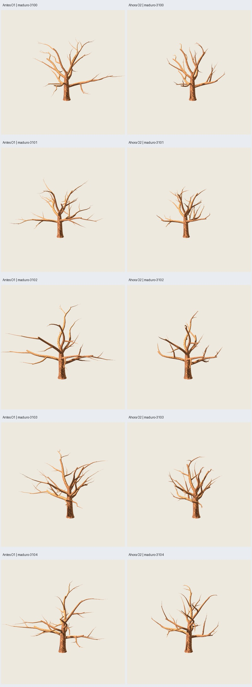
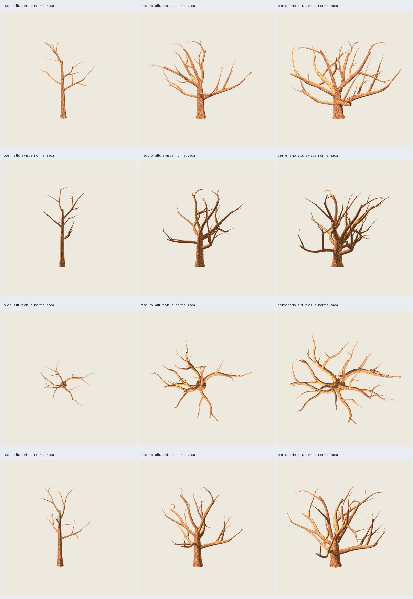

# O2 — brazos contenidos y copa equilibrada

2026-11-03. **Implementado y verificado; comparación artística pendiente del usuario.**
Petición: corregir brazos excesivamente largos y equilibrar la copa conservando
huecos naturales y madurez; repetir sin hojas las semillas3100–3104.

Alternativa explícita **`oak-growth-0.2.0`**, mismo CLI y presets por etapa. O1
0.1.0 y sus presets permanecen reproducibles. No se añadió follaje ni se promovieron
recetas históricas. [Plan](../../../../plans/arquitectura-roble.md),
[uso y nuevos controles](../../../uso-arquitectura-roble.md).

## Qué cambió

O1 favorecía la dirección exterior en cada orden y acumulaba continuaciones por
fracciones de longitud del padre. La penalización radial era débil y no frenaba
el crecimiento. O2 añade:

- Presupuesto suavizado de recorrido por brazo y menor extensión de las nuevas
  órdenes cerca del borde de copa; no un corte posterior de ramas.
- Desaceleración gradual al aproximarse a una envolvente dependiente de altura
  y madurez, con irregularidad regional y ligera anisotropía. No se proyectan
  puntos sobre una esfera ni se fuerzan todos los extremos a una superficie.
- Menor premio a continuar hacia fuera y penalización al proponer bifurcaciones
  que prolongarían un brazo desmesurado. Se conserva competencia por espacio,
  trayectorias curvas, gravedad, vigor y cuatro órdenes.
- Diámetros recalculados por demanda distal y uniones verificadas sobre la malla.

Los presets conservan todos los controles O1 y añaden `crown_balance`: fuerza.85,
radio.70, semialtura.48, recorrido1.0 e irregularidad.10. Los alcances efectivos
varían con madurez. Se conserva el namespace aleatorio0.1.0 para mantener la
variación inicial; algoritmo/preset/resultado se registran0.2.0. Frecuencias,
resoluciones y longitudes nominales por orden no se incrementan para rellenar
vacíos. La disponibilidad local puede cambiar la cantidad efectiva de ramas.

## Misma entrada, cinco semillas

Preset maduro12 m y madurez.65 en ambos. Cámara, luz y escala1 comunes por pareja;
no se cambia el encuadre entre antes/después ni se normaliza su anchura.
Frontal, lateral, superior y perspectiva; también tronco/primarias solos.

| Semilla | Alcance máximo anterior / H | Ahora / H | Reducción | Desplazamiento del centro antes→ahora / H | Tris O2 |
|---|---:|---:|---:|---:|---:|
| 3100 | 1.090 | .688 | 36.90 % | .158→.104 | 3054 |
| 3101 | 1.225 | .650 | 46.93 % | .166→.105 | 3549 |
| 3102 | .968 | .544 | 43.80 % | .031→.029 | 2824 |
| 3103 | 1.109 | .580 | 47.69 % | .126→.070 | 3462 |
| 3104 | 1.028 | .659 | 35.87 % | .073→.042 | 3429 |

Alcance: máxima distancia horizontal de los ejes al origen, dividida entre altura
nominal. Centro: desplazamiento XY de puntos medios ponderados por longitud de
madera, excluyendo el tronco; no es centro de gravedad físico ni área de follaje.
Estas reducciones no significan que cada rama mida ese porcentaje menos.



## Huecos y madurez

Las imágenes muestran menor dominancia de un brazo aislado sobre la silueta y
mayor concentración del crecimiento alrededor de la estructura principal. Las
primarias conservan su carácter; cambia principalmente la extensión acumulada
de las órdenes siguientes. No se rellenaron sectores con ramas nuevas para
lograr un contorno uniforme. Las cinco variantes siguen siendo distintas y
mantienen zonas abiertas.

El coeficiente de variación de alcance en ocho sectores mejora en cuatro casos;
**3100 aumenta de.238 a.401**, por conservar una región más abierta. No se oculta
ese resultado ni se interpreta equilibrio como uniformidad radial. Los mayores
intervalos angulares entre extremos de ejes siguen siendo aproximadamente
45–69° en los cinco nuevos árboles. Es un indicador de aperturas angulares,
no una medición física de huecos ni una garantía desde cualquier cámara.

Joven/centenario3100 se regeneraron antes/después con sus presets. El joven sigue
estrecho y dominante hacia arriba; el centenario conserva mayor extensión
relativa y base robusta, aunque sus prolongaciones desmesuradas se moderan.
La lámina adicional usa igual altura visual y cámaras comunes, con factores
registrados; los GLB mantienen5/12/15 m nominales.



## Comprobaciones y revisión

- **257 pruebas**, ocho nuevas; **78 comprobaciones de cierre**. Catorce árboles
  completos desnudos regenerados: siete O1 y siete O2; un material/corteza compartida.
- **14 GLB O1 idénticos** al cierre previo (dos por cada uno de los siete casos).
  Estructura y ambos GLB O2 de3100 repetidos por CLI: idénticos binariamente.
- Nacimientos auditados sobre la malla; anillos hijos dentro del padre con
  tolerancia1e-5 m y centros conectados. Radios por anillo ≤1.55. Atributos
  float32 de primarias en la ablación son subconjunto exacto del árbol completo.
- Todos los controles O1 iguales entre parejas, salvo versión y bloque nuevo.
  Cuatro órdenes, cinco resultados distintos y un único preset para los cinco
  maduros. Entradas estrictas y trabajo acotado siguen vigentes.
- Maduros O2 **3054/3549/2824/3462/3429 tris**; joven2332, centenario3621.
  Cota analítica5156 de madera +1584 reservados para futura copa =6740, <7000.
  La reserva no valida todavía un árbol con follaje. Sin benchmark/FPS.
- Generación O2 **1.001–1.108 s** en esta ejecución; límite120 s.
- **124 capturas reales Godot4.7.2**, 900×900, MSAA4, Compatibility/OpenGL/RTX5060.
  **108 capturas únicas inspeccionadas en13 láminas**: cinco pares de árbol en
  cuatro vistas, cinco pares de primarias en cuatro vistas, joven/centenario
  completos antes/después y doce imágenes de madurez normalizada. Las16 capturas
  restantes son ablaciones de primarias de los controles de edades.

La inspección confirma brazos más contenidos y menores desequilibrios globales,
sin imponer simetría. Persisten el estilo facetado, algunas regiones bastante
abiertas y uniones por piezas solapadas; no se afirma soldadura universal ni
reconocimiento botánico demostrado por estas métricas. Valoración artística del
usuario pendiente. No hay cambios por semilla ni supresión de resultados incómodos.

## Reproducción

Lote final `artifacts/oak-growth/o2-validacion-01/`; galería `index.html`.
Cada caso contiene `bare/tree.glb`, `scaffold/tree.glb`, `.blend`, estructura,
entradas y auditorías. `before/` contiene las referencias O1 regeneradas.
Pilotos `o2-ensayo-01/-02` conservados. [Auditoría/hashes](verification.json).

```sh
python3 scripts/verify_oak_crown.py --output artifacts/mi-o2
python3 scripts/verify_oak_crown.py --output artifacts/mi-o2 --stage review
python3 scripts/verify_oak_crown.py --output artifacts/mi-o2 --stage ages
PYTHONPATH=src python3 -m unittest discover -s tests
```

Matriz `configs/verification/oak-crown-v2.json`; `--case maduro-3100` selecciona un
caso. Comando de cierre de esta evidencia:

```sh
python3 scripts/close_oak_crown.py --study artifacts/oak-growth/o2-validacion-01 \
  --repeat artifacts/oak-growth/o2-repeat-01 --tests /tmp/oak-o2-tests.log
```

El alcance sigue siendo arquitectura desnuda y siete casos. Sin follaje nuevo,
F6, estaciones, LOD ni certificación de todos los rangos/semillas. Siguiente:
valorar la comparación antes de extender el lote o integrar una copa nueva.
