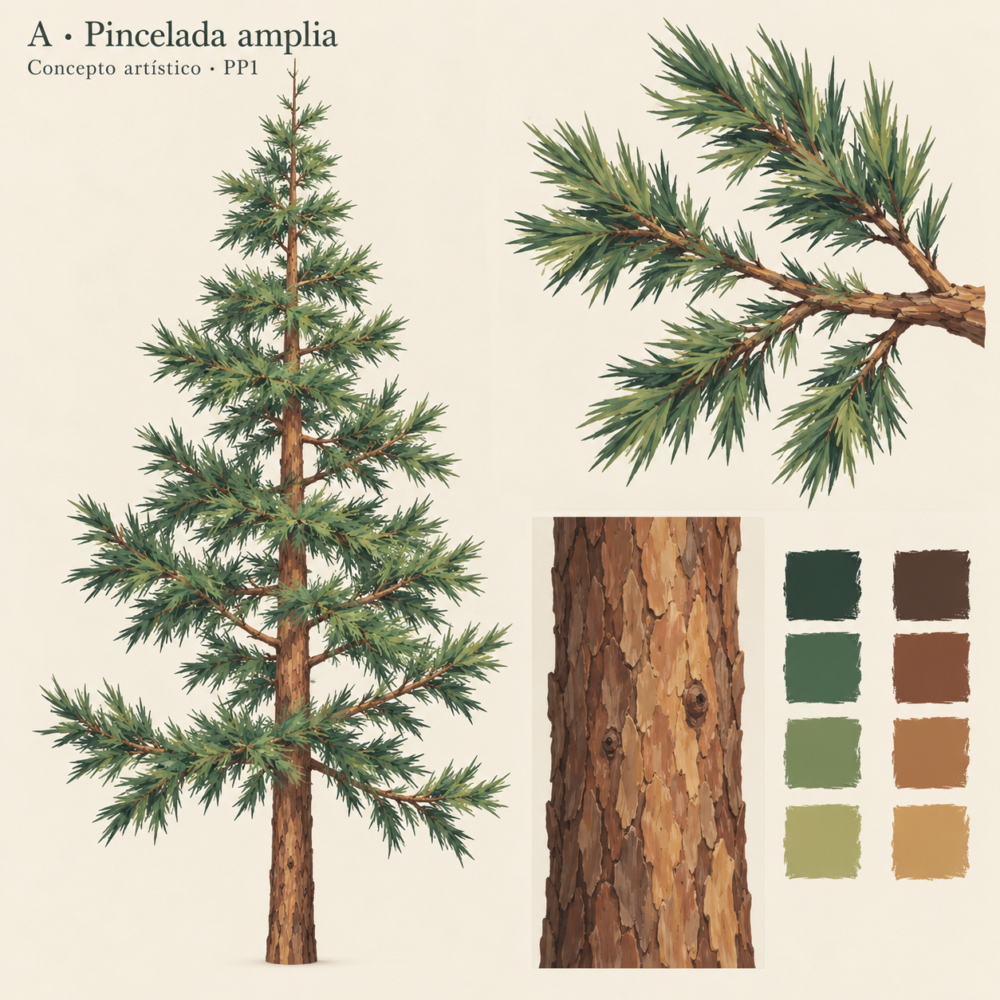
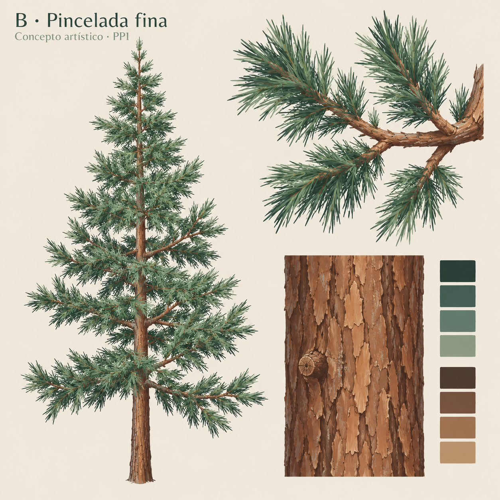

# PP1 — Dirección artística del pino pintado

Fecha: 2026-10-25. [Plan activo](../../../../plans/pino-pintado.md).
Estado: **ficha y dos conceptos realizados; A seleccionada por el agente**.
Aceptación artística del usuario pendiente. PP2–PP4 no iniciadas.

## Resultado y recomendación

Recomiendo **A — Pincelada amplia** para construir la rama de muestra.
Busca materiales mates, corteza cálida con placas irregulares y follaje de
verdes apagados, agrupado en brotes afilados. La pintura aporta variación
visible a la escala del árbol sin depender de dibujar cada acícula en geometría.
La unidad futura de representación es una ramilla con su follaje.

Se conserva la intención estructural del pino 1.1.0: eje central dominante,
ramas desfasadas, inclinaciones variadas y huecos entre grupos. Se permite
cambiar el contorno local de las acículas y su densidad visual. No se busca
una especie botánica exacta ni se añaden piñas, musgo, nieve o elementos nuevos.

Las dos láminas son **conceptos generados por IA** con la captura propia
`docs/evidence/blueprints/pino-revision/pilot.png` como referencia estructural.
No son renders de geometría implementada, ni pruebas de reducción o rendimiento.
La composición es comparable por contenido; las ramas y siluetas no son
geométricamente idénticas. No sirven para medir diferencias de ocupación.

## Comparación visual

| Aspecto | A — Pincelada amplia | B — Pincelada fina |
| --- | --- | --- |
| Color | Verde pino con salvia y oliva cálidos; madera tierra | Verde pino con variación fría azulada; misma familia de madera |
| Follaje | Manchas agrupadas y puntas marcadas; huecos de tamaño medio | Más acículas individuales y huecos pequeños |
| Corteza | Placas alargadas y manchas amplias; nudos escasos | Grietas más finas y numerosas; mayor descripción superficial |
| Lectura buscada | Primero ramilla y copa, después acículas | Primero ramilla, con más detalle individual de cerca |
| Riesgo previsto | Puntas demasiado anchas o aspecto de hojas lanceoladas | Ruido fino y pérdida de detalle al reducir la imagen |
| Elección | Seleccionada por el agente para PP2 | Alternativa documentada |

La preferencia por A es juicio artístico, no una mejora ya demostrada en Godot.
En las láminas revisadas A separa mejor las masas de color; B hace más explícitas
las acículas, pero añade trazo fino. Ambas enriquecen madera y follaje frente
a la referencia de colores uniformes. Ninguna demuestra volumen al girar.

## Referencias y procedencia

Consultadas el 2026-10-25. Se conservan enlaces y atribuciones; ninguna imagen
externa se ha descargado, copiado al atlas ni suministrado al generador.

1. **Vera Ejmander, “Stylized Foliage”, ArtStation**.
   [Proyecto de la autora](https://veraejmander.artstation.com/projects/K3vNJW).
   Referencia de proceso: la autora describe basecolor pintado, atlas y
   control de volumen/color en árboles. Orienta la combinación de pintura y
   representación, sin reproducir su estilo ni trasladar su shader Unreal.
   La página reserva los derechos de sus imágenes.
2. **Valve, “Dota 2 Workshop — Character Art Guide”, Steam Support**.
   [Guía del autor](https://help.steampowered.com/en/faqs/view/0688-7692-4D5A-1935).
   Referencia de diseño: jerarquía de valores, variación de color y zonas de
   descanso. Aplicar esos principios al árbol es una decisión de este proyecto;
   la guía no demuestra un método específico de optimización de vegetación.
3. **Christopher J. Earle, The Gymnosperm Database, “Pinus sylvestris”**.
   [Ficha y fotografías atribuidas](https://www.conifers.org/pi/Pinus_sylvestris.php).
   Referencia natural para placas de corteza, transición de tonos y brotes.
   La página atribuye detalles de follaje/corteza a C. J. Earle (2010-06-16)
   y vistas de ramificación a Jose Angel Campos Sandoval (2008-05).
   Se abstraen rasgos; no se declara fidelidad de especie ni licencia de textura.
4. **Proyecto arboles, pino 1.1.0**, captura propia y
   [revisión estructural](../../blueprints/pino-revision/informe.md).
   Es la referencia de identidad y la única imagen de entrada de los conceptos.

Las propuestas A/B son ilustraciones originales generadas mediante la herramienta
integrada `image_gen.imagegen`; prompts completos en [prompts.json](prompts.json).
Archivos, dimensiones y SHA-256 en [manifest.json](manifest.json). Se conservan
los PNG: repetir un prompt no reproduce exactamente su resultado.

## Paleta y tratamiento seleccionados

Colores sRGB de autoría, previos a iluminación; las muestras generadas son
aproximaciones, no una carta de color calibrada. Esta tabla manda sobre ellas.

| Material | Base profunda | Medio | Variación | Acento escaso |
| --- | --- | --- | --- | --- |
| Follaje A | `#243E35` | `#3F6549` | `#70865A` | `#9DA76D` |
| Madera A y B | `#49352D` | `#78513A` | `#A77950` | `#BC9668` |
| Follaje B | `#243E35` | `#355D54` | `#597C70` | `#8B9C86` |

Para A: predominio del tono medio, parches profundos intercalados y acentos
limitados a algunos brotes. Las diferencias se distribuyen entre ramillas y
dentro de ellas, evitando un lado permanentemente iluminado. No usar blanco,
negro puro ni verde fluorescente como atajos de contraste.

- **Grado de estilización:** intermedio; formas legibles, pincelada perceptible
  de cerca, sin fotografía ni delineado negro. Material mate, sin apariencia
  de plástico. La rugosidad y las normales se resolverán con luz real en PP3.
- **Madera:** placas irregulares en dirección del crecimiento, algunas zonas
  tranquilas y pocos nudos. Variar anchuras y longitudes; evitar franjas que
  parezcan baldosas o una costura vertical repetida. El color distingue madera
  de follaje incluso con exposición neutra.
- **Acículas:** finas y puntiagudas, agrupadas en brotes asimétricos que siguen
  el tallo. El brote debe leerse antes que cada acícula a escala de árbol.
  Evitar estrellas radiales idénticas, hojas anchas y mechones redondos sólidos.
- **Contraste:** concentrarlo en separación de grupos y algunos detalles de
  corteza; evitar llenar toda la textura de trazos de igual intensidad.
- **Densidad:** dejar huecos internos y entre brotes; no rellenar la copa hasta
  convertirla en un cono compacto. No imponer todavía un porcentaje de cobertura
  usando estas ilustraciones, cuyas geometrías difieren.

## Ajustes de la lámina A para PP2

1. Estrechar las puntas que parecen hojas anchas; conservar lectura de acículas
   sin reintroducir el ruido de miles de trazos independientes.
2. Reducir el claro lateral continuo de la corteza ilustrada: la pintura final
   debe funcionar al cambiar la dirección de luz y en todas las caras del tronco.
3. Simplificar el detalle de corteza cuando sea menor que la lectura de las placas.
   Los nudos son variación, no un motivo repetido en cada tramo.
4. Dar profundidad mediante mallas dobladas/cruzadas y orientación de grupos.
   El volumen pintado de esta ilustración no acredita volumen tridimensional.
5. No convertir las láminas de concepto directamente en atlas: contienen fondo,
   encuadres, iluminación ilustrada y formas sin correspondencia UV.

## Criterios observables y evaluación futura

| Criterio | Aceptable en la muestra | Motivo para revisar |
| --- | --- | --- |
| Color | Madera y follaje diferenciados; variación dentro de cada material | Tonos planos únicos o acentos dominantes |
| Corteza | Placas siguen la rama y algunos nudos aportan identidad | Patrón de baldosa, manchas que fingen un sol fijo |
| Agrupación | Tallos y brotes afilados reconocibles, huecos entre grupos | Hoja ancha, estrella repetida o masa compacta |
| Profundidad | Grupo conserva presencia desde perfil, arriba y abajo | Láminas desaparecen, se ven rectángulos o se separan del soporte |
| Escala | En árbol completo se leen copa, grupos y contraste de materiales | Solo funciona al ampliar una captura de detalle |

Se fija [review-config.json](review-config.json) como **especificación pendiente
de ejecución**, no como resultado Godot. Define resolución, ejes, cámaras,
encuadres, distancias e iluminación comunes. Para la rama se congelará la caja
de la rama original seleccionada en PP2 antes de comparar variantes; no se
reencuadrará cada alternativa para ocultar cambios. El árbol conserva las
cámaras históricas y las fracciones de pantalla 50/25/10 % como referencia.

En PP2 se juzgará primero la rama y su unidad material. PP3 comprobará volumen,
recorte, bordes y respuesta a distintas luces en Godot. PP4 comprobará la copa
completa y cuatro semillas. La pintura no debe prometer detalle visible cuando
las acículas ocupen menos de un píxel.

## Cierre de PP1

Ficha, dos propuestas, paleta, recomendación y especificación de evaluación
preparadas; imágenes inspeccionadas visualmente. **A queda seleccionada por el
agente como dirección provisional**, sin aceptación artística del usuario aún.
No hay nuevos GLB, texturas de producción, atlas, cambios del generador,
capturas Godot ni mediciones de ahorro. Siguiente etapa: PP2, cuando se solicite,
aplicando los ajustes anteriores a una rama concreta del piloto.

## Decisión posterior del usuario, 2026-10-25

A elegida, con puntas estrechadas para parecer acículas; PP2 autorizada.
[Registro](../pp2/user-selection.json), [rama de muestra](../pp2/informe.md).
La aceptación de dirección no equivale a aceptación de la muestra resultante.
