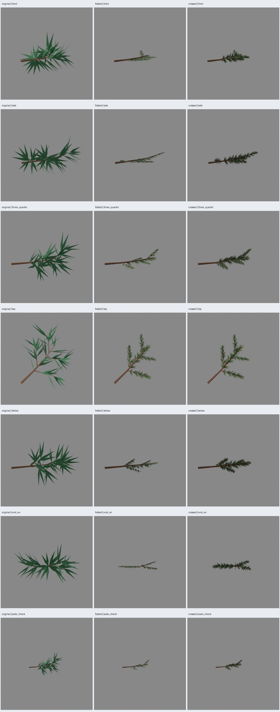

# PP2 — Rama pintada de muestra

Fecha: 2026-10-25. Dirección A elegida por el usuario, con puntas estrechas;
[selección y alcance](user-selection.json). Muestra implementada y revisada en
Blender; aceptación artística de la rama pendiente. PP3/PP4 no iniciadas.

## Entradas y construcción

Receta histórica `pino_conico@1.1.0`, perfil `conico`, semillas base 5100 y
copa 97. Rama **`pine:p:2:0`**, cuatro ramillas hijas y sus 60 acículas originales.
La selección se declara en `src/treegen/pine_painted_sample.py`; se escribe
`reference-lock.json` antes de construir alternativas. Contiene hash de la
geometría original, resolución, semillas, caja, vista de canto y cámaras.

Se conservan las coordenadas originales y la madera de la rama principal.
En las alternativas se sustituyen las cuatro ramillas completas y las acículas
primarias por cinco grupos de láminas; el quinto ocupa el tramo distal de la
rama principal. No quedan acículas geométricas residuales ni follaje duplicado.
Cada grupo se ancla al recorrido original; los secundarios arrancan exactamente
en la raíz de su ramilla. La lámina incluye el pequeño tallo pintado del atlas.
Se conserva un tallo básico al inicio y la punta llega hasta 1.06 veces la
longitud del recorrido sustituido. Las láminas no siguen la cámara.

- **Dobladas (`folded`)**: tres tramos longitudinales y pliegue central; doce
  triángulos por grupo. El relieve eleva los bordes respecto del eje.
- **Cruzadas (`crossed`)**: dos superficies perpendiculares, tres tramos cada
  una; doce triángulos por grupo. Comparten posiciones, variantes de atlas y
  pintura con las dobladas.

El contorno geométrico estrecha la base y el extremo; se evita usar rectángulos
completos, aunque queda transparencia interna entre agujas y brotes. No se ha
medido overdraw. Se usan las tres variantes del atlas, asignadas por hash del
identificador con semilla independiente **2718**, sin cambiar recorridos.

Recursos de autoría en [`assets/pino-pintado/v0.1.0/`](../../../../assets/pino-pintado/v0.1.0/README.md):
PNG fuente y final, manifiesto, prompts completos y procedencia. Generación con
la herramienta integrada `image_gen.imagegen`, únicamente referencia propia A
para follaje. No se han copiado imágenes externas. No existen capas de pintura
previas al PNG; los `.blend` guardan UV/nodos editables y texturas empaquetadas.

## Conteos y exportación

| Muestra | Madera | Follaje | Total triángulos | Materiales | GLB bytes |
| --- | ---: | ---: | ---: | ---: | ---: |
| Original | 124 | 120 | 244 | 2 | 22720 |
| Dobladas | 44 | 60 | 104 | 2 | 4217328 |
| Cruzadas | 44 | 60 | 104 | 2 | 4217264 |

Reducción local: **140 triángulos, 57.38 %**, con cambio deliberado de apariencia.
El tamaño del GLB aumenta por las texturas embebidas; esto no demuestra mejora
de rendimiento ni predice el conteo de un árbol completo. Atlas compartido:
1254×1254 RGBA, 2071699 bytes; corteza: 1254×1254 RGB, 2135876 bytes. Sin mapas
adicionales. Dos materiales mates, rugosidad .95, doble cara; follaje exportado
con `alphaMode=MASK`, umbral .5. Cierre de UV de corteza corregido por cara para
no interpolar desde el último sector del tubo hasta el inicio del atlas.

## Verificación y revisión visual

- 99 pruebas pasan, incluidas dos nuevas sobre selección, semillas, repetición,
  conteos acotados, entradas inválidas, UV y triángulos no degenerados.
- Tres GLB reimportados en Blender: conteos y canal UV conservados.
- Auditoría directa de GLB: UV finitas, follaje dentro del atlas, dos imágenes
  PNG embebidas, dimensiones acotadas, alfa real, doble cara y recorte MASK.
- Repetición sin render: tres GLB idénticos byte por byte con los mismos PNG.
- 21 renders reales Cycles, siete cámaras por muestra, caja de referencia común,
  sin reencuadrar alternativas. Configuración de PP1: frente, perfil, tres cuartos,
  arriba, abajo, canto y comprobación a mitad de tamaño en pantalla. Semillas de
  render predeterminadas de Cycles; estos renders no son el contrato de igualdad
  byte por byte de los GLB. Luz común registrada en el manifiesto.



Revisión del agente: las acículas pintadas son más estrechas y numerosas que
las geométricas originales. La lectura por brotes sigue la rama. La variante
cruzada conserva más presencia en perfil y canto; la doblada se aplana bastante
en esas vistas. **Preferencia provisional: cruzadas** para la siguiente revisión.
Ambas producen una rama más fina y menos voluminosa que la referencia: no se
presenta como conservación de silueta. La corteza se distingue y acompaña el eje.
No se aprecian desconexiones grandes en los encuadres revisados, pero la revisión
fina de uniones y del tallo repetido continúa en PP3 con luz y motor de destino.

Pendientes: volumen durante giro continuo, variación de iluminación, costuras y
repetición de corteza, mipmaps, halos/parpadeo y lectura a escala del árbol.
Las agujas pequeñas pueden perderse con recorte alfa a distancia. El atlas tiene
manchas oscuras de separación pintadas; todavía debe comprobarse que no impongan
una iluminación fija evidente. PP2 entrega ambas construcciones; no elige un
material definitivo para Godot ni integra un pino completo.

## Reproducción y resultados

Desde la raíz, con las dependencias habituales del proyecto y Blender 5.2.1:

```sh
PYTHONPATH=src python3 -m unittest discover -s tests -v
python3 scripts/pine_painted_sample.py --output artifacts/pino-pintado/pp2-sample-02
python3 scripts/pine_painted_sample.py --output artifacts/pino-pintado/pp2-repeat-02 --no-render
python3 scripts/verify_pine_painted_sample.py artifacts/pino-pintado/pp2-sample-02 --repeat artifacts/pino-pintado/pp2-repeat-02
```

Los directorios deben ser nuevos. Límite 180 s por proceso Blender, terminable;
no reintentos ilimitados. Resultados regenerables: `artifacts/pino-pintado/pp2-sample-02/`.
Subdirectorios `original/`, `folded/`, `crossed/`: `branch.glb`, `branch.blend` y
siete imágenes cada uno. `manifest.json` y `reference-lock.json` fijan recursos,
fuentes, cámaras, entradas y versiones. Evidencia durable seleccionada junto a
este informe: manifiesto, verificación de exportación, contrato y comparación.

El primer intento en sandbox produjo renders/exportaciones, pero falló al
escribir miniaturas en caché y quedó atascado al cerrar audio; alcanzó el límite
de ejecución. Se repitió fuera del sandbox con la corrección UV. La prueba de
socket de API también requirió ejecución fuera del sandbox; no se atribuye ese
fallo de permisos al generador. Las recetas, generadores históricos y sus
verificadores permanecen intactos.

## Decisión posterior y revisión Godot

El usuario elige cruzadas y autoriza PP3 el 2026-10-25:
[selección](../pp3/user-selection.json), [resultado PP3](../pp3/informe.md).
La selección sustituye la condición provisional de la construcción de PP2;
la apariencia resultante en el motor se documenta por separado.
