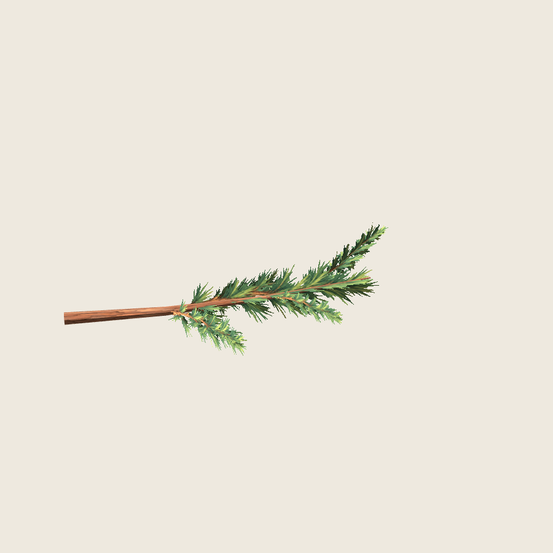
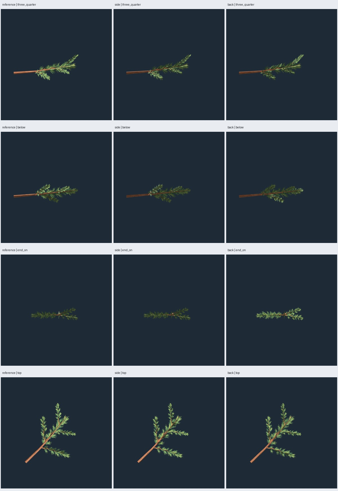
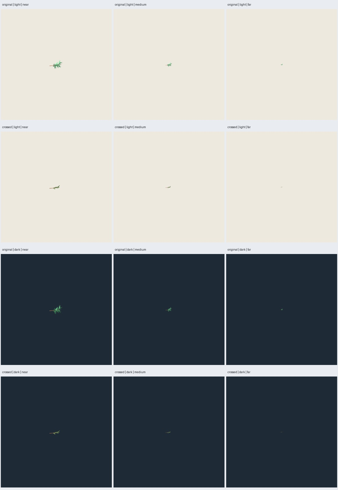

# PP3 — Rama cruzada en Godot

Fecha: 2026-10-25. **Revisión PP3 realizada**, con limitaciones de muestreo
registradas abajo. Cruzadas elegidas por el usuario; [selección](user-selection.json).
La rama está lista para revisión artística en el motor. No hay integración de
un pino completo; PP4 permanece sin iniciar.

## Resultado y decisión

Se conserva la construcción **cruzada de PP2**, sus PNG 0.1.0 y sus 104
triángulos. La comparación usa la rama original de 244 triángulos y las dobladas
de 104 como controles. No se modificaron geometría, UV, PNG ni GLB de PP2.

Material propuesto: **Alpha Scissor a .5**, reversos visibles, rugosidad .95,
normales de malla conservadas, filtrado lineal con mipmaps y anisotropía.
Sombras de ambas caras, MSAA 4× en el visor. Sin mapas normales, billboard,
translucencia ni luz fija adicional. La madera continúa opaca. Configuración
legible para la futura integración:
[`configs/inspection/pine-painted-pp3-v1.json`](../../../../configs/inspection/pine-painted-pp3-v1.json).
Ese archivo registra una decisión; no cambia automáticamente recetas históricas.



Juicio del agente: la rama cruzada mantiene presencia en perfil, canto y
reverso. En el giro de 360° revisado no desaparecen grupos completos ni aparecen
rectángulos opacos. Su volumen es menor que el original de acículas grandes,
como ya se observó en PP2. La variante doblada se aplana de perfil y de canto;
se conserva como control, no como alternativa seleccionada.

## Entorno y protocolo ejecutado

Godot **4.7.2-stable official**, hash `ed1daf0bf001b61586d9930840f2f1394092c079`.
Renderizador `gl_compatibility`, OpenGL 3.3 NVIDIA 595.99.02, RTX 5060.
Capturas **con ventana real**, 900×900, dos dibujos completados después de cada
cambio. No se atribuye revisión visual a la importación headless.

- Misma rama `pine:p:2:0`, piloto 5100/97, atlas 2718. Hashes congelados en
  `source-lock.json`; recursos y fuentes verificados al cerrar.
- Cámaras de PP2 sin reencuadre individual: frente, perfil, tres cuartos, arriba,
  abajo, canto y mitad de tamaño. Se conserva su caja original, más ancha que
  las alternativas. Detalles adicionales se identifican expresamente y recortan
  la rama por su finalidad; no se usan para comparar siluetas.
- Luz de referencia (-35,-25,0), lateral (-35,-90,0) y contraluz (-35,155,0),
  grados Godot, energía 1.2; ambiente blanco .5; exposición 1, tonemapper lineal.
- Fondos `#EEE9DF` y `#1E2A35`. No se cambian exposición o color entre muestras.
- Cerca/media/lejos de árbol completo: escala ortográfica 24/48/120 m,
  equivalente a un árbol de 12 m al 50/25/10 % de altura de pantalla. **Se captura
  solo la rama en esos encuadres**, no un árbol completo todavía inexistente.
- Giro: 72 posiciones, cada 5°, elevación atan(.25) ≈14°, iluminación fija.
  Se revisaron las 72 posiciones en láminas; la secuencia se entrega como GIF.
  No es una prueba de viento ni una medida de velocidad de renderizado.
- Sombras con receptor plano separado: solo recibe sombras, no las proyecta;
  bias .1, normal bias 2, alcance direccional 60 m, mismos valores por muestra.
- Ocho vistas próximas alrededor de la corteza y cuatro acercamientos a las
  inserciones secundarias, escala .7 m. Sin reconstruir ni retocar los PNG.

**282 capturas reales finales**: 21 base + 213 matriz de luces, fondos,
distancias, sombras, giro y movimiento + 36 de suavizado alfa + 12 detalles.
282 es el total de esta revisión; no incluye las capturas del intento previo.

## Comprobaciones técnicas

101 pruebas pasan, incluidas dos del protocolo PP3: bases ortonormales/cámaras
orientadas al objetivo y cobertura de matriz sin modificar encuadres de entrada.
El verificador Godot específico comprueba conteos por material, ejes, escala,
UV presentes/finitas, normales unitarias, dos materiales, texturas importadas de
1254² con diez niveles de mipmaps, madera opaca, follaje Alpha Scissor, umbral,
rugosidad y reversos. Los verificadores históricos siguen intactos.

La auditoría de evidencia verifica los 270 archivos principales y 12 detalles,
cobertura y resolución, ajustes efectivos de material por toma, GLB fuente e
importado idénticos y hashes de fuentes/contratos PP2 conservados. El campo
`passed` de los informes acredita estas comprobaciones, **no una aprobación
artística automática ni ausencia absoluta de defectos visuales**.

## Lectura visual, alfa y distancia

| Aspecto | Resultado revisado | Límite |
| --- | --- | --- |
| Volumen y reversos | Grupos cruzados presentes en las vistas y 72 posiciones | Las superficies siguen siendo láminas; cambian de espesor aparente al girar |
| Uniones | Tallos pintados llegan a la madera; sin desconexiones grandes visibles | En acercamiento extremo hay pequeños fragmentos aislados del recorte y encuentros angulosos |
| Corteza | Placas siguen el eje; sin franja de cierre UV dominante en ocho vistas | La rama es estrecha; no prueba la repetición del atlas sobre un tronco completo |
| Iluminación | Responde a las tres luces y a los reversos, sin halo de fondo dominante | El color pintado conserva claros/oscuros propios; no se ha probado toda iluminación posible |
| Sombras | Siluetas de follaje recortadas, sin sombra rectangular | Las agujas más finas se simplifican en el mapa de sombras |
| Acículas de cerca | Más estrechas y agrupadas que la geometría original | Dentado fino residual; a distancia no se distinguen individualmente |
| Escala de árbol | Permanece una pequeña masa de ramilla | En media/lejana se pierden agujas y huecos; la copa completa debe juzgarse en PP4 |



Tras observar bordes dentados en la base, se compararon los modos de cobertura
alfa 1 y 2 con modo 0, con MSAA 4× y borde .3: seis encuadres por dos fondos,
**36 capturas**. Los ajustes efectivos quedan registrados por toma. Los píxeles
son idénticos entre modos en los doce pares de condiciones de esta configuración;
**no se declara que suavicen los bordes ni se concluye que no funcionen en todos
los renderizadores**. Se mantiene modo 0, sin introducir otra dependencia.
[Propiedades alfa de BaseMaterial3D, documentación oficial](https://docs.godotengine.org/en/stable/classes/class_basematerial3d.html#class-basematerial3d-property-alpha-antialiasing-mode).

Movimiento subpíxel a escala 24 m: doce posiciones, paso de .25 píxeles,
misma cámara y luz, con y sin mipmaps. Máscara de primer plano por diferencia
RGB máxima >5/255 respecto del fondo. Promedio de píxeles que cambian entre
posiciones: **38.36 con mipmaps, 142 sin mipmaps**. No se compensa la traslación;
este indicador incluye desplazamiento normal y no mide solo parpadeo. Bajo las
mismas condiciones, respalda conservar mipmaps y no demuestra rendimiento.
Queda variación de cobertura subpíxel: no se declara eliminado el parpadeo.



## Reproducción, entregables y cierre

Desde la raíz, con `requirements.txt`, Godot y los GLB de PP2 disponibles:

```sh
PYTHONPATH=src python3 -m unittest discover -s tests -v
python3 scripts/review_pine_painted.py --output artifacts/pino-pintado/pp3-review-02 --stage baseline
python3 scripts/review_pine_painted.py --output artifacts/pino-pintado/pp3-review-02 --stage full
python3 scripts/review_pine_painted.py --output artifacts/pino-pintado/pp3-review-02 --stage aa
python3 scripts/pine_painted_review_details.py artifacts/pino-pintado/pp3-review-02
python3 scripts/pine_painted_review_evidence.py artifacts/pino-pintado/pp3-review-02 --evidence docs/evidence/pino-pintado/pp3
```

La primera etapa exige salida nueva; las posteriores verifican los hashes de
fuentes y recursos. Godot admite `GODOT_BIN`; por defecto usa la instalación del
proyecto. Cada subproceso tiene límite 180 s y terminación del grupo al vencer.
Las capturas necesitan acceso al escritorio. `--headless` solo sirve para
inspección técnica y no satisface la auditoría de evidencia visual.

Resultados: `artifacts/pino-pintado/pp3-review-02/index.html`, proyecto Godot con
los tres GLB autocontenidos, protocolos, informes por lote, PNG completos,
`orbit.gif`, `motion-mips.gif` y `motion-nomips.gif`. Aquí se conserva evidencia
seleccionada: comparaciones, luces, sombras, giro, distancias, detalles, alfa,
informes, hashes y decisión. La generación del atlas no se repite para revisar.

En el primer intento el receptor auxiliar proyectaba su propia sombra y mostró
rayado. Se desactivó su proyección y se restablecieron bias explícitos .1/2;
la matriz final se repitió y el rayado desapareció. Ese defecto no se atribuye
al GLB de la rama. La inspección inicial aislada requirió acceso de escritura a
logs fuera del sandbox; las revisiones finales usan XDG dentro de sus resultados.

**PP3 entrega rama revisada y material propuesto, con dentado y pérdida de
agujas a distancia explícitos.** El usuario ya seleccionó las cruzadas de PP2;
la apariencia resultante en Godot queda disponible para su revisión. Siguiente
etapa prevista, cuando se solicite: PP4; no se ha iniciado por cerrar este informe.
