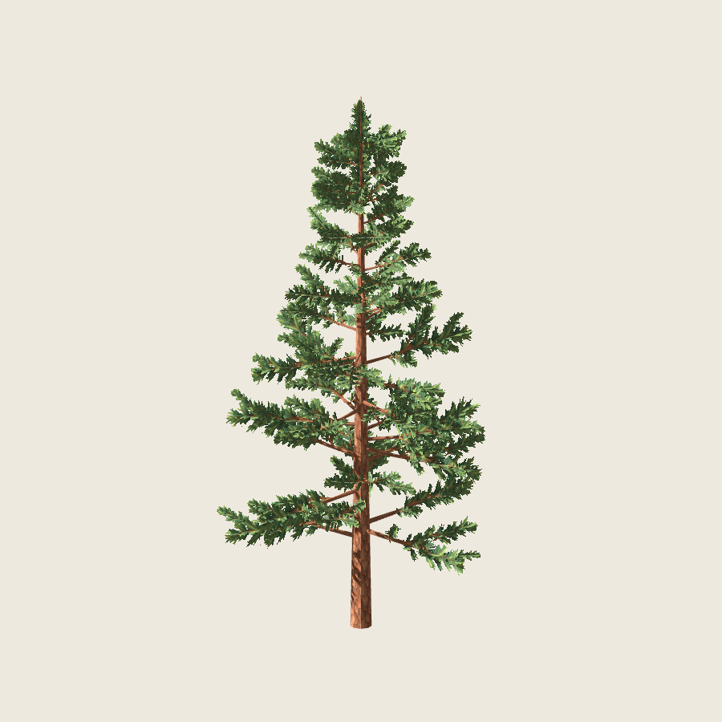
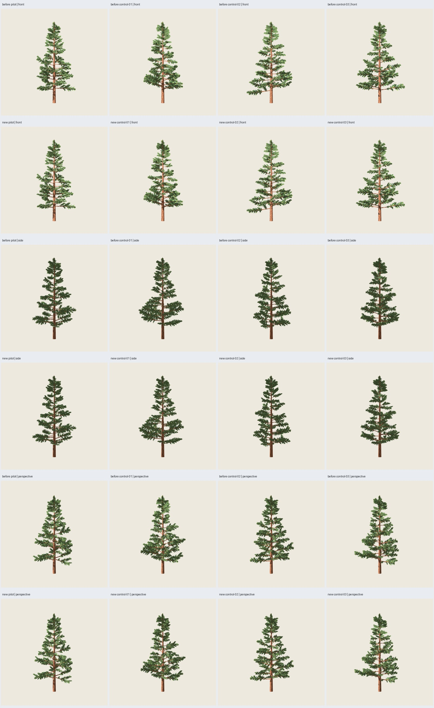
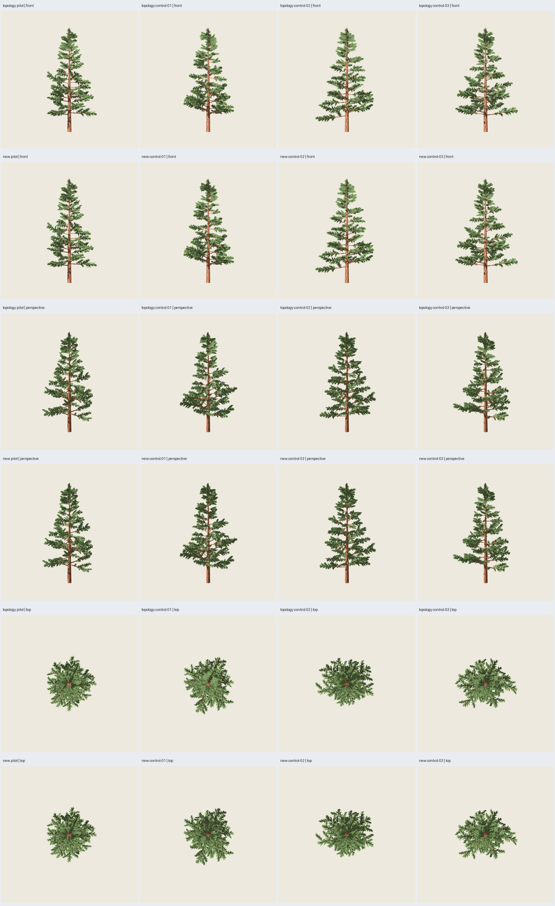

# Pino 2.3.0 — Cruzadas optimizadas y copa algo más ligera

Fecha: 2026-10-25. Implementado en piloto y tres controles, sin ajustes por caso.
El usuario solicita primero reducir tris conservando forma/volumen y después
permite adelgazar la copa aproximadamente un 10 %. Son operaciones distintas.
**Resultado aprobado por el usuario el 2026-10-25**;
[aceptación y hashes](user-acceptance.json). 2.2.0 se conserva ejecutable.



## Cambios

Receta `pino_conico@2.3.0`, representación `pine-painted-crossed@0.4.0`;
distribución 0.2.0, estructura, semillas y recursos congelados. Algoritmo puro:
`src/treegen/pine_painted_cards.py`. Se conservan las 435 cruzadas, sus IDs,
anclajes, planos, orientación, variantes del atlas y transformación UV afín.
La madera es exactamente la de 2.2.0, incluidos sus UV y optimización a 5 mm.

Cada lámina de ocho vértices/seis tris pasa a un soporte pentagonal de cinco
vértices/tres tris: **12 → 6 tris por cruzada**. El pentágono envuelve el recorte
original y conserva el borde superior distal. Las extensiones basal/inferior
caen sobre transparencia del atlas congelado: todos los centros de texel añadidos
están por debajo del umbral alfa .5 en sus tres variantes. No se eliminan zonas
pintadas para alcanzar el ahorro. No se modifica ni remuestrea ningún PNG.

Este soporte tiene más superficie transparente; reducir triángulos no demuestra
una mejora de GPU y puede intercambiar coste geométrico por fragmentos descartados.
No se ha realizado benchmark. El corte superior se conserva porque ampliar
indiscriminadamente a rectángulos añadiría un texel sobre el umbral en el atlas.

Después se aplica el ajuste autorizado de copa: longitud fija y anchura
**sqrt(.9) = .948683298** en ambos planos, desde cada anclaje. Equivale a
**−10 % del volumen envolvente del grupo pintado**, aproximadamente −5,13 % de
anchura. Las láminas son superficies sin volumen físico; no se afirma que la
unión de toda la copa, sus solapamientos o su cobertura proyectada bajen un 10 %.
No se quitan grupos, no se acortan ramas y no se desplazan anclajes.

## Resultados

| Caso | Antes total | Madera idéntica | Follaje nuevo | Total nuevo |
| --- | ---: | ---: | ---: | ---: |
| Piloto 5100/97 | 7164 | 1944 | 2610 | **4554** |
| Control 5101/98 | 7140 | 1920 | 2610 | **4530** |
| Control 5102/99 | 7128 | 1908 | 2610 | **4518** |
| Control 5103/100 | 7152 | 1932 | 2610 | **4542** |

**−50 % de tris de follaje; −36,43 % a −36,62 % de tris totales** frente a 2.2.0.
Altura 12 m, dos materiales y PNG embebidos de 1254²; pintura 2718 y cuatro
semillas base 5100–5103. Cota previa 4910 tris; coste real menor por madera
adaptativa. Semillas canopy 97–100 se conservan como identificación histórica.

119 pruebas pasan (116 en la matriz inicial y tres pruebas nuevas de láminas;
suite completa posterior: 119/119). 51 comprobaciones de matriz y auditoría:
cuatro referencias 2.2.0 idénticas byte por byte; roble B0/columnar B4 idénticos;
piloto repetido y con renders produce idéntico GLB; cambiar semilla de pintura
conserva geometría. Doce GLB reimportados, geometría/UV exportadas comprobadas,
texturas y anclajes válidos. Se rechazan seis defectos inyectados y la ruta
histórica opaca sigue rechazando texturas. El primer intento de pruebas dentro
del sandbox falló por sockets API; fuera del sandbox pasa la suite completa.

## Revisión visual

144 capturas reales Godot 4.7.2 Compatibility/RTX 5060: 108 de comparación
2.2.0/nueva/madera y 36 de referencia de topología. Nueve cámaras comunes por
asset: seis orientaciones y tres distancias; 900²/MSAA 4×, mismos ajustes PP3.
Luz, exposición, fondo, anisotropía, mipmaps, doble cara y recorte .5 conservados.
El agente inspecciona láminas de controles, comparación, distancias y un par
individual de la referencia aislada. Copa algo más fina, con los mismos pisos,
huecos e inclinaciones; sin desaparición dominante ni pérdida visible de masa
atribuible a la simplificación. Persiste dentado y pérdida de detalle lejano.



La referencia aislada conserva los 12 tris y recibe exactamente el mismo ajuste
de anchura: así no se confunde adelgazar la copa con optimizar sus soportes.
36 pares: diferencia simétrica de máscara RGB >20 del fondo de **1–51 píxeles**,
máximo **0,151 %** del área proyectada de referencia. Las diferencias RGB incluyen
sombreado y rasterización; **no hay identidad exacta de píxeles**, ni garantía
para cualquier cámara, distancia o motor. Estas mediciones y la revisión visual
respaldan conservación perceptual de silueta/volumen por la operación de topología
en las condiciones ensayadas. No certifican volumen físico ni aceptación artística.



## Reproducción

```sh
python3 scripts/verify_painted_pine.py --matrix configs/verification/pine-painted-cards-v1.json --output artifacts/pino-pintado/otras-laminas --visual
python3 scripts/verify_pine_cards_topology.py --study artifacts/pino-pintado/otras-laminas
python3 scripts/painted_pine_evidence.py --study artifacts/pino-pintado/otras-laminas --evidence artifacts/pino-pintado/evidencia-laminas
PYTHONPATH=src python3 -m treegen generate-blueprint blueprints/pino_conico/2.3.0.json --instance presets/blueprints/pino-pintado-laminas/pilot.json --output artifacts/pino-pintado/mi-pino --no-render
```

Galería: `artifacts/pino-pintado/pp4-cards-02/index.html`. `before-` = 2.2.0,
`new-` = 2.3.0, `wood-` = madera idéntica, `topology-` = 12 tris con anchura nueva.
Cuatro `tree.glb` autocontenidos, `.blend` editables, escenas Godot, placements,
manifiestos y hashes; `topology-comparison.json` conserva los 36 pares y fuentes.
Máximos de 120 s por generación y 180 s por subproceso. Sin LOD, nuevas edades,
bosque ni otros cambios de alcance.
