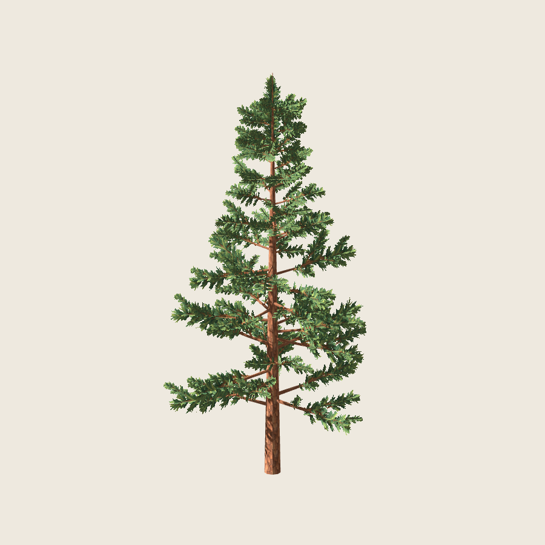
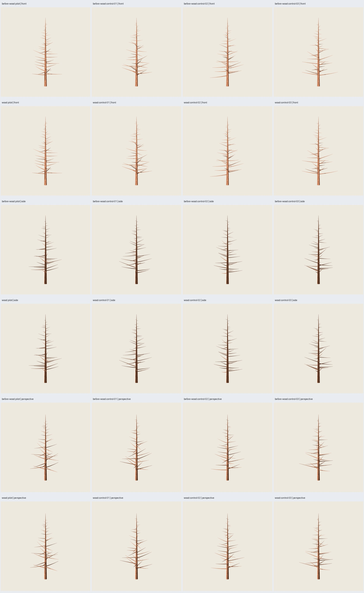
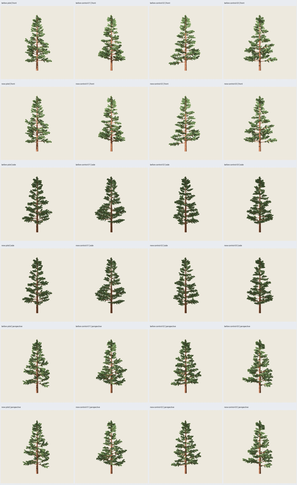

# Pino 2.2.0 — Madera optimizada y copa ligeramente más ligera

Fecha: 2026-10-25. El usuario autoriza optimizar tronco/primarias sin alterar el
follaje durante esa operación, y reducir después un poco la plenitud de la copa,
con la misma regla en piloto y tres controles. **Implementado y verificado;
aprobación artística pendiente.** La ampliación a madera se registra en el
[plan](../../../../plans/pino-pintado.md); no inicia LOD ni benchmark.



## Operaciones separadas

Receta `pino_conico` **2.2.0**, contrato 1.2; guías `pine-whorls@0.2.0`,
distribución `pine-path-groups@0.2.0` y representación
`pine-painted-crossed@0.3.0`. Implementación pura en
`src/treegen/pine_painted_wood.py`, con optimizador `pine-wood-rings-0.1.0`.
La malla de madera queda separada de los recorridos originales; sus simplificaciones
no se utilizan para recalcular ramas, posiciones del follaje o anclajes.
2.1.0 y las recetas anteriores siguen ejecutables.

**Madera:** conservar las ocho caras radiales del tronco y seis de las primarias,
las secciones retenidas y los extremos. Retirar anillos intermedios solo si la
interpolación de todos los vértices radiales omitidos se mantiene dentro de
**5 mm** respecto de los originales. Cada eliminación evalúa el tramo completo,
no solo el último anillo eliminado, para evitar acumular errores sin cota.
Tronco: doce anillos → cuatro, 188 → 60 triángulos. Primarias: simplificación
longitudinal adaptativa donde la curvatura lo admite y retirada de sus tapas
basales únicamente tras comprobar que quedan dentro del tronco con margen.
Las tapas del tronco y de los extremos exteriores se mantienen.

Las UV conservan U por perímetro y V por longitud original, seleccionadas en
los anillos retenidos. Se conservan PNG, rugosidad y demás materiales. Las
normales planas se recalculan sobre la malla reducida; no se declara identidad
exacta de superficie, silueta o normales de madera. La tolerancia es conservadora
respecto de un árbol de 12 m. El ahorro varía por la geometría de cada semilla,
con el mismo algoritmo y tolerancia, sin retoques individuales.

**Copa:** los 435 grupos cruzados originales se conservan, incluidos sus IDs,
recorridos, anclajes, UV y variantes del atlas. Después de la operación de madera,
se aplica a cada grupo desde su anclaje **longitud ×.98 y anchura ×.94**, con
base local del soporte original. No se eliminan grupos ni se cambia su orientación.
Cada placement registra el hash íntegro del grupo 2.1.0 antes del ajuste y los
dos factores; se comprueba la coincidencia de los 435 hashes en cada caso.
Así se distingue el ajuste leve solicitado de cualquier cambio accidental por
simplificar madera. La fórmula es común a los cuatro árboles, también en el ápice.

## Resultado

| Caso | Madera anterior | Madera nueva | Follaje | Total nuevo |
| --- | ---: | ---: | ---: | ---: |
| Piloto 5100/97 | 2300 | 1944 | 5220 | **7164** |
| Control 5101/98 | 2300 | 1920 | 5220 | **7140** |
| Control 5102/99 | 2300 | 1908 | 5220 | **7128** |
| Control 5103/100 | 2300 | 1932 | 5220 | **7152** |

Madera **−15,48 % a −17,04 %**; total **−4,73 % a −5,21 %** frente a 7520.
La reducción de tamaño del follaje no reduce sus triángulos. Dos materiales,
12 m, PNG embebidos de 1254² y semilla de pintura 2718 conservados. El presupuesto
previo es una cota de 7520; el coste de madera exacto se conoce tras simplificar.
No se interpreta este ahorro como mejora de FPS ni se reduce resolución radial
para forzar una cifra mayor.



**116 pruebas, 51 comprobaciones y auditoría pasan.** Se verifica:

- Recorridos originales iguales; grupos antes del ajuste iguales a 2.1.0;
  todos los anclajes y UV conservados, regla de copa común y repetición exacta.
- Cota por correspondencia de anillos ≤5 mm; muestreo bidireccional de caras
  laterales (vértices, centros y puntos medios de aristas) sobre las mallas:
  máximos por caso **4,456 / 3,831 / 4,903 / 4,646 mm**. Este muestreo no es una
  certificación exhaustiva de distancia Hausdorff. Las tapas interiores retiradas
  se comprueban por contención, no se incluyen como superficie exterior a conservar.
- 16 GLB reimportados en Blender: cuatro árboles anteriores, cuatro nuevos,
  cuatro maderas anteriores y cuatro nuevas. Conteos, UV y texturas correctos.
- GLB autocontenidos, finitud, no degeneración, normales unitarias/coherentes,
  recursos iguales a receta y geometría exportada exactamente igual al resultado
  resuelto. Seis fallos inyectados se rechazan; ruta histórica opaca conservada.
- Los cuatro árboles 2.1.0 se regeneran idénticos byte por byte; roble B0 y
  columnar B4 también. El piloto con renders y la repetición sin renders producen
  idéntico GLB. Generación sin renders 1.334–1.901 s; nueve renders 5.493 s.

## Revisión visual y límites

**144 capturas reales Godot 4.7.2 Compatibility**, 900², RTX 5060, MSAA 4×.
Cuatro casos × árbol anterior/nuevo y madera anterior/nueva × nueve cámaras.
Mismo protocolo de 2.1.0: seis orientaciones de forma y escalas 24/48/120 m;
centro común (0,0,6), escala de forma 15.6 m, luz (-35,-25,0), energía 1.2,
ambiente .5, exposición 1 y fondo `#EEE9DF`. Dos dibujos completados por toma.
Filtrado anisotrópico, sombras dobles y recorte alfa .5 conservados.



Revisión del agente de las láminas de los cuatro árboles, madera y distancias:
la silueta general, las inclinaciones y los huecos grandes permanecen; la copa
se aligera de forma leve y conserva el refuerzo superior. La comparación de
madera no muestra una pérdida dominante del contorno en estas cámaras. No se
presenta esta observación como identidad visual absoluta: pueden cambiar pequeños
faceteados y el sombreado de las superficies simplificadas en acercamiento.

Control reproducible de plenitud: cobertura proyectada, diferencia RGB máxima
>20 respecto del fondo, en frente/perfil/perspectiva con cámaras comunes:
**95,32–95,92 %** de la cobertura anterior, aproximadamente **4,1–4,7 % menos**.
Incluye madera y follaje; no mide volumen físico ni equivale a quitar el 4 % de
los grupos. Valores por caso en `optimization.json`.
Persisten hojas angulares, lectura por pisos, pequeños solapamientos y pérdida
de detalle lejano. La aceptación artística corresponde al usuario.

## Reproducción y entregables

```sh
python3 scripts/verify_painted_pine.py --matrix configs/verification/pine-painted-wood-v1.json --output artifacts/pino-pintado/otra-madera --visual
python3 scripts/pine_wood_evidence.py --study artifacts/pino-pintado/otra-madera --evidence artifacts/pino-pintado/otra-evidencia-madera
PYTHONPATH=src python3 -m treegen generate-blueprint blueprints/pino_conico/2.2.0.json --instance presets/blueprints/pino-pintado-madera/pilot.json --output artifacts/pino-pintado/mi-madera --no-render
```

Salida seleccionada: `artifacts/pino-pintado/pp4-wood-01/index.html`.
`before-` = 2.1.0; `new-` = 2.2.0; `wood-` = madera nueva;
`before-wood-` = madera anterior. Galería, cuatro GLB y `.blend` con PNG
empaquetados, maderas, escenas Godot reutilizables, manifiestos/placements,
protocolos y hashes. Evidencia seleccionada en esta carpeta, incluida la
comparación de madera. Semillas, recursos y fuentes congelados; sin regenerar
pintura. Límite 120 s por generación y 180 s por comprobación/captura; modo
sin `--visual` solo valida importación técnica. No requiere `artifacts/` previos.
