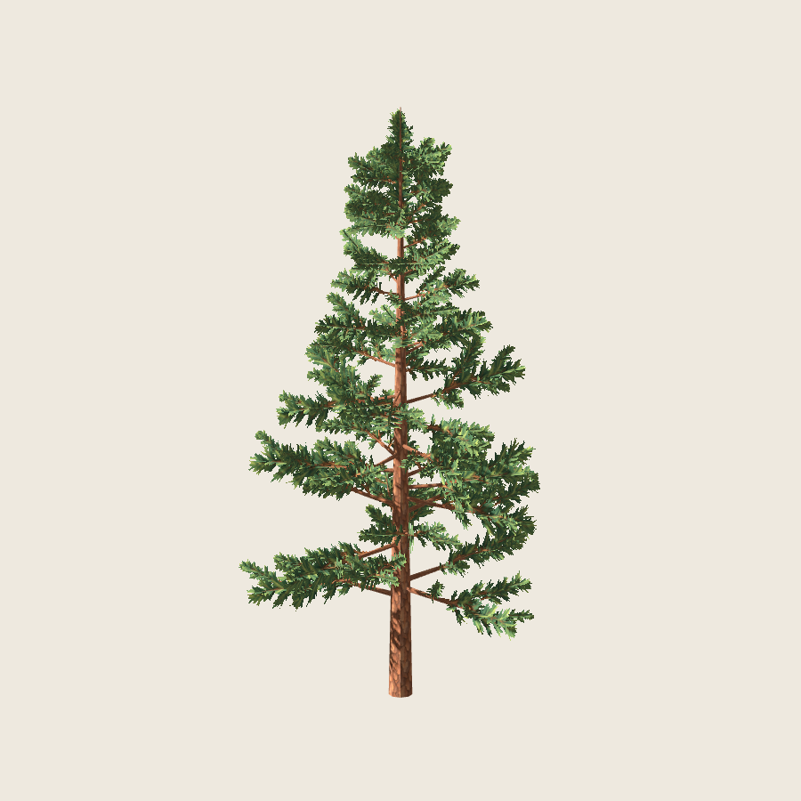
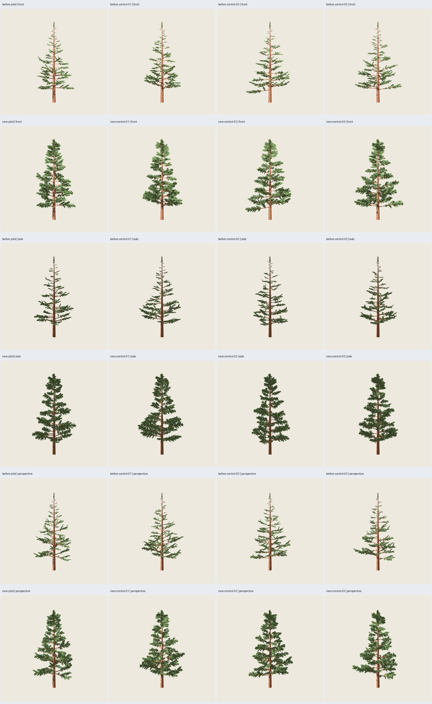
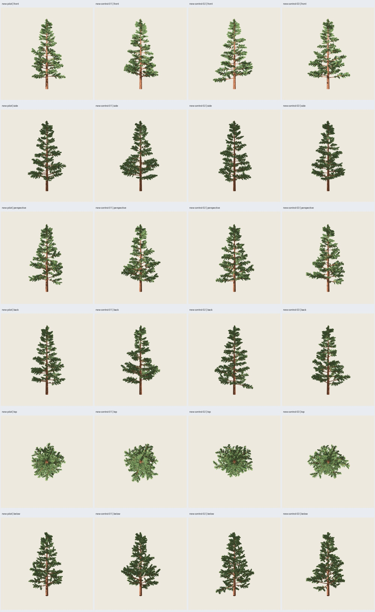
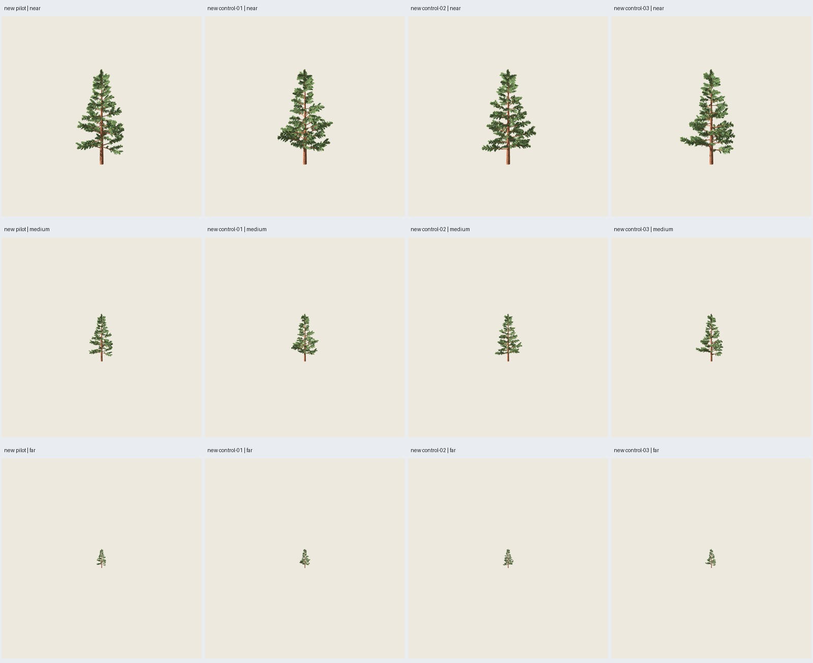

# PP4 — Revisión de volumen del follaje

Fecha: 2026-10-25. Solicitud del usuario: la copa 2.0.0 quedó demasiado rala;
aumentar volumen, especialmente arriba, conservando cruzadas y aplicando el mismo
ajuste al piloto y tres controles. **Implementada y verificada; aceptación
artística de esta revisión pendiente.** La versión 2.0.0 se conserva como
referencia técnica, sin aprobación artística del usuario.



## Regla común y versiones

Receta `pino_conico` **2.1.0**, contrato 1.2 conservado; estructura
`pine-whorls@0.2.0`, distribución `pine-path-groups@0.2.0` y representación
`pine-painted-crossed@0.2.0`. La combinación anterior 0.1.0 sigue ejecutable y
no se admite mezclar distribución/representación de versiones distintas.
Algoritmo puro en `src/treegen/pine_painted_volume.py`; ejecutor, adaptador
Blender, evaluación GLB y materiales Godot comunes. Las fórmulas quedan
versionadas y registradas por sus hashes de fuentes, receta y placements.

Mismos parámetros de 12 m, semillas base/canopy 5100/97, 5101/98, 5102/99,
5103/100 y pintura 2718. **Sin retoques individuales**. No se mueven recorridos,
tronco ni primarias; no se modifica atlas, corteza, UV de cada sprite o material.
La semilla de pintura sigue eligiendo las variantes; no mueve geometría.

- Peso superior `u=clamp((z/12−.2)/.68,0,1)`, a partir del anclaje original
  del soporte. Refuerzo continuo, sin umbral brusco entre pisos.
- Longitud de grupo: máximo de `L×(1.12+.38u)` y `.35+.50u` metros. El mínimo
  evita que las ramillas cortas superiores se reduzcan a unos pocos píxeles.
- Escala radial: ganancia axial × `(1.55+.55u)`. Ensancha las dos láminas
  por igual; mantiene su cruce ortogonal y aumenta su presencia de perfil.
- Segunda cruzada por secundaria, anclada en t=.40 del recorrido existente,
  girada 32° alrededor del mismo eje. No añade tubos ni nuevas ramas de madera.
- Tres grupos en el eje, t=.78/.86/.93, sustituyen al único grupo anterior.
  Refuerzan el tercio superior y el ápice. Cada grupo se escala uniformemente
  desde su anclaje si pudiera superar 11.97 m: no se cortan puntas con un plano.
  La madera conserva los 12 m exactos.

Los IDs de grupo son únicos, separados del ID de soporte: puede haber varios
grupos correctamente anclados en un mismo recorrido. Se comprueban todos los
anclajes, no una lista truncada por emparejar ramas y grupos.

## Coste y comprobaciones

| Por árbol, cuatro casos | PP4 2.0.0 | Revisión 2.1.0 |
| --- | ---: | ---: |
| Grupos cruzados | 241 | 435 |
| Triángulos de madera | 2300 | 2300 |
| Triángulos de follaje | 2892 | 5220 |
| Triángulos totales | 5192 | **7520** |
| Materiales | 2 | 2 |
| Altura | 12 m | 12 m |

Se acepta superar el objetivo inicial aproximado de 6000 para atender la
petición artística de más volumen. Aún reduce **36,93 %** frente a los 11924
del pino geométrico 1.1.0 y permanece bajo el techo contractual 12500.
Los GLB nuevos ocupan 4,69 MB; texturas embebidas iguales a PP4.
No hay benchmark ni afirmación de mejora de rendimiento.

**113 pruebas y 43 comprobaciones de integración pasan.** Incluyen la regla
común sobre cuatro semillas, grupos únicos/anclajes, cota geométrica, altura,
repetición exacta y cambio de pintura sin mover geometría. Cuatro GLB 2.0.0
regenerados **idénticos byte por byte** a PP4; madera/normales/corteza exportadas
idénticas en cada par anterior/nuevo. Roble B0 y columnar B4 se regeneran y
conservan sus GLB exactos. No hay regresión visual nueva atribuida a headless.

Reimportación Blender de 12 GLB (cuatro anteriores, cuatro revisados, cuatro
maderas). Evaluación independiente de triángulos, degeneración, normales,
UV del atlas, PNG embebidos iguales a receta, materiales y grupos exportados
exactamente iguales a los resueltos. Auditoría de hashes de fuentes/capturas,
seis defectos inyectados rechazados y ruta histórica opaca conservada.
Generaciones sin renders 1.336–1.591 s; piloto con nueve renders de inspección
9.077 s, GLB idéntico. Límite de generación 120 s, comprobación/captura 180 s.

## Revisión visual

**108 capturas reales Godot 4.7.2 Compatibility**, RTX 5060, 900² y MSAA 4×.
Mismo protocolo PP4: seis vistas de forma y tres distancias por asset, anterior,
nuevo y madera. Centro (0,0,6), escalas 15.6/24/48/120 m; luz (-35,-25,0),
energía 1.2, ambiente .5, exposición 1 y fondo `#EEE9DF`. Dos dibujos completos
por captura. Mismos materiales: Alpha Scissor .5, doble cara, rugosidad .95,
mipmaps anisotrópicos y sombras dobles. No se modifica el recorte alfa para
simular densidad.



Revisión del agente de los cuatro árboles desde seis orientaciones y tres
distancias: mayor masa visible en toda la copa; **el tercio superior tiene
brotes más anchos y continuidad hasta el ápice**, en lugar del eje casi desnudo
de PP4. Se conserva la conicidad general, la asimetría entre semillas y huecos
entre pisos. No aparecen rectángulos opacos ni grupos completos que desaparezcan
en las vistas muestreadas. Las cruzadas siguen siendo láminas; no se declara
volumen botánico ni ausencia de defectos en toda orientación.

Como control reproducible, máscara de primer plano por diferencia RGB máxima
>20 respecto del fondo, sin reencuadrar: cobertura total proyectada **1,90–2,02×**
en frente/perfil/perspectiva; región superior común `(0,80)–(900,340)`:
**4,18–4,57×** en frente/perfil. Incluye madera y follaje y depende del alfa,
sombras y cámara: **no mide volumen físico ni aprobación artística**.
Valores por caso y protocolo en `coverage.json`.



Persisten huecos grandes en algunos pisos y vistas; el refuerzo superior forma
masas más compactas y puede acentuar una lectura escalonada. Permanecen acículas
pintadas angulares, dentado fino y pérdida de detalle lejano. El atlas y su
repetición siguen siendo los mismos. Resultado disponible para valoración del
usuario; no se atribuye aprobación a las métricas.



## Reproducción

```sh
python3 scripts/verify_painted_pine.py --matrix configs/verification/pine-painted-volume-v1.json --output artifacts/pino-pintado/otro-volumen --visual
python3 scripts/pine_volume_evidence.py --study artifacts/pino-pintado/otro-volumen --evidence artifacts/pino-pintado/otra-evidencia-volumen
PYTHONPATH=src python3 -m treegen generate-blueprint blueprints/pino_conico/2.1.0.json --instance presets/blueprints/pino-pintado-volumen/pilot.json --output artifacts/pino-pintado/mi-pino-volumen --no-render
```

`--stage generate` y `--stage review --visual` permiten separar generación y
revisión, conservando fuentes y la misma salida. Sin `--visual` solo se verifica
la importación técnica. No requiere resultados previos en `artifacts/`; usa
las recetas, PNG y evidencia histórica versionada para regresión.

Salida seleccionada: `artifacts/pino-pintado/pp4-volume-01/index.html`.
`before-` es 2.0.0; `new-` es 2.1.0; `wood-` es la madera retenida.
Cuatro GLB autocontenidos, `.blend` con PNG empaquetados, placements/manifiestos,
escenas reutilizables en `godot/`, protocolos y capturas. Evidencia durable en
esta carpeta. Alcance limitado a la corrección de volumen solicitada; sin
nuevas alturas, LOD, benchmark, madera adaptativa, roble ni fases de IA.
