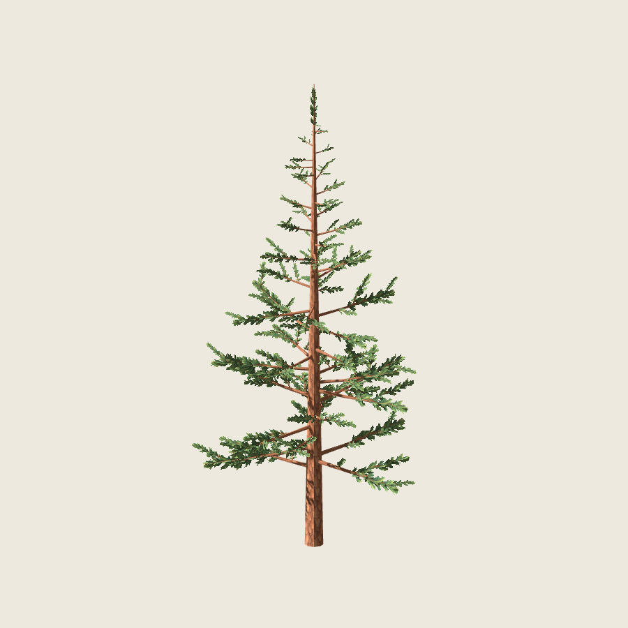
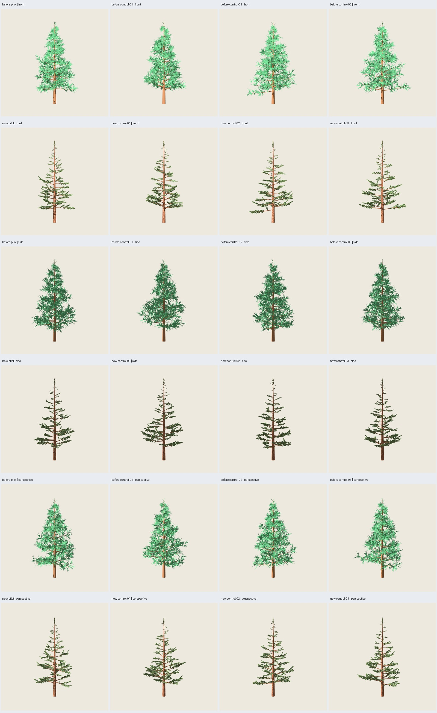
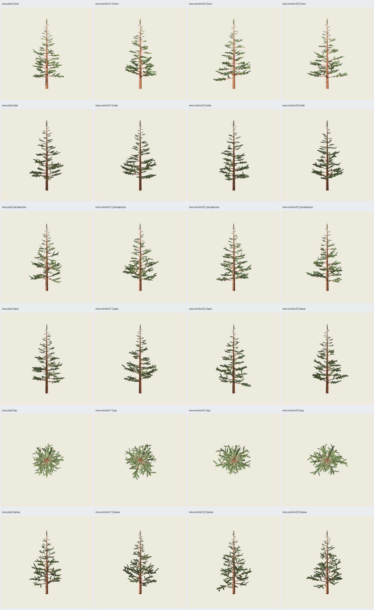
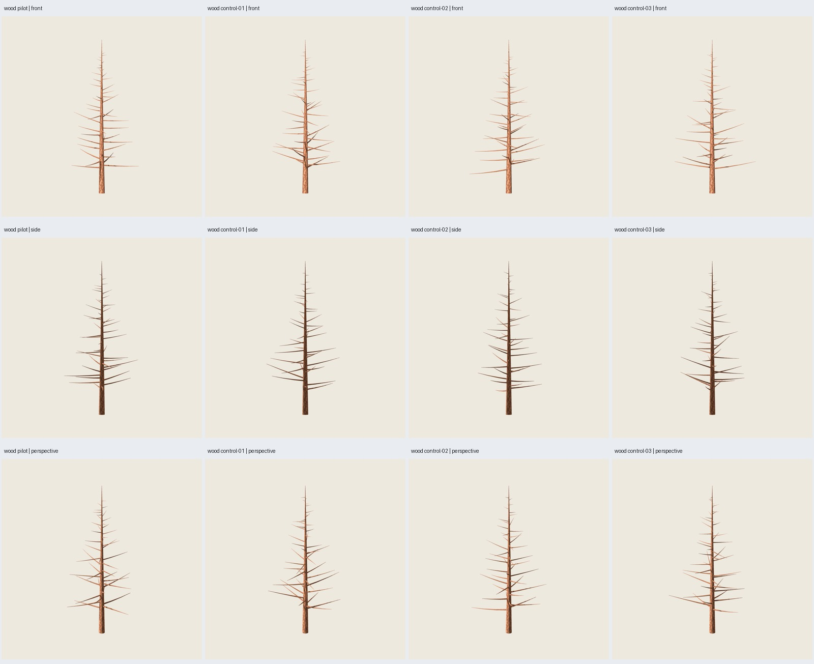
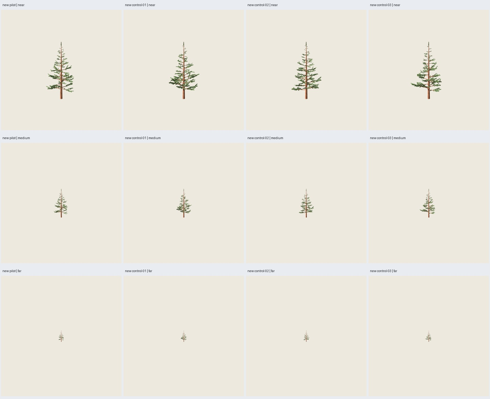

# PP4 — Pino pintado completo

Fecha: 2026-10-25. **Integración y validación técnica realizadas** en piloto y
tres controles conocidos. Autorización: el usuario solicita PP4 con cruzadas y
materiales revisados. **Aceptación artística del árbol completo pendiente**.
[Plan](../../../../plans/pino-pintado.md).



## Resultado y contrato

Receta `blueprints/pino_conico/2.0.0.json`, contrato 1.2; componentes
`pine-whorls@0.2.0`, `pine-path-groups@0.1.0` y
`pine-painted-crossed@0.1.0`. Mantiene el ejecutor/CLI comunes. El módulo puro
`src/treegen/pine_painted.py` separa recorridos, selección de soportes y grupos;
`blender/generate_painted_pine.py` construye UV/materiales y exporta;
`src/treegen/pine_painted_evaluation.py` comprueba el GLB independiente de Blender.
Las rutas históricas y sus validadores de materiales opacos permanecen.

Los **241 recorridos son exactamente iguales** a 1.1.0 en los cuatro casos.
Se conservan tronco y 48 ramas primarias, incluida su conectividad, posiciones,
radios y normales planas. Se sustituyen las 192 ramillas secundarias con sus
acículas, las acículas de las primarias y las del eje; no se añade follaje
geométrico residual. Un grupo cruzado por recorrido, 12 triángulos por grupo.
Los tallos pintados forman parte del atlas, no son tubos secundarios añadidos.

| Geometría | Original 1.1.0 | Pintado 2.0.0 |
| --- | ---: | ---: |
| Madera | 6140 | 2300 |
| Follaje/grupos | 5784 | 2892 |
| Total por árbol | 11924 | **5192** |
| Materiales | 2 | 2 |
| Altura | 12 m | 12 m |

Reducción **6732 triángulos, 56,46 %** en cada caso. Se alcanza el objetivo
inicial aproximado de 6000 sin cambios individuales. Los GLB pasan de unos
0,80 MB a **4,58 MB** por los dos PNG embebidos. Menos triángulos no demuestra
mejor rendimiento; no se midieron FPS, sobrepintado ni memoria de GPU.

Piloto base/canopy **5100/97**, controles **5101/98**, **5102/99**, **5103/100**.
Mismos parámetros, sin overrides. Semilla `paint=2718` común e independiente:
selección de fila del atlas por SHA256 de semilla e ID del recorrido. Cambiarla
modifica UV y conserva posiciones/normales. `canopy` mantiene la identificación
histórica del caso, pero esta distribución no la usa: los anclajes se obtienen
directamente de los recorridos. No se presenta como semilla de dispersión activa.

Anclajes: t=0 en secundarias, .35 en primarias y .90 en eje. Las primarias y
secundarias usan las cruzadas PP2 sin modificaciones; el grupo vertical usa una
base estable y termina en t=.995 para mantener su anchura bajo el techo de 12 m.
La madera del eje conserva la altura exacta. El verificador contrasta los
triángulos exportados contra la madera retenida y los grupos resueltos en
float32; no inventa contactos por acícula. La coincidencia del origen con el
recorrido es un contrato geométrico; la continuidad visual depende del alfa.

## Recursos, materiales y portabilidad

Atlas de tres variantes y corteza **1254×1254**, PNG PP2 **0.1.0** intactos,
con fuentes/procedencia en `assets/pino-pintado/v0.1.0/`. Sin regenerar pintura.
Receta y manifiestos incluyen rutas/hashes; se rechazan recursos ausentes,
alterados, fuera del catálogo o de los límites. GLB autocontenidos, sin URI
externa. `.blend` con PNG empaquetados y nodos editables.

Corteza opaca, follaje **MASK / Alpha Scissor .5**, doble cara, rugosidad .95,
metalicidad 0 y tinte blanco para conservar la pintura. Sin normal map ni
billboard. Mipmaps anisotrópicos y sombras dobles se aplican en Godot mediante
`godot/painted_pine_asset.gd`, reutilizable fuera del visor; las escenas
`new-pilot.tscn` y `new-control-01/02/03.tscn` lo adjuntan al GLB. La auditoría
verifica que el ajuste ya está presente al entrar al inspector. MSAA 4× es una
propiedad del viewport; el destino debe activarlo para reproducir las capturas.
GLB conserva las propiedades portables, sin prometer codificar las del motor.

## Verificación y revisión visual

**110 pruebas y 35 comprobaciones de integración pasan**, incluyendo contratos/semillas/recursos/presupuestos de
PP4. Se repite el piloto con idéntico GLB y placements. La semilla de pintura
alterna conserva geometría y cambia el atlas. Referencias de cuatro pinos
**1.1.0**, roble **B0** y columnar **B4** se regeneran y mantienen sus GLB
**idénticos byte por byte**. La ruta con nueve renders Blender produce
el mismo GLB que la generación sin renders y termina en **4,044 s**; los cuatro
casos sin renders completan en **1,236–1,296 s** en este entorno. Los manifiestos guardan tiempos,
versiones, parámetros, semillas, recursos, hashes de fuentes y exportación.

Reimportación Blender de **12 GLB**: cuatro originales, cuatro pintados y cuatro
maderas. Conteos/materiales/UV/texturas comprobados. La evaluación independiente
comprueba finitud, no degeneración, normales unitarias y orientación de caras,
UV del atlas planificado, imágenes embebidas iguales a la receta, materiales,
altura y geometría exacta de grupos y madera retenida. La auditoría inyecta
seis defectos en copias: alfa opaco, UV ausente/desplazada, imagen externa,
rugosidad incorrecta y normal nula; los seis se rechazan. También confirma que
el verificador histórico sigue rechazando texturas.

Godot **4.7.2-stable official, ed1daf0bf**, `gl_compatibility`, OpenGL/NVIDIA
RTX 5060. **108 capturas reales con ventana**, 900² y dos dibujos completados
por toma: 12 assets × nueve cámaras (frente, perfil, perspectiva, reverso,
arriba, abajo, cerca, media y lejos). Centro común (0,0,6), escala 15.6 m en
vistas de forma y 24/48/120 m en distancia; no hay encuadre individual.
Luz común (-35,-25,0), energía 1.2, ambiente .5, exposición 1, fondo `#EEE9DF`.
Se conservan protocolos y hashes de todas las capturas; `passed` acredita
comprobaciones técnicas y no sustituye el juicio visual ni la aceptación.



Juicio del agente tras inspeccionar las láminas de los cuatro casos, sus seis
vistas de forma, tres distancias y madera: conserva conicidad, huecos y ramas
desfasadas; la pintura se lee en el tronco y los brotes. No aparecen rectángulos
opacos ni desaparición de grupos completos en las vistas muestreadas. **La copa
es bastante más abierta y fina que la original**, especialmente en el tercio
superior y el ápice. Las cruzadas conservan presencia en perfil, pero no el
volumen de las grandes acículas anteriores. Ese cambio necesita valoración
artística del usuario; no se declara equivalencia visual ni superioridad.



Persisten dentado fino, encuentros angulosos y simplificación/pérdida de agujas
a distancia. La corteza del tronco revela repetición longitudinal del mismo
mapa; no se oculta con cambios por semilla. Los anclajes se mantienen unidos a
los recorridos, pero la transparencia deja huecos pequeños entre agujas y tallos.
No se garantiza toda orientación/iluminación; PP4 conserva la decisión material
PP3, sin repetir su matriz completa de luces y giro de rama. Sin viento ni LOD.





## Reproducción y entregables

Desde la raíz con dependencias de `requirements.txt`, Blender 5.2.1 y Godot 4.7.2:

```sh
python3 scripts/verify_painted_pine.py --output artifacts/pino-pintado/otro-pp4 --visual
python3 scripts/painted_pine_evidence.py --study artifacts/pino-pintado/otro-pp4 --evidence artifacts/pino-pintado/otra-evidencia-pp4
```

También puede separarse generación/revisión con `--stage generate` y
`--stage review --visual`, conservando la misma carpeta y fuentes. Los
subprocesos se limitan a 180 s; cada generación a 120 s con terminación del
grupo. Para generar solo un asset: [guía de uso](../../../uso-blueprints.md#pino-pintado-pp4).
No necesita resultados previos en `artifacts/`; sí PNG de producción con hashes
congelados. Repetir desde manifiesto extrae `blueprint_definition` e
`instance_request` y usa el ejecutor común. No regenera pintura.

Salida seleccionada: `artifacts/pino-pintado/pp4-full-05/index.html`, cuatro
`tree.glb`, `.blend`, manifiestos/placements, maderas, proyecto Godot con escenas
reutilizables, capturas/protocolos y verificaciones. Aquí se conservan láminas,
piloto, `verification.json`, `audit.json`, `reimport.json` y resultados de pruebas.
Los intentos de desarrollo permanecen regenerables y no son evidencia final.

En el ensayo con renders Cycles a 16 muestras se alcanzó el límite de 120 s;
el proceso terminó según el contrato. La configuración de inspección Blender
se acotó a cuatro muestras y 480², sin denoising y con datos persistentes,
sin cambiar geometría, PNG ni materiales. El primer ensayo a cuatro muestras
y 900² tampoco bastó para el límite; ambos intentos quedan fuera de la evidencia final.
La evaluación artística principal usa Godot y no depende de la calidad de ese
render de inspección. No se amplió el límite de ejecución para ocultar el coste.

**PP4 técnicamente cerrada para los cuatro casos de 12 m; aceptación artística
pendiente.** No se han iniciado benchmark, madera adaptativa, nuevos rangos,
roble, LOD, bosque ni fases de IA.
