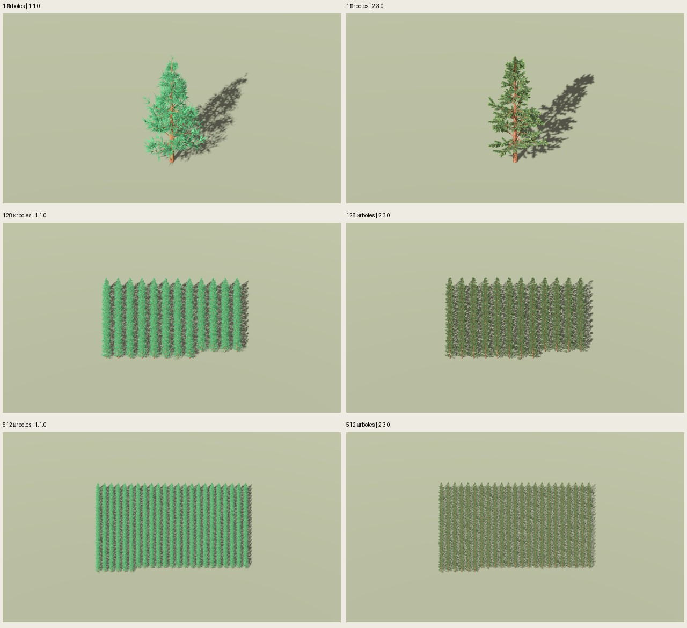

# Rendimiento Godot: pino geométrico 1.1.0 frente a pintado 2.3.0

Fecha: 2026-10-25. **24 mediciones completas y auditadas**, con GPU real.
Referencia corregida por el usuario: **1.1.0 anterior al pintado**, no 2.2.0.
2.3.0 reduce el tiempo por cuadro de forma consistente en las dos cargas múltiples:
**−40,0 % con 128 árboles y −44,9 % con 512**. Un solo pino no presenta ganancia
útil; ambos assets tardan menos de 1 ms en estas condiciones.

## Resultados

Medianas entre cuatro repeticiones por versión y carga. «ms/cuadro» es la mediana
de los tiempos medios de cada repetición; FPS es la mediana de sus FPS medios
(1000/tiempo medio). Se agregan por separado, por lo que sus medianas no son
recíprocos exactos en todos los casos. No se agrupan todos los cuadros como si
fueran miles de experimentos independientes.

| Árboles | 1.1.0 ms/cuadro | 2.3.0 ms/cuadro | 1.1.0 FPS | 2.3.0 FPS | Menos tiempo por cuadro |
| --- | ---: | ---: | ---: | ---: | ---: |
| 1 | 0,545 | 0,568 | 1834 | 1761 | −4,1 %: leve aumento |
| 128 | 2,831 | 1,699 | 353 | 589 | **40,0 %** |
| 512 | 7,945 | 4,380 | 126 | 228 | **44,9 %** |

Las cuatro parejas con 128 árboles reducen tiempo **39,81–40,35 %**; con 512,
**44,73–45,10 %**. FPS aumentan **66,7 %** y **81,4 %**, respectivamente. Reducir
el tiempo un 44,9 % no significa aumentar los FPS un 44,9 %: son magnitudes
inversas. No se presenta el rango de cuatro repeticiones como un intervalo de
confianza poblacional.

Con un árbol, la primera repetición 1.1.0 fue un valor alto (0,789 ms frente a
0,543–0,548 ms en sus otras tres). Se conserva, sin descartarla tras observar
el resultado. La mejora pareada cambia de signo: +28,03 / −4,61 / −4,61 / −3,48 %.
Por ello no se concluye ventaja estable con una sola instancia; el coste GPU
del pintado es 0,410 ms frente a 0,386 ms, una diferencia absoluta de 0,024 ms.

| Árboles | GPU 1.1.0 ms | GPU 2.3.0 ms | CPU render 1.1.0 ms | CPU render 2.3.0 ms | P95 cuadro 1.1.0 ms | P95 cuadro 2.3.0 ms |
| --- | ---: | ---: | ---: | ---: | ---: | ---: |
| 1 | 0,386 | 0,410 | 0,114 | 0,123 | 0,718 | 0,735 |
| 128 | 2,753 | 1,603 | 0,840 | 0,519 | 3,143 | 1,878 |
| 512 | 7,866 | 4,291 | 2,890 | 1,539 | 8,347 | 4,767 |

CPU render es el tiempo del viewport; el tiempo de preparación global se conserva
aparte en `summary.json`. GPU y CPU trabajan con solapamiento: no sumar estas
columnas para reconstruir el tiempo por cuadro. La API y unidades están descritas
en la [documentación oficial de RenderingServer](https://docs.godotengine.org/en/stable/classes/class_renderingserver.html#class-renderingserver-method-viewport-get-measured-render-time-gpu).

| Árboles | Draw calls 1.1.0 / 2.3.0 | Primitivas renderizadas 1.1.0 / 2.3.0 |
| --- | ---: | ---: |
| 1 | 5 / 5 | 23 850 / 9 110 |
| 128 | 851 / 849 | 5 067 702 / 1 923 326 |
| 512 | 3073 / 3073 | 18 315 266 / 6 967 298 |

Contadores incluyen plano receptor y pasadas de sombras, no solo tris del GLB.
Se conservan las mismas instancias y transformaciones; la geometría distinta
puede alterar el culling interno de sombras. Las dos llamadas de diferencia en
128 árboles se registran, no se fuerza igualdad artificial. La mejora se observa
con llamadas casi iguales y una caída del tiempo GPU del **41,8 % / 45,5 %** en
las cargas múltiples. Es compatible con un coste de render menor del asset
completo; no demuestra que el ahorro provenga únicamente de los triángulos.

## Condiciones comunes

- Godot **4.7.2** `ed1daf0bf001b61586d9930840f2f1394092c079`, Compatibility,
  OpenGL 3.3.0/NVIDIA **595.99.02**, **RTX 5060 8 GiB**, Intel **i5-12400F**,
  seis núcleos/doce hilos. Contexto de equipo en `hardware.json`.
- Render interno **1920×1080**, MSAA **4×**, ventana 1280×720 para evitar que el
  escritorio recorte el render. Se comprueban tamaño real, VSync desactivado,
  `Engine.max_fps=0` y `mesh_lod_threshold=0`: sin LOD automático ni cap.
- 1, 128 y 512 MeshInstance3D normales, sin MultiMesh ni un nuevo sistema de bosque.
  Una malla por árbol; 1 usa el piloto, cargas múltiples alternan los cuatro casos
  por índice. Misma rejilla, espaciado 7 m, giro determinista y cámara por pareja.
  Cámara ortográfica estática, sin recorridos o cambios de escena durante la muestra.
- Luz (-35,-25,0), energía 1,2; ambiente 0,5, exposición 1, fondo `#EEE9DF`;
  mismo plano receptor y sombras de ambas caras, distancia de sombras 500 m.
- Materiales propios conservados: 1.1.0, dos materiales opacos sin textura,
  rugosidad .88; 2.3.0, dos materiales pintados, rugosidad .95, PNG 1254²,
  follaje Alpha Scissor .5, mipmaps/anisotropía. Todos doble cara.
- Cuatro repeticiones por versión/carga, orden **ABBA / BAAB**, donde A es 1.1.0.
  **3 s de calentamiento + 6 s de medición** por repetición. Primeras capturas
  fuera de medición con 1 s adicional de calentamiento después del readback.
  144 s de muestras en total, además de calentamiento, carga e importación.
- Tiempo por cuadro medido por reloj monotónico en `_process`, sin usar el FPS
  redondeado de la ventana. CPU/GPU del viewport con medición habilitada y
  contadores del motor por cuadro. Telemetría GPU a 1 Hz, idéntica para ambas.
  Reloj gráfico observado 2595–2767 MHz y temperatura 48–67 °C en toda la serie,
  incluyendo cambios de proceso; no se fija un estado de potencia desde el arnés.

Se verifican los hashes de los ocho GLB contra evidencia histórica y aprobación:
1.1.0 **11 924 tris por árbol** (6140 madera/5784 acículas); 2.3.0
**4518–4554** (1908–1944 madera/2610 follaje), **61,81–62,11 % menos**.
Mismas semillas base 5100–5103 y canopy 97–100; 2.3.0 añade paint 2718.
**La apariencia y los materiales son diferentes por diseño**: la comparación
mide el rediseño completo solicitado, incluida madera, volumen, textura y alfa.
No es una ablación que aísle solo tris, pintura, recorte o simplificación de madera.



El agente revisa esta lámina y la captura de 128 árboles: referencia geométrica
sin pintar y versión pintada correctamente diferenciadas; sombras, encuadre y
rejillas presentes, sin desaparición dominante de la escena. Esta revisión es
visual; la auditoría de resolución, materiales y métricas es una comprobación
independiente, no un sustituto de abrir las imágenes.

## Validación, límites y reproducción

**Tres pruebas del arnés pasan**: percentiles/FPS/parejas, GPU ausente marcada
como no disponible, rechazo de VSync/cap/LOD/resolución incorrectos, software
llvmpipe y muestras vacías/no positivas. La auditoría comprueba 24 mediciones,
≥100 cuadros y duración por ensayo, mismas instancias, materiales esperados,
hashes de fuentes/GLB/raw y seis capturas 1080p. `audit.json`: passed.
No se modificaron recetas ni assets aprobados; no se amplía aceptación artística.

Son cargas sintéticas estáticas, sin juego/IA/física/viento, en un escritorio
con otros procesos; no se garantiza esta tasa en un nivel real o en otra GPU.
Sin pruebas de movimiento, distintos ángulos/densidades, Forward+, dispositivos
móviles o instanciado masivo. Las dos familias de recursos se precargan en cada
proceso: no se interpreta la memoria GPU total como VRAM individual del asset.
Carga de GLB, importación y creación de objetos quedan fuera del tiempo medido.
Las cámaras cambian entre cantidades para encuadrar las rejillas; comparar
versiones dentro de cada cantidad, no escalar linealmente FPS entre cantidades.

```sh
python3 scripts/benchmark_painted_pine.py --output artifacts/pino-pintado/otro-benchmark
python3 scripts/pine_performance_evidence.py --study artifacts/pino-pintado/otro-benchmark --evidence artifacts/pino-pintado/otra-evidencia-benchmark
PYTHONPATH=src python3 -m unittest discover -s tests -p test_pine_performance.py -v
```

Configuración: `configs/verification/pine-performance-v1.json` (protocolo 0.2.0).
Fuentes de medición: `scripts/benchmark_painted_pine.py` y
`godot/benchmark_painted_pine.gd`. Estudio seleccionado:
`artifacts/pino-pintado/performance-v11-01/`: `1/128/512/raw.json` contienen
muestras individuales; entradas, logs, PNG y `gpu-samples.csv` son regenerables.
Esta carpeta conserva resumen de cada repetición, ajustes efectivos, layouts,
hashes de raw, contexto y capturas seleccionadas. Cada subproceso ≤180 s.

Antes de la corrección del usuario se inició un diagnóstico 2.2.0/2.3.0:
`artifacts/pino-pintado/performance-01/`. Completó 1/128; 512 fue interrumpido
antes de terminar, sin raw válido. No se utiliza para este resultado ni se declara
completo. Primera prueba corta falló porque el escritorio reducía la ventana a
1853×1011; se corrigió con viewport interno fijo y la segunda pasó. Ninguno de
los intentos cortos forma parte de las 24 mediciones principales.
