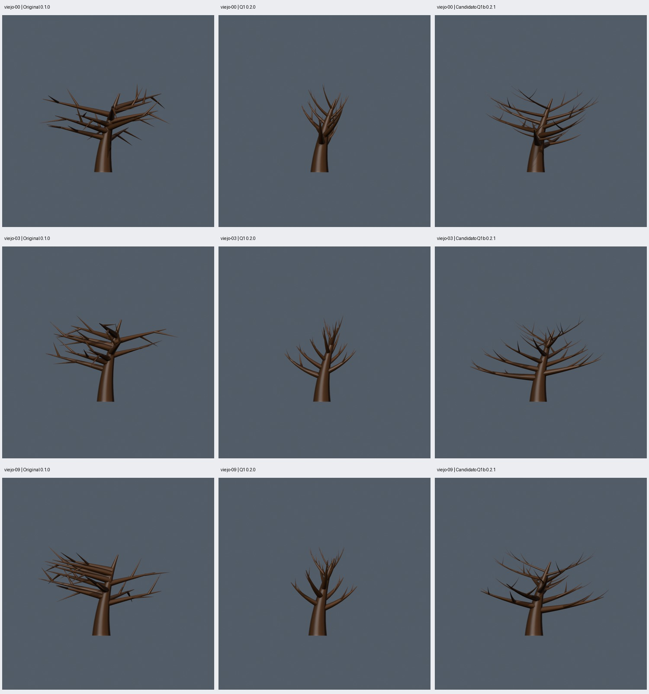

# Q1b: recuperación de extensión y peso de las ramas

Fecha: 2026-10-22. Algoritmo: `oak_geometry_nodes` **0.2.1**. Comprobaciones técnicas completadas y **ramas aprobadas por el usuario el 2026-10-22**. La estructura 0.2.1 queda como base para Q2, copa y proporciones.

## Motivo y alcance

El usuario rechazó Q1 0.2.0: corrigió grosores incoherentes y direcciones agrupadas, pero los viejos quedaron estrechos y ascendentes. Solicitó ramas largas y gruesas como las originales, con más ramificación y mejor estructura. Pasar a Q2 antes de esa valoración fue prematuro.

Q1b mantiene los diez parámetros, semillas, distribución por sectores y dos niveles. Cambia las reglas de estructura y aumenta de dos a tres secundarias por primaria; el cambio de conteos está registrado en el [plan v1](../../../plans/v1-generador-arboles.md). Conserva el follaje y el ajuste Z para comparar la madera. No es el experimento B ni demuestra reducción de cruces.

Las fuentes `oak_nodes.py` 0.1.0 y `oak_nodes_v2.py` 0.2.0 conservan los hashes de sus manifiestos originales; ambas versiones reconstruyen la geometría de viejo-09. Los presets históricos están en `presets/v0.1.0/` y `presets/v0.2.0/`. Los principales usan el candidato 0.2.1 con los mismos parámetros de Q1; `presets/q1b-cases.json` conserva los treinta ids y semillas.

## Reglas implementadas

- `blender/oak_nodes_v21.py` construye los grupos de estructura y ensamblado; reutiliza helpers Q1 y el mallado/follaje congelados.
- Longitud de referencia de cada primaria: `H * branch_ratio * (1.60 - 0.42*t) * (1 + asymmetry*U(-0.18,0.12))`, con `t` según su altura de nacimiento. La longitud de arco medida puede diferir de esta referencia.
- Inclinación de control: `clamp(inclination + 8 - 12*t + U(-8,8), 18,96)` grados; curvatura terminal entre −0.02 y 0.12. La forma final se mide después del ajuste Z.
- Radio primario: 0.72–0.84 del radio local del tronco. Secundario: 0.58–0.70 del radio local de la primaria.
- Tres nacimientos en el tramo 0.38–0.84 de cada primaria, con lados alternados; longitudes de referencia 0.50/0.40/0.30 de su padre, apertura variable y menos ascenso uniforme.
- Límite: 12 primarias, 36 secundarias, 196 masas de follaje. Dos niveles; perfil de ocho lados, presupuesto de 10 000 triángulos/3 materiales.

## Comparación reproducible

Original 0.1.0 / Q1 0.2.0 / Q1b 0.2.1, en ese orden. Semillas y parámetros idénticos. Cada caso comparte cámara y escala de encuadre entre las tres versiones, usando la unión de sus cajas. Ocho vistas por caso: copa frontal/lateral/superior/perspectiva y madera frontal/lateral/superior/oblicua ortográfica; controles adulto-00 y joven-00 incluidos.



| Caso | Anchura del esqueleto XY (m) | Longitud nativa total de primarias (m) | Radio nativo medio de las tres primarias inferiores (m) |
| --- | --- | --- | --- |
| viejo-00 | 11.57 / 6.51 / 12.28 | 58.94 / 41.84 / 61.37 | 0.336 / 0.328 / 0.400 |
| viejo-03 | 12.08 / 6.53 / 12.24 | 54.32 / 39.94 / 58.92 | 0.336 / 0.333 / 0.405 |
| viejo-09 | 11.34 / 5.71 / 11.38 | 58.28 / 41.59 / 61.06 | 0.336 / 0.321 / 0.393 |

La anchura es el mayor intervalo en X/Y de los ejes muestreados, sin espesor de malla; el ajuste Z conserva esas medidas. La longitud y los radios de la tabla proceden de curvas nativas, antes de deformar Z. No son el diámetro o el volumen final del árbol.

Las longitudes totales de primarias tras el ajuste, comparando original → Q1b, son:

- `viejo-00`: 57.97 → 58.99 m.
- `viejo-03`: 53.65 → 56.41 m.
- `viejo-09`: 57.36 → 58.60 m.

En los tres viejos señalados se recupera al menos el 95 % de anchura, longitud nativa de primarias y radio medio inferior de la base. Es un criterio mecánico de esta revisión, no una prueba de apariencia convincente. Frente a Q1, estos tres esqueletos miden 1.88–1.99 veces su anchura y 1.47–1.48 veces su longitud nativa de primarias. Se añaden once secundarias por viejo (33 en vez de 22).

Las otras siete semillas viejas se midieron después de fijar la regla: anchura de 0.885–1.095 veces la base; longitud de primarias 1.021–1.085; radio inferior 1.153–1.244. Viejo-06 y viejo-07 conservan el 92.1 % y el 88.5 % de la anchura de su referencia. **No se declara que los diez viejos recuperen el 95 % de anchura original.**

[Vista superior de las ramas](comparison-top.jpg), [comparación con hojas](comparison-front.jpg) y [galería Godot](gallery-godot.jpg). HTML completo: `artifacts/q1b/acceptance/comparison/index.html`.

## Comprobaciones completadas

- Quince pruebas unitarias aprobadas, incluida la aceptación/rechazo de los nuevos conteos y radios. La prueba HTTP se ejecutó fuera del sandbox por su restricción de loopback.
- Treinta geometrías distintas, exportadas a GLB y validadas contra la malla evaluada. Jóvenes/adultos/viejos: 2724/7324/7992 triángulos, dos materiales, alturas 4/10/9 m.
- Los treinta pasan uniones, jerarquía de radios, reparto angular e inclinaciones. Mayor error de unión muestreado: 0.000350 m; no prueba continuidad topológica.
- Repetición de viejo-09 en 0.1.0, 0.2.0 y 0.2.1 con idénticos hashes de geometría y diagnósticos; adulto-00 repetido en la verificación Godot con iguales fuentes, cámaras y geometría.
- Efecto de los diez parámetros; otra semilla de follaje cambia la malla y conserva las curvas nativas.
- Cinco extremos comprobados: mínimo, máximo, delgado con doce primarias, profundidad 1 sin hojas y una primaria con profundidad 2. Máximo: 9676 triángulos/dos materiales; se mantienen altura y validez de exportación.
- Los treinta GLB importados en Godot 4.7.2: triángulos, materiales, caja, escala y conversión de ejes coinciden. Sesión gráfica abierta y capturas de las treinta variantes generadas.
- El agente revisó las galerías de madera y copa, las comparaciones frontal/superior, vistas individuales de viejo-03 y joven-00 y las capturas Godot. Esa inspección no es aprobación estética del usuario ni sustituye una revisión interactiva de los modelos por él.

La compresión vertical no se corrigió: los diez viejos usan un factor Z de 0.707–0.746. Los radios finales pueden quedar elípticos, las inclinaciones cambian y la semilla de follaje influye en el ajuste. No se atribuye a Q1b la corrección pendiente de Q2.

## Límites y siguiente paso

Las siluetas son más extendidas que Q1, pero se conservan un tronco conductor, uniones superpuestas, ramas con ahusamiento marcado y patrones repetibles. No hay tercer nivel, fusión orgánica ni regla anticolisiones. Las secundarias de un mismo lado pueden seguir casi paralelas. El follaje heredado forma masas gruesas y deja algunos huecos; su revisión continúa pendiente.

**El usuario dio su visto bueno a las ramas Q1b el 2026-10-22**, indicando que se ven mucho mejor. La aceptación visual es posterior a las comprobaciones técnicas y corresponde a esta estructura. Sigue Q2: follaje y proporciones; los extremos del contrato no reciben aprobación estética general por esta decisión. El borrador Q2 retirado del contrato/ejecutor está en `artifacts/q2/draft/`; su previsualización inicial no es una etapa verificada.

## Reproducción

Usar carpetas nuevas; los trabajos no se sobrescriben. Se necesitan las bases F2/Q1 en las rutas indicadas o pasar `--base`/`--q1` al verificador. Las galerías requieren Pillow.

```sh
python3 scripts/verify_q1b.py --visual --output artifacts/q1b/otra-aceptacion
python3 scripts/q1b_gallery.py artifacts/q1b/otra-aceptacion
python3 scripts/make_gallery.py artifacts/q1b/otra-aceptacion/lote
python3 scripts/make_gallery.py artifacts/q1b/otra-aceptacion/lote --godot
```

Mismo entorno fijado de F0–Q1: Blender 5.2.1 `9e2066aef7ef`, Python Blender 3.13.13, ejecutor 3.14.4, jsonschema 4.19.2 y Godot 4.7.2 `ed1daf0bf`. Los manifiestos guardan parámetros, semillas, versiones y hashes de todas las fuentes geométricas, incluido el helper Q1. Límite de 120 segundos por subproceso; las órdenes con `--visual` necesitan sesión gráfica.

Evidencia seleccionada: [resumen](summary.json), [manifiesto viejo-09](viejo-09-manifest.json), [pruebas](unit-tests.txt). Resultados completos regenerables: `artifacts/q1b/acceptance/`, con diagnósticos nativos/finales, logs, imágenes, `.blend` y GLB. Assets importados: `godot/q1b/`.
