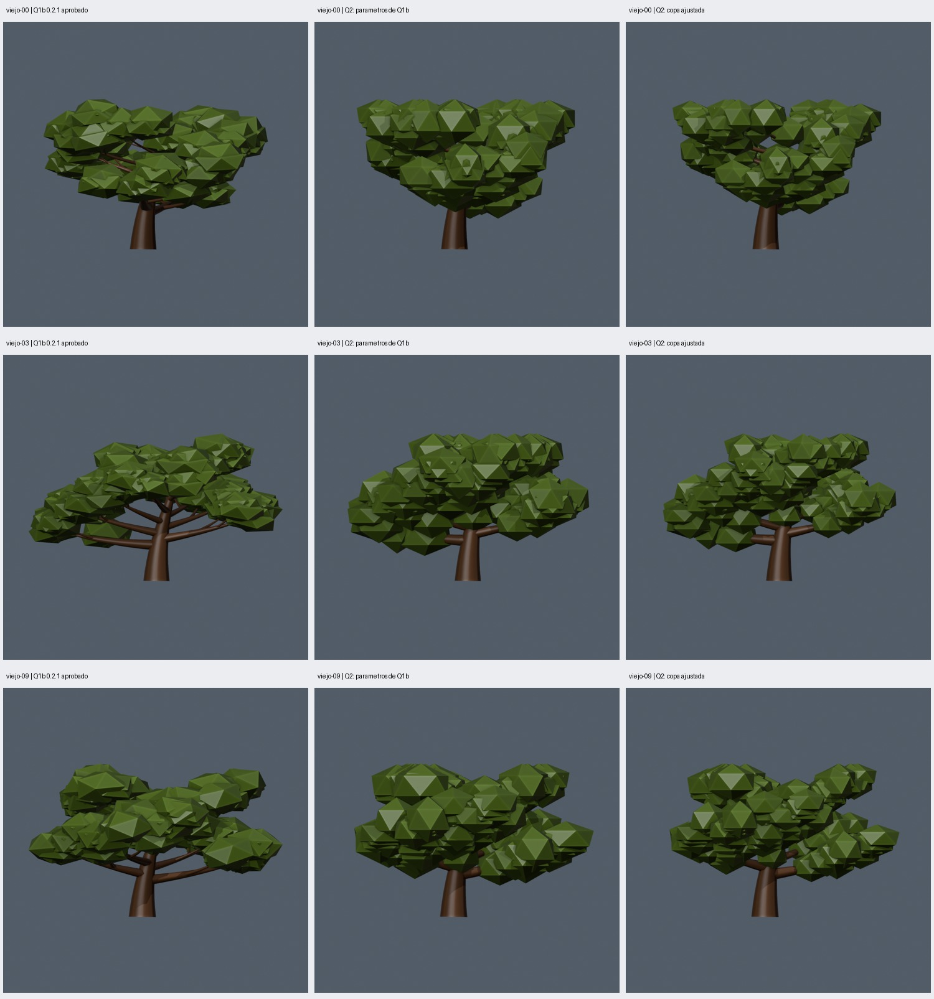

# Q2: copa y proporciones sobre las ramas Q1b aprobadas

Fecha: 2026-10-22. Algoritmo: `oak_geometry_nodes` **0.3.0**. Implementación y comprobaciones técnicas completadas; **copa ajustada aprobada por el usuario el 2026-10-22**. La estructura de referencia aprobada sigue siendo Q1b 0.2.1. F4–F6 no se implementaron.

## Alcance y decisión de altura

El usuario aprobó las ramas Q1b y autorizó continuar con Q2. Se trabaja sobre los mismos robles/semillas de Q1b; los nombres `viejo-00`, `viejo-03` y `viejo-09` indican edad y caso del lote, no versiones abandonadas. Q2 conserva los grafos estructurales 0.2.1, sus radios y su mallado; `blender/oak_nodes_v3.py` revisa el follaje y su marco final.

Q1b normalizaba Z después de unir madera y follaje. Por ello la densidad, escala o semilla de copa también deformaban la madera. Q2 calcula la transformación **solo con la caja de madera**:

`scale = (1, 1, height_m/(wood_max_z-wood_min_z))`

`translation = (0, 0, -wood_min_z*scale_z)`

X/Y conservan exactamente vértices y triángulos de madera Q1b, incluidos sus grosores horizontales. Las curvas de apoyo reciben la misma transformación, y el follaje se coloca dentro de `[0,height_m]`. La madera alcanza la altura pedida incluso sin hojas y queda independiente del follaje. Los centros se desplazan verticalmente según el alcance real de cada masa, calculado con la caja de la primitiva, sin recortar sus caras.

**No se promete conservar el perfil Z aprobado de forma idéntica.** La madera Q1b con hojas tenía menos altura que el árbol completo; ahora su caja alcanza `height_m`. En el lote, las inclinaciones cambian hasta 4.051° frente a Q1b. Se conserva el ajuste solo en Z para mantener la anchura; no se eliminó toda deformación anisotrópica. Los radios finales pueden seguir siendo elípticos. Este cambio deliberado se mostró sin hojas; el usuario aprobó posteriormente la variante Q2 ajustada.

## Distribución y presets

- `floor(4*density+0.5)` masas por curva, máximo cuatro. Densidad cero produce copa vacía. Se conservan dos niveles, hasta doce primarias/tres secundarias por primaria y 196 masas.
- Con más de una masa se muestrea un tramo distal por curva: inicio aleatorio entre 0.42–0.58 y final entre 0.90–0.99 de su longitud. Una sola masa conserva el extremo. Esto sustituye el racimo idéntico instanciado en cada punta.
- Desplazamientos horizontales acotados y tamaños/giros distintos por masa mediante la semilla de follaje, con ID explícito de punto. El giro solo en Z conserva el alcance vertical conocido.
- Icosferas de veinte triángulos. Escalas relativas X/Y/Z entre `(0.85,0.75,0.58)` y `(1.20,1.08,0.85)`. Escala efectiva `min(foliage_scale_m, 0.24*height_m)` para evitar masas desproporcionadas en alturas pequeñas; el extremo 2 m/escala solicitada 3 m usa 0.48 m efectivos.
- Los presets conservan todos los parámetros estructurales Q1b. Solo cambian follaje: joven escala 0.60→0.45 m y densidad 0.5; adulto 1.50→1.15 m y densidad 1→0.75; viejo 1.60→1.30 m y densidad 0.75.

Se preservan los presets aprobados en `presets/v0.2.1/` y el lote `presets/q1b-cases.json`. Los principales usan 0.3.0. `presets/q2-cases.json` congela los treinta casos ajustados; `presets/q2-controlled-cases.json` conserva todos los parámetros Q1b con algoritmo 0.3.0, para aislar el efecto del grafo del ajuste de presets.

## Comparación con Q1b

Las columnas son **Q1b aprobado / Q2 con parámetros Q1b / Q2 con follaje ajustado**. Cinco casos: los tres viejos señalados y controles adulto-00/joven-00. Misma semilla y cámara por caso, con encuadre compartido entre las tres columnas y ocho vistas con/sin hojas. La madera de las dos columnas Q2 es idéntica.



[Ramas sin hojas](comparison-branches.jpg), [vista superior](comparison-top.jpg), [galería Godot](gallery-godot.jpg). Comparación completa: `artifacts/q2/acceptance/comparison/index.html`.

| Caso | Altura de madera Q1b → Q2 (m) | Masas Q1b → Q2 ajustado | Bandas ocupadas (5) | Sectores ocupados (8) | Mayor cambio de inclinación final |
| --- | --- | --- | --- | --- | --- |
| viejo-00 | 7.834 → 9.000 | 135 → 135 | 4 → 4 | 8 → 8 | 3.97° |
| viejo-03 | 8.021 → 9.000 | 135 → 135 | 4 → 4 | 8 → 8 | 3.30° |
| viejo-09 | 7.817 → 9.000 | 135 → 135 | 4 → 4 | 8 → 8 | 4.03° |
| adulto-00 | 8.918 → 10.000 | 148 → 111 | 4 → 4 | 8 → 8 | 3.28° |
| joven-00 | 3.619 → 4.000 | 34 → 34 | 3 → 4 | 8 → 8 | 2.86° |

Las bandas cuentan centros en cinco intervalos iguales de la altura pedida; los sectores usan el centro horizontal de la caja de madera. Son diagnósticos de distribución, **no volumen ocupado, continuidad de copa ni métricas de silueta**. Los adultos/viejos ya ocupaban ocho sectores en Q1b; no se declara una mejora general de cobertura por este conteo. Los treinta nuevos modelos ocupan 3–4 bandas; todos los adultos/viejos ocupan ocho sectores y los jóvenes 6–8.

La inspección visual del agente aprecia masas interiores y grupos menos repetidos, conservando copas amplias en los viejos. Siguen existiendo huecos, solapamientos y facetas muy visibles; algunas zonas superiores se aproximan a la cota máxima de altura. Estas observaciones del agente no constituían aprobación. Posteriormente el usuario aprobó la copa ajustada, manteniendo una observación de mejora sobre grupos demasiado similares.

## Comprobaciones completadas

- Diecisiete pruebas unitarias aprobadas. Las nuevas pruebas distinguen componentes superpuestas, aíslan el hash de madera de cambios de follaje y comprueban la proyección X/Y ante cambios en Z. Contrato/CLI/API siguen pasando; loopback se comprobó fuera del sandbox.
- Treinta GLB válidos y distintos, con malla/materiales/caja/hashes coincidentes con el resultado evaluado. Jóvenes/adultos/viejos: 2724/6584/7992 triángulos y dos materiales; alturas 4/10/9 m.
- Comparación de las treinta maderas guardadas con Q1b: mismo diagnóstico nativo y hash de geometría proyectada en X/Y, no solo igual caja. La jerarquía de radios, uniones, reparto angular e inclinaciones pasan los controles Q1b.
- Q1b viejo-09 reconstruye el mismo hash geométrico; fuentes 0.1.0/0.2.0/0.2.1 conservan sus hashes. Q2 viejo-09 y adulto-00 se repiten con idéntica geometría; adulto-00 conserva también fuentes y cámaras.
- Los diez parámetros siguen modificando geometría. Cambiar semilla de follaje, escala, densidad completa o densidad cero conserva el hash completo de madera Q2 y la transformación de altura.
- Centros/apoyos evaluados: cantidad igual al número de masas; desplazamiento acotado por la escala efectiva. Las masas quedan dentro de la altura pedida. Esto comprueba apoyos y límites, no una fusión topológica entre hojas y madera.
- Seis extremos: mínimo, máximo, delgado con doce primarias, profundidad 1 sin hojas, una primaria/profundidad 2 y árbol de 2 m/escala de follaje solicitada 3 m. Máximo: 9676 triángulos/dos materiales; GLB y altura válidos. Extremos comprobados numéricamente, sin aprobación estética general.
- Godot 4.7.2 importó los treinta GLB con triángulos, materiales, escala y orientación coincidentes. Se abrió sesión gráfica y se capturaron las treinta variantes.
- El agente revisó galerías de copa/madera de los treinta, comparaciones frontales/superiores y de ramas, y capturas Godot. Estas imágenes no sustituyen la valoración del usuario ni una inspección interactiva por él.

El adulto usa menos triángulos al reducir la densidad del preset. Esto no es el experimento C/F6, no compara siluetas con IoU ni demuestra mejora de FPS o de IA. No se añadieron reglas espaciales Python, fusión de mallas ni anticolisiones.

## Reproducción y siguiente paso

```sh
python3 scripts/verify_q2.py --visual --output artifacts/q2/otra-aceptacion
python3 scripts/q2_gallery.py artifacts/q2/otra-aceptacion
python3 scripts/make_gallery.py artifacts/q2/otra-aceptacion/lote
python3 scripts/make_gallery.py artifacts/q2/otra-aceptacion/lote --godot
```

Usar carpetas nuevas. Base por defecto `artifacts/q1b/acceptance/lote/`, configurable con `--base`. Las galerías requieren Pillow y `--visual` necesita sesión gráfica; los subprocesos tienen timeout de 120 s. Entorno fijado: Blender 5.2.1 LTS `9e2066aef7ef`, Python Blender 3.13.13, ejecutor 3.14.4, jsonschema 4.19.2, Godot 4.7.2 `ed1daf0bf`.

Las fuentes son los scripts; GLB, `.blend` e imágenes completas son regenerables en `artifacts/q2/acceptance/`; importados en `godot/q2/`. Los manifiestos registran semillas, sockets, parámetros, `crown_checks`, transformación `normalization` y hashes del generador y todos sus helpers. La evaluación de copa está en `src/treegen/crown.py`; el inspector Blender no modifica los assets guardados.

Evidencia seleccionada: [resumen](summary.json), [manifiesto viejo-09](viejo-09-manifest.json), [pruebas](unit-tests.txt). **El usuario aprobó la copa ajustada Q2 el 2026-10-22.** Solicita ahora propuestas para reducir la repetición de grupos de follaje. La aprobación corresponde a la tercera columna y a los presets de `q2-cases.json`; los experimentos futuros y todos los extremos del contrato no quedan aprobados automáticamente.
