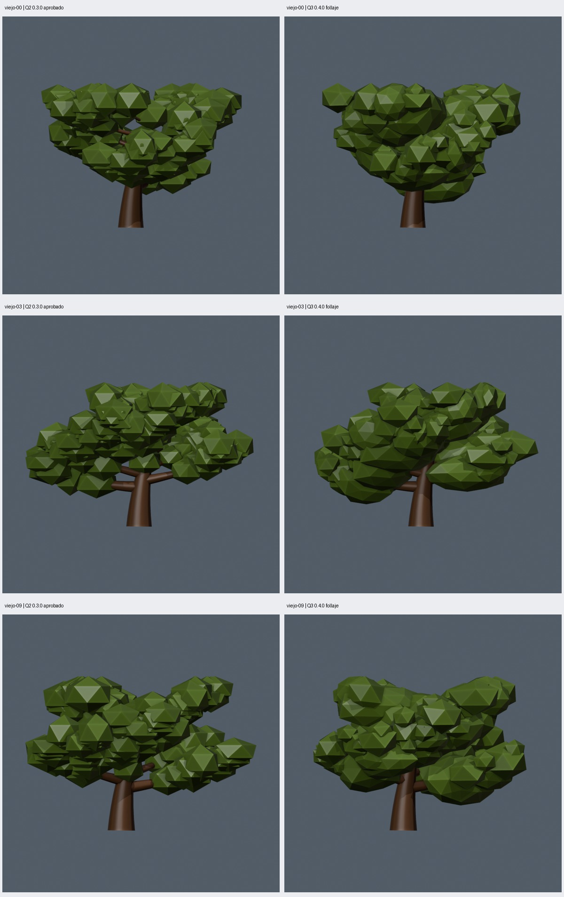
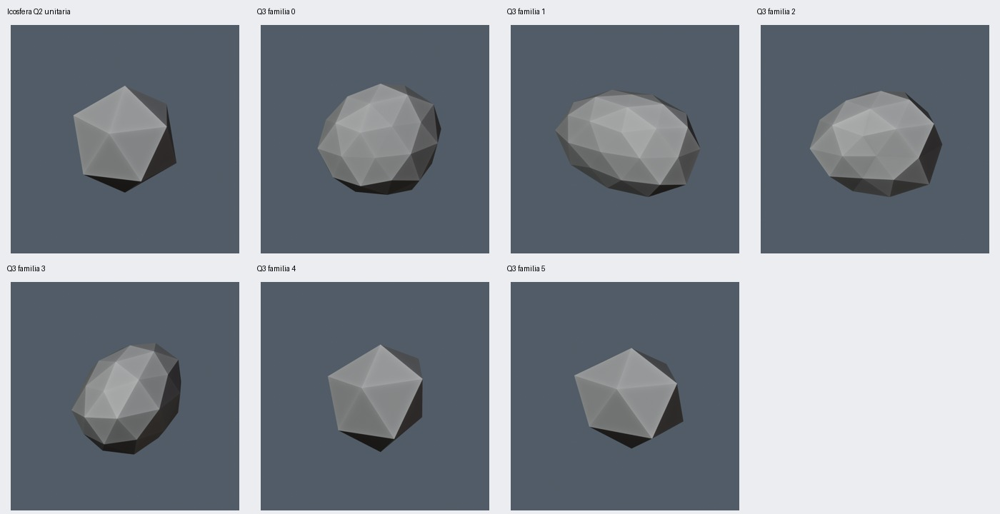

# Q3: formas y jerarquía del follaje sobre Q2 aprobada

Fecha: 2026-10-22. Algoritmo: `oak_geometry_nodes` **0.4.0**. Implementación y verificación técnica completadas; **valoración estética del usuario pendiente**. Referencia: copa ajustada Q2 0.3.0 aprobada por el usuario. Las ramas proceden de Q1b, conservadas por Q2.

## Cambio implementado

El usuario autorizó reducir la repetición mediante formas asimétricas, jerarquía de tamaños y agrupación ligada a las ramas. Se implementan estos tres puntos en `blender/oak_nodes_v4.py`; la fusión parcial queda como posible ensayo posterior. No se implementan F4–F6.

Q3 reutiliza directamente el ensamblado de madera Q2 y reemplaza su follaje. Los treinta casos conservan parámetros y semillas de `presets/q2-cases.json`; solo cambia `algorithm_version`. Se comprobó igualdad del hash completo de madera **en X/Y/Z**, del diagnóstico estructural nativo y de la transformación de altura. La silueta y la caja horizontal del follaje pueden cambiar.

- **Formas:** seis familias procedurales con lóbulos, deformación espacial suave y sesgo asimétrico. Las cuatro familias de mayor detalle parten de icosferas de 80 triángulos; las otras dos, de 20. Cada masa recibe además deformación continua propia en X/Y, escala y giro. La forma depende de la semilla explícita de follaje.
- **Jerarquía:** factores relativos 1.50/1.03/0.62 para masas dominantes/medianas/pequeñas. En primarias, el orden sobre el tramo muestreado asigna esos roles; las secundarias reciben medianas y pequeñas y el tronco, medianas. Los adultos y viejos contienen los tres roles; los jóvenes, con menor densidad, no requieren los tres.
- **Cantidad por rama:** se conserva `D=floor(4*density+0.5)` como control cuantizado, pero la cantidad depende también de longitud relativa a la altura y nivel, con variación acotada. Los máximos por curva son tronco/primaria/secundaria 2/3/2. Cada curva ocupa un tramo distal variable; densidad cero elimina todo el follaje.

Esta interpretación de densidad corresponde a 0.4.0. Las versiones anteriores conservan sus reglas. La escala efectiva sigue siendo `min(foliage_scale_m,0.24*height_m)`; las cotas Z de cada prototipo permiten desplazar su centro para mantener las hojas dentro de la altura solicitada sin modificar la madera.

Hay como máximo 110 masas, de las que hasta 26 tienen 80 triángulos: dos por primaria y dos en tronco. Las demás tienen 20. Con el máximo de madera de 5756 triángulos, el límite derivado es **9516 triángulos**, alcanzado en el extremo máximo. El árbol con hojas usa dos materiales.

## Comparaciones y revisión visual

Las columnas muestran **Q2 aprobada / Q3 candidata**. Los nombres `viejo-00`, `viejo-03` y `viejo-09` identifican edad y semilla, no algoritmos antiguos. Se comparan esos tres casos y los controles adulto-00/joven-00, con parámetros, semillas y cámaras compartidos. La comparación completa contiene ocho vistas con/sin hojas por caso en `artifacts/q3/acceptance/comparison/index.html`.



[Vista superior](comparison-top.jpg), [madera idéntica sin follaje](comparison-branches.jpg) y [los treinta modelos en Godot](gallery-godot.jpg).



La figura de familias usa la semilla de viejo-09, escala unitaria y cámara compartida. Muestra los prototipos antes de la deformación y escala particulares de cada masa. Las familias de veinte triángulos conservan facetas grandes.

| Grupo (10 casos) | Masas Q2 → Q3 | Triángulos Q3 | CV de tamaño Q2 → Q3 |
| --- | --- | --- | --- |
| Joven | 34 → 17 | 2684 | 0.051–0.065 → 0.227–0.273 |
| Adulto | 111 → 65–71 | 6864–6984 | 0.058–0.070 → 0.327–0.357 |
| Viejo | 135 → 85–90 | 8432–8532 | 0.054–0.063 → 0.344–0.366 |

El tamaño se mide con la diagonal de la caja de cada componente de follaje. Su coeficiente de variación (desviación estándar dividida entre media) comprueba diversidad de tamaños; no mide naturalidad, volumen ocupado ni silueta. Por ejemplo, viejo-09 pasa de 135 masas a 89, con 11 dominantes, 46 medianas y 32 pequeñas; su CV pasa de 0.059 a 0.348.

El agente revisó las comparaciones frontales/superiores y las galerías completas de perspectiva, madera y capturas Godot. Se distinguen grupos de tamaños diferentes y masas principales de contorno menos uniforme. Algunas zonas interiores quedan más llenas. Persisten piezas reconocibles, solapamientos y bordes entre masas; no se afirma una copa fusionada ni aprobación estética. La revisión del usuario debe valorar también si las masas dominantes y el relleno resultan excesivos.

Los adultos y viejos usan algo más de triángulos que Q2, aunque tienen menos masas, porque algunas incorporan más detalle. Esto no es una optimización de F6 ni demuestra mejora de FPS o de IA.

## Comprobaciones completadas

- **18 pruebas unitarias** aprobadas, incluidos contrato, semillas, ejecución/API y métricas de copa. La prueba nueva de tamaño distingue traslación de cambio de escala.
- **30 geometrías distintas**, GLB válidos y coincidentes con la malla evaluada. Alturas 4/10/9 m para joven/adulto/viejo; dos materiales. Godot 4.7.2 importó y capturó los treinta, con triángulos, materiales, escala y orientación coincidentes.
- Los treinta guardan madera final Q2 idéntica, mismo diagnóstico nativo, normalización, parámetros y semillas. Los controles de radios, uniones y reparto de Q1b siguen pasando.
- Q2 viejo-09 reconstruye su geometría original y las fuentes 0.1.0/0.2.0/0.2.1/0.3.0 conservan sus hashes. Q3 viejo-09 y adulto-00 se repiten con la misma geometría; el control adulto conserva fuentes y cámaras.
- Los diez parámetros siguen afectando la geometría. Cambiar semilla de follaje, escala, densidad completa o densidad cero conserva la madera final. Las cantidades por rama, roles, familias, detalle y triángulos concuerdan con los atributos de diagnóstico evaluados.
- En cada uno de los treinta archivos se comprueban seis prototipos distintos, sin triángulos degenerados. El residuo RMS frente al mejor ajuste afín supera 0.005 unidades: la deformación no se explica únicamente por escala, giro o traslación. En viejo-09 va de 0.062 a 0.126. Esto acredita cambio geométrico, no calidad estética.
- Apoyos/centros y componentes tienen cantidades coincidentes; los desplazamientos están acotados por la escala efectiva y el follaje permanece dentro de la altura solicitada, con tolerancia numérica de `1e-5` m.
- Seis extremos válidos: mínimo 328 triángulos; máximo 9516/110 masas; delgado con muchas ramas 5756/sin hojas; profundidad 1 sin hojas 1448; una primaria/profundidad 2 1112/11 masas; altura 2 m/escala solicitada 3 m 7184/81 masas. Se comprobaron numéricamente, sin aceptación estética general.

## Reproducción y evidencia

```sh
python3 scripts/verify_q3.py --visual --output artifacts/q3/otra-aceptacion
python3 scripts/q3_gallery.py artifacts/q3/otra-aceptacion
python3 scripts/make_gallery.py artifacts/q3/otra-aceptacion/lote
python3 scripts/make_gallery.py artifacts/q3/otra-aceptacion/lote --godot
```

Usar carpetas nuevas. Base por defecto `artifacts/q2/acceptance/lote/`, configurable con `--base`. Las galerías requieren Pillow y `--visual` necesita sesión gráfica; cada subproceso tiene timeout de 120 s. Entorno: Blender 5.2.1 LTS `9e2066aef7ef`, Python Blender 3.13.13, ejecutor 3.14.4, jsonschema 4.19.2, Godot 4.7.2 `ed1daf0bf`.

Los presets principales usan el candidato 0.4.0. Q2 aprobada queda reconstruible con `presets/v0.3.0/` y `presets/q2-cases.json`; no se sobrescriben lotes anteriores. Los modelos, informes completos y vistas regenerables están en `artifacts/q3/acceptance/`; los GLB importados, en `godot/q3/`. Los manifiestos registran semillas, parámetros, sockets, versiones y hashes de todas las fuentes.

`src/treegen/crown.py` mide componentes y tamaños sin generar geometría; `blender/inspect_q3.py` evalúa los archivos guardados sin modificarlos. `foliage_checks` registra conteos por nivel/rol/familia y distribución por rama. Evidencia seleccionada: [resumen](summary.json), [manifiesto viejo-09](viejo-09-manifest.json) y [pruebas](unit-tests.txt).

Siguiente paso: revisión visual del usuario de Q3 frente a Q2 aprobada. No hay bloqueos de ejecución pendientes. La fusión parcial y F4–F6 siguen sin implementar.
