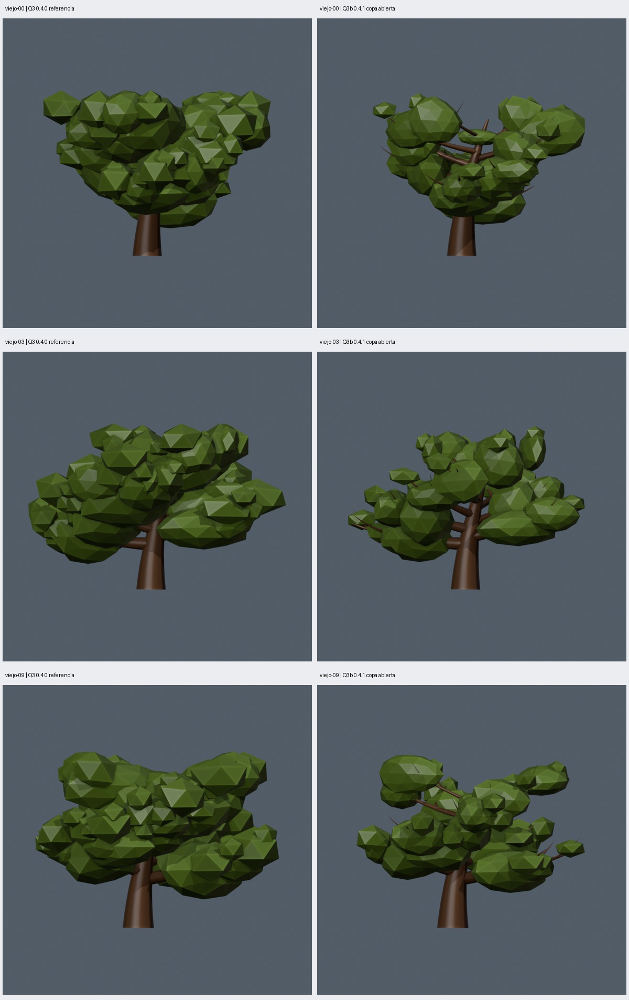
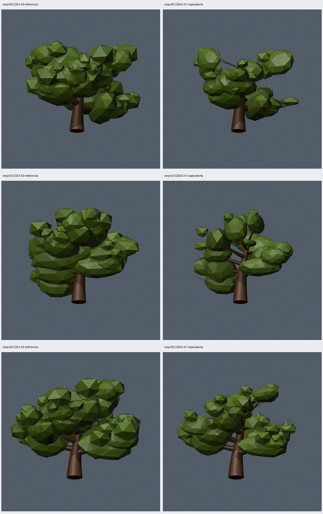

# Q3b: copa abierta, alturas y follaje según grosor

Fecha: 2026-10-22. Algoritmo: `oak_geometry_nodes` **0.4.1**. Revisión solicitada tras valorar el volumen de Q3 0.4.0 y señalar su excesiva compacidad. Implementación y verificación técnica completadas; **valoración estética del usuario pendiente**.

## Qué cambia

Se conserva exactamente la madera aprobada en Q2, que también usaba Q3. Q3b reutiliza sus grafos estructurales y normalización completa; los treinta casos mantienen parámetros y semillas. Solo cambia la versión del algoritmo. La referencia visual inmediata es Q3, cuya copa motivó esta revisión; no se presenta como una nueva aprobación del usuario.

- **Grupos distintos entre ramas principales.** La escala y cantidad usan el radio nativo de la primaria, relativo al basal. Las secundarias heredan esa capacidad y usan también su propio radio. Así, tamaño, cantidad y disposición de las masas de un mismo grupo responden a la rama que lo sostiene.
- **Alturas diferentes.** La posición del grupo sobre la curva varía con su capacidad y una perturbación acotada. Las ramas gruesas admiten grupos más próximos al interior; las delgadas los concentran más hacia las puntas. El espesor vertical y el margen superior cambian por rama. Se encaja el centro manteniendo espesor, evitando aplastar todas las masas contra el techo de altura.
- **Huecos atravesados por madera.** Los grupos ocupan tramos más cortos y la secundaria intermedia de cada primaria queda sin follaje. La rama sigue presente. Se reduce la cobertura continua de los recorridos y se incluyen dos vistas inferiores en las comparaciones.
- **Poca densidad.** Con control cuantizado de hasta dos masas, los grupos se colocan más hacia las puntas y su escala baja un 10 %. Esto conserva la apertura de los jóvenes, que ya eran poco densos en Q3.

La capacidad usa `clamp((radio_primaria/radio_basal - 0.12)/0.46, 0, 1)`. Es una regla artística relativa dentro del árbol, no una ley biológica ni un modelo de carga. Cambiar uniformemente el radio basal no aumenta automáticamente el follaje: `foliage_scale_m` y `foliage_density` siguen controlando su escala y cantidad globales.

Se mantienen las seis familias deformadas Q3, un material de hojas, dos niveles de ramas y las semillas explícitas. Los máximos por curva son tronco/primaria/secundaria 1/3/2; solo dos de las tres secundarias de cada primaria tienen hojas. Límite derivado: 85 masas, hasta 25 de 80 triángulos y 60 de 20, más 5756 de madera: **8956 triángulos** con perfil de ocho lados. La densidad cero sigue eliminando toda la copa.

No se introducen fusión de masas, anticolisiones, tercer nivel ni F4–F6.

## Comparación visual

Columnas: **Q3 0.4.0 / Q3b 0.4.1**. Mismos parámetros, semillas y cámaras por caso. Se conservan viejo-00/03/09 y controles adulto-00/joven-00; los nombres designan edad/semilla. La comparación completa contiene once vistas por pareja, incluyendo dos inferiores y madera sin hojas.





[Vista superior](comparison-top.jpg), [madera sin hojas](comparison-branches.jpg) y [treinta modelos en Godot](gallery-godot.jpg). Comparación completa: `artifacts/q3b/acceptance-final/comparison/index.html`.

## Cómo se comprueba

El inspector lee las mallas guardadas y las curvas nativas. Comprueba que los radios usados por el follaje coincidan con los de las primarias y que una secundaria por primaria no tenga hojas. Agrupa las masas de cada primaria y sus secundarias para medir su altura máxima y volumen cerrado sumado. Los volúmenes sumados cuentan solapamientos; no representan volumen ocupado de la copa.

La dispersión vertical es la desviación estándar de esas alturas máximas, dividida por la altura pedida. La relación radio/follaje se registra como correlación entre radio de primaria y volumen sumado de sus masas y secundarias. No exige orden estricto entre cada par de ramas.

La visibilidad se mide con una cuadrícula de 128×128 rayos ortográficos y encuadre común, sobre la malla completa. Se cuenta el primer material visible: para madera se restringe a Z ≥ 0.33 de la altura. Los huecos son muestras vacías dentro de los límites de cada fila proyectada con hojas; no son un cálculo de porosidad 3D ni IoU. Los resultados dependen de la vista y resolución y se acompañan de imágenes reales de Blender/Godot.

## Resultados completados

- **18 pruebas** aprobadas y **30 geometrías válidas/distintas**, importadas y capturadas en Godot. Los treinta conservan el hash completo de madera X/Y/Z, transformación de altura, diagnóstico estructural nativo, parámetros y semillas de Q3/Q2.
- Q3 viejo-09 reconstruye su geometría; las cinco fuentes históricas 0.1.0/0.2.0/0.2.1/0.3.0/0.4.0 mantienen sus hashes. Q3b viejo-09/adulto-00 se repiten de forma idéntica. Diez parámetros con efecto; semilla, densidad y escala de follaje conservan la madera.
- Los treinta muestran mayor dispersión de alturas entre grupos y más madera visible en la vista inferior geométrica medida. La correlación radio/volumen de grupos queda entre **0.832 y 0.995**. Esto no implica mejora en todos los ángulos: por ejemplo, viejo-09 no aumenta la madera visible en la segunda vista inferior frontal.
- Jóvenes: **2604 triángulos/13 masas**; adultos: **5784–5924/32–33**; viejos: **7032–7212/39–42**. Dos materiales y alturas 4/10/9 m.
- Seis extremos válidos: mínimo 328 triángulos/sin hojas; máximo **8116/55 masas**; delgado con muchas ramas 5756/sin hojas; profundidad 1 sin hojas 1448; una primaria/profundidad 2 952/6 masas; altura 2 m/escala solicitada 3 m 6144/41 masas. Son comprobaciones numéricas, sin aprobación estética general de los extremos.
- Se verifican seis prototipos no afines, radios auténticos, conteos por rama y límites de altura en los treinta archivos. Las fuentes, exportaciones y archivos guardados coinciden con sus manifiestos.

| Caso | Dispersión vertical Q3 → Q3b | Madera visible desde abajo, muestras Q3 → Q3b | Huecos proyectados Q3 → Q3b | Correlación radio/volumen Q3b |
| --- | --- | --- | --- | --- |
| viejo-00 | 0.150 → 0.161 | 20 → 60 | 5.2 % → 12.8 % | 0.966 |
| viejo-03 | 0.142 → 0.161 | 13 → 160 | 2.1 % → 5.2 % | 0.914 |
| viejo-09 | 0.148 → 0.155 | 95 → 161 | 3.5 % → 7.1 % | 0.934 |
| adulto-00 | 0.140 → 0.161 | 22 → 134 | 2.1 % → 19.7 % | 0.944 |
| joven-00 | 0.105 → 0.123 | 167 → 172 | 19.3 % → 30.6 % | 0.863 |

El agente revisó las comparaciones finales frontal/inferior, los controles jóvenes y las galerías completas de perspectiva, madera y capturas Godot. Se ven recorridos de ramas entre grupos y diferencias de altura/tamaño, conservando grupos amplios en ramas gruesas. Algunas puntas quedan desnudas y algunos grupos siguen solapados; la aceptación artística corresponde al usuario. La reducción de triángulos deriva de redistribuir el follaje y no constituye F6 ni una medición de FPS.

## Reproducción y procedencia

```sh
python3 scripts/verify_q3b.py --preview --output artifacts/q3b/otra-preview
python3 scripts/q3b_gallery.py artifacts/q3b/otra-preview
python3 scripts/verify_q3b.py --visual --output artifacts/q3b/otra-aceptacion
python3 scripts/q3b_gallery.py artifacts/q3b/otra-aceptacion
python3 scripts/make_gallery.py artifacts/q3b/otra-aceptacion/lote
python3 scripts/make_gallery.py artifacts/q3b/otra-aceptacion/lote --godot
```

Usar carpetas nuevas. Referencia por defecto: `artifacts/q3/acceptance/lote/`, configurable con `--base`. `--preview` solo genera cinco controles; no realiza aceptación técnica. Las galerías requieren Pillow y `--visual` una sesión gráfica. Subprocesos limitados a 120 s; trabajos individuales permiten como máximo 600 s.

Los presets principales usan 0.4.1 y `presets/q3b-cases.json` congela los treinta casos. Q3 sigue reconstruible en `presets/v0.4.0/` y `presets/q3-cases.json`; Q2 aprobada, en `presets/v0.3.0/` y `presets/q2-cases.json`. Sus grafos y lotes no se sobrescriben. Las pruebas intermedias de `artifacts/q3b/` no son el lote final seleccionado.

Generación en `blender/oak_nodes_v41.py`; inspección separada en `blender/inspect_q3b.py`. Los manifiestos incorporan radios/capacidad/cantidad por rama en `foliage_checks`, además de versiones, semillas, parámetros y hashes de fuentes. Modelos e informes completos regenerables: `artifacts/q3b/acceptance-final/`; importados: `godot/q3b/`.

Entorno fijado: Blender 5.2.1 LTS `9e2066aef7ef`, Python Blender 3.13.13, ejecutor 3.14.4, jsonschema 4.19.2, Godot 4.7.2 `ed1daf0bf`. Evidencia seleccionada: [resumen](summary.json), [manifiesto viejo-09](viejo-09-manifest.json) y [pruebas](unit-tests.txt).

La revisión estética sigue pendiente. Persisten facetas, solapamientos y piezas reconocibles; la regla de dejar libre la secundaria intermedia es deliberada y repetida. La apertura cambia según la cámara. No se declara mejora de IA ni de FPS ni conservación idéntica de la silueta Q3.
