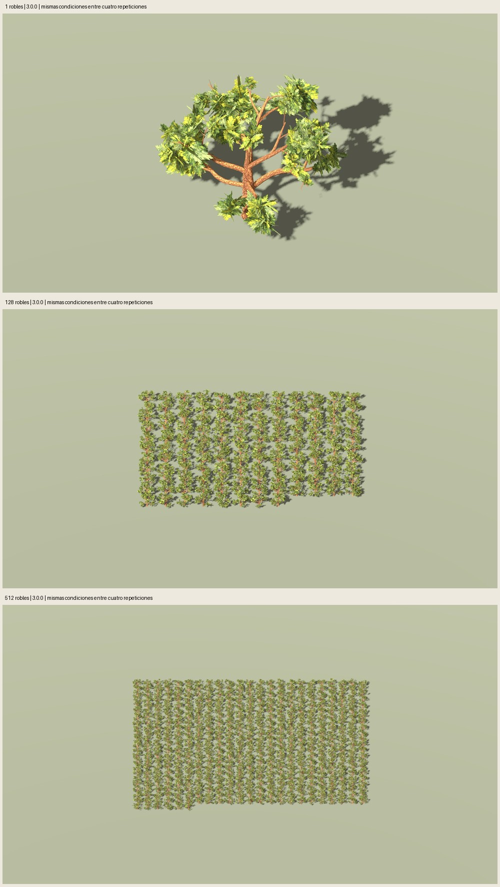

# Rendimiento Godot — roble3.0.0

Fecha: 2026-11-03. **Doce mediciones completas, auditadas con GPU real**.
El usuario autorizó medir1/128/512 árboles, cuatro repeticiones por cantidad,
1080p/MSAA4/sombras y condiciones fijas. Se mide una sola versión aprobada;
no se afirma una mejora frente a otra receta ni a otra especie.

## Resultados

Medianas entre cuatro repeticiones por carga. «ms/cuadro» es la mediana de los
tiempos medios de cada repetición; FPS es la mediana de sus FPS medios. Se
agregan por separado: sus medianas no son recíprocos exactos. P95 es la mediana
de los percentiles95 por repetición. Los cuadros no se tratan como miles de
experimentos independientes ni el rango como intervalo de confianza.

| Robles | ms/cuadro | FPS | P95 cuadro ms | Rango de medias ms |
|---|---:|---:|---:|---:|
| 1 | 0.660 | 1514 | 0.860 | 0.659–0.663 |
| 128 | 1.671 | 598 | 1.955 | 1.667–1.692 |
| 512 | 4.139 | 242 | 4.746 | 4.116–4.146 |

| Robles | GPU viewport ms | CPU render viewport ms | Draw calls | Primitivas renderizadas |
|---|---:|---:|---:|---:|
| 1 | 0.489 | 0.122 | 5 | 11 492 |
| 128 | 1.573 | 0.485 | 787 | 2 314 048 |
| 512 | 4.035 | 1.413 | 3073 | 9 045 269 |

Con512 árboles se registran241.46/242.97/241.18/241.77 FPS en las cuatro
repeticiones (orden exacto y valores completos en `summary.json`). El coste GPU
próximo al tiempo por cuadro y superior al CPU render es **compatible con mayor
peso del renderizado GPU** en esta carga; no aísla alfa, sombras o geometría.
CPU y GPU trabajan con solapamiento: no sumar sus tiempos. Los contadores
incluyen plano receptor y pasadas de sombras, no solo triángulos de los GLB.

## Assets y condiciones congeladas

- Receta `roble_copa_ancha@3.0.0`, cinco maduros3100–3104 aprobados, canopy17,
  paint2718, **5745/6158/5447/6087/6006 tris** por GLB y dos materiales.
  Sus bytes se verifican contra `familia-01/user-acceptance.json` antes de importar;
  no se modificaron mallas, texturas, recetas ni aceptación artística.
- Una instancia usa3100. Cargas múltiples alternan los cinco casos por índice.
  Triángulos de assets por escena:5745 /753425 /3015089. Son MeshInstance3D
  normales con recursos compartidos entre copias, sin MultiMesh ni un nuevo
  sistema de bosque. Cinco prototipos permanecen precargados en cada proceso.
- Godot4.7.2 `ed1daf0bf001b61586d9930840f2f1394092c079`, Compatibility,
  OpenGL3.3.0/NVIDIA595.99.02, RTX5060 de8 GiB, Intel i5-12400F de seis
  núcleos/doce hilos. Contexto y ajustes efectivos en `hardware.json` y
  `engine-settings.json`.
- Render interno1920×1080, ventana1280×720, MSAA4. Se verifica tamaño real;
  VSync, límite FPS y LOD automático desactivados. GPU software rechazada.
- Rejilla determinista18 m, giro `fmod(i*2.399963229728653,TAU)`, variante `i%5`.
  Columnas `ceil(sqrt(count))`, filas `ceil(count/columnas)`; última fila parcial.
  Posiciones y giros auditados en `layouts.json`.
- Cámara ortográfica estática, dirección[0,.65,1], centro[0,7,0]. Tamaño26 m con
  un árbol; con varias instancias,`max(columnas,filas)*18*1.12+26`. Distancia
  `max(40,span*2)`, plano lejano2000 m. **Misma cámara entre repeticiones de cada
  cantidad; cambia el encuadre entre cantidades para mostrar toda la rejilla**.
- Plano receptor1200×1200 m. Luz[-35,-25,0], energía1.2; ambiente.5 y exposición1.
  Sombras dobles, distancia1500 m, bias.1 y normal bias2. El rango de sombras
  cubre esta rejilla extensa; no se hereda el alcance500 m del benchmark del pino.
- Atlas conservados1254² de corteza y2000² de follaje. Recorte alfa.5, doble cara,
  rugosidad.95, mipmaps y filtrado anisotrópico, antialias alfa desactivado.
  Se reutiliza `painted_pine_asset.gd`, adaptador compartido ya empleado en la
  revisión del roble; sus ajustes efectivos se auditan por material.
- Cada carga usa proceso nuevo, cuatro repeticiones consecutivas,3 s de
  calentamiento +6 s de medición por repetición: **72 s de muestras**. Solo la
  primera repetición de cada cantidad guarda PNG antes de medir, seguido de1 s
  adicional de calentamiento. Carga/importación/creación y capturas quedan fuera.
- Tiempo por cuadro con reloj monotónico en `_process`; medición CPU/GPU del
  viewport habilitada y contadores por cuadro. Telemetría NVIDIA a1 Hz:
  118 registros,56–67 °C y765–2737 MHz de reloj gráfico en la serie completa,
  incluidos intervalos entre procesos. No se fuerza un estado de potencia.



Revisión visual del agente: originales1080p de1/128/512 y prueba corta de cinco
árboles inspeccionados. Rejillas, árboles y sombras presentes; no hay desaparición
dominante ni recorte visible de la rejilla. Los árboles se ven progresivamente
pequeños al encuadrar toda la carga, con pérdida de detalle y bordes finos lejanos.
Esta revisión no sustituye la auditoría técnica ni certifica movimiento/aliasing.

## Validación, fallos y límites

**Cinco pruebas del arnés correctas:** estadísticas por repetición, FPS,
GPU sin tiempos marcada como no disponible, rechazo de caps/LOD/software/
resolución/materiales alterados, pérdida de instancias/variantes, muestras
inválidas o cortas y compatibilidad con enteros JSON serializados como decimales.

`audit.json`:passed. Doce ensayos, cuatro por carga,1448–9103 cuadros cada uno,
≥6 s por ensayo; verificados hashes de fuentes, cinco assets aprobados, entradas,
raw, ajustes, materiales, posiciones, giros y tres capturas1920×1080. Datos por
cuadro permanecen regenerables en `artifacts/roble-central/performance-01/`;
Git conserva resúmenes, contexto, layouts y capturas seleccionadas.

Primer smoke: Godot capturó y midió, pero el analizador intentó usar `count=5.0`
en `range`, causando TypeError. Se conserva en `performance-smoke-01/` y en
`smoke-failure.json`; no aporta muestras a este benchmark. Corregida conversión
validada de entero y añadida prueba de regresión. Segundo smoke correcto,
`performance-smoke-02/`, antes de la serie principal. No se descartó ningún
ensayo de las12 mediciones principales ni se eligió una repetición favorable.

**Alcance:** carga sintética estática en este equipo, con otros procesos de
escritorio. No equivale a FPS de un juego con física/IA/terreno ni demuestra una
mejora de versión. Las cámaras y tamaños aparentes cambian entre cantidades;
no extrapolar FPS linealmente ni aplicar estos valores a cientos de árboles
cercanos, otras densidades, cámaras, GPUs o renderizadores. No se midieron
movimiento, viento, LOD ni instanciado masivo. Las cinco variantes precargadas
impiden interpretar la memoria GPU total como consumo individual de un árbol.

**Decisión recomendada:** conservar la geometría aprobada por ahora. Antes de
optimizar, fijar una escena y cámara representativas del juego; si aparece un
problema de presupuesto, aislar sombras/alfa/geometría en un ensayo controlado.
Este benchmark por sí solo no autoriza ni inicia esos desarrollos.

## Reproducción

Requiere los cinco GLB aprobados en `artifacts/roble-central/familia-01/trees/`;
si faltan, reconstruir el lote con [las instrucciones de familia](../familia-01/informe.md).
`--source` permite otra carpeta con los mismos cinco GLB y manifiestos. Sesión
real con GPU; cada subproceso tiene límite180 s. Usar carpetas nuevas:

```sh
PYTHONPATH=src python3 -m unittest discover -s tests -p test_oak_performance.py -v
python3 scripts/benchmark_painted_oak.py --smoke --output artifacts/roble-central/mi-smoke
python3 scripts/benchmark_painted_oak.py --output artifacts/roble-central/mi-benchmark
python3 scripts/oak_performance_evidence.py --study artifacts/roble-central/mi-benchmark --evidence artifacts/roble-central/mi-evidencia
```

Configuración:`configs/verification/oak-performance-v1.json`.
`--analyze-only --output <estudio>` recalcula estadísticas sin nueva medición,
comprobando fuentes/recursos/entradas. El script Godot y arnés del pino históricos
no se modifican; se reutilizan percentiles, configuración de materiales y
control de subprocesos acotados. No se comparan sus FPS con los de este estudio,
pues cambian mallas, cámaras, espaciado y rango de sombras.
