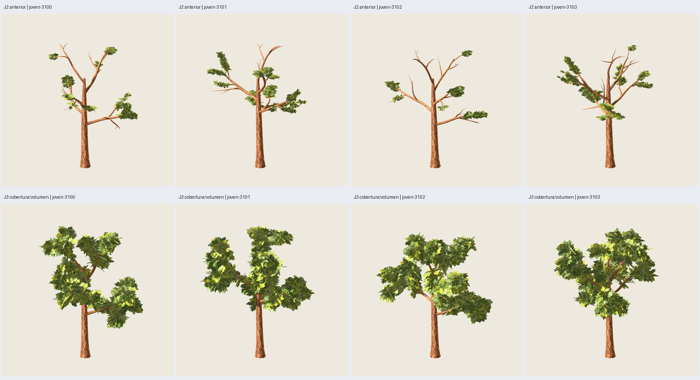

# J3 — más cobertura de ramas y volumen del joven

Fecha:2026-11-04. Petición del usuario: «le falta follaje en varias ramas y mas
volumen tambien». Se conserva la madera y pintura aprobadas y se corrige la
copa de los cuatro jóvenes. **Implementado, verificado y aprobado por el usuario.**
[Aceptación del lote J3](user-acceptance.json),2026-11-04: «mucho mejor lo apruebo».
No se midió rendimiento.

## Resultado y comparación reproducible

Nueva receta experimental `roble_copa_ancha@3.2.0`, componentes jóvenes0.2.0,
contrato1.8 ampliado de forma compatible.3.1.0/3.0.0 y sus recetas permanecen
intactas. Perfil joven O5 de5 m; mismas semillas3100–3103, distribución17 y
pintura2718. F4 congela los cuatro casos antes de generar y repite el mismo plan;
interpretación de Codex en este chat, sin llamada a otro modelo.

| Semilla | Tris J2 | Tris J3 | Madera | Follaje J3 | Ejes con grupos J2→J3 |
|---|---:|---:|---:|---:|---:|
| 3100 | 3816 | **4536** | 2952 | 1584 | 24→83 de83 |
| 3101 | 4097 | **4817** | 3233 | 1584 | 36→92 de92 |
| 3102 | 3536 | **4256** | 2672 | 1584 | 17→71 de71 |
| 3103 | 4122 | **4842** | 3258 | 1584 | 34→89 de89 |

Cada árbol tiene **264 grupos/792 láminas y dos materiales**, frente a144 grupos
en J2; +720 tris de follaje por árbol. Cota de familia:5415 madera+1584 follaje
=6999. Los cuatro quedan bajo5000, sin reducir o modificar madera.



En las capturas la copa gana presencia y continuidad, cubre los tramos altos
antes desnudos y tiene masas mayores. Se conserva la asimetría de cada semilla.
La aceptación artística del usuario está registrada aparte de los conteos y de la inspección del agente.

## Corrección de las reglas

J2 filtraba por radio y solo distribuía en órdenes≥2: varias ramas cortas
cercanas al eje y el líder superior quedaban sin candidatos o sin cupo. Su
compresión de profundidad(.55) y span/H.10 producían grupos pequeños/planos.

J3 calcula un cupo mínimo distal para **cada eje real**, incluido el tramo alto
del tronco. Distribuye el resto por longitud útil/vigor y un peso por orden,
con máximo12 grupos por eje y32 candidatos por eje. Sin filtro radial de
exclusión: se permite poblar ramas interiores y superiores existentes. El
tronco recibe grupos solo en su tramo superior(.74–.96); se conserva la parte
baja despejada. La selección distal se fija cerca de t.91 y las colocaciones
adicionales se reparten por el recorrido útil. No se añaden ejes de madera ni
se usan condiciones por semilla.

Span/H aumenta.10→.16; se recupera profundidad con factores[1.02,1.15,.95]
sobre el aspecto de cada plantilla. La dimensión máxima media de los grupos
sube aproximadamente **.49→.83 m** en las cuatro semillas. Son dimensiones de
láminas/plantillas, no una medición del volumen físico de unión de la copa.
Se usan marcos equilibrados inclinados, fijos en coordenadas del mundo, para
que las tres láminas aporten espesor desde arriba sin depender de la cámara.

Toda raíz pintada continúa anclada a la superficie real de madera y a una
muestra opaca del mismo atlas. No se retocaron PNG ni se alteraron UV para
simular relleno. La distribución de la muestra J1 aprobada no se exige idéntica
en esta revisión, porque el usuario pidió expresamente mayor cobertura y
volumen; su receta/configuración/resultado históricos se conservan íntegros.

## Verificación técnica

- Cuatro GLB finales repetidos byte por byte idénticos y cuatro geometrías
  distintas. Madera exacta frente a J2 en posiciones/normales/UV float32.
- Todos los ejes reales tienen grupos distales y el líder superior está cubierto
  en las cuatro semillas. Esto verifica asignación/contacto, no que toda la
  longitud de cada rama quede oculta por pintura.
- Caras y UV de madera/follaje verificadas sobre GLB, texturas embebidas exactas,
  alfa MASK.5, materiales doble cara, rugosidad.95 y dos materiales. Uniones de
  madera embebidas y contactos de los264 grupos por caso pasan; máximo error
  del lote **.000271 mm**, bajo.01 mm. No certifica cada hoja dibujada dentro
  del atlas ni convierte las uniones en malla soldada.
- 3.1.0 y maduro3.0.0 regenerados: GLB idénticos a sus referencias anteriores.
  La ampliación del esquema no modifica los valores de la receta histórica.
- **35 comprobaciones correctas** de presupuesto, cobertura, identidad, fuentes,
  repetición y regresiones en `summary.json`. **365 pruebas en77 archivos**
  correctas; inventario en `tests.json`.

Se corrigió además el texto genérico de procedencia del adaptador para que
sirva a ambas distribuciones jóvenes; antes describía específicamente cadenasB.
Se conservaron los primeros lotes y se regeneraron lote/repetición con el
adaptador definitivo. Los GLB son idénticos a los capturados antes de esa
corrección de metadatos; las capturas siguen correspondiendo a los mismos bytes.
La repetición final recibió SIGTERM antes de exportar3103, después de tres
casos completados. Se conserva `repeat-interrupted-01/` y se recupera únicamente
3103 con un plan F4 parcial nuevo (`repeat-recovery-plan/`), mismas entradas.
`repeat/` es un inventario compuesto de esas tres salidas completas y la salida
recuperada; no se presenta como una única ejecución sin interrupciones.
No hubo fallos geométricos ni sustitución de semillas en J3.

## Revisión visual y límites

**120 capturas reales Godot**:92 de J3(23 por árbol) y28 de J2 con las mismas
siete cámaras por individuo(frente,perfil,perspectiva,arriba y tres distancias).
Se inspeccionaron las120 como miniaturas en láminas y los cuatro frentes J3
originales900×900. No se declara revisión nativa de cada captura.

Godot4.7.2/Compatibility/RTX5060,900×900,MSAA4,mipmaps/anisotropía y sombras
explícitas. Las cámaras de J3 se congelan antes de capturar y se reutilizan
exactamente con J2; no se ajusta el encuadre por versión para favorecer a J3.
Protocolos en `review-protocol.json` y `comparison-protocol.json`.

Observaciones del agente:

- La cobertura superior y el volumen aparente aumentan claramente respecto
  a J2 con cámaras comunes. Las masas son más continuas y menos pequeñas.
- Más follaje oculta parte de las ramificaciones antes visibles. Se mantienen
  separaciones lobuladas entre conjuntos; no se busca una copa esférica uniforme.
- Algunos cantos y repeticiones de la pintura siguen visibles según el ángulo.
  No aparecen grandes rectángulos opacos evidentes en las vistas inspeccionadas.
- Sombras presentes, con extremos recortados en algunas tomas. Lejos se conserva
  mejor presencia de copa, aunque se pierde detalle. No se evaluó movimiento,
  parpadeo subpíxel, costes de alfa ni FPS.

**Lote J3 aprobado artísticamente por el usuario**, semillas3100–3103.
La receta congelada conserva su metadato histórico experimental; la aceptación
se registra aparte sin cambiar los hashes ni aprobar semillas no revisadas.
No se atribuye mejora de rendimiento por aumentar cobertura ni por seguir bajo
el presupuesto.3.1.0 permanece disponible como referencia anterior con cambios
artísticos solicitados, y el maduro aprobado3.0.0 no se sustituye.

Galería local: `artifacts/roble-joven/j3-volumen-01/index.html`.
[Vista general](overview.jpg), [antes/después](comparison.jpg), [distancias](distance.jpg).

## Reproducción

Entradas:`blueprints/roble_copa_ancha/3.2.0.json`, ejemplares en
`presets/blueprints/roble-joven-volumen/`, petición F4
`configs/language/roble-joven-j3-v1.json`. Carpetas nuevas, Blender/Godot fuera
del sandbox cuando sea necesario para audio/escritorio;120 s por generación y
180 s por subproceso de revisión/pruebas.

```sh
PYTHONPATH=src python3 -m treegen plan-blueprints blueprints/roble_copa_ancha/3.2.0.json --request configs/language/roble-joven-j3-v1.json --output artifacts/roble-joven/mi-j3/plan
PYTHONPATH=src python3 -m treegen generate-blueprint-plan artifacts/roble-joven/mi-j3/plan --output artifacts/roble-joven/mi-j3/trees
PYTHONPATH=src python3 -m treegen generate-blueprint-plan artifacts/roble-joven/mi-j3/plan --output artifacts/roble-joven/mi-j3/repeat
PYTHONPATH=src python3 -m treegen generate-blueprint blueprints/roble_copa_ancha/3.1.0.json --instance presets/blueprints/roble-joven/joven-3100.json --output artifacts/roble-joven/mi-j3/regression-310 --no-render
PYTHONPATH=src python3 -m treegen generate-blueprint blueprints/roble_copa_ancha/3.0.0.json --instance presets/blueprints/roble-central/maduro-3100.json --output artifacts/roble-joven/mi-j3/regression-300 --no-render
python3 scripts/verify_oak_young_volume.py --output artifacts/roble-joven/mi-j3 --stage review
python3 scripts/verify_oak_young_volume.py --output artifacts/roble-joven/mi-j3 --stage audit
python3 scripts/run_tests_bounded.py --output artifacts/roble-joven/mi-j3/tests
```

La comparación usa J2 en `artifacts/roble-joven/j2-completo-01/` o `--baseline`;
si falta, reproducirlo según su informe. Es una referencia de evaluación; la
CLI de generación de3.2.0 funciona sin resultados previos. Los GLB/blend, logs,
PNG y libros completos quedan regenerables; Git conserva evidencia seleccionada.
