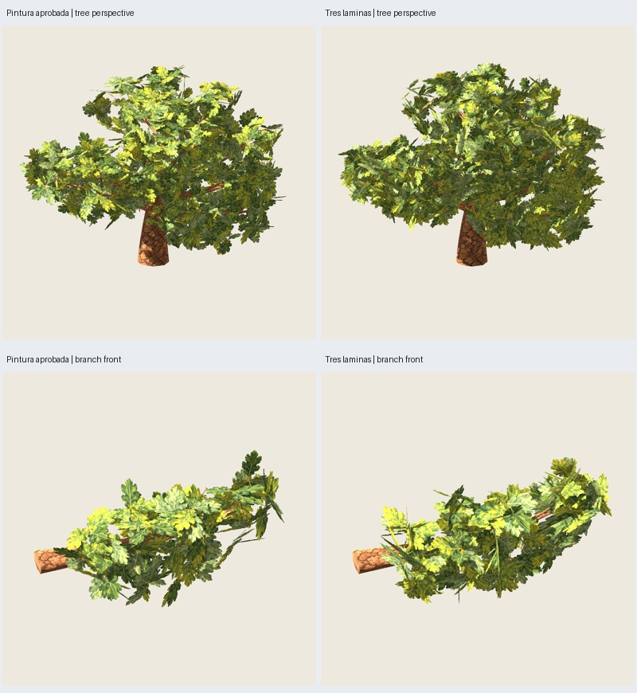

# Roble: ensayo de dos y tres láminas cruzadas por grupo

Fecha: 2026-10-26. **Implementado y verificado técnicamente como ensayo**.
La pintura del piloto está aprobada; el resultado de las cruzadas **no está
aprobado ni integrado en recetas/predeterminados**. [Autorización](user-authorization.json).
[Aceptación de pintura](../piloto-01/user-acceptance.json).

## Algoritmo y recursos

Referencia: piloto completo pintado y con poda, 3009/17/paint 2718, **9420 tris**.
Misma madera, corteza, materiales y luz. No se cambia la distribución de soportes.
La nueva representación **sustituye** las seis tarjetas de hoja de cada grupo:
ya no se afirma conservación de sus planos, posiciones individuales o volumen físico.

`oak-crossed-trial-0.1.0` calcula para cada uno de los **264 grupos** un marco
ortogonal desde el eje de soporte y su normal, centro de la caja local y dimensiones
de sus seis tarjetas. Normaliza sus vértices en esa caja y elige ocho plantillas
reales por selección determinista del punto más alejado, con inicio por hash de ID.
Cada grupo se asigna a la plantilla más próxima en coordenadas normalizadas;
las plantillas vienen del piloto, no de una referencia botánica externa.

Se hornean tres proyecciones ortogonales por plantilla desde las hojas pintadas
0.2.0: **24 celdas de 400²**, cuadrícula 5×5, PNG **2000² RGBA** con una celda libre.
Cycles CPU, ocho muestras/seed 2718, emisión sin iluminación y alfa original .5,
Standard/exposición 0/gamma 1. No se pintan hojas nuevas ni se hornea luz del motor.
Margen del 4 % por lado; la geometría incluye esa franja transparente. El atlas
es una proyección de tarjetas reales, no una textura diseñada previamente para
este tipo de grupo. Algunas hojas de canto producen trazos estrechos en la imagen.

Cada instancia usa su centro, ejes y dimensiones de caja originales; dos planos
longitudinales cruzados, o esos dos más un tercero perpendicular. Cada plano
rectangular cuesta dos tris, doble cara, MASK .5 y mipmaps/filtrado anisotrópico.
Ocho plantillas sustituyen la variación original de 264 grupos; el estilo se
deriva de la pintura aprobada, pero cambian disposición, repetición y sombreado.
No se modifica la madera ni se reutiliza la contracción .9 autorizada para pino.

## Coste

| Variante | Tris/grupo | Follaje | Total árbol | Ahorro frente a pintado |
| --- | ---: | ---: | ---: | ---: |
| Referencia: seis hojas | 12 | 3168 | 9420 | — |
| Dos láminas | 4 | 1056 | 7308 | 2112 (22,4 %) |
| Tres láminas | 6 | 1584 | **7836** | **1584 (16,8 %)** |

Madera+soportes: **6252 tris**, sin cambios. Rama aislada: 952 / 696 / 760 tris.
Dos materiales y PNG embebidos. Menos tris **no demuestra** más FPS: los planos
transparentes, sobrepintado y textura nueva pueden cambiar el coste de rasterización;
no se ha ejecutado benchmark.

## Verificación y comparación

- Catorce pruebas de roble pasan: límites, marcos y UV, centros/dimensiones de
  láminas, selección determinista de plantillas, rechazo de perfiles fuera de rango,
  además de las comprobaciones anteriores de pintura/poda.
- Seis GLB repetidos idénticos con **atlas congelado**: tres variantes de árbol y
  tres de rama. La repetición del horneado del atlas **no se ha ensayado**; se
  conservan receta y hash. No atribuir identidad reproducida al bake por estas repeticiones.
- Referencia reconstruida con los mismos canales de madera y follaje del piloto
  aprobado; madera igual en todos los ensayos, comparando posiciones/normales
  cuantizadas a seis decimales. Auditoría de PNG embebidos/hashes, UV finitas,
  alfa MASK .5, reversos, normales y reimportación Godot.
- **108 capturas reales**: árbol, 11 vistas de color y nueve máscaras × tres
  variantes; rama, ocho vistas de color y ocho máscaras × tres variantes.
  Godot Compatibility, RTX 5060, 900²/MSAA4, luz y ambiente del piloto; cámaras
  comunes por comparación y dos dibujos completados antes de cada captura.
- El revisor original se copia al proyecto del estudio y se amplía localmente
  su comprobación de tamaño para aceptar 2000² además de 1254²; el script fuente
  compartido de pino permanece intacto. La copia efectiva tiene hash en auditoría.

El agente inspecciona el atlas, seis láminas (64 celdas con repeticiones) y el
acercamiento `tree-cross3--branch-close.png` individual. Dos láminas dejan huecos
grandes y muestran demasiado las ramas; **no se recomiendan**. Tres láminas
mantienen mejor masa general, con un resultado más tupido y distinto patrón de
hojas. En la rama se sigue apreciando cambio de distribución; en el acercamiento
hay repetición y trazos estrechos derivados de proyecciones de hojas de canto.
No se certifica identidad visual, continuidad de hojas con madera ni naturalidad.



### Métricas de máscara frente a pintura aprobada

| Ensayo | IoU árbol (9 vistas) | Cobertura árbol | Cobertura rama (8 vistas) |
| --- | --- | --- | --- |
| Dos láminas | .71819–.81140 | −15,87 a −4,19 % | −28,20 a −2,86 % |
| Tres láminas | .84264–.87424 | **+2,64 a +7,01 %** | −1,31 a +10,22 % |

La identidad estricta IoU .99/±1 % **no se cumple en ninguna opción**. Tres láminas
son candidata por su mejor plenitud, no porque pase aquel criterio ni porque
esté probado su volumen físico. Las magnitudes dependen de vista/ocultación;
el aumento de cobertura no significa más volumen. No se ha ajustado escala/alfa
por semilla para aproximar las métricas. La valoración artística corresponde al
usuario antes de adoptar o refinar este ensayo.

## Revisar y reproducir

Galería `artifacts/roble-pintado/cruzadas-01/index.html`. Tres columnas: referencia,
dos láminas, tres láminas. Candidata: `tree-cross3/asset.glb` y `asset.blend`;
rama: `branch-cross3/`; comparación de dos: `tree-cross2/`. Textura generada
`crossed-atlas.png`, grupos normalizados en `groups.json`, plantillas/asignaciones,
recursos, versiones, código y resultados en `manifest.json`. [Auditoría seleccionada](audit.json).

```sh
PYTHONPATH=src python3 -m unittest discover -s tests -p 'test_oak*.py' -v
python3 scripts/oak_crossed_trial.py --output artifacts/roble-pintado/otras-cruzadas
```

Fuente predeterminada: `artifacts/roble-pintado/piloto-completo-01`, regenerable
con el arnés del [piloto](../piloto-01/informe.md). También se necesita el protocolo
de rama `artifacts/roble-pintado/rama-muestra-01/protocol.json`, regenerable con
`scripts/oak_painted_sample.py`. `--source` permite otro piloto, sin reclamar
validación de controles; las aserciones de esta versión están acotadas al caso
3009/17. Etapas `--stage generate` y `--stage review`; ejecutar fuera del sandbox
si Blender se bloquea con audio. Cada subproceso tiene límite de 180 s.

Pendientes: decisión sobre candidata/refinamiento, controles, integración en
catálogo y contratos de producción. El piloto aprobado de 9420 tris se conserva.
