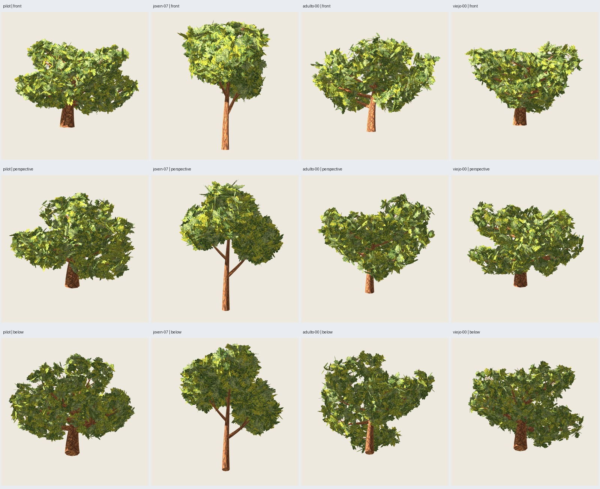

# Roble 2.1.0: tres láminas integradas en blueprints

Fecha: 2026-10-26. **Implementado y verificado: piloto y tres controles**.
[Aceptación e instrucción del usuario](user-acceptance.json): «ok implementalo
con 3 laminas». El piloto aprobado se conserva visualmente; no se atribuye aprobación
artística del usuario a los tres controles nuevos.

## Receta y arquitectura

`roble_copa_ancha@2.1.0`, contratos **1.4**, representación
`oak-painted-crossed@0.1.0`, mismas base 0.4.0 y distribución 0.1.1 históricas.
Registro, CLI, ejecutor, resolución, evaluación de GLB y adaptador Blender
integrados; versiones anteriores y predeterminados históricos conservados.
2.0.0 sigue siendo el ensayo técnico de un triángulo por hoja, no esta pintura.

La producción usa **tres láminas ortogonales (seis tris) por grupo**, caja/marco
de cada grupo y asignación a ocho plantillas **congeladas**, comunes a todos los
casos; no selecciona nuevas plantillas por semilla. Se mantienen 264 grupos/792
láminas. El atlas horneado aprobado se conserva en `assets/roble-pintado/v0.3.0/`,
2000² RGBA, junto con plantillas, UV fuente y procedencia para rehornearlo sin
resultados anteriores. Corteza y fuente de pintura 0.2.0. Los PNG exportados se
incrustan en GLB; `.blend` con imágenes empaquetadas.

Separación: `oak_crossed_production.py` valida recursos, presupuestos, resuelve y
construye; `generate_crossed_oak.py` adapta Blender; `oak_crossed_evaluation.py`
comprueba GLB y datos esperados. Evaluación exacta de posiciones/UV de láminas,
materiales y recursos; comparación de madera/normales a seis decimales con la base
histórica y soportes conservados. Las tarjetas sustituyen hojas individuales:
no se reclama conservar sus planos ni identidad de máscara con la versión anterior.

| Caso | Base/canopy/paint | Soportes conservados | Total tris | Tris sin cruzadas, misma madera |
| --- | --- | ---: | ---: | ---: |
| Piloto viejo-09 | 3009/17/2718 | 120 | **7836** | 9420 |
| Joven-07 | 1007/17/2718 | 46 | **3996** | 5580 |
| Adulto-00 | 2000/17/2718 | 108 | **6812** | 8396 |
| Viejo-00 | 3000/17/2718 | 113 | **7780** | 9364 |

Follaje común: **1584 tris frente a 3168**. Ahorro de 1584 tris en cada árbol;
piloto −16,8 %. Dos materiales. Tiempo de generación verificado: **3.610–3.991 s**
por caso. Límite de 120 s/generación, 180 s/subproceso de revisión; cotas previas
de trabajo/grupos/triángulos y hashes de los cinco recursos validados.

## Comprobaciones

- **139 pruebas pasan**, incluida altura seleccionada por canal de madera,
  contratos/recursos/componentes y los históricos. Una ejecución dentro del
  sandbox falló por `PermissionError` al abrir el socket loopback de la API;
  la suite completa pasó fuera del sandbox.
- Cuatro árboles generados y revalidados desde la receta; cada referencia RF3
  interna coincide byte a byte con B3. GLB del piloto repetido idéntico.
- El piloto de producción coincide con la candidata aprobada en **posiciones/UV
  de ambos canales y normales cuantizadas a seis decimales**. No se exige igualdad
  de bytes con aquel ensayo, que nombraba de otro modo el recurso de imagen.
- **Regresiones pino 2.3.0 y columnar 1.0.0: GLB idénticos a sus referencias**.
- Atlas rehorneado desde plantillas congeladas: **píxeles RGBA idénticos**.
  Los PNG difieren en metadatos de fecha/duración de Blender; no se confunde esto
  con diferencias visuales. Producción reutiliza el PNG aprobado y su hash.
- Auditoría GLB: geometría/UV de 792 láminas por caso, dos materiales, PNG embebidos
  con hash exacto, alfa MASK .5, reversos, normales, bounds y hash de artefactos.
  Soportes de tronco/primarias retirados; madera estructural restante intacta.

### Altura nominal y bounds transparentes

La primera verificación (`implementacion-01/viejo-00`) rechazó altura por medir
las esquinas transparentes de las tarjetas: **9.910583 m** frente a madera de 9 m,
apenas fuera del margen histórico del 10 %. Se conservó ese fallo y se corrigió
la magnitud evaluada para contrato 1.4: altura nominal sobre `Painted_Bark`, bounds
completos sobre toda la geometría. Las demás rutas mantienen su regla histórica.
Una prueba demuestra que se conservan los bounds de tarjetas y que la madera de
altura incorrecta o un canal ausente siguen rechazándose. Las posiciones/UV de
las tarjetas se comprueban independientemente contra el algoritmo resuelto.

## Godot y revisión visual

**144 capturas reales** (36 por caso): seis orientaciones y tres distancias,
referencia pintada con seis hojas frente a tres láminas, y sus máscaras en pase
separado. Godot 4.7.2 Compatibility, RTX 5060, 900²/MSAA4; luz (-35,-25,0), energía
1.2, ambiente .5/exposición 1; cámaras comunes por comparación, dos dibujos
completados por captura. Godot verifica materiales, normales, escala y conteos.

El agente inspecciona la lámina de controles (12 celdas) y cuatro láminas de
comparación de seis parejas (48 celdas): joven mantiene sus masas de copa más
estrechas y tronco largo; adulto/viejos conservan su identidad general. La
representación cruzada se ve más tupida y cambia detalles de distribución y luz;
persisten trazos estrechos de hojas de canto, repetición de ocho plantillas,
uniones/tapa de corteza y posibles hojas sin soporte de madera visible.
No se afirma haber inspeccionado individualmente las 144 capturas.



Cobertura proyectada frente a seis hojas, mismas madera/pintura/cámaras:
piloto +2,64–7,01 %, joven +1,25–7,07 %, adulto +2,30–8,48 %, viejo +2,28–7,02 %.
No cumple identidad estricta IoU .99/±1 % del plan inicial; la sustitución de
representación fue aprobada después del ensayo que mostraba esos cambios.
No se interpreta cobertura como volumen físico ni se declara mejora de FPS.

## Uso y reproducción

```sh
PYTHONPATH=src python3 -m treegen generate-blueprint blueprints/roble_copa_ancha/2.1.0.json --instance presets/blueprints/roble-cruzado/pilot.json --output artifacts/blueprints/roble-cruzado-a --no-render
PYTHONPATH=src python3 -m treegen validate artifacts/blueprints/roble-cruzado-a
python3 scripts/verify_oak_crossed.py --output artifacts/roble-pintado/otra-implementacion
```

Generar desde catálogo no depende de `artifacts/` anteriores ni vuelve a hornear.
El verificador puede comparar opcionalmente el piloto con el ensayo aprobado si
ese GLB existe; en su ausencia omite solo esa comparación histórica, no la auditoría.
Etapas `--stage generate`/`--stage review`. El arnés permite retomar salidas técnicas
completadas, revalidándolas, y deja las capturas en una carpeta nueva.

Galería actual: `artifacts/roble-pintado/implementacion-02/index.html`.
Cada caso contiene `tree.glb`, `tree.blend`, `placements.json`, entradas, manifiesto
con fuentes/recursos/semillas y referencia RF3. [Verificación seleccionada](verification.json).
La CLI conserva perfiles experimentales: estos cuatro casos no garantizan todo el
rango o todas las semillas. No se añaden lote RF5, benchmark, viento, LOD ni IA.
