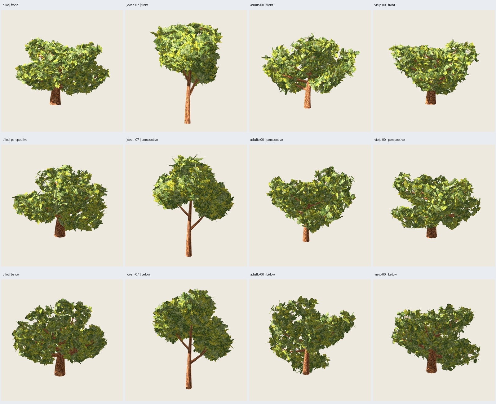

# Roble 2.2.0: madera selectiva integrada

Fecha: 2026-10-26. **Implementado y verificado: piloto y tres controles.**
El usuario aprueba «la variante de 6812 tris» y solicita integrarla al blueprint.
[Aceptación](user-acceptance.json). La aceptación artística corresponde al piloto;
los controles tienen revisión técnica y visual del agente.

## Receta y resultado

`roble_copa_ancha@2.2.0`, contrato **1.4**, representación
`oak-painted-crossed@0.2.0`. Mismos componentes base/distribución, atlas 0.3.0,
pintura/corteza 0.2.0, ocho plantillas y 264 grupos/792 láminas. Dos materiales.

| Caso | Base/canopy/paint | Antes 2.1.0 | Nueva 2.2.0 | Ahorro |
| --- | --- | ---: | ---: | ---: |
| Piloto viejo-09 | 3009/17/2718 | 7836 | **6812** | 1024 / 13,1 % |
| Joven-07 | 1007/17/2718 | 3996 | **3132** | 864 / 21,6 % |
| Adulto-00 | 2000/17/2718 | 6812 | **5820** | 992 / 14,6 % |
| Viejo-00 | 3000/17/2718 | 7780 | **6900** | 880 / 11,3 % |

Solo se simplifican anillos de secundarias, con la regla aprobada de
`oak-wood-rings-0.1.0`: error de correspondencia radial ≤20 mm por tramo completo.
Se mantienen ocho lados, extremos, tapas y UV de anillos retenidos. **Tronco,
primarias, soportes conservados y follaje permanecen exactos** en geometría y
normales; las láminas también en UV. No se traslada ninguna rama a la textura.
La misma regla se aplica a los cuatro casos, sin ajustes por semilla.

Máximo de correspondencia observado: 19,8834 mm; generación **3,621–4,570 s**.
Cota presupuestaria previa conservadora sin descontar ahorro dependiente de
geometría; límite 12500 tris/dos materiales y 120 s/generación. Subprocesos de
pruebas/capturas limitados a 180 s.

## Integración y auditoría

- Registro y combinación de componentes admiten explícitamente 0.2.0 con contrato
  1.4; receta y ejemplares nuevos, anteriores y alias históricos conservados.
- `oak_wood.py` resuelve geometría pura. `oak_crossed_production.py` aplica la
  selección versionada; adaptador Blender hereda la generación de referencias
  RF3 y exporta madera simplificada con su sombreado correcto.
- Manifiesto registra anillos retenidos, tolerancia/error, versión, preservación
  de tronco/primarias, recursos, entradas, semillas y procedencia de fuentes.
  Los campos heredados de referencia RF3 (`wood_sha256`, proyección de soportes)
  describen la madera de origen; no certifican la superficie optimizada final.
- El validador reconstruye la regla, contrasta las caras y UV de madera exportadas
  permitiendo diagonales de triangulación, rechaza caras adicionales/duplicadas,
  y audita conservación de tronco/primarias y soportes contra la referencia.
  También verifica láminas, recursos embebidos, normales unitarias y conteos.
- El resultado distingue `wood_and_remaining_supports_exact=false` de
  `trunk_primary_remaining_supports_exact=true`; no declara toda la madera idéntica.

## Verificaciones

**145 pruebas pasan** fuera del sandbox, incluida API local y pruebas de
resolución versionada, conservación selectiva, UV, extremos y rechazo de caras
alteradas/duplicadas. `git diff --check` sin errores.

Cuatro generaciones nuevas desde receta/ejemplar y recursos versionados, sin
necesitar el ensayo para generar. **16 comprobaciones** pasan:
cuatro regresiones exactas 2.1.0, cuatro conservaciones de follaje, cuatro
auditorías de madera exportada, repetición del piloto, coincidencia con la
candidata aprobada, regresión pino 2.3.0 y regresión columnar 1.0.0.

Piloto repetido: GLB idéntico. Piloto integrado y candidata aprobada del ensayo:
**geometría/UV exactas y normales a seis decimales iguales** en ambos canales;
no se exige mismo nombre de recurso ni igualdad de bytes con aquel ensayo.
Comando público CLI ejecutado y resultado revalidado: **6812 tris y GLB idéntico**
al piloto de producción del verificador.

## Revisión visual real Godot

**288 capturas únicas**, cuatro casos, árbol/madera, antes/después, color/máscara,
seis orientaciones, acercamiento y dos distancias; 900²/MSAA4, luz y cámaras
comunes. GLB reimportados verifican conteos, límites, normales y materiales.
Se inspeccionaron `controls.jpg` y las ocho láminas `*-tree.jpg`/`*-wood.jpg`.

El árbol completo mantiene una apariencia muy próxima en las vistas revisadas;
con madera sola se aprecian cambios pequeños de facetas y bordes de secundarias.
No se observaron saltos grandes nuevos en las vistas inspeccionadas. El joven
presenta mayor cambio relativo en las ramitas sin follaje; no se atribuye al
usuario aprobación artística de estos controles.



| Caso | IoU mínimo árbol, seis vistas | Cambio máximo cobertura, seis vistas | IoU mínimo madera, seis vistas |
| --- | ---: | ---: | ---: |
| Piloto | .9997899 | .0034 % | .9868253 |
| Joven-07 | .9999556 | .0040 % | .9502242 |
| Adulto-00 | .9998244 | .0033 % | .9786259 |
| Viejo-00 | .9998834 | .0041 % | .9904312 |

Incluyendo detalle/distancias, el menor IoU del árbol es .9983916; la madera
lejana del adulto baja a .9375 por cambios de pocos píxeles en ramitas.
Las máscaras no prueban identidad de color, sombras ni volumen físico.
La tolerancia de correspondencia no es una cota Hausdorff certificada;
anclajes originales no garantizan contacto perfecto con la superficie reducida.
Persisten límites del ensayo y de la pintura: posibles pequeñas separaciones,
trazos de canto, costuras de corteza y bounds transparentes mayores que la altura.
**Sin benchmark de roble, LOD ni afirmación de mejora de FPS.**

## Uso y reproducción

```sh
PYTHONPATH=src python3 -m treegen generate-blueprint blueprints/roble_copa_ancha/2.2.0.json --instance presets/blueprints/roble-madera/pilot.json --output artifacts/blueprints/mi-roble-madera --no-render
PYTHONPATH=src python3 -m treegen validate artifacts/blueprints/mi-roble-madera
PYTHONPATH=src python3 -m unittest discover -s tests
python3 scripts/verify_oak_wood.py --output artifacts/roble-pintado/otra-integracion-madera --stage generate
python3 scripts/verify_oak_wood.py --output artifacts/roble-pintado/otra-integracion-madera --stage review
```

Ejemplares: `presets/blueprints/roble-madera/{pilot,joven-07,adulto-00,viejo-00}.json`.
Matriz: `configs/verification/oak-wood-v1.json`. Ejecutar fuera del sandbox si
bloquea sockets/audio/UI. Cada salida requiere carpeta nueva.

Galería completa: `artifacts/roble-pintado/integracion-madera-01/index.html`.
Cada caso contiene `tree.glb` y `tree.blend`, atlas embebidos/empaquetados,
manifest, placements y referencia reproducible. [Verificación seleccionada](verification.json)
con hashes de fuentes/capturas, métricas y versiones; reporte completo en la galería.
No hay pendientes de integración de esta receta. Históricos conservados.
