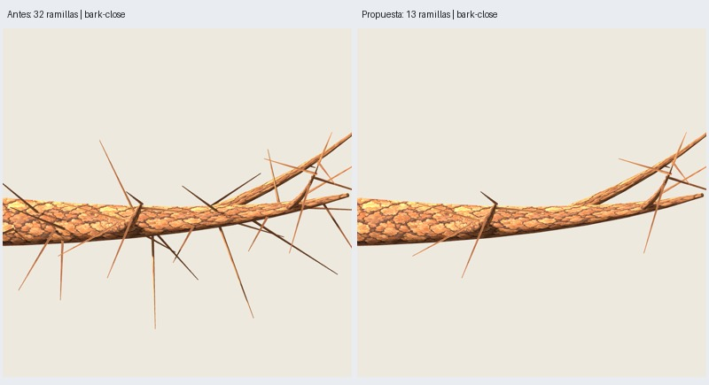
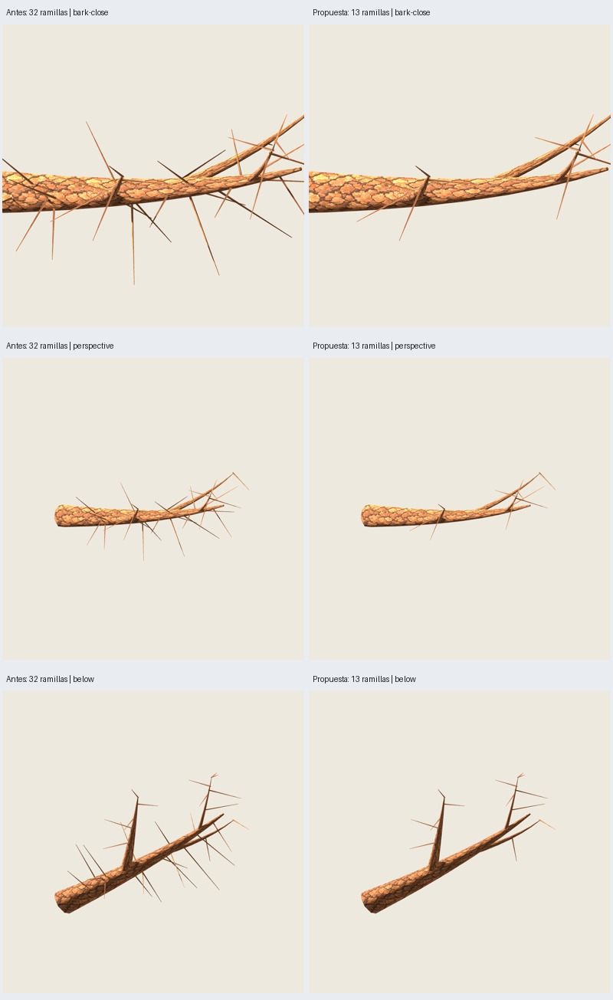

# Roble: madera sin ramillas directas de la primaria

Fecha: 2026-10-26. [Ensayo autorizado](user-request.json); **implementado y verificado**,
pendiente de valoración artística del usuario. Comparación exclusivamente de madera.

## Resultado

Se eliminan los 19 tubos cuyo `parent_branch_id` corresponde a la primaria 100.
Se conservan los 13 nacidos de sus secundarias 200/201/202 (5/2/6), junto con toda
la geometría de la primaria y las secundarias. Se vuelve al grosor original;
no se arrastra el engrosamiento experimental rechazado `fuller-v1`.
La selección usa la relación `parent_id` de las ramas, no una posición espacial
ni una lista de identificadores de soportes elegidos a mano.

**Madera: 720 → 568 tris, −152 (−21,1 %).** Son 19 soportes de ocho triángulos.
Los 568 tris conservados, incluidas sus normales, coinciden con los de la muestra
inicial. Semillas históricas 3009/17; misma corteza 0.2.0, material y UV.
No se cambia la receta del árbol completo. Este ensayo exporta solo madera:
no borra, traslada ni exporta hojas y no constituye una integración de copa.



## Verificación técnica y visual

Diez pruebas de roble pintado/muestra pasan, incluida selección por jerarquía y
rechazo de padres desconocidos. GLB autocontenido, corteza embebida con hash exacto,
UV finitas y material de madera opaco/doble cara. Repetición del GLB idéntica.
Auditoría por multiconjunto de triángulos con posiciones/normales: ninguna cara
nueva ni modificada entre las conservadas; desaparecen exactamente 152.

Godot reimporta ambos modelos y verifica triángulos, límites, materiales y normales.
**18 capturas reales**: seis orientaciones, dos distancias y un acercamiento por
versión. Cámaras y luz comunes del protocolo original, 900²/MSAA4, Compatibility,
RTX 5060, dos dibujos completados antes de cada captura. El agente inspecciona el
acercamiento y la lámina de nueve parejas: la primaria queda despejada, la silueta
de sus ramificaciones mayores se conserva y las ramillas se concentran sobre
secundarias. Sigue visible la rectitud de los tubos conservados. Esta revisión no
equivale a aprobación artística ni valida otras semillas o el árbol completo.



[Auditoría, IDs y hashes](audit.json). Exportaciones y revisión ejecutadas fuera
del sandbox para evitar el bloqueo de audio ya conocido, con límite de 180 s por
subproceso del arnés. Resultados regenerables:
`artifacts/roble-pintado/ramillas-jerarquia-01/`. Galería `index.html`, todas las
vistas en `all-views.jpg`; modelo `after/wood/branch.glb`, editable
`after/wood/branch.blend`, repetición en `repeat/wood/`.

## Reproducir

```sh
PYTHONPATH=src python3 -m unittest discover -s tests -p 'test_oak_painted*.py' -v
python3 scripts/review_oak_wood_hierarchy.py --output artifacts/roble-pintado/otra-jerarquia
```

La fuente predeterminada es `artifacts/roble-pintado/rama-muestra-01`; se regenera
con `python3 scripts/oak_painted_sample.py --output artifacts/roble-pintado/otra-fuente`
y se selecciona con `--source`. El perfil se identifica como `secondary-only-v1`.
El siguiente paso es revisar esta muestra de madera antes de decidir su integración.
