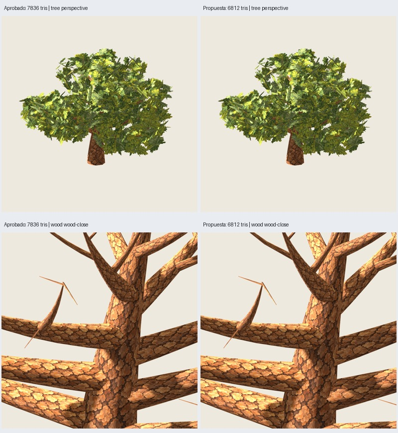

# Roble: ensayo de simplificación de madera

Fecha: 2026-10-26. **Ensayo implementado y verificado en el piloto**, sin cambiar
la receta 2.1.0. El usuario autorizó intentar reducir madera y pidió minimizar
el cambio visual. Los cambios anteriores quedaron guardados primero en el commit
`2d1ed43` («Integra roble pintado con tres láminas y evidencia de validación»).

## Resultado recomendado para revisión

**Simplificar solo ramas secundarias, con tolerancia de correspondencia de 20 mm.**
Piloto viejo-09, base/canopy/paint 3009/17/2718: **7836 → 6812 tris**, ahorro
1024 (**13,1 % del árbol; 16,4 % de madera/soportes**). Madera: 6252 → 5228;
follaje: 1584 → 1584. Dos materiales, ocho lados por sección, mismas texturas.

Tronco y primarias: posiciones, UV y normales del GLB **idénticos** al aprobado.
Los 120 soportes pequeños conservados y sus normales también son idénticos.
Las 792 láminas conservan posiciones/UV/normales; mismas guías, distribución,
anclajes, pinturas y materiales. No se ha incorporado ninguna rama a la textura.



| Variante piloto | Total tris | Ahorro | Alcance |
| --- | ---: | ---: | --- |
| Aprobado 2.1.0 | 7836 | — | Referencia |
| Global 5 mm | 7836 | 0 | Medición; no se puede retirar ningún anillo |
| Global 10 mm | 7644 | 192 / 2,5 % | Exportada y comparada |
| Global 20 mm | 6652 | 1184 / 15,1 % | También cambia tronco/primarias; no recomendada frente a selectiva |
| **Solo secundarias 20 mm** | **6812** | **1024 / 13,1 %** | **Candidata para revisión del usuario** |

## Método y límites geométricos

`src/treegen/oak_wood.py`, `oak-wood-rings-0.1.0`: eliminación determinista de
anillos intermedios, eligiendo el menor error admisible. Cada candidatura evalúa
**todos** los anillos originales del tramo ampliado y sus ocho vértices radiales;
no acumula decisiones con errores locales. Mantiene anillos extremos, tapas,
radios de las secciones retenidas, orientación, UV originales y modo de sombreado.
No reduce resolución radial ni elimina ramas. Geometría y Blender separados.

La cota compara posiciones originales con la interpolación de los vértices
correspondientes en los extremos del tramo (parámetro por índice de anillo).
Máximo observado de la selectiva: **19,846 mm**. No es una distancia Hausdorff
certificada entre superficies trianguladas. Cambian facetas, interpolación de
UV y normales de secundarias; anclajes conservados no prueban que todos sigan
exactamente sobre la nueva superficie. No se ha certificado contacto geométrico
individual ni ausencia universal de pequeñas separaciones.

Entrada acotada: hasta 64 ramas, 64 anillos por rama, 424 piezas de madera y
20 mm de tolerancia máxima; rechazo de topologías no reconocidas/no finitas.
Cada subproceso de generación/revisión tiene límite de 180 s. La receta histórica
conserva su límite de 120 s/generación.

## Verificación y revisión visual

- **143 pruebas pasan**, incluidas cuatro específicas de tubos rectos, error
  acumulado, UV/extremos/tapas, soportes y conservación selectiva. La API local
  requiere ejecutar fuera del sandbox; dentro falló por socket bloqueado.
- Ocho GLB del ensayo (cuatro variantes × árbol/madera) repetidos **idénticos**.
  Referencia reconstruida: geometría, UV y normales iguales al GLB aprobado.
- 17 comprobaciones geométricas/de repetición pasan; recursos embebidos con hash,
  UV finitas, materiales, normales y reimportación Godot comprobados.
- Godot real: seis orientaciones, acercamiento y dos distancias; color y máscara,
  árbol y madera sola, cámaras/luz compartidas, 900²/MSAA4. **144 capturas únicas**;
  216 eventos de captura porque la referencia se repite en cada pareja.
- Revisadas `propuesta.jpg`, `wood.jpg` y `resto-vistas.jpg` de `madera-03`, además
  de las comparaciones globales de `madera-02`. A escala de árbol, la candidata
  mantiene una apariencia muy próxima; en madera sola cambian algunos bordes y
  facetas finas de secundarias. No se observan saltos grandes nuevos en las vistas
  revisadas. No se afirma identidad visual ni aprobación artística del usuario.
- Selectiva, seis vistas de forma del árbol: **IoU ≥ .9997899**. Incluyendo detalle
  y distancias: IoU ≥ .9986320, diferencia de cobertura ≤ **0,137 %**. Son máscaras
  binarias, no equivalencia de color, iluminación o sombras.
- Madera sola: IoU ≥ .9868253 en seis vistas; en la vista lejana baja a .9448819
  por cambios de pocos píxeles en ramillas. No ocultar esa limitación tras la copa.

No hay benchmark ni afirmación de mejora de FPS. Las rutas del generador de
producción, pino, columnar, recetas y recursos no se modifican en este ensayo.

## Controles: solo medición numérica

Referencias de los tres controles regeneradas por CLI. Se calcula la misma regla
selectiva, **sin exportar ni revisar visualmente sus variantes optimizadas**:

| Caso | Aprobado | Selectiva 20 mm | Ahorro |
| --- | ---: | ---: | ---: |
| Joven-07 | 3996 | 3132 | 864 |
| Adulto-00 | 6812 | 5820 | 992 |
| Viejo-00 | 7780 | 6900 | 880 |

La tolerancia absoluta no implica igual impacto visual en diferentes edades.
Antes de integrar esta regla en una receta hay que verificar esas variantes.

## Reproducción y archivos

Desde fuentes y recursos versionados, sin depender de resultados anteriores:

```sh
PYTHONPATH=src python3 -m unittest discover -s tests
python3 scripts/review_oak_wood.py --output artifacts/roble-pintado/otra-madera --stage generate
python3 scripts/review_oak_wood.py --output artifacts/roble-pintado/otra-madera --stage review
```

Ejecutar fuera del sandbox si bloquea socket/audio/UI. El primer intento
`madera-01` exportó, pero Blender quedó bloqueado al cerrar audio y fue terminado
al límite de 180 s; no se contabiliza como verificación exitosa.

La ejecución final reutilizó el piloto mediante
`--source artifacts/roble-pintado/implementacion-02/pilot`, comprobando primero
su hash contra la evidencia aprobada. Resultado completo:
`artifacts/roble-pintado/madera-03/index.html`. Propuesta exportable:
`artifacts/roble-pintado/madera-03/after/secondary20mm-tree/branch.glb` y
`branch.blend`. Comparaciones numéricas, versiones, seeds, hashes de fuentes,
recursos, capturas y resultados en [audit.json](audit.json).

El ensayo queda pendiente de decisión artística; no se promociona a producción.
