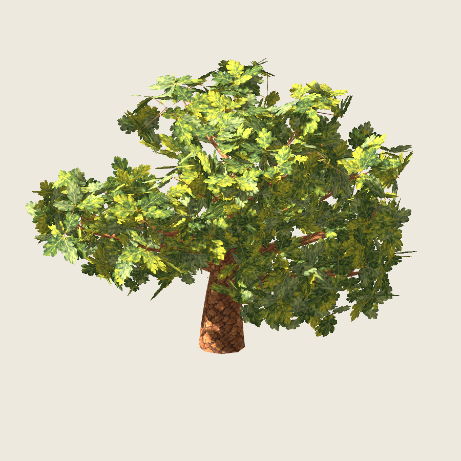
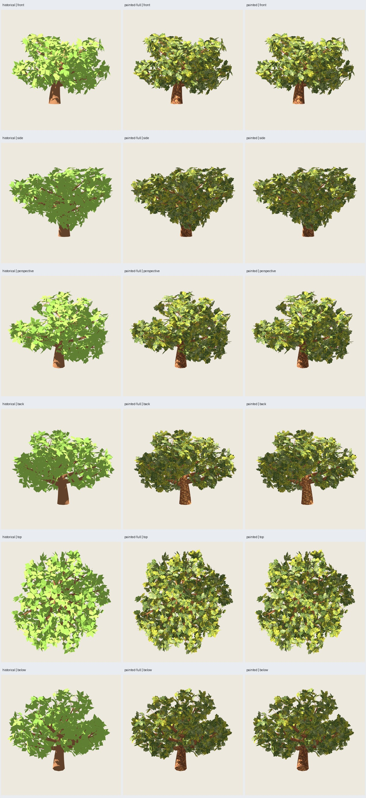
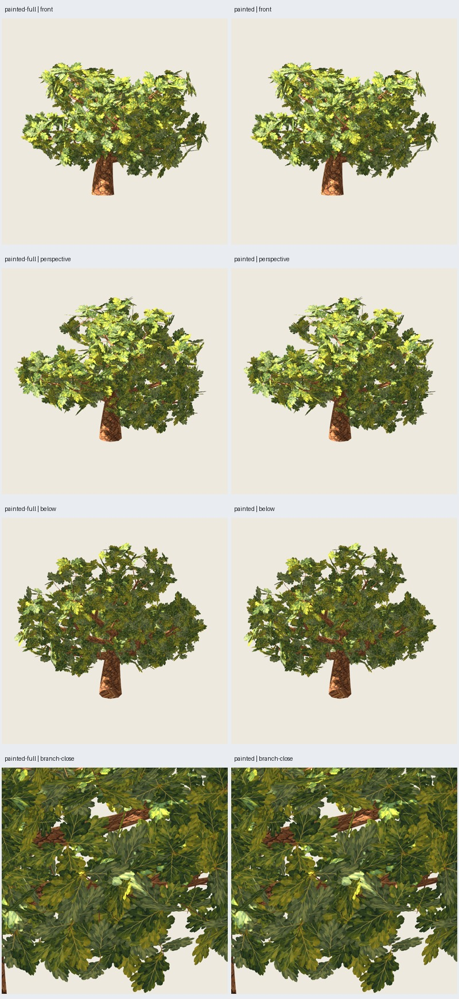

# Roble pintado: piloto completo con ajuste de ramillas

Fecha: 2026-10-26. **Piloto implementado y verificado técnicamente; aceptación
artística de pintura aprobada posteriormente.** [Autorización de integración](user-authorization.json),
[aceptación explícita de pintura](user-acceptance.json).
Se conserva el generador histórico y no se publican nuevos predeterminados.



## Cambio y alcance

Referencia regenerada: `roble_copa_ancha@1.2.0`, viejo-09, semillas **3009/17**;
GLB idéntico al piloto B3 aprobado. Pintura **2718**, atlas/corteza **0.2.0**,
1254². Representación aislada `oak-painted-tree-pilot-0.1.0`, implementada en
algoritmo puro, adaptador Blender, arnés y revisión Godot separados.
No se modifica ni se adopta la receta técnica 2.0.0 con atlas procedural 0.1.0.
La integración en el catálogo/CLI de blueprints y los tres controles siguen pendientes.

Se aplica exactamente la pintura de la rama: hojas lobuladas, dos tris por hoja,
cuatro variantes por hash de semilla/ID; corteza con UV por anillo y longitud.
**1584 hojas** con sus ejes, posiciones y tamaños originales; sin redistribución,
agrupación ni hojas orientadas hacia la cámara. La pintura reemplaza el contorno
visible del rombo, como en la muestra aprobada; no conserva su máscara exacta.

La regla de madera se extiende por jerarquía al piloto: conserva **120 soportes
de secundarias**, elimina **136 de primarias y 8 del tronco**. Radios originales,
sin engrosamiento rechazado, nuevas conexiones ni cambios a ramas mayores.
Se conservan las hojas de los **144 grupos** cuya conexión se retira: no se afirma
continuidad geométrica de esas hojas con la madera. Esta limitación se había
explicado al usuario antes de autorizar la revisión del conjunto.

| Modelo exportado | Triángulos | Finalidad |
| --- | ---: | --- |
| Histórico | 10572 | Referencia RF3/B3 aprobada |
| Pintado con todos los soportes | 10572 | Aislar efecto de pintura |
| Pintado con ajuste de soportes | **9420** | Propuesta actual |
| Madera pintada con todos los soportes | 7404 | Comparación de madera |
| Madera pintada con ajuste | 6252 | Comparación de madera |

**Ahorro: 1152 tris (−10,9 % del árbol, −15,6 % de madera+soportes)**. Hojas:
3168 tris; madera estructural: 5292; soportes conservados: 960. Dos materiales,
PNG embebidos y editable con imágenes empaquetadas. No es una medición de FPS.

## Verificación

- Doce pruebas de roble pintado/muestra/piloto pasan. Se comprueban jerarquías
  inválidas/cíclicas, límites antes de mallar, selección sin depender del nombre
  de la rama y conservación de todas las tarjetas de hojas al podar soportes.
- Referencia histórica regenerada idéntica; cuatro GLB pintados repetidos
  idénticos byte a byte (árbol y madera, con y sin ajuste).
- Auditoría de exportación: PNG embebidos con hashes correctos, sin URI externos,
  UV finitas, MASK .5 en follaje, reversos y materiales correctos. Godot verifica
  reimportación, normales unitarias, conteos, ejes y límites.
- Comparación por multiconjuntos de triángulos con posiciones/normales cuantizadas
  a seis decimales: se conservan los 5292 tris estructurales históricos y los
  restantes tras la poda; desaparecen exactamente 1152 tris de soportes.
  Canales de hojas iguales entre las dos versiones pintadas; hash de colocaciones
  históricas registrado. El algoritmo reutiliza las mismas tarjetas en ambas.
- Límites: hasta 64 ramas, 360 soportes y 2160 hojas, 12500 tris por exportación;
  fuente histórica ≤120 s y subprocesos del estudio ≤180 s, terminables.

**82 capturas reales Godot 4.7.2 Compatibility**, RTX 5060, 900²/MSAA4, luz
(-35,-25,0)/energía 1.2, ambiente .5/exposición 1. Cinco modelos en seis
orientaciones, tres distancias y dos acercamientos: 55 capturas de color.
Tres modelos de copa en nueve vistas de máscara: 27 capturas adicionales.
Dos dibujos completados antes de capturar cada imagen. Cámaras comunes por
comparación; máscaras en pase separado, negro sin iluminación conservando alfa.

## Forma, apariencia y límites

El agente inspecciona cinco láminas (50 celdas, algunas repetidas) y tres capturas
individuales a resolución original: perspectiva, vista inferior y acercamiento
de copa. La copa conserva su disposición general y el cambio de soportes es
discreto con follaje; la madera expuesta queda más despejada. En el acercamiento
se ven solapamientos, pecíolos o grupos sin conexión de madera visible; no se
descarta que se perciban más en otras cámaras o semillas. La corteza presenta
repetición de patrón, uniones UV visibles y una tapa inferior con dibujo estirado;
no se certifica continuidad sin costuras. La luz frontal mantiene amarillos intensos.



Las máscaras separan dos efectos:

- **Solo retirar soportes:** IoU de **.99880–1**, cobertura **−.1204 % a 0 %**
  en las nueve vistas medidas. Cumple IoU ≥.99/cobertura ±1 % en seis vistas de
  forma. Las pequeñas diferencias son de madera; no se elimina ninguna hoja.
- **Aplicar la pintura, antes de retirar soportes:** IoU **.94636–.95867** y
  cobertura **+2,63–3,58 %** en seis vistas de forma frente al rombo histórico.
  En distancias near/medium/far: **+2,14/+0,89/−2,21 %** de cobertura. El objetivo
  original de identidad IoU ≥.99/±1 % **no se cumple con el contorno lobulado**;
  no se afirma conservación exacta de silueta ni solución universal al aliasing lejano.

La nueva forma requiere valoración artística: no se modifica tamaño ni umbral
alfa para forzar esa métrica. `passed` en el manifiesto del estudio acredita
exportación/repetición/reimportación; [auditoría seleccionada](audit.json) registra
por separado objetivo de forma fallido para pintura, cumplido para poda y aceptación
artística pendiente en el momento de la auditoría; pintura aprobada después en el
archivo de aceptación enlazado arriba. No se han ejecutado todavía joven-07/adulto-00/viejo-00 ni un
nuevo benchmark, lote, viento, LOD o más reducción de tris.



## Revisar y reproducir

Galería: `artifacts/roble-pintado/piloto-completo-01/index.html`. Modelo propuesto:
`painted/tree.glb`; editable `painted/tree.blend`. Comparación con todas las
ramillas: `painted-full/`; madera: `wood/` y `wood-full/`; histórico en `source/`.
Fuente, semillas, perfiles, hashes de recursos/código/exportaciones/capturas,
colocaciones y métricas en `manifest.json`, `protocol.json` y `placements.json`.

```sh
PYTHONPATH=src python3 -m unittest discover -s tests -p 'test_oak_painted*.py' -v
python3 scripts/oak_painted_tree_pilot.py --output artifacts/roble-pintado/otro-piloto
python3 scripts/oak_painted_tree_evidence.py --study artifacts/roble-pintado/otro-piloto --evidence docs/evidence/roble-pintado/otra-evidencia
```

Ejecutar fuera del sandbox si el audio de Blender se bloquea. El arnés también
admite `--stage generate` y luego `--stage review` en la misma carpeta, comprobando
el bloqueo de fuentes entre etapas. Siguiente paso: valoración del piloto para
decidir si se traslada esta representación a los tres controles y al catálogo.
