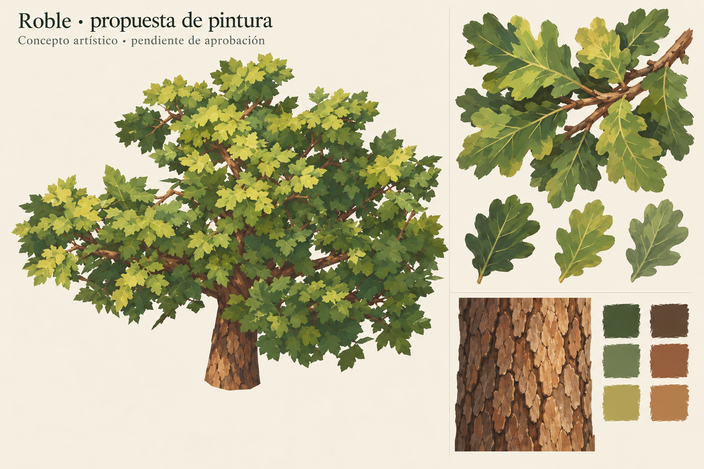

# Roble — propuesta de pintura para aprobación

Fecha: 2026-10-25. **Dirección de hojas y corteza aprobada por el usuario**;
[aceptación y alcance](user-acceptance.json).
La integración y la optimización de tris están **pausadas por solicitud expresa**.
Primero se revisa la calidad de la pintura de hojas, grupos y corteza.

Pincelada amplia y mate, verdes roble/oliva con variaciones salvia y doradas;
nervaduras contenidas y manchas legibles. Corteza cálida con placas irregulares,
variación ocre/marrón y grietas sin ruido excesivo. Se busca coherencia con la
dirección A del pino aprobado, con hojas anchas de roble y sin acículas.

**Es un concepto generado por IA, no un render del modelo implementado ni un
atlas de producción listo para integrar.** La imagen usa el piloto como referencia
estructural pero no conserva exactamente su geometría, huecos o volumen; no se
usa para medir silueta. La aprobación solicitada se limita a la pintura. Mantener
la forma del roble sigue siendo requisito para una integración posterior.

El atlas procedural del ensayo previo era una muestra técnica del recorte; no
queda promovido como pintura aprobada. La nueva propuesta tampoco sustituye ese
atlas ni cambia los GLB existentes. Después de aprobar la dirección se podrá
producir una muestra de textura/ramilla separada para revisar su aplicación real,
antes de retomar la integración completa.

Herramienta: `image_gen.imagegen` integrado. Referencias: captura propia del roble
y concepto A propio del pino. Sin imágenes externas suministradas al generador.
[Prompt completo y procedencia](prompt.json). PNG fuente generado conservado en
`propuesta.png`; no hay capas de pintura anteriores a ese PNG.

La rama de muestra solicitada ya está disponible para revisar la aplicación:
[muestra real en Godot](../rama-01/informe.md). La aprobación del concepto no
extiende aprobación automática a esa aplicación ni reanuda la optimización.
