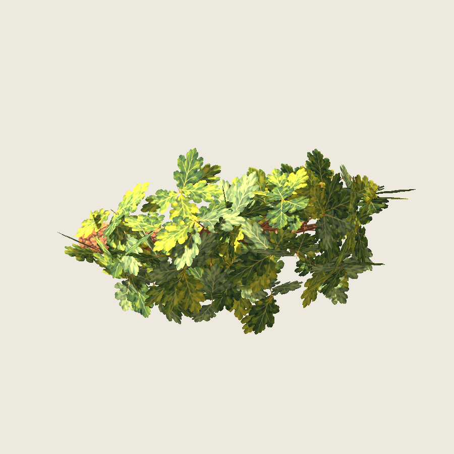
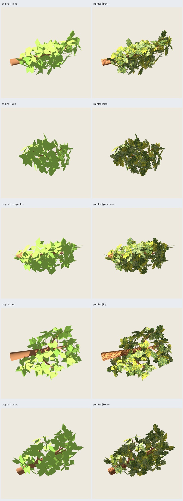
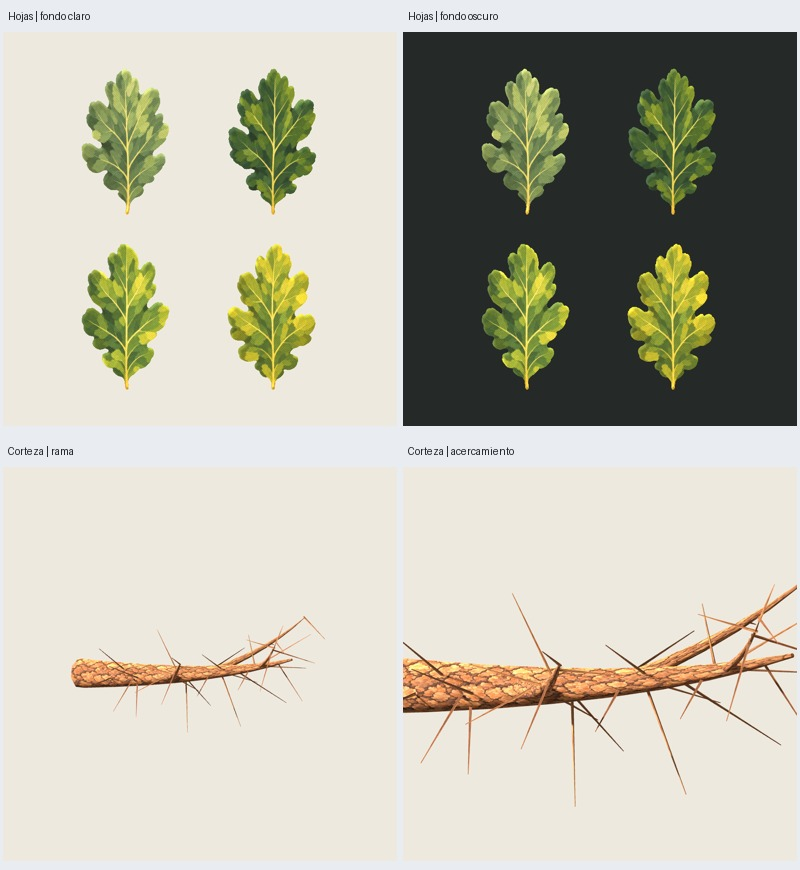

# Roble — rama de muestra con la pintura aprobada

Fecha: 2026-10-25. **Muestra implementada; revisión artística de su aplicación
pendiente**. [Dirección de hojas/corteza aprobada](../pintura-01/user-acceptance.json).
Integración y optimización del roble completo siguen pausadas por el usuario.



## Muestra y recursos

Rama primaria `q3:primary:100` del piloto RF3 viejo-09, receta
`roble_copa_ancha@1.2.0`, semillas base **3009**, canopy **17**, paint **2718**.
Tres secundarias `200/201/202`, **32 soportes y 192 hojas**. Selección explícita
congelada antes de pintar; fuente regenerada desde la receta histórica y GLB
idéntico a la referencia aprobada. No depende del intento de optimización pausado.

Madera, ramillas de soporte, anclajes, planos y tamaños nominales de hoja
conservados. Se aplica corteza mediante UV por anillo/perímetro y longitud;
las ramillas pequeñas comparten corteza. Cada hoja usa un rectángulo fijo de
**dos triángulos**, con el recorte lobulado del atlas. El pecíolo se ancla a la
raíz histórica; la envolvente nominal usa la longitud original y anchura .6L.
Se mantienen exactamente las 192 colocaciones, sin agruparlas ni orientarlas
hacia la cámara. Original y pintada tienen **1104 tris**; madera+soportes 720,
hojas 384. **No es una optimización ni una demostración de conservación exacta
del contorno anterior**: la forma lobulada cambia los rombos y su cobertura;
eso deberá comprobarse aparte al retomar la integración.

Dos texturas nuevas en `assets/roble-pintado/v0.2.0/`, **1254²** cada una:
RGBA de cuatro hojas y RGB de corteza, creadas con ImageGen integrado a partir
del concepto aprobado. Pincelada amplia, verdes oliva/salvia y dorados, nervaduras
contenidas y corteza cálida mate. Alfa original conservado, sin retoque ni
remuestreo. [Prompts completos](../../../../assets/roble-pintado/v0.2.0/prompts.json),
hashes y regiones UV en el manifiesto de recursos. Son mapas nuevos de producción
para la muestra, no recortes reutilizados del tablero conceptual. PNG fuente
conservados; no hay capas anteriores al PNG generado.

## Exportación y revisión

Cuatro recursos: `original`, `painted`, `wood` (720 tris) y `swatches` (8 tris).
Cada carpeta contiene `branch.glb` autocontenido y `branch.blend` con UV, nodos e
imágenes empaquetadas. Pintada: dos materiales, rugosidad .95, doble cara,
recorte alfa .5. Godot aplica filtrado anisotrópico/mipmaps y sombras dobles.
La referencia original conserva su color/rugosidad históricos. No se hornean
sombras del motor en las texturas.

**29 capturas reales Godot 4.7.2 Compatibility**, RTX 5060, 900² y MSAA 4×,
luz (-35,-25,0), energía 1,2, ambiente .5 y exposición 1. Comparación original/
pintada desde seis orientaciones y dos distancias adicionales; madera aislada,
acercamiento de corteza y cuatro hojas frente a fondos claro/oscuro. Encuadres
y luz comunes por pareja. Dos dibujos completados antes de cada captura.





El agente inspecciona las dos láminas: la pintura se lee sobre la madera y sobre
hojas lobuladas con variaciones; la textura sigue la rama y las hojas mantienen
profundidad al cambiar de vista. El tablero de hojas permite evaluar pinceladas
y nervaduras sin ocultación. Persisten solapamientos densos, brillo amarillo
marcado bajo luz frontal y discontinuidades posibles en tapas/costuras de UV.
El acercamiento de madera recorta deliberadamente los extremos para mostrar la
pintura; no representa una pieza distinta. Repetición de corteza solicitada al
generador pero no certificada sin costuras. La evaluación artística corresponde
al usuario; ninguna de estas capturas valida todavía la copa de todo el roble.

Auditoría GLB: hashes de PNG embebidos iguales a los recursos, sin URI externos,
UV finitas, alfa MASK .5 y reversos conservados. Métricas y conteos pasan en los
cuatro exports. Dos pruebas del módulo puro pasan: plano/UV/raíz en las cuatro
variantes, estabilidad de selección y rechazo de un grupo incompleto. Repetición
de los cuatro GLB con recursos congelados documentada en `audit.json`.

## Reproducir y revisar

```sh
python3 scripts/oak_painted_sample.py --output artifacts/roble-pintado/otra-rama
PYTHONPATH=src python3 -m unittest discover -s tests -p test_oak_painted_sample.py -v
```

Estudio seleccionado: `artifacts/roble-pintado/rama-muestra-01/index.html`.
Modelo principal: `painted/branch.glb`; editable: `painted/branch.blend`.
Proyecto Godot reutilizable en `godot/`, con escena `painted.tscn`. `materials.jpg`
muestra las cuatro hojas y la corteza; `comparison.jpg`, las vistas por pareja.
Entradas, fuentes, procedencia, hashes y capturas en el manifiesto del estudio;
fuente histórica regenerable en `source/`. Generación ≤120 s por árbol fuente,
subprocesos Blender/captura ≤180 s. No se cambia el árbol completo ni se reanuda
su optimización hasta revisar esta muestra.
