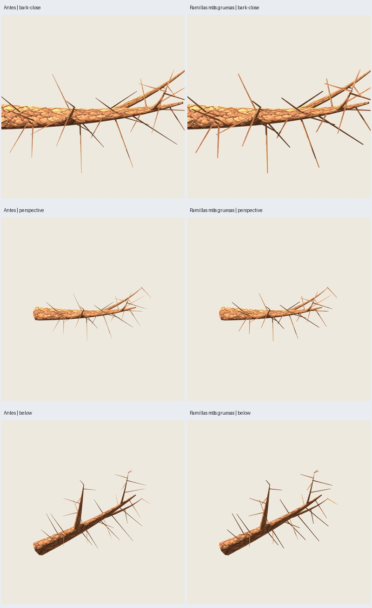
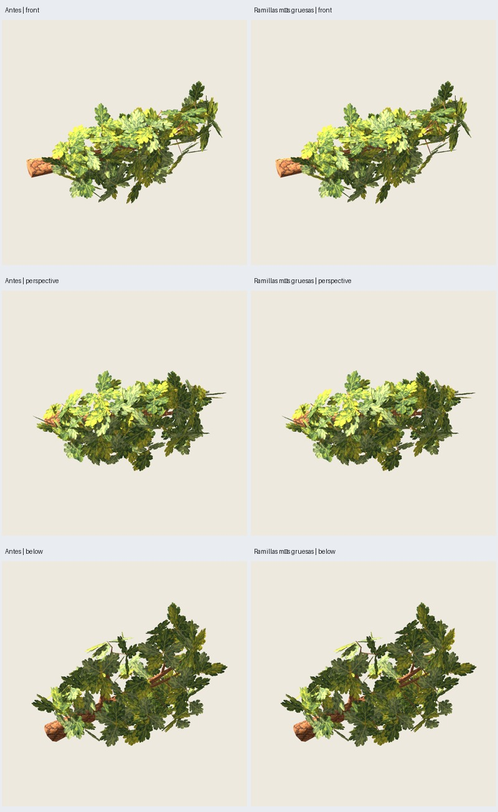

# Roble: ensayo de grosor de ramillas sin coste adicional de tris

Fecha: 2026-10-26. El usuario valora favorablemente la rama con follaje y pide
probar ramillas más gruesas y un estrechamiento más gradual antes de ver el árbol
completo. [Petición y alcance](user-request.json). Variante **experimental**, aún
sin aceptación artística; no se integra al generador del árbol completo.

## Cambio acotado

Misma rama primaria 100 del piloto 3009/17, paint 2718, atlas/corteza 0.2.0.
Perfil opcional `fuller-v1`: radio de base **.020 → .025 m (+25 %)**; radio final
**.005 → .0125 m**, el 50 % del nuevo radio inicial frente al 25 % anterior.
El estrechamiento sigue siendo lineal, con menor caída absoluta a lo largo del
soporte. No se añaden anillos ni se curva la madera. Las puntas conservan tapa.
Solo cambia el radio de los **32 tubos triangulares de soporte** del follaje;
las tres ramas secundarias mayores y la primaria permanecen intactas.

**1104 → 1104 tris (+0)**: 464 de ramas, 256 de soportes y 384 de hojas.
Los 464 tris de ramas y sus normales coinciden; cambian los 256 tris de soportes.
Se conservan exactamente ejes, longitud y colocaciones de los soportes, geometría,
normales y colocaciones de las 192 hojas, UV de hojas y texturas. El aumento de
radio rodea el eje original, sin recalcular los anclajes de hojas en la superficie.
Original y tablero de hojas producen GLB idénticos a la muestra anterior.

## Verificación

- Nueve pruebas de roble pintado/muestra pasan, incluida conservación de ejes,
  topología y entradas para soportes de dos y tres anillos.
- Cuatro GLB repetidos idénticos (original, pintada, madera y tablero).
- Reimportación Godot verificada: materiales, texturas embebidas, UV finitas,
  normales y conteos. Exportación con la misma auditoría de la muestra anterior.
- **34 capturas reales** de comparación, cámaras/luz comunes tomadas del protocolo
  anterior: madera en seis orientaciones, dos distancias y acercamiento; follaje
  en seis orientaciones y dos distancias, ambas versiones. Godot Compatibility,
  900², MSAA4, RTX 5060. Dos dibujos completados antes de capturar cada vista.
- El agente revisa las doce imágenes de las dos láminas seleccionadas: puntas menos
  agudas y mayor cuerpo en madera; cambio discreto con follaje, sin desplazamiento
  visible de hojas. La rectitud de los tubos sigue dando aspecto rígido sin hojas.
  Las 34 capturas no se presentan como 34 vistas inspeccionadas individualmente.





[Auditoría y hashes](audit.json). El primer intento dentro del sandbox
(`rama-ramillas-02`) excedió 120 s al cerrar el audio de Blender; fue terminado
por el ejecutor, sin declararlo válido. Generación, repetición y revisión posteriores
fuera del sandbox completaron correctamente con límites de 120/180 s.

## Reproducción

```sh
PYTHONPATH=src python3 -m unittest discover -s tests -p 'test_oak_painted*.py' -v
python3 scripts/oak_painted_sample.py --output artifacts/roble-pintado/otra-ramilla --twig-profile fuller-v1
python3 scripts/oak_painted_sample.py --output artifacts/roble-pintado/otra-ramilla-repeat --twig-profile fuller-v1 --stage generate
python3 scripts/review_oak_twigs.py --before artifacts/roble-pintado/rama-muestra-01 --after artifacts/roble-pintado/otra-ramilla --repeat artifacts/roble-pintado/otra-ramilla-repeat --output artifacts/roble-pintado/otra-comparacion
```

Resultados actuales: `artifacts/roble-pintado/rama-ramillas-03/`; modelo/editable
en `painted/branch.glb` y `painted/branch.blend`. Galería de comparación:
`artifacts/roble-pintado/ramillas-comparacion-01/index.html`. La opción predeterminada
`original` conserva los radios anteriores. Históricos, recetas de árbol completo,
pino y distribución de follaje no cambian. No se infieren FPS ni validez para todas
las semillas a partir de esta rama; los controles completos siguen pendientes.
