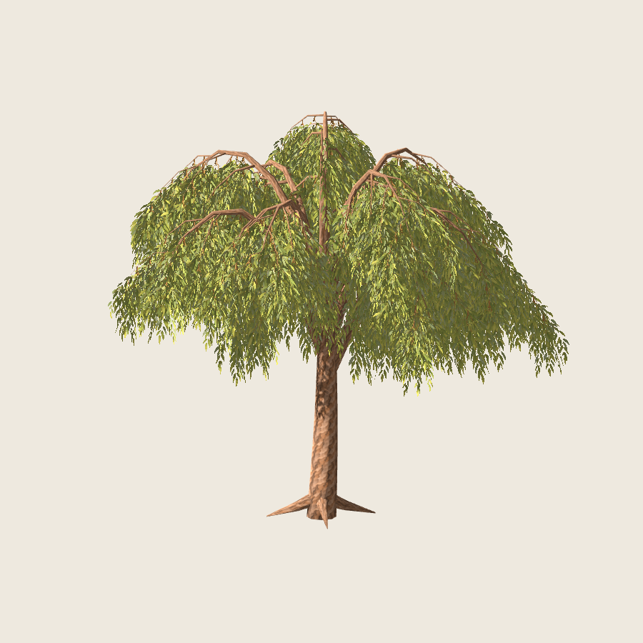
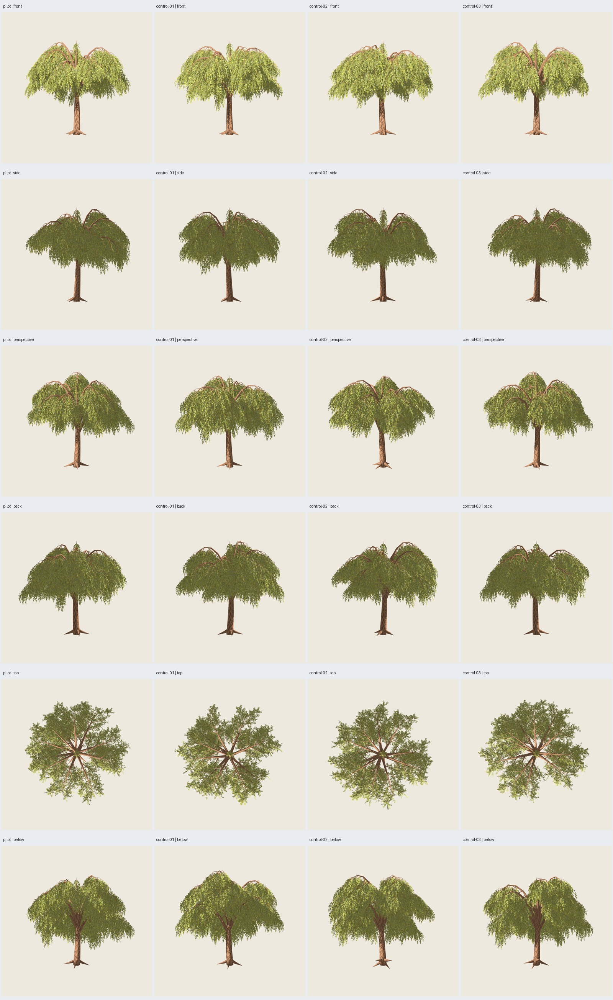

# Sauce colgante — blueprint completo 1.0.0

2026-11-02. Pintura y rama aprobadas, continuación al árbol completo autorizada;
[decisión](../rama-01/user-acceptance.json). **Implementado y verificado
técnicamente; resultado artístico rechazado posteriormente por el usuario**;
[decisión y motivos](user-rejection.json). Revisión en
[1.1.0](../revision-01/informe.md).
[Plan](../../../../plans/sauce-pintado.md), [contrato 1.6](../../../contrato-blueprints.md).



## Resultado y presupuesto

Receta `blueprints/sauce_colgante/1.0.0.json`, perfil adulto de 10 m con parámetros
cerrados; piloto y tres controles, semillas base **7100–7103**, copa **17**, pintura
**2718**. Catálogo: cinco tipos/quince recetas. Nueva estructura de sauce con
tronco irregular, bifurcaciones, primarias arqueadas y secundarias descendentes;
distribución y representación separadas. No altera recetas históricas.

| Parte | Elementos | Triángulos por árbol |
| --- | ---: | ---: |
| Tronco | 12 anillos, 8 lados | 188 |
| Raíces | 4 recorridos | 104 |
| Primarias | 12 recorridos | 960 |
| Secundarias | 96 recorridos | 2688 |
| Follaje | 423 grupos, 1269 planos | 2538 |
| **Total** | **113 recorridos de madera** | **6478** |

Los cuatro GLB reimportados tienen **6478 tris, dos materiales y madera de 10 m**.
Cota previa 6478, incluida toda la madera, tapas y láminas; se rechaza exceso
antes de mallar, sin descontar ahorros de simplificación. Primarias con selección
de anillos bajo error de 5 mm; en estos casos no se elimina ninguno. Tronco,
raíces y secundarias finas mantienen anillos. La topología inicial ya cumple.

Normalización Z común a ejes y vértices para fijar altura, sin cambiar XY ni
radios nominales; puede dejar secciones elípticas. La altura nominal se verifica
en madera, separada de los márgenes transparentes de las tarjetas. `dimensions_m`
incluye toda la geometría y `wood_height_m` mide madera.

PNG de follaje/corteza 0.1.0 **idénticos a los de la rama aprobada**, 1254²,
procedencia y prompts conservados. Tres planos fijos por grupo inclinados .22 rad,
anclaje superior sobre su soporte y crecimiento hacia abajo. No son billboards.
Madera opaca, follaje Alpha Scissor .5, doble cara, rugosidad .95; mipmaps,
filtrado anisotrópico y sombras dobles configurados en Godot.

GLB autocontenido, texturas embebidas y `.blend` editable empaquetado. Contratos,
algoritmos puros, ejecutor, adaptador y auditoría separados. Límites: generación
≤120 s y cada subproceso de revisión ≤180 s, ambos terminables.

## Verificación

- **208 pruebas pasan** fuera del sandbox: nueve nuevas del árbol, además de las
  cinco de la rama. Presupuesto antes de geometría, altura/arcos/caída, entradas
  inválidas, semillas, UV, recursos, determinismo y errores de madera cubiertos.
- Cuatro casos generados y auditados; repetición del piloto con **GLB idéntico**.
  Generación final **1.230–1.286 s** por caso, sin render Blender.
- CLI pública real con sus **nueve vistas Blender** y GLB idéntico al piloto.
  No se sustituye la prueba CLI por una llamada simulada al ejecutor.
- Regresiones **roble 2.2.0, pino 2.3.0, abedul 1.0.0 y columnar 1.0.0**:
  cada GLB idéntico al registrado en su evidencia histórica.
- Auditoría reconstruye receta y compara caras/UV de madera y follaje, anclajes
  registrados, normales, materiales, PNG embebidos y conteos. **Ocho defectos
  inyectados rechazados**: alfa, reversos, canal de imagen, posición, UV, normal
  NaN, cara de madera ausente y hash de distribución alterado.
- **120 capturas reales Godot**: 60 de copa y 60 de madera, cuatro semillas,
  seis orientaciones, tres distancias, fondo oscuro, luz lateral/contraluz,
  receptor de sombra y dos acercamientos. Fuentes/hashes, versiones, protocolo,
  CLI, regresiones y defectos en [verification.json](verification.json).

Dos intentos iniciales no se presentan como éxitos: el primero rechazó diferencias
de último bit entre Python Blender 3.13 y ejecutor 3.14; se fijaron vértices/ejes
de grupos a doce decimales antes de registrar/exportar. El segundo usaba por
error bounds completos para exigir altura nominal exacta; el auditor ahora mide
los vértices de madera. La comparación estricta de caras/UV float32 se conserva.

La primera revisión visual completa mostró una copa demasiado escalonada. Se
ajustaron bifurcaciones, arqueado y longitud de grupos con reglas comunes a todos
los casos, sin retoques por semilla. La entrega final amplía los acercamientos;
sus cuatro GLB y 104 capturas comunes son idénticos a esa revisión ajustada.

## Revisión visual y límites

Inspeccionadas seis láminas que contienen las **120 capturas**, perspectiva
individual y acercamientos. Godot 4.7.2, Compatibility, RTX 5060, 900²/MSAA4;
sol .75, ambiente .35, exposición 1. No se declara revisión visual por las
pruebas sin interfaz.

La copa se lee ancha, con cortinas descendentes y variación entre semillas.
Los arcos superiores, codos facetados y parte del ápice de madera quedan visibles;
hay un pequeño mechón central más alto. Desde arriba se abren huecos entre
grupos y se aprecia el reparto radial. Las hojas se conservan a distancia media
y se funden en masas al alejarse; tonos amarillo verdosos más fuertes bajo luz
frontal. Hay cruces finos de canto y solapamientos; no se certifica ausencia
universal de halos o parpadeo. Las sombras se ven en suelo, con parte de su
extensión fuera de encuadre.

En acercamientos se ven las conexiones de primarias y secundarias y la pintura
de follaje. La madera mantiene uniones superpuestas, sin soldar; corteza repetida,
tapaderas y aristas pueden ser visibles. No hay certificación universal de todos
los contactos ni de otras alturas, edades o semillas. La aceptación artística
del árbol completo corresponde al usuario. **Sin benchmark de rendimiento**.



[Distancias y fondo oscuro](tree-distances.jpg),
[luces, sombras y acercamientos](tree-details.jpg),
[madera](wood-views.jpg), [detalle de madera](wood-details.jpg),
[madera a distancia](wood-distances.jpg).

## Uso, reproducción y entrega

Desde la raíz, con salidas nuevas:

```sh
PYTHONPATH=src python3 -m unittest discover -s tests -v
PYTHONPATH=src python3 -m treegen generate-blueprint blueprints/sauce_colgante/1.0.0.json --instance presets/blueprints/sauce-pintado/pilot.json --output artifacts/sauce-pintado/mi-sauce --no-render
PYTHONPATH=src python3 -m treegen validate artifacts/sauce-pintado/mi-sauce
python3 scripts/verify_willow.py --output artifacts/sauce-pintado/otra-matriz --stage all
python3 scripts/audit_willow_export.py --source artifacts/sauce-pintado/otra-matriz/pilot --output artifacts/sauce-pintado/otros-defectos
```

Omitir `--no-render` para las nueve vistas Blender. Variables `BLENDER_BIN` y
`GODOT_BIN` admitidas; revisión Godot requiere escritorio real. Usar ejecución
fuera del sandbox si bloquea audio/UI/GPU o el socket de las pruebas de API.

Entrega seleccionada: `artifacts/sauce-pintado/arbol-05/index.html`, casos
`{pilot,control-01,control-02,control-03}/tree.glb`, `tree.blend`, `wood.glb`,
manifiestos, resolución, colocaciones, geometría base, auditoría y proyecto Godot.
CLI ensayada: `artifacts/sauce-pintado/cli-01/`; defectos:
`artifacts/sauce-pintado/defectos-01/`. Salidas voluminosas regenerables ignoradas.
Selección reproducible:

```sh
python3 scripts/willow_evidence.py --study artifacts/sauce-pintado/arbol-05 --output docs/evidence/sauce-pintado/arbol-01 --cli artifacts/sauce-pintado/cli-01 --defects artifacts/sauce-pintado/defectos-01
```

Visor autocontenido con las cuatro semillas:

```sh
/home/tao/repos/godot/openworld-forever/.tools/godot-4.7.2/Godot_v4.7.2-stable_linux.x86_64 --path artifacts/sauce-pintado/arbol-05/godot --audio-driver Dummy
```

Arrastrar/rueda: cámara; espacio: giro automático; `N`: siguiente semilla;
`1`: árbol; `2`: madera; `B`: fondo; `L`: luz; `R`: restablecer. Visor abierto
al entregar. **F4 queda pendiente para después de terminar esta variante**;
sin implementación de F4, otras edades, viento, estaciones, LOD o bosque.
