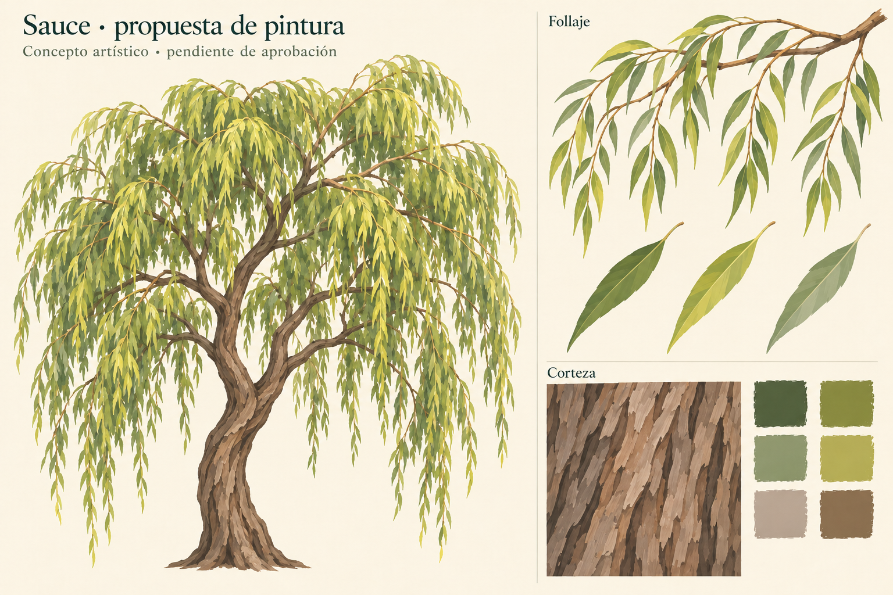

# Sauce — propuesta de pintura

Fecha: 2026-11-02. **Dirección de pintura aprobada por el usuario**;
[aceptación y continuación](user-acceptance.json).
[Plan activo](../../../../plans/sauce-pintado.md).

Hojas estrechas y lanceoladas, nervadura central sencilla, verdes oliva/salvia,
luces amarillo verdosas y reversos gris verdosos. Ramillas arqueadas que caen en
cortinas irregulares. Corteza parda cálida de trazos amplios y surcos verticales.
La ilustración de árbol completo muestra la intención de copa colgante con claros;
no fija escala, densidad ni forma definitiva de la geometría.

Generada por IA con la herramienta integrada `image_gen.imagegen`, no pintada
por una persona. Referencia de estilo/presentación: propuesta propia de abedul
`docs/evidence/abedul-pintado/pintura-01/propuesta.png`. Sin imágenes externas.
[Prompt exacto y procedencia](prompt.json). PNG fuente conservado sin retoques.
SHA-256 de `propuesta.png`:
`8a1cdaff4c274ac26b82b20c49547f973feb1b3f33f1fd701fcb49cf420c3bfc`.

Inspección visual del resultado: hojas alargadas y diferenciadas del abedul,
ramillas descendentes, claros entre cortinas y corteza parda presentes. La muestra
de corteza tiene trazos oblicuos y sombreado ilustrado; preparar una textura de
producción sin fijar sombras fuertes y comprobar costuras posteriormente.

Es una propuesta artística, no un atlas utilizable ni un render del generador.
No se han validado láminas cruzadas, transparencia, sombras, conexiones en Godot,
presupuesto geométrico o rendimiento sobre esta lámina. Los recursos de producción
y la [rama real de muestra](../rama-01/informe.md) se prepararon después;
la aceptación de pintura no implica aprobación de esa aplicación.
