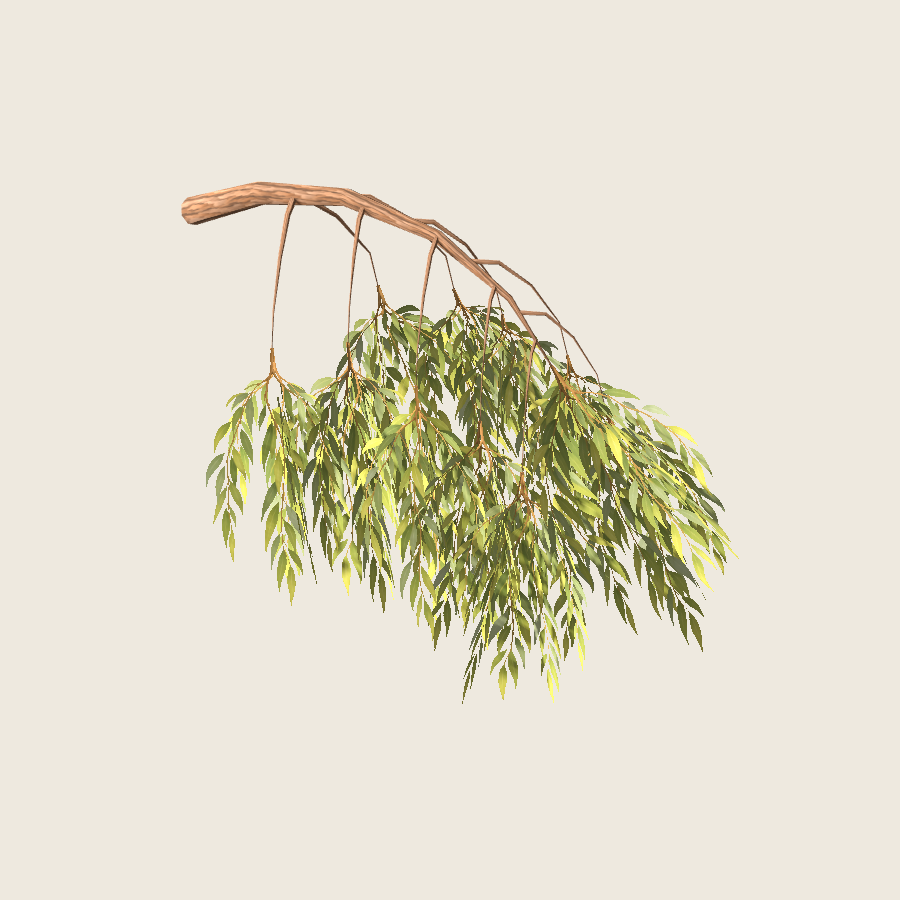
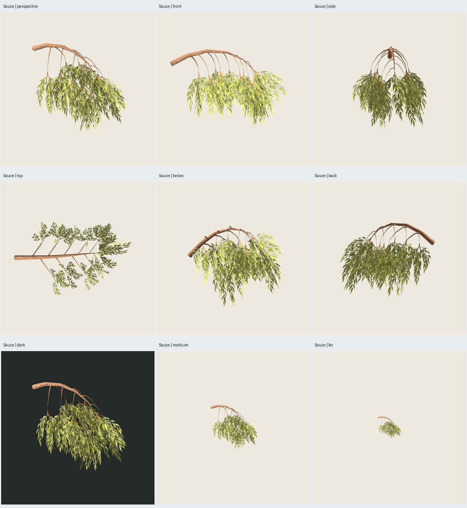
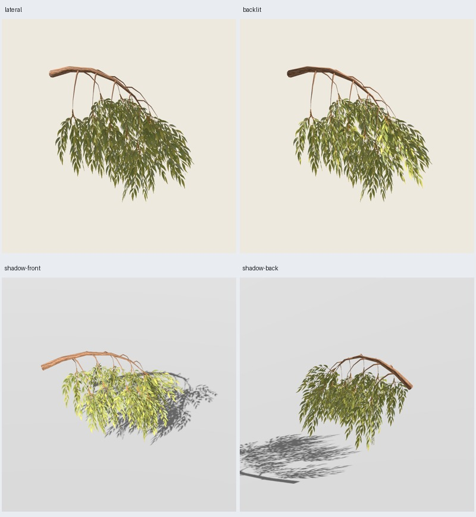

# Sauce — rama colgante con pintura aplicada

2026-11-02. Pintura aprobada y continuación autorizada por el usuario;
[decisión](../pintura-01/user-acceptance.json). **Rama implementada y verificada;
posteriormente aprobada por el usuario**;
[aceptación y continuación al árbol completo](user-acceptance.json).
[Plan activo](../../../../plans/sauce-pintado.md).



## Construcción y recursos

`willow-branch-sample-0.1.0`: una primaria arqueada de 2.5 m de recorrido en X,
diez secundarias que pasan de expansión lateral a caída y once grupos de
ramillas pintadas. Semillas estructura **7100**, pintura **2718**. Geometría
pura en `src/treegen/willow_sample.py`, adaptación en `blender/willow_sample.py`;
reutiliza tubos y utilidades existentes sin cambiar fuentes históricas.
Esta entrega es una rama aislada, **no una receta completa registrada en CLI**.

| Parte | Triángulos |
| --- | ---: |
| Madera, once tubos | 652 |
| Follaje, once grupos × tres planos × dos tris | 66 |
| Total de la rama | **718** |

Dos materiales, madera y follaje. Atlas de cuatro ramillas colgantes RGBA y
corteza RGB de 1254² en `assets/sauce-pintado/v0.1.0/`. Pintura de estilo manual
generada por IA con la herramienta integrada `image_gen.imagegen` usando el
concepto propio aprobado como referencia. PNG fuente sin retoques; prompts
exactos en `assets/sauce-pintado/v0.1.0/prompts.json`, hashes/regiones/anclajes
en `manifest.json` de esos recursos y [verificación seleccionada](verification.json).

El tallo pintado empieza arriba y crece hacia abajo. Anclaje medido dos texeles
dentro del inicio con alfa ≥128; se coloca 12 mm dentro del extremo de madera.
Tres planos fijos inclinados .22 rad (~12.6°) alrededor de la caída, sin girar
hacia la cámara. La esquina superior del atlas no es el anclaje del tallo.
Las regiones UV recortan espacio vacío con ocho texeles de margen sin editar el
PNG. Con alfa ≥128, cada variante forma un conjunto principal conectado; hay
restos aislados de 1/0/13/1 texeles, conservados. Esto no certifica contactos 3D.

GLB autocontenido y `.blend` con imágenes empaquetadas. Madera opaca, follaje
Alpha Scissor .5, doble cara, rugosidad .95; mipmaps, filtrado anisotrópico y
sombras dobles explícitos en Godot. Sin mapas normales ni material por grupo.

## Verificación y límites visuales

Cinco pruebas nuevas comprueban semillas/determinismo, separación de pintura y
madera, contactos de ejes, caída de planos, correspondencia UV→anclaje, geometría
finita/no degenerada, presupuesto y recursos medidos, entradas inválidas.
Suite completa: **199 pruebas pasan**. Primer intento en sandbox: 198 pasan y
la prueba de API falla por prohibición de socket loopback; repetición completa
fuera: 199/199. No se presenta el primer intento como éxito.

Exportación con follaje y madera sola reimportadas en Blender y Godot. Auditoría
independiente de GLB: geometría, UV, materiales y PNG embebidos iguales a fuentes.
Dos repeticiones GLB **idénticas byte por byte**. Generación .816 s, repetición
.766 s, límites terminables de 120 s y 180 s por subproceso de revisión. El
ensayo inicial y la entrega final tienen los mismos GLB y 37 capturas idénticas.

**37 capturas reales inspeccionadas**: 25 con follaje y 12 de madera; seis
orientaciones, tres distancias, fondo oscuro, luz lateral y contraluz, doce pasos
orbitales, corteza de cerca y dos vistas con receptor de sombra. Godot 4.7.2,
Compatibility, RTX 5060, 900²/MSAA4, sol .75, ambiente .35, exposición 1.
Se inspeccionaron las láminas completas y la perspectiva a resolución original.

Las cortinas y hojas largas se leen desde varias orientaciones. La densidad
cambia al girar; desde arriba el follaje se ve más estrecho y deja madera
expuesta. Los soportes superiores son deliberadamente desnudos en esta muestra;
su longitud y la distribución entre cortinas quedan sujetas a valoración.
Hay tonos amarillo verdosos fuertes en caras iluminadas, cruces finos de canto,
solapamientos y pérdida de detalle a distancia. No se observa un fondo rectangular
opaco; esto no garantiza ausencia universal de halos o parpadeo. Corteza clara
en caras iluminadas, con repetición de textura y tramos de madera facetados.
Las dos vistas de sombra conservan siluetas de hojas; sin benchmark de FPS.





[Órbita completa](orbita.jpg), [madera en doce vistas](madera.jpg),
[corteza de cerca](corteza.png).

**718 tris de rama no acreditan el árbol entero**. La futura integración debe
presupuestar madera y grupos desde el inicio, validar piloto/tres controles
≤6999 tris y dos materiales, y revisar copa completa y madera en Godot.

## Reproducción y visor

Desde la raíz, con salida nueva:

```sh
PYTHONPATH=src python3 -m unittest discover -s tests -v
python3 scripts/willow_sample.py --output artifacts/sauce-pintado/otra-rama --stage all
python3 scripts/willow_sample_evidence.py --study artifacts/sauce-pintado/otra-rama --output artifacts/sauce-pintado/evidencia-rama
```

Ejecutar fuera del sandbox si bloquea audio/UI/GPU o sockets; variables
`BLENDER_BIN` y `GODOT_BIN` admitidas. Recursos congelados, tiempos, versiones,
hashes de fuentes/GLB/capturas y auditorías en `verification.json`.

Entrega: `artifacts/sauce-pintado/rama-02/index.html`,
`crossed/branch.glb`, `crossed/branch.blend`, `wood/branch.glb`,
`placements.json`, protocolo y proyecto Godot autocontenido. Visor:

```sh
/home/tao/repos/godot/openworld-forever/.tools/godot-4.7.2/Godot_v4.7.2-stable_linux.x86_64 --path artifacts/sauce-pintado/rama-02/godot --audio-driver Dummy
```

Arrastrar: girar; rueda: zoom; espacio: giro automático; `1`: follaje; `2`:
madera; `B`: fondo; `L`: luz; `R`: restablecer. Visor abierto al entregar.

Checkpoint previo solicitado: commit `daae751` enviado a `origin/main`
(`Erick-vital/procedural-trees`) antes de implementar esta muestra. Los cambios
del sauce posteriores se entregan en el checkout. F4 permanece pendiente para
después del sauce; no se inicia por la entrega de rama.
