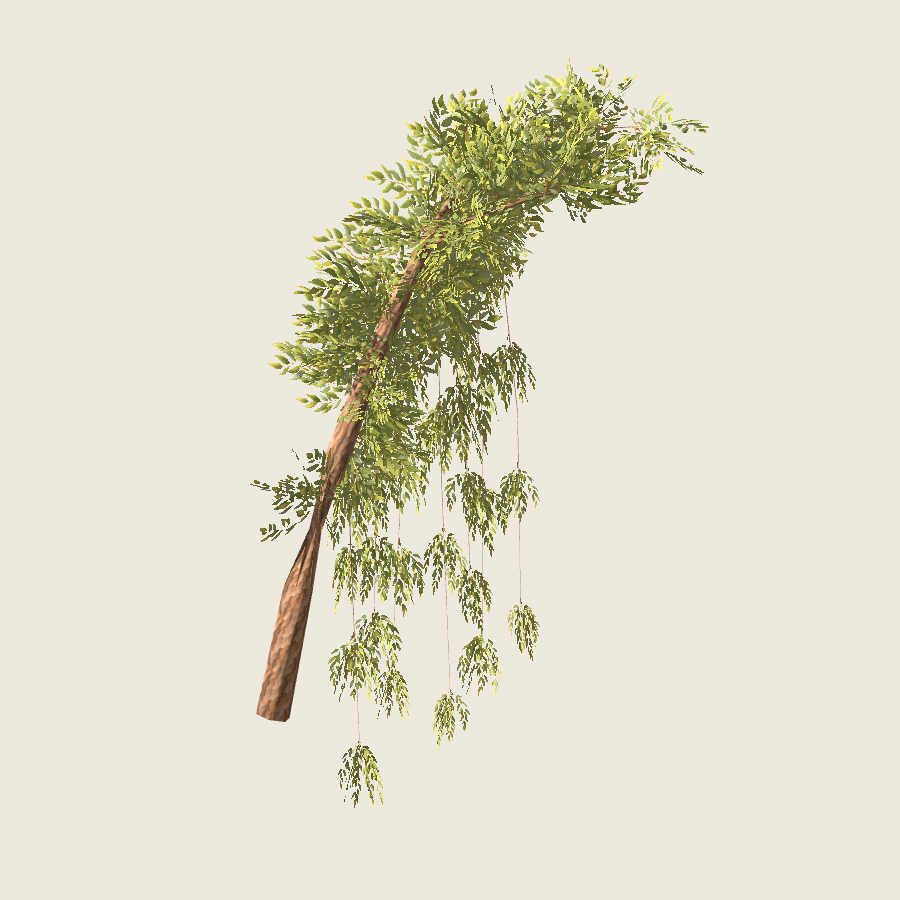

# Sauce — nueva rama seleccionada por delegación

2026-11-02. El usuario rechaza el árbol completo 1.0.0 y autoriza revisar incluso
la aprobación de la rama anterior. [Decisión y delegación exacta](decision.json).
**Muestra 0.2.0 seleccionada por el agente para integración**, sin atribuir una
nueva aprobación artística explícita al usuario.



Derivada de una primaria real de la receta candidata `sauce_colgante@1.1.0`,
con sus diez secundarias: tres de copa y siete hebras largas. Semillas base
7100, copa 17, pintura 2718. **804 tris, dos materiales y 74 grupos** de tres
planos fijos. Texturas 0.1.0 de la rama anterior conservadas byte por byte.

La rama cambia de arquitectura y de aplicación del follaje: agrupaciones de
copa con orientaciones variadas y planos de ancho ×1.75–2 para formar masas;
hebras con ancho ×.75–1, longitud decreciente y caída diferente. Escala afín
alrededor del tallo, UV y anclaje conservados. No es pintura nueva ni un atlas
modificado; se registra como representación 0.2.0. Los tres planos mantienen
inclinación .22 rad y no se orientan hacia la cámara.

Generación pura en `src/treegen/willow_v2.py`, adaptación en
`blender/willow_revision_sample.py` y orquestación en
`scripts/willow_revision_sample.py`. La receta se resuelve en Python externo y
se pasa congelada a Blender; no se instalan dependencias en Blender. Un primer
intento falló por intentar importar `jsonschema` allí y se descartó. Las primeras
orientaciones de copa se veían alargadas como plumas; la muestra seleccionada
usa orientaciones volumétricas y proporciones más compactas.

GLB con follaje/madera reimportados, auditoría de imágenes/UV/materiales y
repeticiones GLB idénticas. **37 capturas reales**: seis orientaciones, distancias,
fondo oscuro, luces, doce pasos orbitales, detalle y dos sombras. Revisión visual
de la perspectiva y láminas de orientación/órbita/luz/madera: follaje por encima
de la madera y hebras legibles, con variación angular de cobertura, pequeños
tramos desnudos entre agrupaciones y pérdida de detalle lejano. No certifica
ausencia universal de cantos, halos o contactos imperfectos.

Esta muestra sustituye la anterior **para 1.1.0**, conforme a la delegación.
La muestra antigua y receta 1.0.0 se conservan como antecedentes. El árbol
completo sigue requiriendo valoración artística independiente.

[Verificación y hashes](verification.json), [vistas](vistas.jpg),
[órbita](orbita.jpg), [luces/sombras](luces-sombras.jpg), [madera](madera.jpg).
Salida: `artifacts/sauce-pintado/rama-revision-05/`, visor y GLB/Blender.

```sh
python3 scripts/willow_revision_sample.py --output artifacts/sauce-pintado/otra-rama-revisada --stage all
python3 scripts/willow_sample_evidence.py --study artifacts/sauce-pintado/otra-rama-revisada --output artifacts/sauce-pintado/evidencia-rama-revisada
```

F4 permanece pendiente para después de cerrar el sauce.
