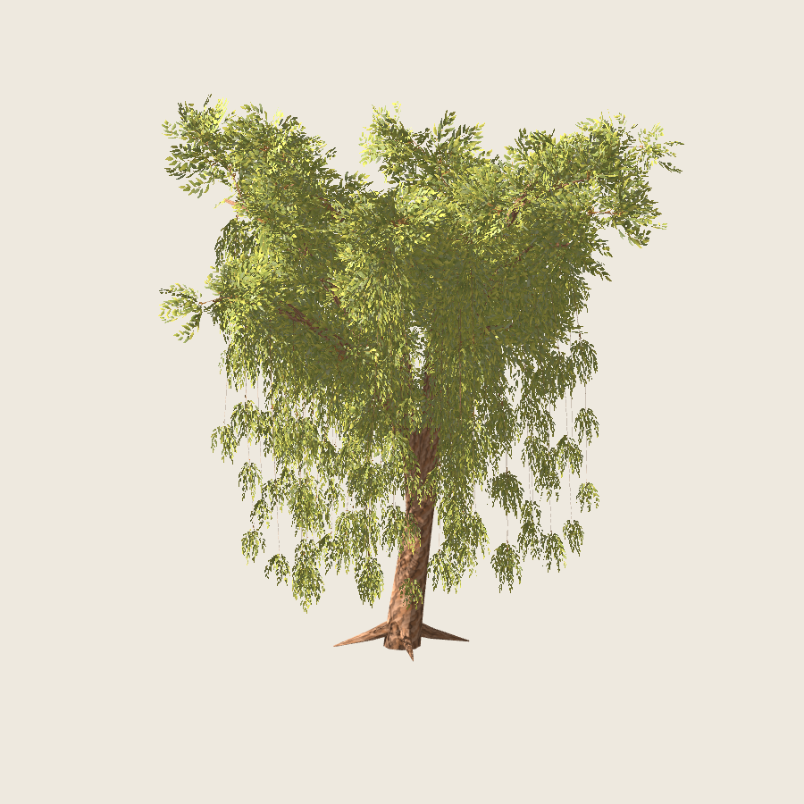
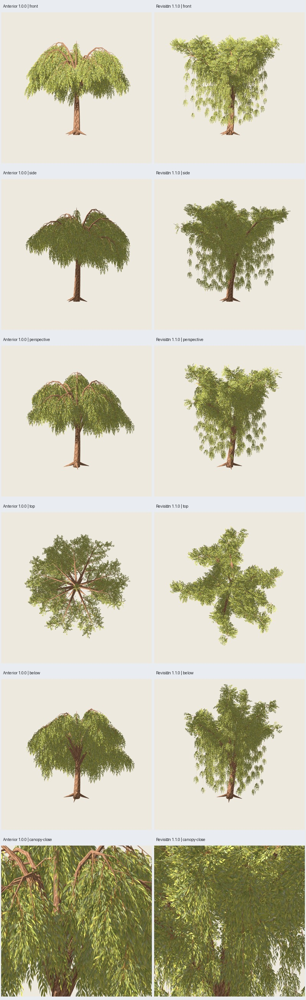

# Sauce 1.1.0 — revisión de estructura y copa

2026-11-02. Revisión solicitada tras el [rechazo artístico de 1.0.0](../arbol-01/user-rejection.json).
**Implementada, verificada y aprobada artísticamente por el usuario**;
[aceptación final](user-acceptance.json). Variante 1.1.0 cerrada.
[Plan](../../../../plans/sauce-pintado.md), [referencia e imágenes aportadas](referencia.md),
[rama nueva y delegación](../rama-02/informe.md).



## Qué cambia

- Tronco corto bifurcado, sin prolongación central hasta la punta de la copa.
- Ocho brazos con alturas, alcances, giros y puntos de control propios, en lugar
  de repetir el mismo arco. Tres ramificaciones de copa por brazo; siete hebras
  largas de caída desigual, algunas próximas al suelo.
- Follaje de copa sobre la madera y cortinas debajo: **307 grupos superiores y
  280 colgantes**. Orientaciones variadas, proporciones compactas arriba y
  agrupaciones más estrechas/pequeñas hacia las puntas de las hebras.
- Pintura original 0.1.0 conservada. Cambia su aplicación mediante escala afín
  de ancho (copa ×1.75–2, hebras ×.75–1), con UV/tallo preservados; las hojas
  pintadas pueden verse proporcionalmente más anchas arriba. Tres planos fijos
  por grupo, sin billboards ni materiales por rama.

Inspiración en tronco, brazos, masas superiores y hebras de
[`willow.js`](https://github.com/MikeFernandez-Pro/just-a-simple-tree/blob/8fd94b8edc7ef1b87c086694382a0808c059971c/willow.js),
con implementación propia Bézier/atlas. No se copia su implementación ni se
traslada el motor o el sombreado cel. Se conserva Python/Blender/Godot, ejecutor,
API, exportador y formato 1.6; se amplían componentes/registro de esta especie y
herramientas de revisión. Algoritmo/receta 1.0.0 quedan disponibles e idénticos.

La nueva muestra de rama se seleccionó por delegación expresa del usuario,
después de revisar prototipos; no se deduce una aprobación artística explícita
del árbol. [Decisión](../rama-02/decision.json). La selección sustituye la muestra
anterior para 1.1.0, sin borrar el antecedente aprobado.

## Presupuesto y perfiles

`blueprints/sauce_colgante/1.1.0.json`, componentes 0.2.0, perfil adulto cerrado.
Semillas base 7100–7103, copa 17, pintura 2718, iguales a la comparación anterior.
Altura nominal **10 m sobre madera**, no sobre todo el recorte de hojas.

| Parte | Cantidad | Triángulos |
| --- | ---: | ---: |
| Tronco y cuatro raíces | 5 recorridos | 292 |
| Primarias | 8 recorridos | 640 |
| Secundarias de copa | 24 recorridos | 672 |
| Hebras de madera | 56 recorridos | 1568 |
| Follaje superior | 307 grupos | 1842 |
| Follaje colgante | 280 grupos | 1680 |
| **Total por árbol** | **93 recorridos, 587 grupos/1761 planos** | **6694** |

Cuatro casos: **6694/6694/6694/6694 tris y dos materiales**. Cota previa 6694,
incluidas tapas, madera oculta y toda lámina, antes de simplificar o mallar.
Presupuesto versionado separado de 0.1.0; rechaza 6693 como límite insuficiente.
La candidata inicial de 5734 dejó la copa demasiado abierta; el refuerzo añade
160 grupos superiores, sin retocar semillas ni retirar madera para cumplir.

UV, texturas embebidas y `.blend` empaquetado; recursos de 1254² congelados.
Recorte alfa .5, doble cara, rugosidad .95, mipmaps, filtrado y sombras existentes.
Normalización Z común y registro a doce decimales; primarias con simplificación
acotada a 5 mm, demás anillos conservados. Ningún anillo eliminado en estos casos.
Los bounds completos del piloto son aproximadamente **12.51 × 11.05 × 13.14 m**
en ejes Godot; incluyen follaje y margen transparente, aunque madera mida 10 m.

## Verificación y revisión visual

**214 pruebas pasan**, seis nuevas de la revisión: cuatro semillas, presupuesto
y frontera, bifurcación baja, diversidad de perfiles de brazos, distinta caída,
roles de copa/cortina, geometría/anclajes, muestra derivada, semillas y rechazo
de versiones mixtas. Pruebas no sustituyen la inspección visual.

Generación **1.279–1.433 s** por caso sin render; repetición GLB idéntica.
CLI real con nueve vistas Blender y GLB idéntico al piloto. Ocho defectos
inyectados en exportación rechazados. Regresiones GLB exactas de roble 2.2.0,
pino 2.3.0, abedul 1.0.0, columnar 1.0.0 **y sauce 1.0.0**.
[Auditoría, hashes, CLI y defectos](verification.json).

**150 capturas reales Godot**: 120 nuevas de cuatro árboles y cuatro maderas,
más 30 de la referencia anterior. Las 30 de referencia coinciden byte por byte
con las previamente inspeccionadas. Inspección de las seis láminas de candidata,
comparación, perspectiva y detalles; revisión de rama adicional de 37 capturas.
Godot 4.7.2/Compatibility/RTX 5060, 900²/MSAA4; cámara, luz, exposición y material
comunes entre versiones. Protocolo: seis orientaciones, tres distancias, fondo
oscuro, luz lateral/contraluz, sombra y acercamientos a madera/follaje.



La candidata pierde el poste central y los arcos desnudos repetidos, tiene
brazos de distinta silueta y más follaje encima. Las hebras bajan a diferentes
alturas, con pequeños claros entre agrupaciones; desde arriba siguen existiendo
huecos entre lóbulos. Copa luminosa amarillo verdosa con luz frontal y más
oscura en laterales; conserva la pintura mate, distinta del cel de la referencia.
Agrupaciones algo abultadas en las puntas superiores y variación angular de
cobertura quedan visibles. El detalle se pierde a distancia.

La madera mantiene uniones superpuestas, costuras y alguna tapa visible al
mostrarla sola. La copa no certifica todas las conexiones ni ausencia universal
de halos, cantos o parpadeo. Más solapamiento de tarjetas arriba puede afectar
coste de transparencia; **sin benchmark de FPS ni afirmación de rendimiento**.
Solo un perfil y cuatro semillas verificados; el usuario aprueba el resultado
revisado presentado, sin extender la aceptación a otros rangos o especies.

## Reproducción y visor

Desde la raíz, con salidas nuevas:

```sh
PYTHONPATH=src python3 -m unittest discover -s tests -v
python3 scripts/willow_revision_sample.py --output artifacts/sauce-pintado/otra-rama-revisada --stage all
PYTHONPATH=src python3 -m treegen generate-blueprint blueprints/sauce_colgante/1.1.0.json --instance presets/blueprints/sauce-revision/pilot.json --output artifacts/sauce-pintado/mi-sauce-revisado --no-render
python3 scripts/verify_willow.py --matrix configs/verification/willow-v2.json --compare-previous --output artifacts/sauce-pintado/otra-revision --stage all
python3 scripts/audit_willow_export.py --source artifacts/sauce-pintado/otra-revision/pilot --output artifacts/sauce-pintado/otros-defectos-revision
```

Omitir `--no-render` para vistas Blender. Revisión nativa requiere escritorio
y acceso GPU/audio; las pruebas de API necesitan socket loopback. Cada generación
está limitada a 120 s y cada subproceso de revisión a 180 s, terminables.

Entrega: `artifacts/sauce-pintado/revision-03/index.html`, casos piloto/control
con `tree.glb`, `tree.blend`, `wood.glb`, manifiestos y proyecto Godot; referencia
reproducida en `regression-willow/`. CLI: `revision-cli-02/`, defectos:
`revision-defectos-02/`, rama: `rama-revision-05/`, bajo `artifacts/sauce-pintado/`.
Salidas voluminosas ignoradas. Selección de evidencia:

```sh
python3 scripts/willow_evidence.py --study artifacts/sauce-pintado/revision-03 --output docs/evidence/sauce-pintado/revision-01 --cli artifacts/sauce-pintado/revision-cli-02 --defects artifacts/sauce-pintado/revision-defectos-02
/home/tao/repos/godot/openworld-forever/.tools/godot-4.7.2/Godot_v4.7.2-stable_linux.x86_64 --path artifacts/sauce-pintado/revision-03/godot --audio-driver Dummy
```

Visor abierto al entregar. `N`: semilla; `1/2`: árbol/madera; arrastrar/rueda:
cámara; `B`: fondo; `L`: luz; espacio: giro; `R`: restablecer. F4 continúa pendiente
después de cerrar el sauce; no se inicia con esta revisión.
